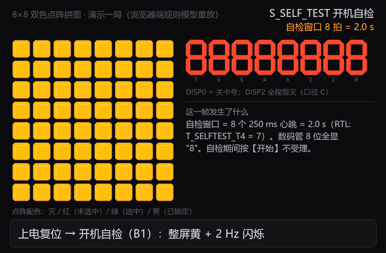

# 简易拼图游戏

**在一块没有 CPU、也没有片上 RAM 的 CPLD 上，用纯 VHDL 实现的 8×8 双色点阵拼图游戏。**

`VHDL-93` ｜ `Quartus II 9.1` ｜ `MAX II EPM1270T144C5` ｜ `1264 / 1270 LE` ｜ `Fmax 54.27 MHz` ｜ `184 条断言全绿`

**文档站（答辩速查）**：<https://tortrixx.github.io/dld/>

---

## 这是什么

先亮出目标图案 5 秒，零片随机散落；玩家用 4×4 矩阵键盘选块、上下左右移动、必要时原地旋转 90°，
把零片拼成与目标一致的形状后逐块按【确认】锁定 —— 拼对过关，超时或拼错判负，三关递增。

整机由 **11 个 VHDL 子模块**组成：键盘消抖、状态机、碰撞判定、图案存储、显示扫描、音效乐句
全部自己写，没有 CPU、没有 IP 核、没有软核，52 个引脚全部显式锁定。


*规则模型重放（软件渲染，**不是板子实录**）*

## 快速开始

```powershell
python scripts/check_env.py                  # 1. 环境自检（Python / Quartus / 依赖 / 行尾）
python scripts/gen_project.py puzzle_top     # 2. 生成 quartus/puzzle.qpf + .qsf（.qpf 故意不入库）
quartus_sh -t scripts/build.tcl              # 3. 编译：map → fit → asm → sta
python scripts/sim.py run <模块名>            # 4. 仿真：12 个模块/场景、184 条断言
python -m http.server 3000 --directory docs  # 5. 本地预览文档站
```

环境不齐先用 `scripts/bootstrap.ps1`（Windows）/ `scripts/bootstrap.sh`（Linux、macOS）。
**改了任何 RTL 都要走完整条链**：重扫 `SEED` → 清洁重编译 → 重跑全部测试台 → 重烧 → 回填读数。

## 做到了什么

| 档位 | 内容 | 状态 |
|:---|:---|:---|
| **基本要求 B1~B11** | 开机自检（整屏黄 2 Hz 闪 + 数码管全 8）、待机、预览 5 秒、零片随机不重叠、第一关 30 秒倒计时、选择/移动/确认、过关与失败判定、随时重开 | ✅ **11 / 11**，每条都有仿真断言 + 实测证据 |
| **提高要求 A1 / A2 / A4 / A5** | A1 音效与背景音乐；A2 增加关数 + 多种图案随机；A4 零片 90° 旋转（**且是通关必需**）；A5 自拟功能 S1~S7 | ✅ **4 / 4** |
| **提高要求 A3** | 「位置随机 + 方向随机」 | 🔶 **完成一半**：位置随机 ✅；初始朝向随机**有意不做** |

> **A3 的「方向随机」为什么不做**：本设计要求「**不旋转就拼不出来**」，开局朝向固定为
> `PIECE_ORI_INIT = 1/1/2/2`，由 `scripts/check_geometry.py` 对四幅图案穷举证明。
> 若朝向也随机，256 种组合里只有 162 种满足该性质 ⇒ 约 **37% 的牌局不转也能拼出来**，
> 而那正是上板后被明确否掉的现象（ERR-043）。**用 A3 的一半换 A4 的成立**，取舍记录在
> [`docs/00` §1.2](docs/00-规范理解与需求.md) 与 [`docs/06` §15.2](docs/06-硬件调试记录.md)。

> **DISP2 口径（2026-10-12 用户裁决）**：题目要求 9（「第二关 DISP2 显示 2」）与要求 3
> （「关数由 DISP0 显示」）冲突，裁定要求 9 属笔误 ⇒ **关号只由 DISP0 显示，DISP2 全程熄灭**
> （自检态除外）。证据：`sim/rounds/disp_format/r22` 断言 ⑥/⑥c；原委见 [`docs/06` §12](docs/06-硬件调试记录.md)。

## 关键实测数字

| 项 | 值 |
|:---|:---|
| 器件 | MAX II **EPM1270T144C5**（1270 LE / 127 LAB） |
| 资源 | **1264 / 1270 LE**（99%，余 6）、**127 / 127 LAB**（100%）—— 真正的瓶颈是 **LAB** 不是 LE |
| 时序 | **Fmax 54.27 MHz**、setup slack **+1.572 ns**、hold **+1.078 ns**（约束 50 MHz，0 条违例） |
| Fitter seed | `SEED 8`（重扫 1~16 后按「装得进 127 LAB **且** ≥ 50 MHz」选定） |
| 引脚 | 52 / 116，全部显式锁定 |
| 仿真 | 12 个模块/场景、**184 条断言全部通过**（含两种整机场景） |
| 固件 | `puzzle.pof`（sha256 `cc3c69b3…`，27312 字节）—— 2026-10-15 清洁重编译**逐字节复现**；已重烧并读回校验 0 errors |
| 上板验收 | ✅ **2026-10-12 复测通过**，用户结论：「**现象满足题目要求，效果可以**」 |

> 这些数字的**唯一真值源**是 [`quartus/build_provenance.json`](quartus/build_provenance.json) 与
> [`docs/05`](docs/05-资源利用与编译报告.md)，本表只是摘要。改过 RTL 后请以那两处为准
> —— 本项目的纪律：**同一个读数不许手抄两遍**。

## 文档地图

| 想了解 | 读 |
|:---|:---|
| **逐模块微架构 · 仿真波形分析 · 答辩高频考点** | <https://tortrixx.github.io/dld/>（源文件在 [`docs/`](docs/README.md)） |
| 课程交付的实验报告（27 页） | [`docs/report/实验报告_题目4_简易拼图游戏.pdf`](docs/report/实验报告_题目4_简易拼图游戏.pdf) |
| 题目要求怎么理解、每条落在哪、引脚定义 | [`docs/00-规范理解与需求.md`](docs/00-规范理解与需求.md) |
| 每个模块怎么设计（框图与代码逐条对账） | [`docs/02-模块详细设计.md`](docs/02-模块详细设计.md) |
| 仿真怎么做的、每条断言在验什么 | [`docs/03-仿真验证方案.md`](docs/03-仿真验证方案.md) |
| 资源占用与时序（编译报告） | [`docs/05-资源利用与编译报告.md`](docs/05-资源利用与编译报告.md) |
| 故障分析 **ERR-001 ~ ERR-056**（现象/根因/修法/证据） | [`docs/06-硬件调试记录.md`](docs/06-硬件调试记录.md) |
| 报告用的仿真波形图怎么拍 | [`docs/图/README.md`](docs/图/README.md) |
| **怎么编译 / 仿真 / 烧录**、开工清单、已知残余 | [`HANDOFF.md`](HANDOFF.md)（工程操作手册 + 分阶段工作日志） |
| 进度账本与阶段表 | [`PROGRESS.md`](PROGRESS.md) |
| AI 工具怎么用的、哪些结论被人纠正过（评分项 ⑦） | [`AI_LOG.md`](AI_LOG.md) |
| **文档站怎么维护**（内容规范、门禁、发布面） | [`HANDOVER.md`](HANDOVER.md) |
| 课程原始资料与版权声明 | [`refs/README.md`](refs/README.md) |

## 仓库结构

```
rtl/       16 个 VHDL 源文件（12 个设计模块 + 3 个诊断顶层 + 1 个包）
sim/       12 个 Python 测试台 tb_*.py + 轮次记录 rounds/<模块>/rNN.{json,md}
           12 个 .vwf —— 既是激励也是结果（Quartus 仿真器把波形回写进文件本身）
scripts/   构建 / 仿真 / 审计工具（环境探测、证据链审计、几何穷举、站点门禁…）
quartus/   工程文件（.qsf/.qpf 由脚本生成）+ 入库的 build_provenance.json
docs/      文档站（Docsify）+ 课程交付文档 + 图/（Quartus GUI 实测截图）+ report/
facts/     站点的唯一机读事实模型（由 scripts/extract_facts.py 从 rtl/sim/quartus 抽出）
refs/      课程原始资料（题目 / 课程说明 / 实验板手册 / 讲义）
```

## 已知限制

* **资源已到顶**：`LAB 127/127` 已满（LE 余 6，但装箱层面仍≈0）—— 再加逻辑必须先腾出 LAB（[`docs/05` §1.5](docs/05-资源利用与编译报告.md)）。
* **A3 只完成一半**：初始朝向不随机，理由见上。
* **音效的「好听」无法离线验证**：仿真只能证明发的是哪个音效码、这一步响不响；听感由上板复测确认。
* **被拒的移动/旋转没有提示音**：实测需 +5 LE / 128 LAB，装不下，已回退并留档。
* **每关内容更新率 25 / 21 Hz**（画面扫描 125 Hz、键盘 200 Hz）—— 面积与观感的取舍，非缺陷。
* **零片散落的极端回退分支不做重叠检查**（ERR-018b）：需连续 16 次随机冲突才可能触发，概率约 1e-7。
* **没有真实硬件照片**：仓库里 0 张开发板实拍。真板效果只有文字记录与上板复测结论；
  `docs/图/演示-*.gif` 是**网页引擎按同一套规则渲染**的，不是硬件实拍。

## 许可与致谢

* 本仓库的 RTL、测试台与文档是课程设计作品，**未附开源许可证**；如需引用请先联系作者。
* `refs/` 下的课程原始资料（题目、课程说明、板卡手册、授课讲义）版权归课程组所有，
  **仅作学习用途**，详见 [`refs/README.md`](refs/README.md)。

---

> 本项目最花时间的不是写功能，而是**让每一句话都有可执行的证据**：每条实测数字都能在
> `sim/rounds/`、`quartus/*.rpt`、`build_provenance.json` 里查到来源。这套纪律与踩过的坑
> 记在 [`docs/06`](docs/06-硬件调试记录.md) 与 [`AI_LOG.md`](AI_LOG.md)。
