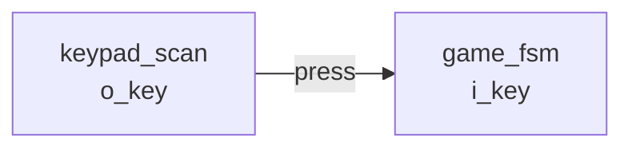

# 文档撰写规范（`book/AUTHORING.md`）

> 所有给 `book/docs/**` 写页面的人（包括 AI 助手）**必须先读完这一页**。
> 这份规范的目的只有一个：让 52 个页面看起来像**同一个人**写的，
> 并且**每一句话都能指回仓库里的一个文件**。

---

## 0. 一句话纪律

> **凡是能从源码/仿真/编译报告机械得到的，一律引用或生成，不许手打；
> 得不到证据的，写"待核实"，不许编。**

本项目已经被"文档与代码不一致"咬过（`docs/06` 的 ERR-022 就是位宽抄错）。
文档站的存在意义是**可核验**，不是好看。

---

## 1. 事实从哪来

唯一机读事实源是 `facts/facts.json`（由 `scripts/extract_facts.py` 生成）。
页面里**不要手打**这些数字，用占位符：

| 写法 | 展开成 | 例子 |
|---|---|---|
| `{{fact:sim.totals.assertions}}` | facts.json 的某个标量 | `184` |
| `{{fact:build.fit.le}}` | 同上 | `1,264 / 1,270 ( 100 % )` |
| `{{src:rtl/clk_gen.vhd:58}}` | GitHub 该文件第 58 行的**链接** | 可点 |
| `{{src:rtl/puzzle_top.vhd}}` | GitHub 该文件的链接 | 可点 |
| `{{tree:sim/rounds}}` | GitHub 该目录的链接 | 可点 |
| `{{repo}}` | `https://github.com/tortrixx/dld` | |
| `{{showcase}}` | 工程展示站地址 | |
| `{{docs_site}}` | 本文档站地址 | |

**规则**：
- `{{fact:...}}` 的路径写错 ⇒ **构建失败**（这是故意设计的）。
- `{{src:...}}` 指向的文件**必须已入库**（`git ls-files` 能查到），
  否则克隆下来就是死链。`{{tree:目录}}` 同理，只是判的是"该目录下有已入库文件"。
- `{{src:...}}` 与 `{{tree:...}}` 在**页面模式自检**时，对"工作区里有、但本次交付
  还没提交"的路径只记 **WARN**（写作中期是正常的）；**站点模式门禁**（不给参数）
  算 **FAIL**。所以交付前必须保证这些文件真的入库了。
- 常用路径可以先查一眼：

```bash
python -c "import json;f=json.load(open('facts/facts.json',encoding='utf-8'));print(list(f))"
```

## 2. 表格不要手写

15 个实体的端口表、4 个顶层的连接表、层级表、引脚表、`puzzle_pkg` 的
常量/类型/函数表、12 个模块的仿真轮次与断言明细、图片清单、ERR 索引 ——
**全部已经机械生成**，用包含语法引用：

```markdown
## 端口契约

--8<-- "_generated/ports/clk_gen.md"
```

可用的生成页（完整清单见 `book/scripts/gen_pages.py` 头部注释）：

| 生成页 | 内容 |
|---|---|
| `_generated/metrics.md` | 关键读数（LE/LAB/Fmax/slack/POF 指纹/源码指纹） |
| `_generated/hierarchy.md` | RTL 层级、实例表、实体一览、统计口径 |
| `_generated/connections.md` | 四个顶层的跨模块连接总表 |
| `_generated/connections-puzzle_top.md` | 只含 `puzzle_top` 的连接表 |
| `_generated/ports/<实体>.md` | 该实体的端口契约表 |
| `_generated/pkg-constants.md` / `pkg-types.md` / `pkg-functions.md` | 设计包 |
| `_generated/pins.md` | 引脚锁定表 |
| `_generated/sim-rounds.md` | 12 个模块的最新有效轮次 |
| `_generated/assertions-index.md` / `assertions/<模块>.md` | 断言索引与逐条明细 |
| `_generated/figures.md` | 图片清单（含证据分级） |
| `_generated/errors.md` | ERR-xxx 故障索引 |

⚠️ **不要在被 `--8<--` 包含的生成页里写 `{{fact:...}}`** —— 钩子只处理
页面本身，包含进来的片段不再经过钩子。生成页里的数字由生成脚本直接算好。

> 包含语法的解析细节：`hooks/facts.py` 会在 Markdown 解析**之前**把
> `--8<-- "_generated/xxx.md"` 改写成绝对路径（因为 `pymdownx.snippets` 的
> `base_path` 是相对**当前工作目录**解析的，从仓库根构建时会找不到）。
> 你只管写简洁的相对路径，从任何目录构建都能解析；片段缺失仍然**构建失败**。

## 3. 图片

素材由 `book/scripts/sync_assets.py` 从 `docs/图/` 同步到 `docs/assets/`。
**只写 `docs/assets/` 下的路径**（`docs/图/` 在文档目录之外，直接引用会 404）：

| 路径 | 数量 | 证据级别 |
|---|---|---|
| `../assets/waveforms/quartus/GUI-<模块>.png` | 12 | ✅ **真实 Quartus GUI 仿真截图** |
| `../assets/waveforms/scripted/SIM-<模块>.svg` | 12 | ❌ 脚本渲染的辅助波形 |
| `../assets/figures/演示-跑一局.gif` 等 | 3 | ❌ 网页引擎渲染，**不是硬件实拍** |
| `../assets/diagrams/dld-架构.drawio` | 1 | 可编辑图表源 |
| `../assets/hardware/` | **0** | ⚠️ **真实硬件照片缺失** |

**每张图必须写清四件事**，用 Material 的 `figure` 写法：

```markdown
<figure markdown="span">
  { loading=lazy }
  <figcaption>
  **图 6.1** clk_gen 各级 tick 的实测间隔。
  测试场景：tb_clk_gen 断言③；观察信号 `o_tick_1k`/`o_tick_200`/`o_tick_1hz`；
  预期：1 ms / 5 ms / 1 s；实测：见 r10 断言③；
  证据：{{src:sim/rounds/clk_gen/r10.json}}。
  **能证明**：分频计数器的翻转间隔正确。**不能证明**：板子上 50 MHz 晶振绝对准。
  </figcaption>
</figure>
```

禁止：
- 把 `SIM-*.svg`（脚本渲染）说成 Quartus 截图；
- 把 `演示-*.gif`（网页引擎）说成硬件实测；
- 贴图不给判据（"这张图证明什么、不能证明什么"必须写）。

## 4. 页面骨架（统一模板）

```markdown
# 页面标题

> 一句话定位：这一页回答什么问题。

（开篇 1~3 段：先给结论，再说依据。）

## 一、……

（正文：表格 / Mermaid 图 / 源码行引用）

## 证据与出处

| 结论 | 依据 |
|---|---|
| …… | {{src:rtl/xxx.vhd:123}}、`sim/rounds/xxx/rNN.json`、{{src:docs/05-资源利用与编译报告.md}} |
```

**每页至少要有**：
1. 一个 **表格**（结构化的东西不要写成流水账）；
2. 一个 **Mermaid 图**（架构页/流程页/接口页**必须**有，纯文字页可省）；
3. 至少一处 `{{src:...}}` 源码行链接；
4. 一节"证据与出处"。

## 5. 证据三级（必须区分，不许混）

| 标记 | 含义 | 能证明 |
|---|---|---|
| 【RTL 仿真】 | Quartus 内置仿真器跑的 `.vwf` + Python 断言 | 逻辑功能、时序关系（在激励覆盖范围内） |
| 【编译/STA】 | Fitter / TimeQuest 报告 | 资源占用、时序裕量、引脚 |
| 【板级实测】 | 真板子上电、烧录、读回、人眼观察 | 电气正确、外设真实行为、听感/观感 |

**不许用"仿真通过"代替"硬件验收"**。凡只有一类证据支持的结论，要写明另外两类
缺什么。

## 6. Mermaid 用法

用围栏代码块，不要用图片：

```markdown

```

- 节点里要写**真实信号名或端口名**，不要写"数据"、"控制"这类空词。
- 连线要有标签说明语义（脉冲/电平/数据）。
- 复杂的图拆成多张，不要挤成一张。

## 7. 语言风格

- **中文技术写作**：先结论、再依据、后细节。
- 不用"赋能"、"闭环"、"强大的"这类营销词；不用"我们"。
- 术语第一次出现给英文/VHDL 原文（例如"消抖（debounce）"）。
- 代码标识符、文件名、信号名一律用反引号包起来。
- 引用仓库文件用 `{{src:...}}`（GitHub 链接）或反引号路径；**不要**写
  站点内不可达的相对链接指向 `.vhd`/`.py`（门禁会 FAIL）。

## 8. Admonition 约定

| 类型 | 用途 |
|---|---|
| `!!! note` | 事实陈述 / 读法说明 |
| `!!! quote` | **设计理由**（为什么这么选） |
| `!!! tip` | 经验 / 更省事的做法 |
| `!!! warning` | 易错点 / 约束 / **待核实** |
| `!!! danger` | **缺失的证据** / **不能证明**的结论 |
| `!!! bug` | 真实踩过的坑（配 ERR 编号） |

"待核实"一律长这样，并给出核实路径：

```markdown
!!! warning "待核实"
    源码里没有注释说明 `i_rot` 的最短脉宽要求。核实路径：
    读 {{src:rtl/puzzle_ctrl.vhd:520}} 的边沿检测进程，或
    在 tb_puzzle_ctrl 增加一条窄脉冲激励重新跑仿真。
```

## 9. 自检（**交稿前必须跑**）

```bash
# 只查自己写的页面（快，不会和别人的构建冲突）
python book/scripts/check_book.py book/docs/03-modules/clock-reset.md book/docs/03-modules/keyboard-input.md
```

它会检查：占位符能否解析、`{{src:}}` 是否已入库、`--8<--` 是否存在、
图片是否存在、内部链接是否存在、有没有残留占位。

⚠️ **不要跑 `mkdocs build`** —— 站点构建由 Lead 统一执行（并发构建会互相
覆盖 `book/site/`）。

## 10. 绝对不要做的事

1. 不要改 `rtl/`、`sim/`、`quartus/`、`docs/`（除 Leader 明确指派）。
2. 不要改 `site/`（前端展示站）——那由专门的人负责。
3. 不要改 `facts/facts.json`（它是生成的）。
4. 不要写自己没有核实过的断言、时序、位宽、硬件现象。
5. 不要为了让检查通过而删掉链接或降低标准 —— 报告问题，而不是掩盖。
6. 不要留占位页（`<!-- PLACEHOLDER`）——门禁会 FAIL。
