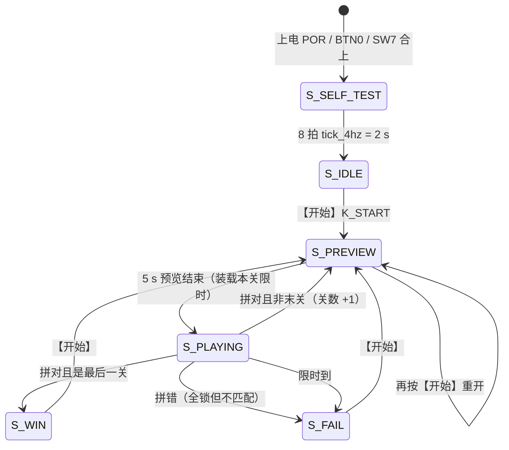

# 功能清单与实现状态

> 一句话定位：这一页是**功能级的验收清单**——每一项功能写清"实现在哪、证据是什么、**验证到了什么程度**"。

状态列有三种取值，含义严格区分：

| 标记 | 含义 |
|---|---|
| ✅ **仿真已证** | 有模块级/整机级断言覆盖，`sim/rounds/` 里有通过的轮次记录 |
| 🔶 **仅逻辑在** | 源码里确实实现了，但**仿真未直接覆盖**（或只被间接覆盖），结论只能到"代码是这样写的" |
| ❌ **未做** | 有意不做，理由写在 [已知限制与取舍](limitations.md) |

!!! warning "**没有一项功能是"板级已验"**"
    板级只有**烧录 + 读回校验**（证明固件能进器件），**没有逐功能的板上复核记录**，
    更没有真实硬件照片。所以本页状态最多到 ✅ 仿真已证。补拍/补验清单见
    [上板验证与缺失证据](../06-verification/board-validation.md)。

## 一、功能总表

| # | 功能 | 实现位置 | 证据 | 状态 |
|---|---|---|---|---|
| F1 | **开机自检**：点阵全黄 2 Hz 闪 2 s + 数码管全 "8" 2 Hz 闪 | {{src:rtl/game_fsm.vhd:264}}、{{src:rtl/puzzle_top.vhd:735}}、{{src:rtl/disp_format.vhd:6}} | `sim/rounds/puzzle_top/r56.json` | ✅ |
| F2 | **待机**：点阵全灭、`DISP7='5'`、`DISP0='1'` | {{src:rtl/game_fsm.vhd:281}}、{{src:rtl/puzzle_top.vhd:739}} | `sim/rounds/puzzle_top/r57.json` | ✅ |
| F3 | **图案预览 5 s**（`DISP7` 倒计时） | {{src:rtl/game_fsm.vhd:289}}、{{src:rtl/puzzle_top.vhd:745}} | `sim/rounds/puzzle_top/r56.json` | ✅ |
| F4 | **随机散落**三块/四块零片（不重叠、有界候选 + 拒绝采样） | {{src:rtl/puzzle_ctrl.vhd}}（散落状态机）、{{src:rtl/rng_lfsr.vhd:5}} | `sim/rounds/puzzle_ctrl/r37.json`、{{src:scripts/check_geometry.py}} | ✅ |
| F5 | **循环选择**零片（选中 = 绿色） | {{src:rtl/game_fsm.vhd:410}}、{{src:rtl/puzzle_ctrl.vhd:764}} | `sim/rounds/puzzle_ctrl/r37.json` | ✅ |
| F6 | **上下左右移动**（越界/重叠拒绝） | {{src:rtl/game_fsm.vhd:412}}、{{src:rtl/puzzle_ctrl.vhd:823}} | `sim/rounds/puzzle_ctrl/r37.json` | ✅ |
| F7 | **90° 旋转**（4 朝向循环，且"不转就拼不出来"） | {{src:rtl/puzzle_pkg.vhd:766}}、{{src:rtl/game_fsm.vhd:416}} | `sim/rounds/puzzle_ctrl/r37.json`、{{src:scripts/check_geometry.py}} | ✅ |
| F8 | **确认锁定**（变黄、之后不可选不可移） | {{src:rtl/game_fsm.vhd:411}}、{{src:rtl/puzzle_ctrl.vhd:360}} | `sim/rounds/puzzle_ctrl/r37.json` | ✅ |
| F9 | **过关**（并集 == 目标且全部锁定 ⇒ 下一关/胜利） | {{src:rtl/puzzle_ctrl.vhd:360}}、{{src:rtl/game_fsm.vhd:337}} | `sim/rounds/puzzle_top/r56.json` | ✅ |
| F10 | **失败**（拼错 ⇒ 立即失败；超时 ⇒ 失败） | {{src:rtl/game_fsm.vhd:352}}、{{src:rtl/game_fsm.vhd:355}} | `sim/rounds/puzzle_top/r57.json` | ✅ |
| F11 | **关卡切换**（1 → 2 → 3，`DISP0` 显示关数） | {{src:rtl/game_fsm.vhd:340}}、{{src:rtl/disp_format.vhd:18}} | `sim/rounds/game_fsm/r36.json`、`sim/rounds/disp_format/r27.json` | ✅ |
| F12 | **重新开局的任意时刻性**（对局/结算态按【开始】都重开） | {{src:rtl/game_fsm.vhd:332}}、{{src:rtl/game_fsm.vhd:362}} | `sim/rounds/game_fsm/r36.json` | ✅ |
| F13 | **背景音乐**（三关各一首 16 步乐句，对局中持续） | {{src:rtl/buzzer_ctrl.vhd:290}}、{{src:rtl/game_fsm.vhd:570}} | `sim/rounds/buzzer_ctrl/r37.json` | ✅ |
| F14 | **提示音**（自检 / 预览 / 过关 / 拼错 / 胜利 / 失败） | {{src:rtl/buzzer_ctrl.vhd}}（`MEL_*`）、{{src:rtl/game_fsm.vhd:565}} | `sim/rounds/buzzer_ctrl/r37.json` | ✅ |
| F15 | **告急幽灵提示**（剩余 ≤ 10 s 时目标空格显示**绿色 + 2 Hz 闪烁**） | {{src:rtl/puzzle_top.vhd:653}}（`hint_on`）、{{src:rtl/puzzle_top.vhd:660}}（`hint_blink`） | `sim/rounds/puzzle_top/r56.json` | ✅ |
| F16 | **第三关随机图案**（四幅图案库任选一幅） | {{src:rtl/puzzle_pkg.vhd:251}}、{{src:rtl/puzzle_top.vhd}}（`pat_sel` 锁存） | `sim/rounds/puzzle_top/r56.json` | ✅ |
| F17 | **`SW7` 系统开关**（=0 全灭且回到序列起点） | {{src:rtl/game_fsm.vhd:253}}、{{src:rtl/puzzle_top.vhd}} | `sim/rounds/puzzle_top/r57.json` | ✅ |
| F18 | **`BTN0` 按键复位**（20 ms 非对称消抖，比 POR 更可靠） | {{src:rtl/clk_gen.vhd:103}} | `sim/rounds/clk_gen/r25.json` | ✅ |
| F19 | **8 位数码管动态扫描**（125 Hz/位） | {{src:rtl/seg_scan.vhd}}、{{src:rtl/disp_format.vhd}} | `sim/rounds/seg_scan/r31.json`、`sim/rounds/disp_format/r27.json` | ✅ |
| F20 | **点阵 125 Hz 行扫描**（8 行 × 1 ms） | {{src:rtl/dot_matrix_scan.vhd:41}}、{{src:rtl/puzzle_top.vhd:816}} | `sim/rounds/dot_matrix_scan/r23.json` | ✅ |
| F21 | **结算画面**（绿色粗对勾 / 红色叉；先闪 1 s 再常亮） | {{src:rtl/puzzle_pkg.vhd:374}}、{{src:rtl/puzzle_top.vhd:750}} | `sim/rounds/puzzle_top/r56.json` | ✅ |

## 二、功能是怎么串起来的

| 状态 | 点阵 | 数码管 | 音效 |
|---|---|---|---|
| `S_SELF_TEST` | 整屏黄，2 Hz 闪 | 八位全 "8"，2 Hz 闪 | `SND_SELF` 单声短鸣 |
| `S_IDLE` | 全灭 | `DISP7='5'`、`DISP0='1'` | `SND_NONE`（静音） |
| `S_PREVIEW` | 完整目标图案（红） | `DISP7` 倒计时 5→1、`DISP0`=关数 | `SND_PREVIEW` 上行纯五度 |
| `S_PLAYING` | 零片（选中绿/锁定黄/未锁定红）+ 告急幽灵（绿 2 Hz） | `DISP4:DISP3` = 剩余秒、`DISP0`=关数 | 本关 BGM（`SND_BGM1/2/3`） |
| `S_WIN` | 绿色粗对勾（先闪 1 s 再常亮） | 同上（关数保留） | `SND_WIN` 长号角 |
| `S_FAIL` | 红色粗叉（同节奏） | 同上 | `SND_FAIL` 下行警示 |

## 三、**没有**实现的功能（明确列出）

| 功能 | 状态 | 说明 |
|---|---|---|
| 初始朝向随机（A3 后半） | ❌ 有意不做 | 会让 37% 的牌局"不转也能拼出来"，见 [题目要求与验收](requirements.md) |
| 被拒操作（越界/重叠/已锁定）的提示音 | ❌ 无 | 5 个 `SND_*` 码**没有查表臂**，落 `when others` ⇒ 静音（面积装不下），见 [音效与背景音乐](../05-gameplay/sound-effects.md) |
| 最后一关后的续关/计分 | ❌ 无 | 题目未要求；`S_WIN` 即结束，按【开始】只从第一关重开 |
| 板上逐功能的观感/听感复核记录 | ❌ 无证据 | **真实硬件照片 0 张**，只有文字记录 |

## 四、动态演示（**不是硬件实拍**）

<figure markdown="span">
  { loading=lazy }
  <figcaption>
  **图 1.1** 一局的完整流程（预览 → 散落 → 移动/旋转 → 锁定 → 结算）。
  **证据级别：❌ 网页引擎渲染**——这是原展示站的 TypeScript 引擎按同一套规则重放的动画
  （原 `site/` 已在 2026-10-15 第 27 工作阶段删除，只留这份已入库的产物），
  **不是** Quartus 波形，**也不是**开发板实拍。
  它能直观说明**玩法与流程**，**不能**作为功能正确性的证据；
  功能正确性请另看 12 张 `GUI-*.png`（真实 Quartus 截图）与 `sim/rounds/` 的断言记录。
  </figcaption>
</figure>

## 证据与出处

| 结论 | 依据 |
|---|---|
| 各功能的实现位置 | {{src:rtl/game_fsm.vhd}}、{{src:rtl/puzzle_ctrl.vhd}}、{{src:rtl/puzzle_top.vhd}}、{{src:rtl/buzzer_ctrl.vhd}} |
| 状态与显示映射 | {{src:rtl/puzzle_top.vhd:735}}（`case` 到 `S_SELF_TEST/S_IDLE/S_PREVIEW/S_WIN/S_FAIL/S_PLAYING`） |
| 断言与轮次 | {{tree:sim/rounds}}、{{src:sim/tb_puzzle_top.py}}、{{src:sim/tb_puzzle_ctrl.py}} |
| "旋转必需"的穷举证明 | {{src:scripts/check_geometry.py}} |
| 被拒操作无音效 | {{src:rtl/puzzle_pkg.vhd:564}}（码表）、{{src:rtl/buzzer_ctrl.vhd}}（查表臂） |

!!! warning "待核实"
    表中四处"✅"依赖整机轮次 `puzzle_top r56/r57`，而整机激励是**脚本生成的固定走法**
    （四条计划：一关 19 条命令、二关 34、三关 PAT0 24 / PAT2 30）。
    核实路径：`sim/rounds/puzzle_top/` 下看该轮的 `detail` 字段；
    或按 {{src:scripts/check_plans.py}} 重放。
    **仿真覆盖不到的**：人手操作的真实手感、连按抖动、点阵实际亮度。
