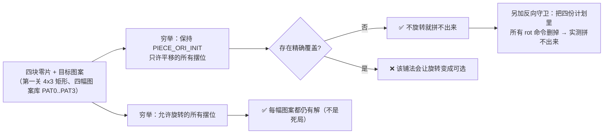

# 核心亮点

> 一句话定位：这一页只讲**工程上真正难的地方**以及**它凭什么可核验**——不写"功能强大"这类话。

每一条都给出：**是什么** → **数字或证明** → **为什么它算亮点**（以及**边界**：这条亮点证明不了什么）。

## 一、纯 RTL，零 IP 核

16 个 VHDL 文件、15 个实体、1 个设计包，全部手写，**没有例化任何厂商 IP**，
也没有用 `ALTERA_*` 原语库里的宏功能（`lpm_*`、`altpll` 等一概未用）。

| 项 | 值 | 依据 |
|---|---|---|
| VHDL 文件 | 16 | {{tree:rtl}} |
| 实体 | 15（11 个游戏子模块 + 3 个诊断顶层 + `puzzle_top`） | {{src:rtl/puzzle_top.vhd}}、{{src:docs-site-plan.md}} §1.1 |
| 设计包 | `puzzle_pkg`：常量 / 类型 / **24 个纯函数** | {{src:rtl/puzzle_pkg.vhd}} |

**为什么算亮点**：时钟分频、消抖、LFSR、BCD 拆分、七段译码、行列扫描、
**旋转坐标变换**全部自己写——**没有黑盒**，答辩时可以逐行解释任何一个行为。
**边界**：这不是"更先进"，只是"更可控"；用 IP 核（如 `altpll`）换资源也是合理选择，
本项目不用它是因为**板上只有一路 50 MHz 时钟**、且需要的是**节拍使能**而不是新时钟域。

## 二、LAB 满载条件下的面积控制

| 指标 | 值 |
|---|---|
| 逻辑单元 | **{{fact:build.fit.le}}** |
| 逻辑阵列块（LAB） | **{{fact:build.fit.lab}}** ← 真正的瓶颈（LE 只能按每 LAB 10 个成组分配） |
| 引脚 | {{fact:build.fit.pins}} |
| 时序 | 约束 50 MHz、实测可达 **54.27 MHz**（`setup slack +{{fact:build.sta.setup_slack}} ns`） |

面积不是"省出来的"，是**一处一处用实测换来的**——三条代表性的账：

| 手法 | 具体做法 | 实测代价 |
|---|---|---|
| **位宽收窄** | 消抖计数器 8 位 → **2 位**（`0..3`）、半周期计数器 9 位 → **8 位**、预分频 ÷64 → **÷256** | 整机 **−7 LE**（见 {{src:rtl/keypad_scan.vhd:105}}） |
| **把置换放在已被复用的那一级** | 旋转**不做**"24 位形状整体置换"（约 +190 LE），只在"一拍算一行"处放 **3 个 4:1 mux** | 每调用点 **+6 LE**（见 {{src:rtl/puzzle_pkg.vhd:99}}） |
| **常量换常量** | "旋转必需"用 `PIECE_ORI_INIT` 换掉原来的 `(others => '0')` | **0 LE**（见 {{src:rtl/puzzle_pkg.vhd:310}}） |

!!! quote "为什么"省"在这里是硬约束而不是美德"
    器件只有 **127 个 LAB**，LE 再多也**必须按 10 个一组塞进 LAB**。
    所以几处"手算觉得够"的写法都翻过车：加宽自检计数器要多 **1 个 LAB**、
    "红/绿交替"的幽灵提示实测报错 **"Design contains 1278 blocks of type logic cell,
    device contains only 1270"**（负结果留档在 {{src:docs/06-硬件调试记录.md}} §22.3）。
    **本页所有"0 LE / −7 LE / +6 LE"都来自真编译，不是估计。**

## 三、"不旋转就拼不出来"是**穷举证明**过的

提高要求 A4（旋转）很容易做成"摆设"——如果**保持初始朝向平移**就能拼出来，
旋转键就没人会按。本项目把这条性质做成了**可证明的**：

| 证明 | 结论 | 依据 |
|---|---|---|
| 每幅图案在初始朝向下无解 | 四幅库 + 第一关矩形**都**不存在"只平移"的精确覆盖 | {{src:scripts/check_geometry.py}} |
| 允许旋转后仍有解 | 不是死局；PAT0/PAT1/PAT2 各 1 种铺法、PAT3 2 种 | {{src:scripts/check_geometry.py}} |
| 四块形状真的变了 | 初始朝向下 4/4 块的形状与"朝向 0"不同 | {{src:scripts/check_geometry.py}} |
| 计划里删掉旋转就失败 | 四份走法计划反向守卫（`check_plans.py` 从 `puzzle_pkg` **现读** `PIECE_ORI_INIT`） | {{src:scripts/check_plans.py}} |

**为什么算亮点**：这是一条**设计不变量**，而不是"实现了旋转键"。
**边界**：它证明的是**几何可解性**（离线、纯 Python 模型），
**不能证明**玩家一定能拼出来（难度/手感是另一回事，见 [已知限制与取舍](limitations.md)）。

## 四、整套可核验的证据链

文档站里每个数字都能追到三样东西之一：

| 环节 | 手段 | 作用 |
|---|---|---|
| **源码指纹** | `quartus/build_provenance.json` 记录 16 个 RTL 文件的 sha256 与**剥离注释后的逻辑指纹** | 证明"跑仿真时用的源码"就是"编译时用的源码" |
| **轮次记录** | `sim/rounds/<模块>/rNN.json`（机读）+ `rNN.md`（人读） | 每轮断言名、判据、实测值、激励来源都可复查 |
| **强制对账** | `scripts/audit_evidence.py`（硬件证据 A~G 段）、`book/scripts/check_book.py`（站点门禁）、`scripts/extract_facts.py --check`（事实模型） | 文档/站点里写的数字与真值源不一致就报 FAIL |

**为什么算亮点**：项目被"文档与代码不一致"咬过（ERR-022 位宽抄错、
ERR-027 注释里的错误刷新率假设）。现在**审计脚本会主动抓这类漂移**：
例如"第三关 40 s → 60 s"的改动，脚本里有一条专门守它。

## 五、真实截图 + 断言规模

| 资产 | 数量 | 证据级别 |
|---|---|---|
| Quartus 波形编辑器截图 `GUI-*.png` | **12** | ✅ 真实 GUI 截图（每张只保留波形编辑器区域） |
| 脚本渲染波形 `SIM-*.svg` | 12 | ❌ 辅助，**不是** GUI 截图 |
| 网页引擎渲染图 `演示-*` | 3 | ❌ **不是**硬件实拍 |
| 通过断言 | **{{fact:sim.totals.assertions}}** 条，覆盖 {{fact:sim.totals.modules}} 个模块/场景 | 【RTL 仿真】{{tree:sim/rounds}} |
| 真实硬件照片 | **0** | ⚠️ 缺失（见 [已知限制与取舍](limitations.md)） |

## 证据与出处

| 结论 | 依据 |
|---|---|
| 文件/实体/设计包统计 | {{tree:rtl}}、`facts/facts.json` → `hierarchy` |
| 资源与时序 | {{src:docs/05-资源利用与编译报告.md}}、`facts/facts.json` → `build` |
| 面积账（−7 / +6 / 0 LE） | {{src:rtl/keypad_scan.vhd:79}}、{{src:rtl/puzzle_pkg.vhd:99}}、{{src:rtl/puzzle_pkg.vhd:310}} |
| 1278 LE 失败实测 | {{src:docs/06-硬件调试记录.md}} §22.3 |
| 几何穷举与计划守卫 | {{src:scripts/check_geometry.py}}、{{src:scripts/check_plans.py}} |
| 指纹与轮次 | {{src:quartus/build_provenance.json}}、{{tree:sim/rounds}} |

!!! warning "待核实"
    "24 个纯函数""常量/类型个数"这类统计口径由 `scripts/extract_facts.py` 机械抽取，
    本页只引用结论。核实路径：`python scripts/extract_facts.py --check`，
    或看由 `book/scripts/gen_pages.py` 生成的 `book/docs/_generated/pkg-functions.md`。
