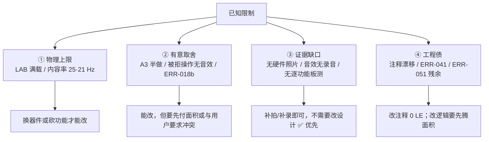

# 已知限制与取舍

> 一句话定位：这一页把**所有已知的不足**摊开写——影响是什么、为什么接受、**能不能改**。
> 不淡化、不解释成"设计特色"。

先说结论：本设计**功能是完整的**（基本要求 11/11、提高要求 4/4 + A3 半做），
但**资源没有任何余量**、**板级证据链不完整**、**有一处源码注释与实际连接不一致**（第 9 条）。
下面每一条都给"影响 / 为什么接受 / 能不能改"三段。

## 总表

| # | 限制 | 严重度 | 影响面 | 能不能改 |
|---|---|---|---|---|
| 1 | LAB **{{fact:build.fit.lab}}** 满载（总面积余量 ≈ 0） | 高 | 任何功能追加 | 能，但要**换器件或砍功能** |
| 2 | 提高要求 A3 只做一半（初始朝向不随机） | 中 | 玩法多样性 | 能，代价是重解四份走法计划 |
| 3 | 音效**听感**无法离线验证 | 中 | 验收观感/听感项 | 能，靠上板听 + 迭代（已迭代 3 次） |
| 4 | 被拒操作**没有**提示音 | 低 | 操作反馈 | 能（+5 LE），但**用户明确不要** |
| 5 | 内容率 **25 / 21 Hz**（扫描 125 Hz） | 低 | 移动时的"涂抹感" | 能（+76 LE），装不下 |
| 6 | 散落极端回退分支**不做**重叠检查（ERR-018b） | 低 | 概率极小的重叠 | 能（+面积），收益极低 |
| 7 | **真实硬件照片 = 0 张** | 中 | 证据链完整性 | 能，补拍即可 |
| 8 | git **历史**里仍含本机绝对路径 | 中 | 公开仓库的隐私 | 能，需**重写历史**（有代价） |
| 9 | 一处 RTL 注释与实际连接**不一致** | 低 | 读代码的人 | 能（改注释，0 LE） |
| 10 | 自检提示音在 1/8 相位下**偏短**（ERR-051 残余） | 低 | 听感一致性 | 能（+1 个比较器/LAB） |
| 11 | 板上**没有逐功能复核记录** | 中 | 验收说服力 | 能，按补验清单走一遍 |

## 限制是怎么分类处理的

**处理原则**：③ 类（证据缺口）**成本最低、收益最高**，应优先补；
② 类要**主动说明**而不是偷偷留着；① 类是选题决定的，说明即可。

## 1. LAB 满载：面积余量为零

| 项 | 值 |
|---|---|
| LE | **{{fact:build.fit.le}}** |
| LAB | **{{fact:build.fit.lab}}**（LE 只能按每 LAB 10 个成组分配） |
| 失败的实测 | 幽灵提示"红/绿交替"版：**1278 LE > 1270**，报错原文 *Design contains 1278 blocks of type logic cell, device contains only 1270* |

**影响**：任何"顺手加一个计数器/多一个状态"的改动都可能**直接装不下**；
布局与布线质量也被压缩（Fmax 的可选空间小）。

!!! quote "为什么接受"
    题目指定的器件就是 EPM1270（1270 LE / 127 LAB）。功能已经做满，
    继续加功能必须**先砍掉等量的东西**——这不是"没优化"，是**器件的物理上限**。

**能不能改**：能。三条路——① 换更大器件（如 EPM2210）；② 删功能（例如第三关、
告急幽灵）；③ 继续做面积优化（把更多逻辑搬进已复用的那一级）。
本项目的选择是**不动**：功能完整性优先。

## 2. 提高要求 A3 只做一半

**影响**：每局零片的**初始朝向固定**（1/1/2/2）。玩家想"靠运气"少按几次旋转键是不可能的；
不过位置仍然随机，所以每局走法不同。

**为什么接受**：初始朝向随机会让 **37%** 的牌局"不旋转也能拼出来"
（4⁴ = 256 种朝向组合里只有 162 种满足"保持朝向就拼不出来"），
那会直接毁掉 A4 的设计意图。穷举与数字见 [题目要求与验收](requirements.md) 第三节。

**能不能改**：能，但要按随机初始朝服用**带旋转的 A\*** 重解四份走法计划
（`rot` 的落点全变），并同步改 `scripts/check_plans.py` 与整机仿真；
工作量大于收益，故不做。

## 3. 音效听感无法离线验证

**影响**：仿真只能证明"**音效码对、拍数对、频率表对**"，
**不能**证明"好不好听、三个提示音能不能区分开"。

!!! bug "这不是假设，是真踩过的坑（ERR-055）"
    上板后用户判断"金币音 / 过关号角 / Game Over **三个都混**"——
    根因是旧版三段都**依赖小音程**（单音蜂鸣器上区分度差）。
    第 21 工作阶段按"大跳 + 音区差异"重做。见 {{src:docs/06-硬件调试记录.md}} §21。

**为什么接受**：离线环境没有音频回放链路（Quartus 9.1 内置仿真器不出声）。

**能不能改**：能——把音高表导出成 `.wav` 试听，或在板上迭代。
本项目选了后者（迭代 3 次），所以**结论只能到"听感已在板上迭代过"**，
**没有**客观音频证据（无录音）。

## 4. 被拒操作没有提示音

**影响**：零片越界、与别的零片重叠、已锁定的零片被选中——这些**被拒绝**的操作
**完全静音**，玩家只能靠"画面没动"判断。

**为什么接受**：两重原因。① `SND_*` 里有 5 个码（`1010`/`1100`/`1101`/`1110`/`1111`）
**没有查表臂**，落 `when others` ⇒ 整句静音，加臂要 **+5 LE**，而当时那一轮编译已经是 **1268/1270 LE**（**当前**读数是 {{fact:build.fit.le}}）；
② 第 18 工作阶段用户明确要求"**确认、旋转按键没必要有特殊音效打扰背景音乐**"，
于是【确认】`1100` 与【旋转】`1010` 的**生成分支与查表臂都被删掉**。
常量与乐句保留，属于"将来可接回"的状态（依据见 {{src:docs/00-规范理解与需求.md}} §1.2 A1）。

**能不能改**：能（补回查表臂 +5 LE），但需要先腾出面积，且**与用户要求相冲突**。

## 5. 内容率只有 25 / 21 Hz

| 层 | 频率 | 说明 |
|---|---|---|
| 点阵**行扫描** | **125 Hz**（8 行 × 1 ms） | 亮度调制层，**不闪**（ERR-027 已修） |
| 数码管位选 | **125 Hz**（8 位 × 1 ms） | 同上 |
| 拼图**内容**更新 | **25 Hz**（第一关：8 行 × 5 拍）/ **约 21 Hz**（二、三关：8 行 × 6 拍） | 引擎一拍只算一行的 `row_mask`，一帧 = 8 × (npc+2) 拍 |

**影响**：快速连续移动零片时，画面变化有 **≤ 40 ms** 的延迟感（"涂抹感"），
但不影响判定的正确性（判定用的是**整帧快照**，不是被扫描的那一行）。

**为什么接受**：把引擎节拍从 200 Hz 提到 1 kHz 需要 **+76 LE**（实测 1188 → 1264，
正好吃掉最后的余量），换来的只是"手感更跟手"。不值。

**能不能改**：能，但要**先腾出至少 76 LE**；或者接受降级（减少同时显示的零片数）。

## 6. 散落极端回退分支不做重叠检查（ERR-018b）

**影响**：随机散落采用"**有界候选 + 拒绝采样**"（每块零片的锚点从 `3×3` 邻域候选里抽，
抽到不合法就重抽）。当重试次数用尽时，代码会走一条**回退路径**直接落位——
这条路径**不做重叠检查**。

| 项 | 值 |
|---|---|
| 触发概率 | 量级约 **1e-7**（依赖 LFSR 连续多次抽到非法候选） |
| 已记录的结论 | "已记录，**未修**" |

**为什么接受**：修它需要增加比较逻辑（面积），而触发概率低于"器件在实验室里的
软错误量级"；留着比修更划算。

**能不能改**：能，但**性价比极低**。正确做法是在答辩时**主动说明**这条边界。

## 7. 真实硬件照片 = 0 张

!!! danger "这是本次审计最重要的发现"
    仓库图片资产 31 个，**没有一张是开发板实拍**：
    12 张 `GUI-*.png` 是 Quartus 波形截图（真实但属仿真）、
    12 张 `SIM-*.svg` 是脚本渲染、3 张 `演示-*` 是网页引擎渲染。

**影响**：文档无法证明"这套固件真的在一块板子上跑起来过、点阵真的这么亮"——
只有文字记录（烧录 + 读回校验 0 error）。

**为什么接受**：本轮收尾时**开发板不在手边**（用户明确说明），无法补拍。

**能不能改**：能，**补拍即可**。清单：① 整板上电全貌；② 自检态（全黄 + 数码管全 8）；
③ 待机态；④ 对局中（绿色选中块与黄色锁定块同框）；⑤ 胜利画面；
⑥ 失败画面；⑦ 告急幽灵（≤10 s 的绿色闪烁，需要连拍/短录屏）。
推荐路径见 [上板验证与缺失证据](../06-verification/board-validation.md)。

## 8. git 历史里仍含本机绝对路径

**影响**：早期提交的 `refs/README.md` 里有 **41 处** `C:\Users\<用户名>\...`。
这些路径**已经脱敏**（改成 `<本机用户目录>\...`），
**但历史提交里仍然存在**——克隆仓库后 `git log -p` 仍看得到。

**为什么接受**：重写历史会让所有已推送的提交哈希失效（文档、指纹、引用全部要改），
代价远大于收益；而且路径里只有用户名，没有凭据。

**能不能改**：能。`git filter-repo --path refs/README.md --replace-text` 一类操作可以清掉，
但需要**所有人重新克隆**，并同步更新文档里的提交哈希引用。**需项目负责人决定。**

## 9. 一处 RTL 注释与实际连接不一致

!!! bug "本站在写作时发现的（不是设计缺陷，是注释漂移）"
    `rtl/puzzle_ctrl.vhd` 顶部端口注释写 `i_tick` 是 **行渲染节拍：顶层给 1 kHz**
    （{{src:rtl/puzzle_ctrl.vhd:64}}），顶层 `puzzle_top` 确实接 `t_1k`
    （{{src:rtl/puzzle_top.vhd:526}}）；但同文件 **377~403 行**那段说明仍写着
    "**本模块的 `i_tick` 仍保持 200 Hz**（内容 25 Hz 更新）"——那是早期版本的结论，
    与现在的连接**矛盾**（内容率由 1 kHz ÷ 40/48 拍得到 25/21 Hz）。

**影响**：读代码的人可能被这段注释误导，把内容率算错 5 倍。

**为什么接受**：这是**本轮发现的**，`rtl/` 不在文档作者的写入范围内（不能顺手改），
已按纪律**上报 Lead** 而不是偷偷改。

**能不能改**：能，**改注释即可，0 LE**（改完重编译 `.pof` 应逐字节不变，
可用 `scripts/check_comments.py diff` 证明"只改注释"）。

## 10. 自检提示音在 1/8 相位下偏短

**影响**：自检窗口是"数 8 个 `tick_4hz`"，而窗口起点与 `tick_4hz` 网格**不同相**，
第一个旋律步只有 `(0, 250] ms`；发声步恰好落在这半步上时（概率 **1/8**）这一声会偏短。

**为什么接受**：ERR-051 的**主症状**（SW7 重新进入时自检只有 1 s、某些相位整段不响）
已经修好（`cnt` 倒计数、窗口恒 8 拍）——剩下的是**残余**，听感差异很小。

**能不能改**：能，代价是多一个相位比较器（可能是 1 个 LAB）；在当前满载状态下没做。

## 11. 板上没有逐功能复核记录

**影响**：`docs/06` 里记的是"某次上板发现/修好了什么"，
**没有**一张"每条功能逐个打勾"的验收表，也没有照片。

**为什么接受**：板子不在手边（同第 7 条）。

**能不能改**：能。**建议的验收顺序**（也是答辩演示的顺序）见
[现场演示脚本](../09-defense/demo-script.md)：自检 → 待机 → 预览 → 散落 →
选择/移动/旋转/确认 → 过关 → 失败/超时 → 第三关随机图案 → 结算画面。

## 证据与出处

| 结论 | 依据 |
|---|---|
| 资源读数与 1278 LE 失败实测 | {{src:docs/05-资源利用与编译报告.md}}、{{src:docs/06-硬件调试记录.md}} §22.3 |
| A3 的 162/256 穷举 | {{src:scripts/check_geometry.py}}、{{src:rtl/puzzle_pkg.vhd:310}} |
| 音效听感迭代（ERR-055） | {{src:docs/06-硬件调试记录.md}} §21 |
| 被拒操作无音效 / 用户要求 | {{src:rtl/puzzle_pkg.vhd:564}}、{{src:docs/00-规范理解与需求.md}} §1.2 A1 |
| 内容率 25/21 Hz 与 +76 LE | {{src:rtl/puzzle_ctrl.vhd:64}}、{{src:rtl/puzzle_top.vhd:526}} |
| ERR-018b / ERR-051 残余 / ERR-041 | {{src:docs/06-硬件调试记录.md}}、`facts/facts.json` → `errors` |
| 图片证据分级、硬件照片 0 张 | {{src:docs-site-plan.md}} §1.2 |
| 历史路径脱敏（41 处） | {{src:refs/README.md}} |
| 注释漂移（第 9 条） | {{src:rtl/puzzle_ctrl.vhd:64}}（说 1 kHz）与 {{src:rtl/puzzle_ctrl.vhd:377}}（说 200 Hz） |

!!! warning "待核实"
    第 6 条的"触发概率约 1e-7"来自 `docs/06` 里的量级估算，**不是**穷举统计结果。
    核实路径：写一个脚本枚举"连续 K 次抽到非法候选"的 LFSR 序列长度，
    或用 `sim/tb_puzzle_ctrl.py` 的激励强制走进回退分支再统计。
