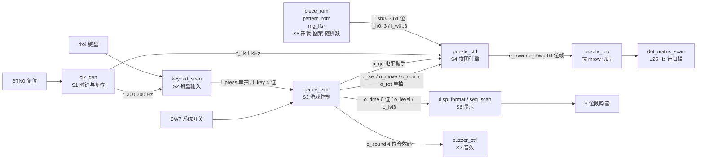

# 项目概览

> 一句话定位：这是**一块 MAX II 实验板上的 8×8 双色点阵拼图游戏**——
> 纯 VHDL-93 手写、Quartus II 9.1 综合，**不使用任何 IP 核**，
> 在 LAB **{{fact:build.fit.lab}}** 的满占用条件下工作。

本页回答三个问题：**它是什么**、**它由哪些部分组成**、**凭什么说它能工作**。
细节分别指向 [系统总体架构](../02-architecture/system-overview.md)、
[模块总览](../03-modules/index.md) 与[验证策略](../06-verification/strategy.md)。

## 一、它是什么

| 项 | 值 | 出处 |
|---|---|---|
| 设计名称 | {{fact:design.title}} | `facts/facts.json` → `design.title` |
| 硬件平台 | {{fact:design.family}} **{{fact:design.device}}**（144 脚 TQFP） | {{src:docs/00-规范理解与需求.md}} §3.1 引脚表 |
| 显示器件 | {{fact:design.matrix}} 点阵 + 8 位七段数码管 | {{src:rtl/dot_matrix_scan.vhd:6}}、{{src:rtl/seg_scan.vhd}} |
| 输入器件 | 4×4 矩阵键盘、`SW7`（系统开关）、`BTN0`（复位） | {{src:rtl/keypad_scan.vhd:2}}、{{src:rtl/puzzle_top.vhd}} |
| 语言 / 工具 | {{fact:design.hdl}} / {{fact:design.tool}} | {{src:rtl/puzzle_top.vhd}} |
| 关卡数 | {{fact:design.games}} 关（前两关照题目，第三关属提高要求 A2） | {{src:docs/00-规范理解与需求.md}} §1.2 |
| 游戏顶层 | `puzzle_top`（**唯一绑定引脚**的游戏顶层） | {{src:rtl/puzzle_top.vhd}} |

**它解决的问题**：把题目 4「简易拼图游戏」的 **11 条基本要求 + 5 条提高要求**
（原文见 {{src:docs/00-规范理解与需求.md}} §1.1/§1.2）落到一块**资源几乎用满的 CPLD** 上，
并且让每一步都能**指回仓库里的证据**——不是"看起来能跑"，而是"能逐条核对"。

!!! quote "为什么把"证据"当成设计的一部分"
    本项目被"文档与代码不一致"咬过不止一次：`docs/06` 的 ERR-022 是**位宽抄错**、
    ERR-027 是**注释里写错了刷新率假设**（索引见 [故障索引](../08-debugging/index.md)）。
    所以从第 10 工作阶段起同时维护三样东西：`rtl/` 源码、`sim/rounds/` 轮次记录、
    以及一个会对账的审计脚本 `scripts/audit_evidence.py`——**本文档站的每个数字都要能在这三样里找到出处**。

## 二、系统架构（简化图）

!!! note "这张图省略了什么"
    `clk_gen` 到各模块的**节拍使能**（`t_1k`/`t_200`/`t_4hz`/`t_1hz`）只画了代表性的几条；
    `puzzle_pkg` 是**设计包（package）而不是模块**——它没有端口，24 个函数全是纯函数，
    综合时被展开成常量与组合逻辑 ⇒ **不能画成方框**（依据见
    [RTL 层级与实例](../02-architecture/hierarchy.md)）。

## 三、关键指标

| 指标 | 值 | 证据级别 / 出处 |
|---|---|---|
| 逻辑单元（LE） | **{{fact:build.fit.le}}** | 【编译/STA】{{src:docs/05-资源利用与编译报告.md}} |
| 逻辑阵列块（LAB） | **{{fact:build.fit.lab}}** ← **真正的瓶颈** | 【编译/STA】同上 |
| 引脚 | **{{fact:build.fit.pins}}** | 【编译/STA】{{src:quartus/puzzle.qsf}} |
| 时钟约束 | {{fact:build.constraint.period_ns}} ns（= {{fact:build.constraint.fmax_mhz}} MHz） | 【编译/STA】{{src:quartus/puzzle.sdc}} |
| 建立裕量 | +{{fact:build.sta.setup_slack}} ns ⇒ 实测可达 **54.27 MHz** | 【编译/STA】`quartus/output_files/puzzle.sta.rpt`（构建产物，未入库；摘要见 {{src:docs/05-资源利用与编译报告.md}}） |
| 保持裕量 | +{{fact:build.sta.hold_slack}} ns | 【编译/STA】同上 |
| 仿真断言 | **{{fact:sim.totals.assertions}} 条全部通过**，覆盖 **{{fact:sim.totals.modules}}** 个模块/场景 | 【RTL 仿真】{{tree:sim/rounds}} |
| 板上固件 | `puzzle.pof`（{{fact:build.provenance.pof.bytes}} B，sha256 `{{fact:build.provenance.pof.sha256}}`） | 【板级实测】{{src:quartus/build_provenance.json}} |

!!! warning "别把"实测可达 54.27 MHz"读成"Fmax 指标 = 54.27 MHz""
    `{{fact:build.constraint.fmax_mhz}}`（50.0）是**约束值**；54.27 MHz 是由
    `setup slack = +{{fact:build.sta.setup_slack}} ns` 反推的**余量**
    （`1 / (20 ns − 1.572 ns)`）。前者是"要求"，后者是"实际留了多少"。
    推导与逐项读数见[时序报告](../07-implementation/timing-report.md)。

## 四、凭什么是"验证过的"

| 级别 | 手上有什么 | 能证明 | 不能证明 |
|---|---|---|---|
| 【RTL 仿真】 | {{fact:sim.totals.modules}} 个测试台的 {{fact:sim.totals.assertions}} 条断言 + 每轮 `rNN.json` 记录 | 逻辑功能与模块间时序关系（在激励覆盖范围内） | 电气行为、外设真实观感与**听感** |
| 【编译/STA】 | Fitter / TimeQuest 报告（{{src:docs/05-资源利用与编译报告.md}}） | 资源占用、时序裕量、引脚锁定 | 逻辑功能是否正确 |
| 【板级实测】 | 烧录 + **独立读回校验**（0 error，见 {{src:docs/06-硬件调试记录.md}}） | 固件能进器件、编程链路正确 | 每一局玩法都试过（**没有跑遍历**） |

!!! danger "缺失的证据：真实硬件照片 = 0 张"
    仓库里 12 张 `GUI-*.png` 是 **Quartus 波形编辑器截图**（真实），
    12 张 `SIM-*.svg` 是**脚本渲染的辅助波形**，
    3 张 `演示-*.gif/png` 是**网页引擎渲染**（不是实拍）——
    **真实开发板实拍照片一张都没有**。点阵与数码管的"实际观感"目前只有人的文字记录。
    补拍清单见[上板验证与缺失证据](../06-verification/board-validation.md)。

## 五、已知限制（摘要）

| 限制 | 影响 | 详见 |
|---|---|---|
| LAB {{fact:build.fit.lab}} 满载 | 任何"再加一点逻辑"的改动都可能装不下（已被 1278 LE 的失败实测证实） | [已知限制与取舍](limitations.md) |
| 提高要求 A3 只做一半 | 零片**位置**随机 ✅、**初始朝向**随机 ❌（有意不做，理由与穷举证明见该页） | [题目要求与验收](requirements.md) |
| 音效听感无法离线验证 | 只能靠人耳在板上判断；仿真只能验"码对不对、拍数对不对" | [音效与背景音乐](../05-gameplay/sound-effects.md) |
| 内容率 25 / 21 Hz | 移动零片时有 ≤ 40 ms 的"涂抹感"（扫描率 125 Hz，**不闪**） | [已知限制与取舍](limitations.md) |

## 证据与出处

| 结论 | 依据 |
|---|---|
| 平台 / 工具 / 关卡数 | {{src:docs/00-规范理解与需求.md}} §1、§3；`facts/facts.json` → `design` |
| 资源与时序读数 | {{src:docs/05-资源利用与编译报告.md}}、`quartus/output_files/puzzle.fit.rpt`（构建产物） |
| 架构与例化关系 | {{src:rtl/puzzle_top.vhd}}（11 个子模块的 `port map`）、{{src:docs-site-plan.md}} §1.1 |
| 断言数与模块数 | {{tree:sim/rounds}}、`facts/facts.json` → `sim.totals` |
| 固件指纹与烧录 | {{src:quartus/build_provenance.json}}、{{src:docs/06-硬件调试记录.md}} |
| 图片证据分级 | {{src:docs-site-plan.md}} §1.2 |

!!! warning "待核实"
    上一段"板级实测"一栏声称**读回校验 0 error**，出处是 `docs/06` 的烧录记录；
    仓库里**没有保存烧录日志原文**（只有文字记录）。核实路径：重跑一次
    `quartus_pgm` 并保留 stdout，或按 [上板验证与缺失证据](../06-verification/board-validation.md)
    的清单补拍/补录。
