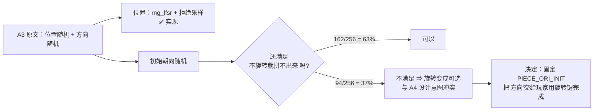
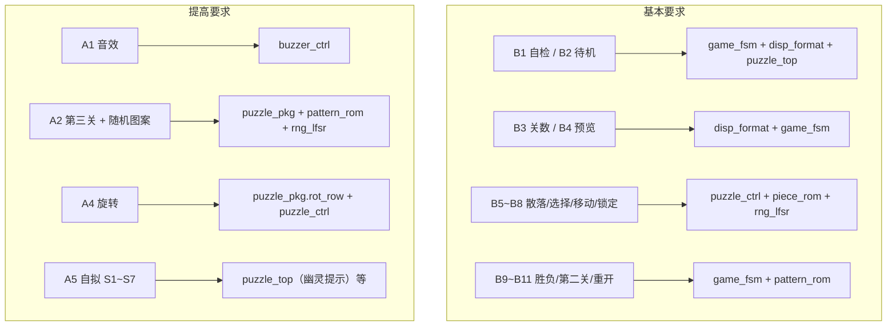

# 题目要求与验收

> 一句话定位：这一页把题目 4 的**每一条要求**逐条映射到**实现它的模块**与**能验收它的证据**，
> 并**如实标出哪一条只做了一半**。

结论先摆出来：**基本要求 B1~B11 = 11/11 实现；提高要求 A1/A2/A4/A5 = 4/4 实现；
A3 只完成一半**（位置随机 ✅、初始朝向随机 ❌ **有意不做**）。
逐条依据见下面两张表，判定口径与冲突裁定见第三、四节。

## 一、基本要求（原文 11 条）

原文逐字见 {{src:docs/00-规范理解与需求.md}} §1.1；下表是"要求 → 实现 → 证据"。

| # | 要求（摘要） | 实现位置 | 验收证据 | 状态 |
|---|---|---|---|---|
| B1 | `SW7='1'` 先自检：点阵全**黄** 2 Hz 闪 + 8 位数码管全 "8" 2 Hz 闪 | {{src:rtl/game_fsm.vhd:264}}（状态）、{{src:rtl/puzzle_top.vhd:735}}（全黄）、{{src:rtl/disp_format.vhd}}（全 8） | `sim/rounds/puzzle_top/r56.json`、{{src:sim/tb_puzzle_top.py}} | ✅ |
| B2 | **2 秒**后待机：点阵全灭、`DISP7='5'`、`DISP0='1'` | {{src:rtl/game_fsm.vhd:281}}、{{src:rtl/disp_format.vhd:7}} | 同上；断言见 {{src:sim/rounds/puzzle_top/r57.json}} | ✅ |
| B3 | 共**两关**，关数由 `DISP0` 显示，控制键用 4×4 键盘 | {{src:rtl/disp_format.vhd:18}}（关卡编码）、{{src:rtl/keypad_scan.vhd}} | `sim/rounds/disp_format/r27.json`、`sim/rounds/keypad_scan/r27.json` | ✅ |
| B4 | 按【开始】显示完整图案 **5 秒**，`DISP7` 倒计时 | {{src:rtl/game_fsm.vhd:289}}（`T_PREVIEW`）、{{src:rtl/puzzle_top.vhd:745}} | `sim/rounds/puzzle_top/r56.json` | ✅ |
| B5 | 预览后出现**三块**零片（随机、不重叠），`DISP4:DISP3` 开始 **30 秒**倒计时 | {{src:rtl/puzzle_ctrl.vhd}}（散落）、{{src:rtl/puzzle_pkg.vhd:460}}（`T_LEVEL1`） | `sim/rounds/puzzle_ctrl/r37.json`、`sim/rounds/puzzle_top/r57.json` | ✅ |
| B6 | 【选择】循环切换零片，**选中的变绿** | {{src:rtl/game_fsm.vhd:410}}、{{src:rtl/puzzle_ctrl.vhd:764}} | 断言 ⑨/⑩ 见 `sim/rounds/puzzle_ctrl/r37.json` | ✅ |
| B7 | 上/下/左/右移动绿色零片，**不能移出 8×8** | {{src:rtl/game_fsm.vhd:412}}、{{src:rtl/puzzle_ctrl.vhd:823}} | `sim/rounds/puzzle_ctrl/r37.json`（越界拒绝） | ✅ |
| B8 | 【确认】后变**黄**且不可再选/移动 | {{src:rtl/game_fsm.vhd:411}}、{{src:rtl/puzzle_ctrl.vhd}}（`locked`） | 同上（锁定后拒绝移动） | ✅ |
| B9 | 30 秒内拼对进第二关；拼错或超时显示失败图案 | {{src:rtl/game_fsm.vhd:337}}（过关）、{{src:rtl/game_fsm.vhd:352}}（拼错）、{{src:rtl/game_fsm.vhd:355}}（超时） | `sim/rounds/puzzle_top/r57.json`（赢/输/超时三场景） | ✅ |
| B10 | 第二关：图案自拟、**四块**零片、**40 秒**，成功显示胜利图案 | {{src:rtl/puzzle_pkg.vhd:461}}、{{src:rtl/puzzle_pkg.vhd:273}}（`L2_FIXED_PAT`） | `sim/rounds/puzzle_top/r56.json` | ✅ |
| B11 | 对局中或结束后再按【开始】可开新局 | {{src:rtl/game_fsm.vhd:332}}、{{src:rtl/game_fsm.vhd:362}} | `sim/rounds/game_fsm/r36.json` | ✅ |

!!! warning "B9 里的 `DISP2` 是题目笔误 —— 已裁定，不是漏做"
    要求 9（B9）写"进入第二关，数码管 **DISP2 显示 2**"，与要求 3（B3）
    "游戏关数由 **DISP0** 显示"直接冲突。2026-10-12 裁定 **取 B3**：
    关数只由 `DISP0` 显示、**`DISP2` 全程熄灭**（口径 C）；只有 B1 的自检态例外
    ——那一条明文要求八位全显 "8"。实现上 `disp_format` **没有任何 `DISP2` 赋值**。
    全过程与三条独立证据见 {{src:docs/00-规范理解与需求.md}} §5 Q2 与
    {{src:docs/06-硬件调试记录.md}} §12。

## 二、提高要求（原文 5 条）

| # | 要求 | 实现 | 证据 | 状态 |
|---|---|---|---|---|
| A1 | 不同情况播放不同提示音/音乐 | 4 位音效码 `SND_*` + 16 条 16 步乐句；三关不同 BGM | {{src:rtl/buzzer_ctrl.vhd}}、`sim/rounds/buzzer_ctrl/r37.json` | ✅ |
| A2 | 增加关数 + 多种图案随机选择 | 新增**第三关**（`T_LEVEL3`）；第三关从**四幅图案库**随机选（第二关按题目固定 PAT3） | {{src:rtl/puzzle_pkg.vhd:251}}、{{src:rtl/puzzle_top.vhd}}（`pat_sel` 锁存） | ✅ |
| A3 | 零片位置随机、**方向随机** | 位置随机 ✅（`rng_lfsr` + 拒绝采样）；**初始朝向随机 ❌ 有意不做** | 见第四节 | 🔶 **半做** |
| A4 | 零片可 **90° 旋转** | 每按一次【旋转】把选中未锁定的零片顺时针转 90°（4 次回原位）；**旋转是通关必需的一步** | {{src:rtl/puzzle_pkg.vhd:766}}、{{src:rtl/game_fsm.vhd:416}}、{{src:scripts/check_geometry.py}} | ✅ |
| A5 | 自拟其他功能 | 自拟功能 S1~S7（关数+随机图案、旋转、告急幽灵…） | {{src:docs/00-规范理解与需求.md}} §4 | ✅ |

!!! note "A2 与 B3 的"两关 / 三关"口径"
    题目 B3 说"共两关"、A2 说"增加游戏关数"，表面冲突。处理办法是**分层**：
    **前两关严格照基本要求**（B3 的"两关"完整可见），**第三关整体属于 A2 的加分扩展**。
    板上表现：第一关过 → 第二关（固定 PAT3）→ 第三关（图案随机）→ 胜利；
    `DISP0` 全程显示当前关数 1/2/3。拍板记录见 {{src:docs/00-规范理解与需求.md}} §1.2。

## 三、A3 为什么只做一半

题目 A3 是"**位置**随机、**方向**随机"两件事。位置随机做了；**初始朝向随机不做**，
理由不是"做不出来"，而是**做了会破坏另一条更重要的性质**：

| 做法 | 后果 |
|---|---|
| 四块零片开局朝向 = `PIECE_ORI_INIT`（1,1,2,2，固定） | **每一块都至少要转一次**才能拼进去 ⇒ "旋转"是通关必需的（A4 的落地价值） |
| 四块零片开局朝向也随机 | 穷举 4⁴ = 256 种朝向组合，**只有 162 种**仍然满足"保持朝向、只许平移就拼不出来" ⇒ 约 **37% 的牌局不转也能拼出来**，那正是被明确否掉的现象（ERR-043） |

!!! quote "取舍的正式说法"
    A4 实现后，**玩家可以自己把任意零片转成任意朝向**，"方向"这件事在玩法上已经完备；
    不做的只是"**开局**让朝向随机"。代价是：如果要随机，四份走法计划
    （整机仿真与 `scripts/check_plans.py` 共用）必须按随机初始朝服用**带旋转的 A\*** 重解，
    收益不抵工作量。穷举证明见 {{src:scripts/check_geometry.py}} 的"A4 旋转必需性"一节。

## 四、要求 → 模块 → 证据（速查图）

## 证据与出处

| 结论 | 依据 |
|---|---|
| 基本要求原文 11 条 | {{src:docs/00-规范理解与需求.md}} §1.1 |
| 提高要求原文 5 条 | {{src:docs/00-规范理解与需求.md}} §1.2 |
| B9 的 `DISP2` 裁定（口径 C） | {{src:docs/00-规范理解与需求.md}} §5 Q2、{{src:docs/06-硬件调试记录.md}} §12、{{src:rtl/disp_format.vhd:25}} |
| A3 半做的穷举证明 | {{src:scripts/check_geometry.py}}、{{src:rtl/puzzle_pkg.vhd:310}}（`PIECE_ORI_INIT`） |
| 四份走法计划与"删掉旋转就拼不出来" | {{src:scripts/check_plans.py}}、{{src:sim/tb_puzzle_top.py}} |
| 逐条断言 | {{tree:sim/rounds}}（逐模块明细由 `book/scripts/gen_pages.py` 生成到 `_generated/assertions/`） |

!!! warning "待核实"
    上表的"状态 ✅"是**按源码与仿真轮次判定**的。【RTL 仿真】能证明模块逻辑，
    **不能证明**板上的实际观感/听感（例如 A1 的音效是否"好听"）。
    板级证据目前只有人的文字记录，**没有真实硬件照片**——补拍清单见
    [上板验证与缺失证据](../06-verification/board-validation.md)。
