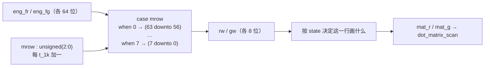
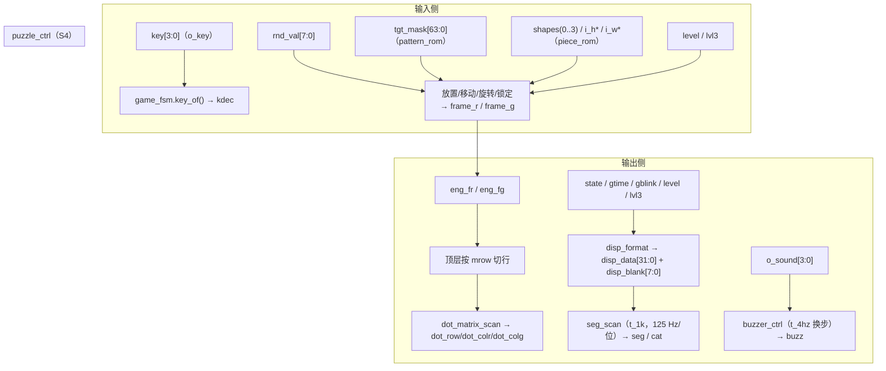

# 数据通路与控制通路

> 一句话定位：这一页回答"一个格子的颜色，从哪一位开始算起、经过哪几级寄存器、
> 最后怎么变成点阵上的一行"，以及"哪些线是数据、哪些线只是命令"。

## 一、先把两类线分开

| 类别 | 判据 | 本设计的例子 |
|---|---|---|
| **数据通路** | 多位（>1 位）、内容每拍都可能变或按行/按帧推进、接收方直接把它当"值"用 | `key[3:0]`、`tgt_mask[63:0]`、`shapes(0..3)`、`rnd_val[7:0]`、`eng_fr/eng_fg[63:0]`、`mat_r/mat_g[7:0]`、`disp_data[31:0]`、`disp_blank[7:0]`、`cat/seg/dot_*` |
| **控制/握手** | 多为 1 位；语义是"现在做某件事"或"我现在处于某状态" | `press`（单拍）、`sel/move/conf/rot/up/down/left/right`（单拍）、`go`（电平握手）、`solved`/`all_lock`/`shuf_busy`（电平）、`rst`、各级 `tick` |

!!! note "为什么必须分开讲"
    数据线可以"晚一拍到"，控制线往往**必须恰好一拍**（例如 `press` 是单时钟宽的脉冲，
    如果被当成电平用两次，一次按键就会被解释成两次移动）。
    逐条的脉宽/有效条件见 [控制信号与握手](../04-interfaces/control-signals.md) 与
    [时序契约](../04-interfaces/timing-contracts.md)。

## 二、帧寄存器：本设计的"显存"

拼图引擎内部持有两片 **64 位帧寄存器**，一拍一位平面：

| 寄存器 | 位宽 | 含义 | 源码 |
|---|---|---|---|
| `frame_r` | 64 | 红色位平面：每一位 = 一个格子 | {{src:rtl/puzzle_ctrl.vhd:249}} |
| `frame_g` | 64 | 绿色位平面：同上 | {{src:rtl/puzzle_ctrl.vhd:250}} |

两片一起看才能表达 8x8 双色的四种状态：

| `frame_r` 位 | `frame_g` 位 | 面板上看到 |
|---|---|---|
| 1 | 0 | 红 |
| 0 | 1 | 绿 |
| 1 | 1 | **黄**（两列都亮；锁定块与"目标图案"叠色会用到） |
| 0 | 0 | 灭 |

!!! warning "8x8 的 64 位不是"一整张图直接送出去""
    引擎**没有**把 64 位整帧一次性推给点阵。它把帧按行切开：
    引擎 `o_rowr`/`o_rowg`（各 64 位，见 {{src:rtl/puzzle_ctrl.vhd:333}}）
    → 顶层信号 `eng_fr`/`eng_fg` → 顶层组合进程按行号 `mrow` 取 8 位
    → `mat_r`/`mat_g` → `dot_matrix_scan.i_colr/i_colg`。
    一行 8 位是**刻意的**：`dot_matrix_scan` 的活就是"点亮一行"，
    真正的面积/时序约束也因此落在"每拍只算 8 位宽"上（{{src:rtl/dot_matrix_scan.vhd:27}}）。

### 2.1 按行切片（`puzzle_top` 自己的组合进程）

- 行号到位的映射是**逐条写死**的 `case`，不是循环：
  `mrow=0 → eng_fr(63 downto 56)`、`mrow=1 → (55 downto 48)` … `mrow=7 → (7 downto 0)`
  （{{src:rtl/puzzle_top.vhd:724}}）。
- `mrow` 每来一个 `t_1k`（1 ms）加一，8 行一轮 ⇒ **行扫描 125 Hz**
  （{{src:rtl/puzzle_top.vhd:816}}）。

### 2.2 这一行到底画什么：`state` 决定

顶层不是无脑把帧送出去，而是按游戏状态选内容（同一个进程，
{{src:rtl/puzzle_top.vhd:712}} 的敏感列表里就有人读到的全部信号）：

| `state` | 画什么 | 用到的数据 |
|---|---|---|
| `S_SELF_TEST` | 整行全亮（自检） | 常量 `'1'` |
| `S_IDLE` | 全灭 | 常量 `'0'` |
| `S_PREVIEW` | 目标图案（预览） | `prev_row`（引擎渲染的目标行） |
| `S_PLAYING` | 引擎帧 + 目标图案叠色 + 告急幽灵 | `rw`/`gw`/`prev_row`/`hint_mask` |
| `S_WIN` | 绿色胜利行 | `win_row` |
| `S_FAIL` | 红色失败行 | `fail_row` |

!!! tip "`mat_r`/`mat_g` 的最终两行写法（省 LE 的等价改写）"
    对局态最终写成 `mat_r <= rw; mat_g <= gw or (prev_row and (not rw) and hint_mask);`
    （{{src:rtl/puzzle_top.vhd:809}}）。它不是"红 = 非红且非绿"那种直觉写法——
    那种写法会多一个输入（实测 0 LE 差异的等价改写，注释里记了原因）。

## 三、位序约定（数据通路的"坐标系"）

这是全设计最容易看错的地方，必须分清三件不同的事：

| 层面 | 约定 | 证据 |
|---|---|---|
| **逻辑格子坐标** | `(row, col)`，`row=0..7` 自上而下、`col=0..7` 自左向右——**游戏语义上的**行/列 | 引擎的夹紧与边界判定按 `(cr, cc, hh, ww)` 做 |
| **位掩码下标** | `bit = 8*row + col`（`mk_cell` 与 `mask_to_px` 都这么建），且注释写明 **bit0 = 左上角** | {{src:rtl/puzzle_pkg.vhd:621}}、{{src:rtl/puzzle_pkg.vhd:643}} |
| **物理扫描引脚位序** | 行是**低电平选通**、红/绿列是**高电平点亮**；逻辑行 0 对应 `ROW7`（PIN_1） | {{src:rtl/dot_matrix_scan.vhd:6}}、{{src:rtl/dot_matrix_scan.vhd:87}} |

!!! warning "待核实：`bit0 = 左上角` 与"帧切片"的朝向关系"
    两处源码事实摆在一起时会出现一个需要核实的朝向问题：
    ① `mask_to_px` 的注释写 "bit0 = 左上角"（{{src:rtl/puzzle_pkg.vhd:640}}）；
    ② 顶层把 `mrow=0` 切到**高 8 位** `(63 downto 56)`（{{src:rtl/puzzle_top.vhd:725}}），
    而 `dot_matrix_scan` 又把 `i_row=0` 译到 `ROW7`（物理**上**边，见该文件头实测记录）。
    ⇒ 若 ① 成立，则 `mrow=0` 取到的是掩码的**第 7 行**（底部），与"0 = 顶部"相左。
    `dot_matrix_scan` 的文件头自己就记着一对互相矛盾的注释
    （{{src:rtl/dot_matrix_scan.vhd:81}} 与 {{src:rtl/dot_matrix_scan.vhd:84}}），
    说明这个朝向**在源码注释层面没有被统一**。
    核实路径：(a) 用 `board_test_top` 的测试 2（左上角红点的空心方框）看红点实际出现在哪个角
    （该文件头已记过一次实测结论）；(b) 或读引擎的行渲染循环，确认 `frame_r(63..56)`
    对应的内部行号。**在核实之前，本页只陈述这三个已核实的独立事实，不合并成一个朝向结论。**

## 四、数据流全景（含控制）

## 五、三条数据链的关键宽度（一张表看完）

| 链路 | 源 | 宽度 | 中间级 | 目的地 | 周期/节拍 |
|---|---|---|---|---|---|
| 键盘 → 游戏 | `keypad_scan.o_key` | 4 | `game_fsm.key_of()` → `kdec` | 状态机分支 | 扫描 200 Hz；接受后单拍 `press` |
| 图案/零片 → 引擎 | `pattern_rom.o_mask`、`piece_rom.o_mask/o_h/o_w` | 64 / 64 / 3 / 3 | 顶层直连（无寄存器） | `puzzle_ctrl` 组合路径 | 每拍可用（纯组合查表） |
| 引擎 → 点阵 | `puzzle_ctrl.o_rowr/o_rowg` | 64+64 | 顶层切行 → `mat_r/mat_g` 8+8 | `dot_matrix_scan` | 行 125 Hz；内容 25/21 Hz |
| 状态 → 数码管 | `game_fsm.o_state/o_time/o_blink` | 3 / 6 / 1 | `disp_format` → `disp_data/disp_blank` | `seg_scan` | 位选 125 Hz |
| 状态 → 蜂鸣器 | `game_fsm.o_sound` | 4 | `buzzer_ctrl` 乐句表 | `o_buzz` | 换步 4 Hz（250 ms/步） |

## 证据与出处

| 结论 | 依据 |
|---|---|
| `frame_r`/`frame_g` 各 64 位、写在引擎内 | {{src:rtl/puzzle_ctrl.vhd:249}}、{{src:rtl/puzzle_ctrl.vhd:659}} |
| `o_rowr`/`o_rowg` 输出整帧 | {{src:rtl/puzzle_ctrl.vhd:333}} |
| 顶层按 `mrow` 切行（逐行 `case`） | {{src:rtl/puzzle_top.vhd:724}} |
| 行扫描 125 Hz（`mrow` 走 `t_1k`） | {{src:rtl/puzzle_top.vhd:816}}、{{src:rtl/clk_gen.vhd:14}} |
| 按 `state` 选择显示内容 | {{src:rtl/puzzle_top.vhd:712}} |
| `bit = 8*row + col`、bit0 = 左上角 | {{src:rtl/puzzle_pkg.vhd:621}}、{{src:rtl/puzzle_pkg.vhd:640}} |
| 点阵行/列极性与行译码 | {{src:rtl/dot_matrix_scan.vhd:6}}、{{src:rtl/dot_matrix_scan.vhd:87}} |
| 显示与音效的节拍 | {{src:rtl/puzzle_top.vhd:530}}、{{src:rtl/buzzer_ctrl.vhd:125}} |
