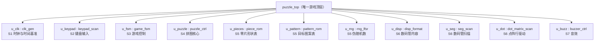
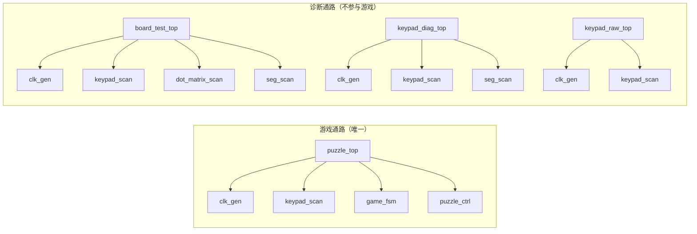

# 层级与顶层

> 一句话定位：这一页回答"到底谁是顶层、谁只是设计包、谁只是诊断工具，
> 以及为什么框图里不能把它们混在一起画"。

**三条必须先记住的结论**：

1. **游戏顶层只有一个**：`puzzle_top`。它是唯一把 11 个游戏子模块接起来、
   并且绑定引脚的游戏设计（{{src:rtl/puzzle_top.vhd:54}}）。
2. **`board_test_top` / `keypad_diag_top` / `keypad_raw_top` 是诊断顶层**：
   它们同样有实体、同样有引脚约束，但用途是"上板排查"（硬件自检、键盘映射实测、
   键盘电气测试），**不是游戏数据通路的一部分**。把 `board_test_top` 画进
   "输入 → 引擎 → 显示"主链的框图都是错的。
3. **`puzzle_pkg` 是设计包（package），不是模块**：它没有端口、没有实例，
   90 个常量 + 2 类型 + 2 子类型 + 24 个纯函数在**综合时被展开进调用者**。
   框图里**不能**把它画成一个带端口的方框（那会暗示它是一级流水）。

## 一、机械层级表

下面这张表由 `book/scripts/gen_pages.py` 从源码真实 `port map` 与实体声明抽出，
**不要手改**（改源码才会变）：

--8<-- "_generated/hierarchy.md"

## 二、怎么读这张表

| 列 | 含义 | 读法 |
|---|---|---|
| 实例名 | `puzzle_top` 里 `u_xxx : entity work.yyy` 的标签 | `u_clk` / `u_keypad` / `u_fsm` / `u_puzzle` / `u_pieces` / `u_pattern` / `u_rng` / `u_disp` / `u_seg` / `u_dot` / `u_buzz` |
| 实体 | 被例化的实体名 | 11 个游戏子模块之一 |
| 行号 | 该 `port map` 在源文件里的起始行 | 可点过去看真实连接 |

`puzzle_top` 的 11 个实例（子系统代号沿用源码文件头的 S1~S7）：

!!! note "`puzzle_pkg` 在这张图里为什么看不到"
    它以 `use work.puzzle_pkg.ALL;` 的形式出现在每个源文件里，是**编译期的名字空间**。
    它的常量在综合后不存在独立电路，因此层级表里没有它的实例——
    这是正确行为，不是漏画。

## 三、四个顶层怎么区分

| 顶层 | 用途 | 例化了什么 | 能不能进游戏数据通路 |
|---|---|---|---|
| `puzzle_top` | **正常游戏** | 11 个游戏子模块 | ✅ **只有它** |
| `board_test_top` | 硬件自检（`test_idx` 是 4 位、15→0 回绕，共 16 槽） | `clk_gen`、`keypad_scan`、`dot_matrix_scan`、`seg_scan` | ❌ 诊断 |
| `keypad_diag_top` | 键盘映射实测（把键号直接显示出来） | `clk_gen`、`keypad_scan`、`seg_scan` | ❌ 诊断 |
| `keypad_raw_top` | 键盘电气测试（列驱动直通 / 原始行电平） | `clk_gen`、`keypad_scan` | ❌ 诊断 |

三个诊断顶层与游戏顶层共享**同一套底层模块**（`clk_gen`/`keypad_scan`/`seg_scan`/
`dot_matrix_scan`）——这正是它们能当"最小可复现实验台"的原因：**同样的 RTL**，
只换顶层接线。

!!! warning "`o_tick_2hz`：在游戏顶层里没人读，但它**不是死逻辑**"
    在 `puzzle_top` 里 `u_clk` 的 `o_tick_2hz` 被显式写成 `=> open`
    （{{src:rtl/puzzle_top.vhd:425}}），但它的**唯一实读者是 `board_test_top`**
    （自检走动计数）。所以"这个信号没人用"这句话**必须限定到具体顶层**才成立——
    这一点在 `clk_gen` 的端口注释里专门订正过（{{src:rtl/clk_gen.vhd:58}}）。

## 四、诚实清单：无人读的信号与显式悬空输出

机械抽取发现 `puzzle_top` 里有 **9 个信号被驱动但无人读**、**2 个输出端口显式 `open`**。
这是**设计事实**，必须逐条交代，而不是回避：

| 信号 / 端口 | 位宽 | 来源 | 状态与理由 |
|---|---|---|---|
| `release` | 1 | `u_keypad.o_release` | 顶层未使用：`game_fsm` 只用 `o_press`，释放脉冲暂无消费者 |
| `kp_raw` | 4 | `u_keypad.o_raw` | 端口注释写明是"调试：实时列驱动" |
| `piece_n` | 3 | `u_pieces.o_n` | 本关零片数量；关卡块数在常量里已定，游戏未用 |
| `sel_idx` | 2 | `u_puzzle.o_sel_idx` | 引擎"当前选中块"的观测点 |
| `pos_dbg` | 32 | `u_puzzle.o_pos` | 引擎锚点/坐标观测点 |
| `lock_dbg` | 4 | `u_puzzle.o_lock` | 引擎 `locked[3:0]` 观测点 |
| `scanrow` | 3 | `u_puzzle.o_scanrow` | 引擎内部行号观测点 |
| `t_100` | 1 | `u_clk.o_tick_100` | 10 ms 通用网格，**全工程无读者**（端口注释已写明） |
| `t_40` | 1 | `u_clk.o_tick_40` | ⚠️ 游戏里无人读，但 `board_test_top` 的自检**逐行推进点阵**要用它 ⇒ **不要删** |
| `u_clk.o_tick_2hz` | 1 | `=> open` | 见上一节：唯一实读者是 `board_test_top` |
| `u_puzzle.o_ori` | 8 | `=> open` | 引擎输出的"4 块零片朝向"；游戏显示不用它（朝向只影响引擎内部渲染） |

!!! warning "待核实：这些观测点是不是"刻意保留""
    上表把 `kp_raw`/`sel_idx`/`pos_dbg`/`lock_dbg`/`scanrow` 归为"调试观测点"，
    依据是**端口名与端口注释**（例如 `o_raw` 的注释直接写"调试：实时列驱动"），
    但源码里**没有**一处注释说明"顶层刻意保留它们以便未来上板观测"。
    核实路径：(1) 读 `puzzle_top` 里这些信号的声明处，看是否带注释；
    (2) 看 `quartus_map` 的警告清单里有没有对应的未连接网络提示（旁证，不是证据）。
    在核实之前，**不要**把它们写成"设计者的刻意保留"。

## 证据与出处

| 结论 | 依据 |
|---|---|
| 唯一游戏顶层、11 个实例与行号 | {{src:rtl/puzzle_top.vhd:54}}、`_generated/hierarchy.md` |
| 计数：实体 {{fact:hierarchy.counts.entities}} / 游戏子模块 {{fact:hierarchy.counts.modules}} / 诊断顶层 {{fact:hierarchy.counts.diag_tops}} / 设计包 {{fact:hierarchy.counts.packages}} | `facts/facts.json` → `hierarchy.counts` |
| 三个诊断顶层的用途 | {{src:rtl/board_test_top.vhd:2}}、{{src:rtl/keypad_diag_top.vhd:2}}、{{src:rtl/keypad_raw_top.vhd:2}} |
| `puzzle_pkg` 无端口、只有常量/类型/纯函数 | `_generated/pkg-constants.md`、`_generated/pkg-types.md`、`_generated/pkg-functions.md` |
| 无人读信号与 `open` 输出清单 | `_generated/connections-puzzle_top.md`（"未连接（`open`）的输出端口"一节） |
| `o_tick_2hz` 的唯一实读者 | {{src:rtl/clk_gen.vhd:58}} |
| `t_100` 无读者 / `t_40` 仍被自检使用 | {{src:rtl/clk_gen.vhd:57}}、{{src:rtl/clk_gen.vhd:61}} |
