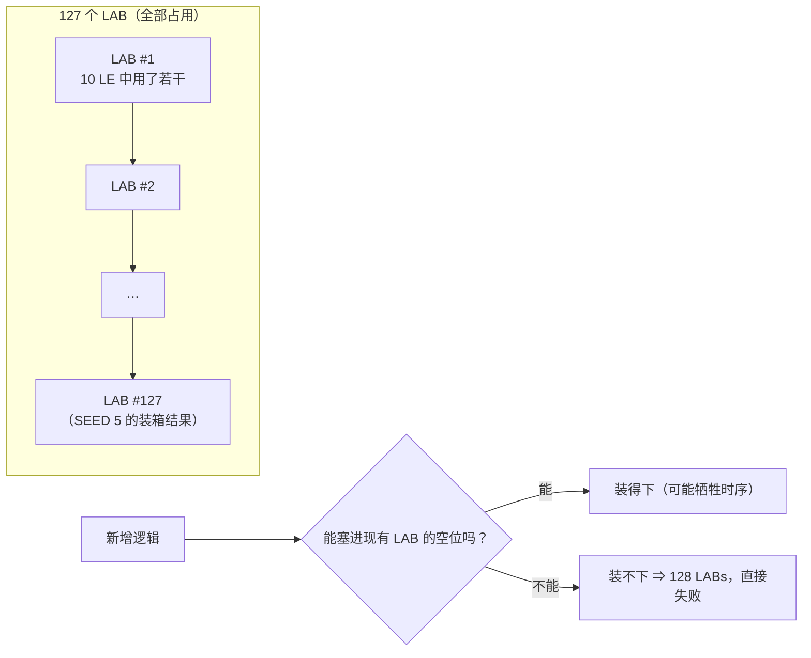

# 资源预算与瓶颈

> 一句话定位：这一页回答"这个设计到底把 EPM1270 用满了没有、剩多少余量、
> 以及为什么'只剩 6 个逻辑单元'这句话只说对了一半"。

## 一、关键读数（机械生成，不要手打）

--8<-- "_generated/metrics.md"

## 二、真正的瓶颈是 **LAB**，不是 LE

| 量 | 读数 | 含义 |
|---|---|---|
| 逻辑单元 LE | {{fact:build.fit.le}} | 用了 1,264 个，器件共 1,270 个 |
| 逻辑阵列块 LAB | **{{fact:build.fit.lab}}** | **127 个全用完，一个不剩** |
| 每个 LAB 的 LE 数 | 10 | MAX II 的 LAB = 10 个 LE（1,270 ÷ 127 = 10，与读数自洽） |
| 理论可用 LE | 127 × 10 = 1,270 | 与器件标称一致 |
| 实际可用余量 | **6 LE**，但**必须落在已有的 LAB 空位里** | 若新逻辑需要"新开一个 LAB"（额外布线/共享资源），**即使只剩 1 LE 也没法装** |

!!! quote "为什么"只剩 6 LE"这句话迷惑人"
    Fitter 是按 **LAB** 装箱的：一个 LAB 里的 10 个 LE 共享进位链与局部互连。
    1,264/1,270 说明"LE 只剩 6 个"，但 127/127 说明"**LAB 一个都没有了**"。
    于是出现很反直觉的现象：**把某段逻辑改小也可能装不下**——
    原装箱被扰动后，本来共用一个 LAB 的两段逻辑被拆到两个 LAB，就多要一个。
    这也是为什么本项目每次改动（哪怕只改常量值）都要**真编译**量一次。

实测的两个例子（都写在源码注释里）：

| 例子 | 现象 | 证据 |
|---|---|---|
| ERR-051 的三种修法 | 加宽 `selfc`（2→3 位）：实测要 **128 LABs，装不下**；复用 `cnt` 但**正计数**：同样装不下；**复用 `cnt` + 倒计数**才装得下（复用已有的减法器/比较器） | {{src:rtl/game_fsm.vhd:186}} |
| 键位宽度收窄 | `settle` 8→6 位、`cnt` 8→2 位：`keypad_scan` 少 **12 个 LC**，整机 **−7 LE** | {{src:rtl/keypad_scan.vhd:76}} |
| 拼图渲染串行化 | 一拍算一块（`chk` 状态机 + `ph` 相位），把每拍的组合路径压到 8 位宽，这是引擎能装进 EPM1270 的原因 | {{src:rtl/puzzle_ctrl.vhd:254}} |
| 旋律表连奏填音 | 只改常量值，面积反而 **−5 LE**（大量相邻表项变成同一个值，fitter 能合并） | {{src:docs/05-资源利用与编译报告.md}} |

## 三、面积与面积的"代价"：SEED 扫描

资源用满之后，**Fitter 的随机种子（seed）也成了设计变量**：
同一个 RTL、同一个 `.qsf`，换 seed 会换一种装箱方式，面积与时序都会变。

| 项 | 事实 | 证据 |
|---|---|---|
| 扫描范围 | 逐 seed 真编译（`.tmp/opt/L1…L15` 之类的隔离工程），判据是"**装得下（≤127 LAB）且时序 ≥50 MHz**" | {{src:docs/05-资源利用与编译报告.md}} |
| 结论示例 | 某些 seed"装得下但过不了 50 MHz"（例如 SEED 15 = 47.87 MHz），可用集合里取时序最好的那个 | {{src:docs/05-资源利用与编译报告.md}} |
| 为什么必须写进文档 | 换 seed 会改变**读数**，所以"LE/Fmax 是多少"必须绑定"用的是哪个 seed" | {{src:quartus/puzzle.qsf}} |

!!! warning "种子结论不是永久事实"
    `quartus/puzzle.qsf` 里的 seed 是**当时**扫描出来的最优解。
    任何 RTL 改动都要重跑一遍扫描（本项目把这一步写进了工作流：
    先跑隔离工程编译，再决定是否升级主工程的 seed）。
    当前主工程读数见 `_generated/metrics.md`，其 `timestamp` 是快照时间。

## 四、引脚预算

| 项 | 读数 | 说明 |
|---|---|---|
| 引脚 | {{fact:build.fit.pins}} | 52 个已用，全部**显式锁定**（`pins_locked = {{fact:build.pins_locked}}`） |
| 点阵 | 行 8 + 红列 8 + 绿列 8 | 三组各占一排引脚 |
| 数码管 | 段 8 + 位选 8 | `seg` / `cat` |
| 键盘 | 行 4 + 列 4 | `kp_row` / `kp_col` |
| 其它 | `clk`、`sw7`、`btn`、`buzz` | 见 `_generated/pins.md` |

!!! danger "只有【编译/STA】证据，缺什么"
    本节全部读数来自 **Fitter / TimeQuest 报告**。它们能证明"资源与时序达标"，
    **不能**证明：板子上的实际功耗、芯片温度、长时间运行稳定性——
    这些需要【板级实测】，而本仓库目前**没有硬件实拍照片与仪器读数**
    （`docs/图/hardware/` 为空）。补测清单与判据见文档站的"关于证据"一节。

## 证据与出处

| 结论 | 依据 |
|---|---|
| LE/LAB/引脚读数 | `quartus/build_provenance.json`、`_generated/metrics.md` |
| LAB 是装箱单位（10 LE/LAB） | 器件架构；1,270 ÷ 127 = 10 与读数自洽 |
| ERR-051 三种修法的面积实测 | {{src:rtl/game_fsm.vhd:186}} |
| 键位收窄省 12 LC / 整机 −7 LE | {{src:rtl/keypad_scan.vhd:76}} |
| 引擎串行化的面积理由 | {{src:rtl/puzzle_ctrl.vhd:254}} |
| 种子的取舍记录 | {{src:docs/05-资源利用与编译报告.md}}、{{src:quartus/puzzle.qsf}} |
| 引脚锁定表 | `_generated/pins.md` |
