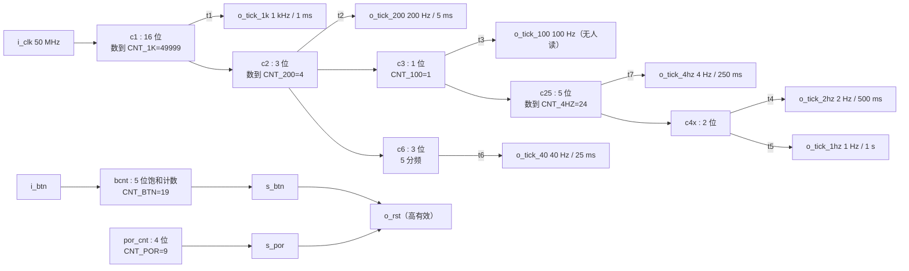
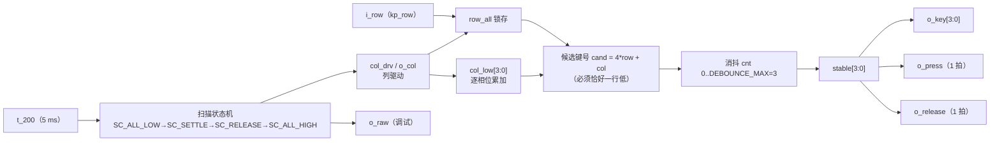
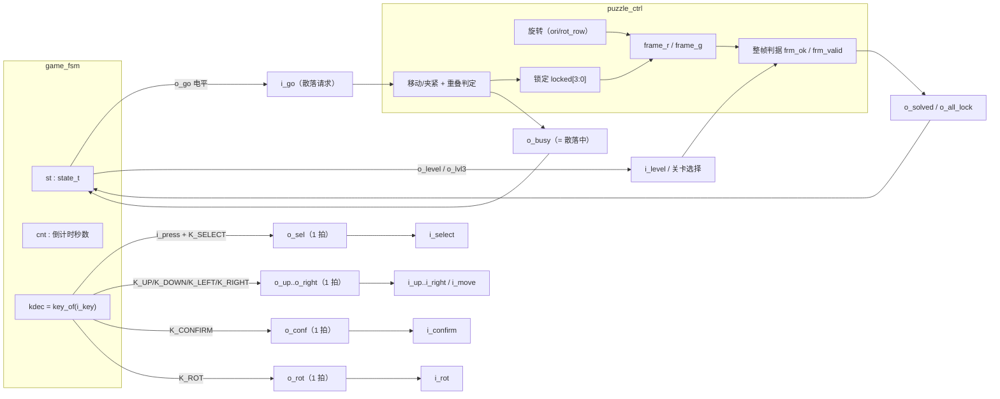
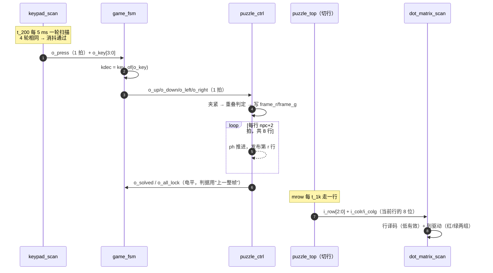

# 系统架构总览

> 一句话定位：这一页回答"整个设计由哪些模块组成、它们之间到底用哪些线连起来、
> 哪些是数据、哪些是控制、哪些只是节拍"。

**结论先给**：本设计只有 **一个正常游戏顶层** `puzzle_top`（{{src:rtl/puzzle_top.vhd:54}}），
它内部例化 **11 个游戏子模块**（`clk_gen` `keypad_scan` `game_fsm` `puzzle_ctrl`
`piece_rom` `pattern_rom` `rng_lfsr` `disp_format` `seg_scan` `dot_matrix_scan` `buzzer_ctrl`），
另外使用 **1 个设计包** `puzzle_pkg`（90 常量 / 2 类型 / 2 子类型 / 24 纯函数，**没有端口**）。
全设计只有 **一个时钟** `clk`（PIN_18，50 MHz），其余所有"节拍"都是它分频出来的
**单时钟宽使能脉冲（tick）**——**不存在异步时钟域，也不存在跨时钟域同步器**。

依据：层级与连接由 `scripts/extract_facts.py` 从真实 `port map` 机械抽出
（见 `_generated/hierarchy.md` 与 `_generated/connections-puzzle_top.md`），
不是从旧文档抄的；`puzzle_top` 里 73 条内部连接、11 个实例、2 个显式 `open` 输出，
每一条都能在源码里指到行。

!!! warning "三个诊断顶层不在游戏数据通路上"
    `board_test_top`（硬件自检）、`keypad_diag_top`（键盘映射实测）、`keypad_raw_top`
    （键盘电气测试）也是**顶层**（各有引脚约束），但它们**不是游戏数据通路的一部分**：
    游戏跑的是 `puzzle_top`。把诊断顶层画进"输入→引擎→输出"的主链是常见错误，
    见 [层级与顶层](hierarchy.md)。

---

## 一、系统级框图

```mermaid
flowchart LR
  subgraph PHY_IN["物理输入（引脚）"]
    clk["clk<br/>PIN_18 50 MHz"]
    sw7["sw7<br/>PIN_125 开关"]
    btn["btn<br/>PIN_61 BTN0"]
    kprow["kp_row[3:0]<br/>PIN_111..114"]
  end

  subgraph S1["S1 时钟与时间基准"]
    uclk["u_clk : clk_gen<br/>o_rst / o_tick_1k / o_tick_200<br/>o_tick_1hz / o_tick_4hz / o_tick_40"]
  end

  subgraph S2["S2 键盘输入"]
    ukey["u_keypad : keypad_scan<br/>i_tick=t_200"]
  end

  subgraph S3["S3 游戏控制"]
    ufsm["u_fsm : game_fsm<br/>state / level / lvl3 / o_time"]
  end

  subgraph S45["S4 拼图核心 + S5 数据表"]
    upuz["u_puzzle : puzzle_ctrl<br/>frame_r / frame_g（各 64 位）"]
    upat["u_pattern : pattern_rom<br/>tgt_mask[63:0]"]
    upie["u_pieces : piece_rom<br/>shapes[0..3] / h / w / n"]
    urng["u_rng : rng_lfsr<br/>rnd_val[7:0]"]
  end

  subgraph S6["S6 显示"]
    udisp["u_disp : disp_format<br/>disp_data[31:0] / disp_blank[7:0]"]
    useg["u_seg : seg_scan<br/>i_tick=t_1k"]
    udot["u_dot : dot_matrix_scan<br/>i_row=mrow"]
  end

  subgraph S7["S7 声音"]
    ubuzz["u_buzz : buzzer_ctrl<br/>i_t4=t_4hz"]
  end

  subgraph TOPMUX["顶层自身逻辑（puzzle_top 的进程）"]
    slice["按 mrow 切行：<br/>eng_fr / eng_fg → mat_r / mat_g"]
    psel["pat_sel[1:0] 锁存"]
  end

  subgraph PHY_OUT["物理输出（引脚）"]
    dot["dot_row / dot_colr / dot_colg"]
    segp["seg / cat"]
    buzz["buzz<br/>PIN_60"]
    kpcol["kp_col[3:0]<br/>PIN_117..120"]
  end

  clk --> uclk
  btn --> uclk
  uclk -->|rst 高有效| ukey & ufsm & upuz & urng & useg & udot & ubuzz
  uclk -->|t_200| ukey
  uclk -->|t_1k| useg & upuz
  uclk -->|t_1hz| ufsm
  uclk -->|t_4hz| ufsm & ubuzz
  kprow --> ukey
  ukey -->|kp_col| kpcol
  ukey -->|o_key[3:0] / o_press| ufsm
  sw7 -->|i_sw / i_en| ufsm & useg & udot & ubuzz
  ufsm -->|sel / move / conf / rot / up..right 单拍| upuz
  ufsm -->|o_go 电平（握手）| upuz
  ufsm -->|o_level / o_lvl3| upuz & upat & upie & udisp
  upuz -->|rnd_step 单拍| urng
  urng -->|rnd_val[7:0]| upuz
  upat -->|tgt_mask[63:0]| upuz
  upie -->|i_sh0..i_sh3 / i_h* / i_w*| upuz
  upuz -->|o_rowr=eng_fr / o_rowg=eng_fg| slice
  upuz -->|o_solved / o_all_lock / o_busy| ufsm
  ufsm -->|o_state / o_time / o_blink| udisp
  slice -->|mat_r / mat_g| udot
  udot --> dot
  udisp -->|disp_data / disp_blank| useg
  useg --> segp
  ufsm -->|o_sound[3:0]| ubuzz
  ubuzz --> buzz
  ufsm -->|o_time/gtime| udisp
  psel -->|i_pat| upat & upuz
```

**这张图怎么读**：方框是**实体**（模块），箭头是**信号**，箭头标签是**真实信号名**。
图中刻意把"顶层自身逻辑"画成一个方框——`eng_fr/eng_fg → mat_r/mat_g` 的按行切片
**不在任何子模块里**，它写在 `puzzle_top` 自己的组合进程里（{{src:rtl/puzzle_top.vhd:712}}）。

## 二、五类连线（不要把它们的性质混在一起）

| 类别 | 本设计里的例子 | 性质 | 在哪里看 |
|---|---|---|---|
| **时钟/复位/节拍** | `clk`；`rst`（高有效）；`t_1k` `t_200` `t_1hz` `t_4hz` `t_40` | 复位是**电平**（进每个模块的同步复位端），tick 是**单时钟宽脉冲**（20 ns） | {{src:rtl/clk_gen.vhd:50}} |
| **数据通路** | `key[3:0]`、`eng_fr/eng_fg`（64 位）、`mat_r/mat_g`（8 位）、`disp_data[31:0]`、`tgt_mask[63:0]`、`shapes(0..3)` | 多位、**每拍都可能变**或按行推进 | `_generated/connections-puzzle_top.md` |
| **控制/握手** | `press`（单拍）、`sel/move/conf/rot/up..right`（单拍）、`go`（**电平**，请求/应答）、`solved/all_lock`（电平）、`shuf_busy`（电平） | 脉冲只维持 1 个 `clk`；电平时序由双方约定 | [控制信号与握手](../04-interfaces/control-signals.md) |
| **设计时常量** | 90 个常量、64 位图案掩码、旋律表、数码管字位码 | **没有端口**，综合时被展开进调用者的组合逻辑 | `_generated/pkg-constants.md` |
| **仿真边界** | `sim/*.vwf` + `sim/tb_*.py`；12 个模块 184 条断言 | 不是 RTL 的一部分：仿真用 `.vwf` 激励、Python 断言判据 | {{tree:sim}}（见 [模块接口契约](../04-interfaces/module-ports.md)） |

!!! quote "为什么把 tick 做成"脉冲"而不是"时钟""
    如果给每个子系统各分一路时钟，就会引入多时钟域与门控时钟，MAX II 上的
    时序约束、`set_false_path`、以及"某个域没被复位"的风险都会成倍增加。
    本设计只有**一个**时钟、一段**同步复位树**，所有节拍都是使能脉冲——
    代价是每个消费者都要写 `if (i_tick = '1') then`，收益是时序分析只需看
    一个 20 ns 周期（约束见 {{src:quartus/puzzle.sdc}}）。

## 三、七张子系统图

### 3.1 时钟与复位（S1）



### 3.2 键盘链路（S2）



### 3.3 游戏控制 ↔ 拼图引擎（S3 ↔ S4）

这张图是**控制通路**的核心：命令从 `game_fsm` 走单拍脉冲进引擎，状态从引擎走电平回 `game_fsm`。



### 3.4 图案与零片数据流（S5）

```mermaid
flowchart LR
  lv["o_level / o_lvl3"] --> pat["pattern_rom"]
  psel["pat_sel[1:0]（顶层锁存）"] --> pat
  psel --> eng["puzzle_ctrl"]
  lv --> pie["piece_rom"]
  pat -->|tgt_mask[63:0]| eng
  pie -->|shapes(i) 64 位 / i_h* / i_w* / piece_n| eng
  rnd["rng_lfsr<br/>SEED_DEFAULT=x5A"] -->|rnd_val[7:0]| eng
  eng -->|rnd_step 单拍| rnd
  eng -->|o_rowr / o_rowg| engfr["eng_fr / eng_fg"]
```

!!! note "`pat_sel` 是**顶层**锁存的，不是任何子模块的输出"
    第一关 `pattern_rom` 忽略 `i_pat`（恒为图 4-1）；第二关锁 `L2_FIXED_PAT`（`"11"`）；
    第三关才在进预览的瞬间锁 `rnd_val(1 downto 0)`。锁存发生在 `puzzle_top`
    自己的进程里（{{src:rtl/puzzle_top.vhd:410}}），并把同一个 `pat_sel` 同时送给
    `u_pattern` 和 `u_puzzle`——两者必须看到**同一个**图案下标。

### 3.5 显示链路（S6）

```mermaid
flowchart LR
  fr["eng_fr / eng_fg（各 64 位）"] --> slice["顶层组合进程：<br/>case mrow 切 8 位"]
  mrow["mrow : unsigned(2:0)<br/>t_1k 推进"] --> slice
  slice --> matr["mat_r[7:0] / mat_g[7:0]"]
  st["o_state / o_time / o_blink / o_level / o_lvl3"] --> disp["disp_format"]
  disp -->|disp_data[31:0]<br/>8 位 × 4 位字位码| seg["seg_scan"]
  disp -->|disp_blank[7:0]| seg
  seg -->|o_seg / o_cat| segout["seg / cat 引脚"]
  matr --> dot["dot_matrix_scan"]
  mrow -->|i_row| dot
  dot -->|o_row / o_colr / o_colg| dotout["dot_row / dot_colr / dot_colg"]
  sw7["sw7 → i_en"] --> seg & dot
```

!!! bug "点阵"内容刷新率"与"行扫描率"是两个数（ERR-027）"
    行扫描：`mrow` 每 `t_1k` 走一行，8 行 = 8 ms ⇒ **125 Hz**；
    内容：引擎一行要 `npc+2` 拍才发布（第一关 5 拍、二三关 6 拍），
    8 行一帧 ⇒ **25 Hz / 21 Hz**。把 125 Hz 当成"画面刷新率"是 ERR-027 的根源，
    见 {{src:rtl/puzzle_ctrl.vhd:257}} 与 [时序与节拍](timing.md)。

### 3.6 音效链路（S7）

```mermaid
flowchart LR
  st["o_state（state_t）"] --> snd["sound_p 组合拼线"]
  lv["o_level / o_lvl3"] --> snd
  snd -->|o_sound[3:0]| sel["buzzer_ctrl i_sel"]
  sel --> mel["MEL_* 乐句查表（编译期常量）"]
  t4["t_4hz（250 ms）→ i_t4"] --> step["旋律步进"]
  step --> mel
  mel --> half["音高表 → 半周期计数"]
  half --> buzz["o_buzz（翻转）→ buzz PIN_60"]
  sw7["sw7 → i_en"] --> buzz
```

`o_sound` 是**4 位码**（16 个场景），不是"音符"；码到乐句的映射是纯常量表，
其中对局期背景音乐是**拼线**得到的：`sound_p <= "10" & lvl3 & level`
（{{src:rtl/game_fsm.vhd:570}}），两位直接来自既有寄存器 ⇒ 0 个逻辑单元。

### 3.7 端到端按键时序（sequenceDiagram）



## 四、规模与边界（读数一律引用，不手打）

| 项 | 值 | 出处 |
|---|---|---|
| 器件 | MAX II `EPM1270T144C5` | {{fact:build.device}} |
| 逻辑单元 LE | {{fact:build.fit.le}} | `quartus/build_provenance.json` |
| 逻辑阵列块 LAB | {{fact:build.fit.lab}} | 同上（**真正的瓶颈**） |
| 引脚 | {{fact:build.fit.pins}} | 同上 |
| 时钟约束 | {{fact:build.constraint.fmax_mhz}} MHz / 周期 {{fact:build.constraint.period_ns}} ns | {{src:quartus/puzzle.sdc}} |
| Setup slack | {{fact:build.sta.setup_slack}} ns | `quartus/build_provenance.json` |
| Hold slack | {{fact:build.sta.hold_slack}} ns | 同上 |
| 实体数 / 游戏子模块 / 诊断顶层 / 设计包 | {{fact:hierarchy.counts.entities}} / {{fact:hierarchy.counts.modules}} / {{fact:hierarchy.counts.diag_tops}} / {{fact:hierarchy.counts.packages}} | {{src:scripts/extract_facts.py}} |
| 仿真模块数 / 断言总数 | {{fact:sim.totals.modules}} / {{fact:sim.totals.assertions}} | {{tree:sim/rounds}} |

!!! danger "这一页**不能**证明的事"
    1. 框图里的连接是**逻辑**连接；引脚到物理器件的映射见 `_generated/pins.md`，
       而"板子上真的这么连"只有板级实测能证明。
    2. 全设计**没有真实硬件照片**（`docs/图/hardware/` 为空）——任何"观感/听感"结论
       目前只有【RTL 仿真】+【编译/STA】两类证据。
    3. 本设计**没有异步时钟域**，因此不存在"跨时钟域同步"这一节；如果他人的框图里
       出现第二个时钟，那是错的。

## 证据与出处

| 结论 | 依据 |
|---|---|
| 唯一游戏顶层是 `puzzle_top`，11 个子模块例化名可核对 | {{src:rtl/puzzle_top.vhd:54}}、`_generated/hierarchy.md` |
| 73 条内部连接、信号名/位宽/类型 | `_generated/connections-puzzle_top.md` |
| 单时钟、其余全是 tick；tick 周期与用途 | {{src:rtl/clk_gen.vhd:14}}、{{src:rtl/puzzle_pkg.vhd:397}} |
| tick 常量值（`CNT_1K`/`CNT_200`/`CNT_4HZ`…） | {{src:rtl/puzzle_pkg.vhd:421}}、`_generated/pkg-constants.md` |
| `puzzle_pkg` 是设计包、无端口 | `_generated/pkg-types.md`、`_generated/pkg-constants.md` |
| 行切片在顶层进程内完成 | {{src:rtl/puzzle_top.vhd:712}} |
| 引擎整帧判据与 `o_solved`/`o_all_lock` | {{src:rtl/puzzle_ctrl.vhd:360}} |
| `pat_sel` 锁存与三关口径 | {{src:rtl/puzzle_top.vhd:410}}、{{src:rtl/puzzle_pkg.vhd:251}} |
| 资源读数 | {{src:quartus/build_provenance.json}}、`_generated/metrics.md` |
