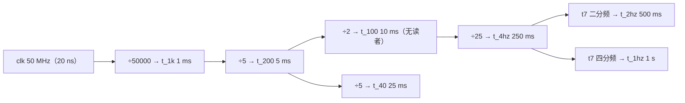

# 时序与节拍

> 一句话定位：这一页回答"全设计有几个时钟、各级节拍到底是多少毫秒、
> 为什么点阵"行扫描 125 Hz"而"内容只是 25/21 Hz"。

## 一、只有**一个**时钟域

| 项 | 事实 | 证据 |
|---|---|---|
| 时钟 | `clk`（PIN_18，50 MHz），**全设计唯一** | {{src:rtl/puzzle_top.vhd:56}}、`_generated/pins.md` |
| 其余"节拍" | 全部是 `clk` 分频出来的**单时钟宽使能脉冲**（tick），不是时钟 | {{src:rtl/clk_gen.vhd:130}} |
| 异步时钟域 | **没有**；因此也**没有**跨时钟域同步器、没有 `set_clock_groups`、没有门控时钟 | {{src:quartus/puzzle.sdc}} |
| 复位 | `rst` **高电平有效**；`o_rst <= s_por or s_btn`，进各模块的**同步**复位端 | {{src:rtl/clk_gen.vhd:259}} |
| 时钟约束 | {{fact:build.constraint.fmax_mhz}} MHz / 周期 {{fact:build.constraint.period_ns}} ns | {{src:quartus/puzzle.sdc}} |
| 时序结果 | setup slack {{fact:build.sta.setup_slack}} ns、hold slack {{fact:build.sta.hold_slack}} ns | `quartus/build_provenance.json` |

!!! quote "为什么不做多时钟域"
    每个子系统各分一路时钟，看起来"分层清晰"，代价却是：多时钟域的约束、
    门控时钟在 MAX II 上的布线资源、以及"某个域忘了复位"的隐蔽错误。
    本设计的做法是**一个时钟 + 一段复位 + 一组使能脉冲**：每个消费者自己写
    `if (i_tick = '1') then`。这样时序分析只需要看一个 20 ns 周期，
    而节拍的正确性由各模块自己的仿真断言保证。

!!! note "等效最高频率怎么算"
    约束周期 20 ns、实测 setup slack +1.572 ns ⇒ 等效 Fmax ≈ 1/(20 − 1.572) ns ≈ **54.27 MHz**
    （推导自 {{fact:build.sta.setup_slack}}；`docs/05-资源利用与编译报告.md` 里记的
    TimeQuest Fmax 也是这个值）。
    ⚠️ 注意生成页 `_generated/metrics.md` 的 "Fmax（TimeQuest）" 行取到的是
    **约束值 50.0 MHz**，与本条不是同一个量——以本页的公式与 `docs/05` 为准（已报 Lead 核对）。

## 二、分频链的真值

`clk_gen` 的每一级都是"数到 N-1、发一个 `clk` 宽的脉冲、回绕"。
N 全部来自 `puzzle_pkg` 的常量（**改常数就等于改节拍**，不要手改 `clk_gen` 里的数字）：

| 级 | 计数器 | 常量（值） | 输出 tick | 周期 | 用途 |
|---|---|---|---|---|---|
| 1 | `c1`（16 位） | `CNT_1K = CLK_HZ/1000 − 1`（49999） | `o_tick_1k` | **1 ms** | 点阵行推进、数码管位选、引擎行渲染 |
| 2 | `c2`（3 位） | `CNT_200 = 1000/200 − 1`（4） | `o_tick_200` | **5 ms** | 键盘扫描轮次 |
| 3 | `c3`（1 位） | `CNT_100 = 200/100 − 1`（1） | `o_tick_100` | **10 ms** | 通用 10 ms 网格（⚠️ **全工程无读者**） |
| 4 | `c25`（5 位）+ `c4x`（2 位） | `CNT_4HZ = 100/4 − 1`（24） | `o_tick_4hz` | **250 ms** | 2 Hz 闪烁的翻转源、蜂鸣器换步 |
| 4 | 同上（`t7` 二分频） | `CNT_2HZ`（49） | `o_tick_2hz` | **500 ms** | 仅 `board_test_top` 自检走动计数 |
| 4 | 同上（`t7` 四分频） | `CNT_1HZ`（99） | `o_tick_1hz` | **1 s** | 游戏倒计时 |
| 5 | `c6`（3 位） | 200 Hz 的 5 分频 | `o_tick_40` | **25 ms** | 仅 `board_test_top` 自检逐行轮播 |

!!! quote "第 4/5/6 级为什么合并成一条链"
    原实现是三个各自独立的计数器（分别数 50 / 100 / 25），一共 18 个触发器；
    但三个节拍本来就是同一个 100 Hz 的 1/50、1/100、1/25，各数一遍是重复的。
    改成"一个 25 分频计数器 `c25` + 2 位"第几个 4 Hz"`"后派生出 `t7`/`t4`/`t5`，
    触发器 14 → 7。三个节拍的**周期比完全不变**，只是相对复位时刻的**相位**
    最多早一个 4 Hz 周期（对"闪烁/音效节奏"无影响）——见 {{src:rtl/clk_gen.vhd:80}}。

## 三、复位

| 项 | 事实 | 证据 |
|---|---|---|
| 上电复位 | `por_cnt`：4 位饱和计数，`CNT_POR = T_POR_MS − 1 = 9` | {{src:rtl/puzzle_pkg.vhd:427}} |
| 按钮复位（消抖） | `bcnt`：5 位**饱和**计数，`CNT_BTN = T_BTN_MS − 1 = 19`；任一拍 `i_btn='0'` **立刻清零**（非对称） | {{src:rtl/clk_gen.vhd:98}} |
| 判据 | 连满 20 个 1 ms 样本才置位；8 个样本的毛刺只到 8 ⇒ 不产生复位 | {{src:rtl/clk_gen.vhd:231}} |
| 组合路径 | `o_rst` 是**组合**输出（`s_por or s_btn`），扇出到每个寄存器的同步复位端 | {{src:rtl/clk_gen.vhd:259}} |

!!! warning "实测与注释的差异（已如实记录）"
    `s_por` 实际是在 `por_cnt` 达到 `CNT_POR` 时释放，即经过 **9 个 `tick_1k`（约 9 ms）**，
    而不是标称的 10 ms。源码里保留了这条实测记录（{{src:rtl/clk_gen.vhd:238}}）。
    ⇒ 写"上电复位 10 ms"这类绝对说法要改成"标称 10 ms / 实测约 9 ms"。

!!! bug "位宽陷阱（ERR 类问题，两处同源）"
    `por_cnt` 只有 4 位：一旦 `T_POR_MS ≥ 17`，`CNT_POR` 会被**截断成 0**、
    比较恒假、上电复位**静默失效**（{{src:rtl/clk_gen.vhd:115}}）。
    `bcnt` 与 `keypad_scan` 的 `settle`/`cnt` 有同样的陷阱
    （{{src:rtl/keypad_scan.vhd:76}}、{{src:rtl/keypad_scan.vhd:104}}）。
    改这些常量时必须同步改位宽。

## 四、四条"看起来矛盾"的刷新率

这是本设计最容易被记错的一组数，逐个给出口径：

| 名称 | 数值 | 口径 | 证据 |
|---|---|---|---|
| **点阵行扫描** | **125 Hz** | `mrow` 每 `t_1k`（1 ms）走一行，8 行 = 8 ms ⇒ 一帧 8 ms | {{src:rtl/puzzle_top.vhd:816}} |
| **点阵内容刷新** | **25 Hz（第一关）/ 21 Hz（二三关）** | 引擎渲染一行要 `npc+2` 拍：`npc=3`（第一关，3 块）⇒ 5 拍；`npc=4` ⇒ 6 拍；8 行一帧 ⇒ 40 ms / 48 ms | {{src:rtl/puzzle_ctrl.vhd:257}}、{{src:rtl/puzzle_ctrl.vhd:457}} |
| **数码管位选** | **125 Hz/位** | `seg_scan` 的 `i_tick` 接的就是 `t_1k`（与点阵**同源同速**）；8 位一扫 = 8 ms | {{src:rtl/puzzle_top.vhd:530}} |
| **键盘扫描** | **200 Hz（5 ms/轮）** | 一轮 = 4 个相位 + 每相位 64 拍 settle | {{src:rtl/keypad_scan.vhd:149}} |

!!! bug "ERR-027：把 125 Hz 当"画面刷新率""
    行扫描 125 Hz ≠ 内容 125 Hz。内容一帧要 8 行 × (npc+2) 拍，
    第一关 40 拍 / 二三关 48 拍 ⇒ **25 Hz / 21 Hz**。
    源码里专门留了这条注释（{{src:rtl/puzzle_ctrl.vhd:259}}）。

## 五、其它与时间有关的约定

| 项 | 值 | 说明 | 证据 |
|---|---|---|---|
| 按键消抖 | **20 ms** | `DEBOUNCE_MAX = 3` ⇒ 需要 4 次**连续相同**的 5 ms 采样 | {{src:rtl/puzzle_pkg.vhd:503}} |
| 首键延迟 | ≈ **55 ms** | 上电后第一次按键（ERR-036 修正后的实测值，断言 ⑨ = 11T） | `sim/rounds/keypad_scan/r27.json` |
| 后续键延迟 | ≈ **45 ms** | 稳态下 9T（断言 ⑨ = 103T） | 同上 |
| 自检窗口 | **恒 8 个 `t_4hz` 步**（4 步=1 s，8 步=2 s 的名义值） | ⚠️ 入口相位不定 ⇒ 只能说"窗口恒 8 步、恰好一声"，**不能说"时长恒 2 s"** | {{src:rtl/game_fsm.vhd:177}} |
| 预览窗口 | **(4, 5] s** | 倒计时按自由走的 1 Hz 递减、入口是按键（与节拍错相） | {{src:rtl/game_fsm.vhd:301}} |
| 关卡限时 | 第一关 **30 s**、第二关 **40 s**、第三关 **60 s** | 起点与节拍对齐 ⇒ **恰好** T_LEVEL* 秒 | {{src:rtl/puzzle_pkg.vhd:474}} |
| 旋律步 | **250 ms/步**，一句 16 步 = 4 s | `buzzer_ctrl.i_t4` 接 `t_4hz` | {{src:rtl/buzzer_ctrl.vhd:125}} |

## 证据与出处

| 结论 | 依据 |
|---|---|
| 单时钟、tick 由分频链产生 | {{src:rtl/clk_gen.vhd:130}}、{{src:rtl/clk_gen.vhd:200}} |
| 各级节拍常量值 | {{src:rtl/puzzle_pkg.vhd:394}}、`_generated/pkg-constants.md` |
| 复位组合输出与实测 9 拍 | {{src:rtl/clk_gen.vhd:238}}、{{src:rtl/clk_gen.vhd:259}} |
| 行扫描 125 Hz / 内容 25·21 Hz | {{src:rtl/puzzle_top.vhd:816}}、{{src:rtl/puzzle_ctrl.vhd:257}} |
| 数码管位选与点阵同源（`t_1k`） | {{src:rtl/puzzle_top.vhd:530}} |
| 键盘 200 Hz 扫描与 20 ms 消抖 | {{src:rtl/keypad_scan.vhd:149}}、{{src:rtl/puzzle_pkg.vhd:503}} |
| 按键延迟实测值 | `sim/rounds/keypad_scan/r27.json` |
| 时钟约束与 slack | {{src:quartus/puzzle.sdc}}、`quartus/build_provenance.json` |
