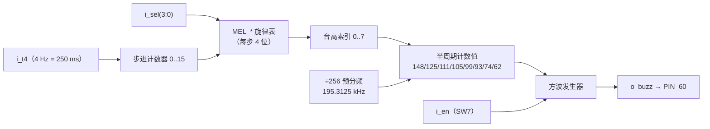

# 音效 `buzzer_ctrl`

> 一句话定位：这一页回答"4 位音效码怎么变成声音、为什么音域要高、为什么对局中按键不发声"。

`buzzer_ctrl` 是 S7，只有 **6 个端口**：它不做任何决策，只回答两个问题 ——
**放哪个音**（`i_sel` 查旋律表）与**放多久**（`i_t4` 的 250 ms 步进）。
板载蜂鸣器由 `PIN_60` 驱动：写方波即发声，所以"一个音"不过是一个分频比。

## 一、模块基本信息

| 项 | 值 |
|---|---|
| 子系统 | S7 音效（对应提高要求 A1"不同情况下播放不同的提示音效或音乐"） |
| 源码 | {{src:rtl/buzzer_ctrl.vhd}}（实体在 {{src:rtl/buzzer_ctrl.vhd:119}}） |
| 端口 | 6：`i_clk`/`i_rst`/`i_en`/`i_sel(3:0)`/`i_t4` → `o_buzz` |
| 上游 | `game_fsm`（`o_sound` 4 位码）、`clk_gen`（`tick_4hz` → `i_t4`）、`sw7`（`i_en`） |
| 下游 | 板载蜂鸣器（`PIN_60`） |
| 核心难点 | ①换能器谐振点高 ⇒ 音域必须上移；②旋律表/码表/测试台**三方必须一致**；③"区分度"要靠**音区 × 轮廓方向 × 音长密度**，不能靠音符个数 |

## 二、端口契约

--8<-- "_generated/ports/buzzer_ctrl.md"

| 端口 | 语义（本页补充） |
|---|---|
| `i_en` | `'0'` 强制静音（来自 SW7：开关关掉时整机静默） |
| `i_sel(3:0)` | 4 位音效码（第 14 工作阶段由 3 位加宽），码表见 §四 |
| `i_t4` | **4 Hz**（250 ms）换步节拍；一句 **16 步 = 4 s** 循环 |
| `o_buzz` | 方波输出（直接接 `PIN_60`） |

## 三、为什么音域整体上移一个八度（用户实测反馈逼出来的）

!!! bug "第一版"游戏过程中完全没有声音""
    旧版音域是 **G4..C6（392..1047 Hz）**，而小板载蜂鸣器（压电/电磁换能器）
    的谐振点通常在 **1~4 kHz** —— 392 Hz 处几乎推不动，实机就是"没声音"。
    第 14 工作阶段做两件事（**架构不变，只改音高、位数与分频**）：

    * 音域上移到 **C6..C7 = 1046.5 ~ 2093 Hz**（换能器高效区，也是 chiptune 常用音域）；
    * 面积：先把 50 MHz **÷256 → 195.3125 kHz** 作为粗时间基准，
      方波计数器只数这个 tick ⇒ 半周期计数最大 373，**9 位 → 8 位**，
      比较器/计数器一起瘦一圈（讲义"先把时间基准做粗"的做法）。

**音高表（8 个音，f = 195312.5 / (2×(half+1))）**

| idx | 音名 | 目标频率 | 半周期拍数 | 实际频率（≈） |
|---|---|---|---|---|
| 0 | E5 | 659.3 Hz | 148 | 656.8 Hz |
| 1 | G5 | 784.0 Hz | 125 | 777.3 Hz |
| 2 | A5 | 880.0 Hz | 111 | 877.4 Hz |
| 3 | A#5 | 932.3 Hz | 105 | 927.5 Hz |
| 4 | B5 | 987.8 Hz | 99 | 983.4 Hz |
| 5 | C6 | 1046.5 Hz | 93 | 1046.8 Hz |
| 6 | E6 | 1318.5 Hz | 74 | 1319.7 Hz |
| 7 | G6 | 1568.0 Hz | 62 | 1575.1 Hz |

!!! warning "音准统一偏低，最大偏 1.25%"
    ÷256 预分频让"半周期拍数"只能取整 ⇒ 每个音都有几百到一千多音分的偏差
    （上表演算见 {{src:rtl/buzzer_ctrl.vhd:53}}）。功能无影响（听感无差别），
    但要**如实写明**：这不是"准确音高"，是"够用的音高"。

## 四、音效码表（16 个码，每句 16 步 × 250 ms = 4 s）

| 码 | 名称 | 内容 | 现在还会被生成吗 |
|---|---|---|---|
| `0000` | `SND_NONE` | 静音（待机） | — |
| `0001` | `SND_SELF` | 自检 = POST 单声短鸣（C6 ≈1 kHz）；**第 0/8 步各一个发声步** ⇒ 窗口内听到 **1 声** | ✅ |
| `0010` | `SND_PREVIEW` | 预览 = **上行纯五度** A5 → E6（2 个音、0.75 s，全系统最短） | ✅ |
| `0011` | `SND_CLEAR` | 过关 = 大三和弦琶音回旋 ×4（16/16 全发声） | ✅（事件码，被 `snd_hold` 保持 2 步） |
| `0100` | `SND_WRONG` | 拼错 = E6 起**纯下行** ＋ 低音抖动（16/16） | ✅（事件码） |
| `0101` | `SND_KEY` | 按键音（G6 blip）—— 码与乐句保留，**`game_fsm` 已不再发出** | ❌ |
| `0110` | `SND_WIN` | 通关 = 最高音区 ＋ **同音反复 ＋ 拖长**（G6 为主，4 s） | ✅ |
| `0111` | `SND_FAIL` | 失败 = 从最高音**大跳落到底**：E6 → A5 → E5（纯五度 ＋ 纯四度下行） | ✅ |
| `1000` | `SND_BGM1` | 第一关 BGM = 高音区、只换 4 次音、16/16 连奏 | ✅ |
| `1001` | `SND_BGM2` | 第二关 BGM = **低音区块状脉冲**（E5→G5→A5→E5 各 4 拍） | ✅ |
| `1010` | `SND_ROT` | 旋转音 —— **第 18 工作阶段起不再生成，查表臂已删 ⇒ 静音** | ❌ |
| `1011` | `SND_BGM3` | 第三关 BGM = **跨音区快速换音**（G5↔E6，换 14 次音） | ✅ |
| `1100` | `SND_CONF` | 确认/锁定音 —— **第 18 工作阶段起不再生成，查表臂已删 ⇒ 静音** | ❌ |
| `1101`/`1110`/`1111` | 预留 / `SND_SEL`/`SND_MOVE`/`SND_TIME` | 第 16 工作阶段起不再生成 ⇒ 落入 `when others` ⇒ 静音 | ❌ |

!!! quote "为什么三个 BGM 的码必须正好是 `"10" & lvl3 & level`"
    这样 `game_fsm` 那边就是**纯拼线、0 逻辑单元**（见 [游戏控制](game-control.md)）。
    为了凑出这个规律，码表把第三关的曲子放在 `1011`、把旋转音挪到 `1010`。

!!! danger "码表 / 旋律表 / 测试台**三方同步**是硬约束"
    源码注释与 `sim/tb_buzzer_ctrl.py` 的 `MEL` 表必须**逐条对应**：
    第 18 工作阶段就是"改了 RTL 忘了同步 tb"被测试台当场抓出来的
    （ERR-022 的"陈旧绿"同类：全绿但验的是旧表）。
    本模块头部那张码表**已按实现重写**（此前一直停留在第 16 工作阶段的旧旋律）。

## 五、旋律怎么存：每步 4 位，8 个音共用一个方波发生器

```
每步 4 位 = 1 位"这步响不响" + 3 位音高索引（0..7）
一句 16 步，i_t4 = 4 Hz ⇒ 4 s 循环
8 个音高共用一个方波发生器；16 步节奏共用一个步进计数器
```



* **换旋律只改表、不碰逻辑**：新增/修改曲子只动 `MEL_*` 常量。
* **面积账**（第 14 工作阶段，**整机** `quartus_map` 层次表口径）：
  旧版 **68 LC / 24 寄存器** → 本版 **57 LC / 23 寄存器**（−11，−16%）。
  拆开看：预分频 ＋ 8 位半周期计数器把"方波那一侧"从 63 降到 49，
  但旋律表从 7 句扩到 16 句**多花 17**（128×4 查表在 4 输入 LUT 上就是这么贵）。

!!! warning "看这个模块的面积**必须**用整机报告"
    若用"单模块顶层"的隔离工程量，会得到 **81 → 84（变大）**——
    跨模块资源共享（`AUTO_RESOURCE_SHARING`）只在整机里生效。
    所以面积归因一律看 **整机 `quartus_map` 层次表**（`quartus/output_files/puzzle.map.rpt`，
    构建产物、**不入库**，跑一次 `scripts/build.tcl` 即可重新生成）；`docs/05` §1.1 的"旧版 68"就是同一口径。

## 六、"区分度"这条需求被实测改写过一次（值得单独记）

!!! bug "ERR-050 / 第 21 工作阶段：靠"音符个数"区分音效**被上板证伪**"
    * **第 16 工作阶段第二轮**：三关 BGM 换成马里奥系曲子，但"连不连"没管 ⇒
      BGM1 一句 16 步里只有 **7 步**真的在发声（56% 静音）⇒ 听感是"嘀…停…嘀…停"，
      用户判为"断断续续"（**ERR-050**）。修法是**连奏填音**：
      每个休止步填成"下一个将要发声的音高"、句尾休止填上一个音
      ⇒ 音高序列与音的先后**完全不变**、16 步全发声。
    * **第 21 工作阶段**：原设计用"发声步数"区分三类一次性提示
      （自检 2 / 失败 4 / 预览 8 / 胜利 14）。用户上板复测反馈
      **"三个都混，说不出哪个像哪个；都是一串嘀嘀嘀，听不出旋律轮廓"**
      ⇒ 该规则被**实测证伪**：单音蜂鸣器上"数音符个数"不可靠，
      而旧旋律靠**半音级进/同音反复**（预览 A5 A#5 B5 C6、胜利 B5×4）——
      **小音程正是蜂鸣器上最不可分辨的东西**（相邻半音只差 ~6% 频率）。
    * **现在的口径**：**音区 × 轮廓方向 × 音符长度/密度** 三个维度同时取相反值：

      | 提示 | 音区 | 轮廓 | 时长/密度 |
      |---|---|---|---|
      | 预览 | 中音区（A5→E6） | **上行纯五度** | 极短（0.75 s） |
      | 失败 | **落点最低音 E5** | **大跳下行** | 短而稀疏（1.5 s） |
      | 通关 | **最高音区（E6/G6）** | **同音反复 ＋ 拖长** | 长（4 s） |

      这三条在 `tb_buzzer_ctrl` 里是**可执行断言**：CUE 的
      `(音区下界, 音区上界, 换音次数, 发声步数)` 四元组必须**两两不同**（断言⑩）。
    * 循环播放的背景音乐**一律 16/16 全发声**（不许稀疏），
      区分度由**音区 ＋ 换音速率**承担（上板已确认三关"都明显不同"）。

## 七、一个完整示例：自检"恰好一声"

| 步 | 输入/状态 | 内部动作 | 输出 |
|---|---|---|---|
| 1 | `game_fsm` 处于 `S_SELF_TEST` ⇒ `i_sel = 0001`（`SND_SELF`） | 查 `MEL_SELF`：**第 0 步与第 8 步**是发声步（C6），其余 14 步静音 | — |
| 2 | `i_t4` 每 250 ms 来一拍 | 步进计数器 0→15 循环；到发声步就装上 C6 的半周期计数值（93） | `o_buzz` 输出 1046.8 Hz 方波，其余时间静音 |
| 3 | 自检窗口 = 8 个 `tick_4hz`（见 [游戏控制](game-control.md) 的 ERR-051） | 8 个**连续**旋律步必然包含第 0 或第 8 步中的一个（两者相隔 8） | **恰好听到一声**，且复位路径与 SW7 重入路径**都成立** |
| 4 | 过关：`i_sel = 0011`（`SND_CLEAR`） | 大三和弦琶音回旋 **16/16 全发声**；`snd_hold` 保持 2 个旋律步（250~500 ms）确保第一拍完整放出 | 一声上行"过关"乐句 |
| 5 | `i_en = '0'`（SW7 关） | 强制静音 | `o_buzz = '0'` |

## 八、验证与证据

--8<-- "_generated/assertions/buzzer_ctrl.md"

<figure markdown="span">
  { loading=lazy }
  <figcaption>
  **图 3.10** `buzzer_ctrl` 的 Quartus 波形编辑器实测截图（`sim/buzzer_ctrl.vwf`）。
  观察信号：`i_sel`、`i_t4`、`i_en`、步进计数器、当前音高索引、半周期计数器、`o_buzz`。
  预期：每 250 ms 换一步；同一句的 16 步按 `MEL_*` 决定"响/不响"；`i_en='0'` 时 `o_buzz` 静音；同一音高下 `o_buzz` 的周期等于表中半周期值的两倍。
  实测：`r37` 的 16 条断言全过（{{fact:sim.modules.buzzer_ctrl.passed}} / {{fact:sim.modules.buzzer_ctrl.total}}）。
  证据：{{src:sim/rounds/buzzer_ctrl/r37.json}}、`sim/buzzer_ctrl.vwf`。
  **能证明**：旋律表内容、步进节拍、方波频率与静音语义、三类提示的区分度四元组。
  **不能证明**：板上的实际响度与音色（换能器特性）—— 那只能靠【板级实测】听。
  </figcaption>
</figure>

| 证据类别 | 有什么 | 缺什么 |
|---|---|---|
| 【RTL 仿真】 | `r37` = {{fact:sim.modules.buzzer_ctrl.passed}} / {{fact:sim.modules.buzzer_ctrl.total}}：逐码核对音高/节奏/发声步数、区分度四元组两两不同、静音语义 | — |
| 【编译/STA】 | 68 → 57 LC（整机层次表口径）；单模块隔离会得出相反结论 | 无模块级独立 STA |
| 【板级实测】 | 用户三次反馈（"没声音"→"断断续续"→"三个都混"）与最终"都明显不同" | **没有**录音/频谱；"好听/能分辨"是主观结论 |

## 证据与出处

| 结论 | 依据 |
|---|---|
| 音域上移与 ÷256 的由来（换能器谐振点） | {{src:rtl/buzzer_ctrl.vhd:11}} |
| 音高表与频率公式 | {{src:rtl/buzzer_ctrl.vhd:53}} |
| 16 个音效码的逐条内容 | {{src:rtl/buzzer_ctrl.vhd:57}} |
| 步进 4 Hz、一句 16 步 = 4 s | {{src:rtl/buzzer_ctrl.vhd:111}} |
| 面积账（68 → 57 LC、旋律表 +17）与"必须看整机" | {{src:rtl/buzzer_ctrl.vhd:102}} |
| 连奏填音（ERR-050）与"区分度"口径的实测改写 | {{src:rtl/buzzer_ctrl.vhd:82}}、{{src:docs/06-硬件调试记录.md}} |
| `SND_CONF`/`SND_ROT` 的查表臂已删（第 18 工作阶段） | {{src:rtl/puzzle_pkg.vhd:576}}、{{src:rtl/game_fsm.vhd:515}} |
| 码表三方同步（RTL / tb） | {{src:sim/tb_buzzer_ctrl.py}} |
| 实测数值 | {{src:sim/rounds/buzzer_ctrl/r37.json}} |
