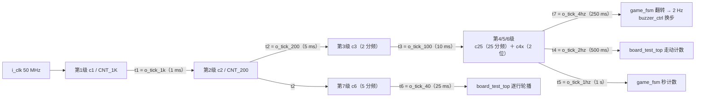

# 时钟与复位 `clk_gen`

> 一句话定位：这一页回答"50 MHz 怎么变成 7 路节拍、复位有几种来源、为什么第 4/5/6 级被合并成一条链"。

`clk_gen` 是**唯一直接面对板级 50 MHz 时钟**的模块（引脚 `PIN_18`）。
它做两件事：**分频**（产生 7 路单拍 `tick`）与**复位**（上电复位 ＋ 按键复位）。
其它 10 个子模块都只吃它吐出来的脉冲，谁也不自己去数 50 MHz ——
这条纪律是整套设计能塞进 127 LAB 的前提之一。

## 一、模块基本信息

| 项 | 值 |
|---|---|
| 子系统 | S1 时钟与复位 |
| 源码 | {{src:rtl/clk_gen.vhd}}（实体在 {{src:rtl/clk_gen.vhd:50}}） |
| 端口 | 10（`i_clk` / `i_btn` ＋ `o_rst` ＋ 7 路 `o_tick_*`） |
| 上游 | 板级晶振（50 MHz）、复位按键 BTN0 |
| 下游 | **所有**模块：`puzzle_top`、`board_test_top`、`keypad_diag_top` 各例化一次（`u_clk`） |
| 核心难点 | ①分频比不能写错（写错整个时基全错，且不报错）；②复位要"上电有效 ＋ 按键有效 ＋ 无幽灵复位"，同时尽量省触发器 |

## 二、端口契约

--8<-- "_generated/ports/clk_gen.md"

关键端口的语义补充：

| 端口 | 周期（板上） | 谁在读它 | 备注 |
|---|---|---|---|
| `o_rst` | — | 每个模块的同步复位端 | **高电平有效**；来源见 §四 |
| `o_tick_1k` | 1 ms | `dot_matrix_scan`（行推进）、`seg_scan`（位选）、`puzzle_ctrl`（引擎行渲染）、`keypad_scan`（1 ms 采样）、`game_fsm`（秒计数） | 全设计最忙的一路 |
| `o_tick_200` | 5 ms | `keypad_scan` 的扫描轮次 | 键盘 200 Hz |
| `o_tick_100` | 10 ms | **端口无人读** | 但内部 `t3` 是第 4/5/6 级链的输入，不是废逻辑 |
| `o_tick_2hz` | 500 ms | **只有 `board_test_top`**（自检走动计数） | ⚠️ **不是**音效节奏：蜂鸣器换步走 `tick_4hz` |
| `o_tick_4hz` | 250 ms | `game_fsm`（翻转出 2 Hz 方波）、`buzzer_ctrl`（`i_t4` 换步） | 见 §五 ERR-038 |
| `o_tick_1hz` | 1 s | `game_fsm` 的秒计数、`disp_format` | |
| `o_tick_40` | 25 ms | **只有 `board_test_top`**（自检逐行轮播点阵） | ⚠️ 曾被评为"已不再使用"，是**错的**，别删 |

!!! quote "为什么每路都做成单拍脉冲"
    本设计只有**一个时钟域**（50 MHz）。用"脉冲 ＋ 同步逻辑"而不是多时钟/门控时钟，
    换来的是 TimeQuest 只需分析一条时钟路径（约束见 {{src:quartus/puzzle.sdc}}），
    代价是每级分频都要自己的计数器。

## 三、分频链与一个完整工作示例



| 级 | 计数器 | 分频常量（`puzzle_pkg`） | 输出 |
|---|---|---|---|
| 1 | `c1`（16 位，要数到 50000） | `CNT_1K = CLK_HZ/1000 - 1` | `o_tick_1k` |
| 2 | `c2`（3 位） | `CNT_200 = 1000/200 - 1` | `o_tick_200` |
| 3 | `c3`（1 位） | — | `o_tick_100` |
| 4/5/6 | `c25`（5 位）＋ `c4x`（2 位） | `CNT_4HZ = 100/4 - 1` | `o_tick_4hz` / `o_tick_2hz` / `o_tick_1hz` |
| 7 | `c6`（3 位，数到 4） | — | `o_tick_40` |

**输入输出示例（上电 → 按键复位；信号名与 `sim/clk_gen.vwf` 一致）**

1. **上电**：`i_btn = '0'`（板卡说明：按键空闲低、按下高）。`por_cnt` 从 0 起每来一个 `t1` 加 1，
   只要 `por_cnt /= CNT_POR` 就有 `s_por = '1'` ⇒ `o_rst = '1'`，系统被按住复位。
2. `por_cnt` 数到 `CNT_POR = T_POR_MS - 1` 后**饱和**，`s_por` 变 `'0'`。
   实测（`r25` 断言④）：`o_rst` 在上电后 **1810 ns（= 9.05 标称 ms）** 释放
   —— 经过 **9** 个 `tick_1k` 而不是 10（见 §四"差一"）。
3. **按下 `i_btn`**：`bcnt` 每 1 ms 加 1，连满 `T_BTN_MS = 20` 才饱和。
   实测（断言⑥）：仿真时间 20000 ns 处按下，`o_rst` 在 23810 ns 置位（Δ = 19.05 标称 ms）。
4. **松开 `i_btn`**：任一拍采到低电平就立刻把 `bcnt` 清零 ⇒ `o_rst` 在一个 1 ms 采样内释放
   （断言⑦实测 Δ = 0.05 标称 ms）。这就是**非对称消抖**：按下要连续 20 个样本，松开立刻生效。
5. **8 拍短毛刺**（断言⑧）：`bcnt` 只到 8，远不到 20 ⇒ `o_rst` 全程 `'0'`，不产生复位。

!!! note "仿真时间 ≠ 板上时间"
    测试台在隔离副本里把 `CLK_HZ` 补丁成 `10_000`（{{src:sim/tb_clk_gen.py:31}}），
    所以**仿真里 1 个标称 ms = 10 个时钟 = 200 ns**。上面的 "1810 ns / 23810 ns"
    是仿真时间，板上对应的是 9 ms / 20 ms 量级。

## 四、复位：两个来源、一个"差一"、两条陷阱

```
o_rst <= s_por or s_btn;      -- 上电复位 或 按键复位
```

| 来源 | 信号 | 判据 | 为什么这么做 |
|---|---|---|---|
| 上电复位（POR） | `por_cnt` → `s_por` | 数 `tick_1k`，到 `CNT_POR` **饱和** | 配置完成后保持约 10 ms 复位；饱和计数**绝不回绕** ⇒ 不会产生幽灵复位 |
| 按键复位（BTN） | `bcnt` → `s_btn` | 连续 20 个 1 ms 样本为高 | 板卡没有消抖电路，必须自己做（要求原文："消抖电路须由用户自行设计"） |

!!! bug "两个真实踩过的坑（都写在源码里）"
    * **释放时间差一**（{{src:rtl/clk_gen.vhd:238}}）：RTL 比较的是
      `CNT_POR = T_POR_MS - 1`，实测因此是 **9** 个 `tick_1k` 而不是 10。
      功能无害（毫秒级时基），所以**保持板上实测行为、只改正注释**；
      要刚好 10 ms 就与 `T_POR_MS` 比较。
    * **位宽悄悄截断**：`por_cnt` 只有 4 位 ⇒ `T_POR_MS ≥ 17` 时 `CNT_POR` 被截断成 0、
      比较恒假、**上电复位直接失效且不报错**（{{src:rtl/clk_gen.vhd:113}}）。
      同理 `bcnt` 是 5 位 ⇒ `T_BTN_MS ≤ 31`。改常量必须同步改位宽。

!!! quote "为什么把消抖移位寄存器换成饱和计数器"
    旧版是 20 位全 1 移位寄存器 ＋ 20 输入与门，而且它**组合地产生 `o_rst`**、
    再扇出到每个寄存器的同步复位端 —— 是全设计**最差路径的源头**。
    换成 5 位饱和计数器后：触发器 20 → 5，判据完全等价，面积与时序同时改善
    （{{src:rtl/clk_gen.vhd:98}}）。

## 五、第 4/5/6 级为什么要合并

`4 Hz / 2 Hz / 1 Hz` 本来就是同一个 100 Hz 网格的 1/25、1/50、1/100，
旧实现用三个独立计数器各数一遍（18 个触发器）。现在只留一个 25 分频 `c25`
＋ 2 位"第几个 4 Hz 脉冲" `c4x`，由它派生三路：**14 个触发器 → 7 个**
（{{src:rtl/clk_gen.vhd:80}}）。周期比完全不变，代价只是三路相对复位时刻的**相位**
最多早一个 4 Hz 周期 —— 对闪烁/音效节奏无影响。

⚠️ 这里正是 **ERR-038（"2 倍算错"）** 的现场：B1 要求自检 **2 Hz** 闪烁，
而"每个 2 Hz 脉冲翻转一次"得到的是 **1 Hz** 方波。修法是**新增 `tick_4hz` 专供翻转**
（而不是改 B1 的期望），所以端口表里同时有 `o_tick_2hz` 与 `o_tick_4hz`
—— 前者给自检走动计数，后者给"翻转成 2 Hz"（{{src:rtl/clk_gen.vhd:160}}）。

## 六、验证与证据

--8<-- "_generated/assertions/clk_gen.md"

<figure markdown="span">
  { loading=lazy }
  <figcaption>
  **图 3.1** `clk_gen` 的 Quartus 波形编辑器实测截图（打开 `sim/clk_gen.vwf` 后 `Ctrl+W` 铺满时间轴）。
  观察信号：`i_clk`、`i_btn`、`o_rst`、`o_tick_1k/200/100/2hz/4hz/1hz`、内部 `t1/t2/t3/t6/t7`、`por_cnt`、`bcnt`。
  预期：7 路 tick 各是**单 clk 周期宽**的脉冲；`por_cnt` 单调到 9 后饱和；`bcnt` 连满 20 饱和、松开归零。
  实测：`r25` 的断言②④⑤⑥⑨⑩（{{fact:sim.modules.clk_gen.passed}} / {{fact:sim.modules.clk_gen.total}} 全过）。
  证据：{{src:sim/rounds/clk_gen/r25.json}}、`sim/clk_gen.vwf`（**既是激励也是结果**）。
  **能证明**：分频比、脉冲宽度、POR 与消抖的行为、饱和/归零语义。
  **不能证明**：板上 50 MHz 晶振的绝对精度、按键真实的电气抖动特性 —— 那属于【板级实测】。
  </figcaption>
</figure>

| 证据类别 | 有什么 | 缺什么 |
|---|---|---|
| 【RTL 仿真】 | `r25` = {{fact:sim.modules.clk_gen.passed}} / {{fact:sim.modules.clk_gen.total}}：脉冲宽度、7 档周期比、级联比、POR、消抖、内部计数器 | — |
| 【编译/STA】 | 合并优化后触发器减少；全设计 setup slack `{{fact:build.sta.setup_slack}}` ns | 没有模块级独立 STA 报告 |
| 【板级实测】 | 复位键可用、点阵/数码管扫描正常（`docs/06`） | **没有**示波器波形与晶振实测 ⇒ "1 ms 就是 1 ms"只有仿真依据 |

## 证据与出处

| 结论 | 依据 |
|---|---|
| 7 路 tick 的周期与各自读者 | {{src:rtl/clk_gen.vhd:13}}；`o_tick_2hz` 的订正见 {{src:rtl/clk_gen.vhd:21}} |
| 级联分频（只有第 1 级见 50 MHz） | {{src:rtl/clk_gen.vhd:5}}、{{src:rtl/clk_gen.vhd:130}} |
| POR 差一（9 而非 10 ms） | {{src:rtl/clk_gen.vhd:238}} |
| `por_cnt`/`bcnt` 位宽截断陷阱 | {{src:rtl/clk_gen.vhd:113}}、{{src:rtl/clk_gen.vhd:107}} |
| 第 4/5/6 级合并（省 11 个触发器） | {{src:rtl/clk_gen.vhd:80}} |
| `tick_2hz` **不是**音效节奏（蜂鸣器走 `tick_4hz`） | {{src:rtl/clk_gen.vhd:21}}、{{src:rtl/buzzer_ctrl.vhd:125}} |
| `tick_40` 仍在用（自检逐行轮播） | {{src:rtl/clk_gen.vhd:61}} |
| 实测数值 | {{src:sim/rounds/clk_gen/r25.json}}、{{src:sim/tb_clk_gen.py}} |
