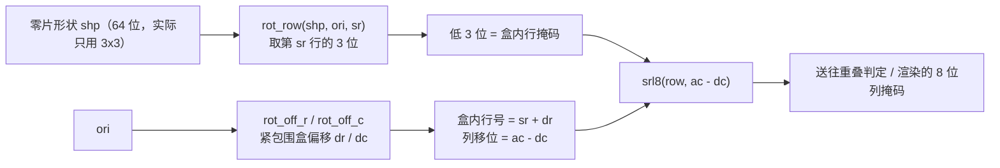

# 设计包 `puzzle_pkg`

> 一句话定位：这一页回答"点阵的 64 位掩码谁定的位序、旋转与移位为什么这么算、为什么这些不该写成模块"。

`puzzle_pkg` 是 `rtl/` 下 **唯一不是模块** 的文件：它没有端口、不被例化，
在 Quartus 的层次树里**找不到它的方框**。但它是整个设计里最重要的一个文件 ——
它把"8×8 点阵怎么用一个 64 位数表示"这件事**只写了一遍**，
之后 11 个子模块、12 个测试台、几何校验脚本都从这里取同一套约定。

!!! quote "为什么必须是 package 而不是 module"
    1. **VHDL-93 的端口不能用匿名数组类型**：`mask_arr_t`/`dim_arr_t` 这类类型必须在一个
       包里声明一次、由所有模块共用（{{src:rtl/puzzle_pkg.vhd:22}}）。做成模块的话，
       类型还是得另找地方声明。
    2. **常量不该走端口**：`L1_TARGET_MASK`、`K_UP`、`CNT_1K` 都是**编译期常量**。
       如果打包成模块，每个消费者都要在端口上连一根"常量线"，
       而综合器本来可以直接把它们折进逻辑 —— 白花引脚与走线。
    3. **纯函数在综合时是免费的**：包里的 12 个函数全部是组合逻辑/常量求值，
       没有任何状态。它们被综合器在调用点**展开**，不产生实例层次。
    4. **它是"改一处、全体同步"的措施**：需求 B4 的图案掩码、
       朝向编码、键码表、音效码表都只在这里各有一份。

## 一、位序约定（全设计的唯一真值源）

这是本页最该记住的一段：**点阵的一个格子 ↔ 64 位掩码的一位**。

| 约定 | 值 | 后果 |
|---|---|---|
| 位序号 | `bit = 8 * row + col` | 每 8 位 = 一行 |
| `bit 0` | **左上角** `(row=0, col=0)` | 掩码的 LSB 在**上边** |
| 行内方向 | 第 0 列是 `bit 0`（**不是**该行的 MSB） | 列号增大 = 位序号增大 |
| 向右移一列 | 把整条 64 位掩码**左移**（`sll`） | 与"MSB 在左"的直觉相反，见下面的坑 |

!!! warning "为什么不能直接对 64 位掩码做 `sll` / 变距离移位"
    * **`sll` 会穿墙**：把 64 位掩码左移 1 位，第 `r` 行最右边的格子会绕到第 `r+1`
      行最左边 —— 经典的"像素穿墙"。必须用逐行清零边界的 `shift_mask`
      （{{src:rtl/puzzle_pkg.vhd:55}}）。
    * **变距离移位在 64 位上极贵**：对 64 位字做 `dc = -2..7` 的移位相当于一个
      64×6 交叉开关；源码注释记着实测 **4690 个逻辑单元** —— 比整颗 EPM1270 还大。
      所以引擎一律"**先取一行（8 位）再移位**"（`srl8`，{{src:rtl/puzzle_pkg.vhd:64}}）。

!!! danger "本包里三个函数**当前没有调用者**"
    `mask_to_px`、`shift_mask`、`row24` 只有声明与函数体，全工程没有任何调用点
    （{{src:rtl/puzzle_pkg.vhd:45}}、{{src:rtl/puzzle_pkg.vhd:55}}、{{src:rtl/puzzle_pkg.vhd:74}}）。
    主路径上的等价功能是 `puzzle_ctrl` **自己的局部函数** `row_mask`
    （{{src:rtl/puzzle_ctrl.vhd:140}}，多了朝向参数、并补回旋转的锚点偏移）。
    它们保留下来是**做离线核对与教学对照**用的，不是死代码漏删 —— 读代码时不要以为
    主路径走了它们。

## 二、类型与子类型

--8<-- "_generated/pkg-types.md"

`dim_arr_t`（4 × 3 位）与 `mask_arr_t`（4 × 64 位）分别是"四块零片的包围盒尺寸"与
"四幅图案掩码"的容器；`state_t` 是主状态机 6 个状态的 3 位子类型，
它让 `case` 语句在综合时被当成完整覆盖（见 [游戏控制](game-control.md)）。

## 三、12 个纯函数

--8<-- "_generated/pkg-functions.md"

!!! note "这张表为什么有 24 行"
    包由"声明部分"与"包体（`package body`）"两段组成，生成脚本对同一个函数
    各列一行（声明 + 实现）。**实际只有 12 个函数**。

| 函数 | 一句话作用 | 主路径在用吗 |
|---|---|---|
| `mk_cell(r, c)` | 造"只含一个格子"的掩码 | ✅ 常量与校验用 |
| `popcount(m)` | 数掩码里 '1' 的个数（自检/离线核对） | ❌ 仅离线 |
| `mask_to_px(r, c)` | 单格绝对坐标 → 64 位掩码（就是独热编码） | ❌ **无调用者** |
| `shift_mask(m, dr, dc)` | 掩码平移并清掉越界位（不穿墙） | ❌ **无调用者** |
| `srl8(r, dc)` | **8 位行**右移 `dc` 列，`dc` 允许负值 | ✅ |
| `row24(shp24, sr, ac)` | 从打包形状取第 `sr` 行、放到锚点列 `ac` | ❌ **无调用者** |
| `rot_row(shp, ori, sr)` | 取旋转后形状的第 `sr` 行（3 位） | ✅ |
| `rot_off_r` / `rot_off_c` | 旋转后**紧包围盒**在 3×3 盒内的偏移 | ✅ |
| `oh` / `ow` | 旋转 90°/270° 时高宽互换 | ✅ |
| `ori_next(ori)` | 下一个朝向（4 次回原样） | ✅ |

## 四、旋转为什么这么绕：在 3×3 盒里转，在"算行掩码"那一级补偏移

零片的包围盒都 ≤ 3×3（`PIECE_MAX_DIM`），朝向只有 4 种。
源码里对比过两种做法（{{src:rtl/puzzle_pkg.vhd:99}}）：

| 做法 | 代价（实测） | 结论 |
|---|---|---|
| 把 24 位形状整个做 4 选 1 置换 | 约 **+190 LE** | 太贵 |
| 每个调用点只对"当前这一行"的 3 个格子做 4:1 mux | 约 **+6 LE** | ✅ 采用 |
| 旋转改在**紧包围盒**里做（每个下标都要 `h-1-c`/`w-1-c` 与范围保护） | 约 **+229 LE**，**直接装不下** | ❌ 否决 |

代价是"转完的紧包围盒不再锚在 (0,0)"：1×3 横条转 90° 会落到盒子的第 2 列。
修法**不是**把旋转改回紧包围盒，而是在**唯一一处**算行掩码的地方把偏移补回来
（{{src:rtl/puzzle_pkg.vhd:106}}）：

```
盒内行号 = 紧包围盒行号 sr + dr
列移位   = 锚点列 ac - dc        （可能为负 ⇒ srl8 多给两档负范围）
```



## 五、常量表

--8<-- "_generated/pkg-constants.md"

!!! warning "读这张表的一个坑"
    「注释」列是生成脚本从源码里**机械抽取的邻近注释**，个别行取到的不是该常量自己的注释
    （例如 `MASK_ZERO` 那行取到的是段落标题）。**逐条语义请以源码为准**；
    几个最关键的（图案掩码、朝向初值、键码、音效码、字位码）在下表里做了对照。

| 常量 | 值 | 含义 |
|---|---|---|
| `L1_TARGET_MASK` | 64 位掩码 | 第一关图 4-1：4 行 × 3 列实心矩形，占第 2..5 行、第 2..4 列（12 格） |
| `L1_P0..L1_P2` | 3 × 64 位 | 第一关三块零片的形状（每块最多 3 行） |
| `L2_PAT0..L2_PAT3` | 4 × 64 位 | 第二/三关共用的图案库（`L2_PATS` 是它的数组形式） |
| `L2_FIXED_PAT` | `"11"` | 第二关**恒锁** PAT3（阶梯，自拟但不随机） |
| `L2_P0..L2_P3` | 4 × 64 位 | 第二/三关四块自拟异形零片 |
| `PIECE_ORI_INIT` | `"10"&"10"&"01"&"01"` | 上电时四块零片的初始朝向（**故意非零**，否则"旋转"这个玩法没被用上） |
| `SEED_DEFAULT` | `x"5A"` | LFSR 复位种子（非零，全零是吸收态） |
| `K_NONE..K_ROT` | 4 位 × 9 | 键码表（见 [键盘输入](keypad-input.md)） |
| `SND_NONE..SND_TIME` | 4 位 × 16 | 音效码表（见 [音效](audio.md)） |
| `DIG_BLANK`…`DIG_I` | 4 位 | 数码管"字位码"：0~9 用 BCD 本身，字母用 ≥10 的码 |

## 六、一个具体例子：读一个格子、转一个零片

**例 1（位序）**：面板第 3 行第 5 列的格子（`row=3, col=5`）对应
`bit = 8*3 + 5 = 29`。要构造"只含这一格"的掩码就是 `mk_cell(3, 5)`，
即把 `bit 29` 置 1。第 3 行（`row=3`）在掩码里是 `mask(31 downto 24)`，
第 5 列是这一段的 `bit 5`（从行首数第 6 位）—— 注意**不是** `bit 2`。

**例 2（旋转 + 偏移，1×3 横条）**：
初始朝向 `ori="00"` 时形状是 1 行 3 列；按一次【旋转】后 `ori="01"`，
它变成 3 行 1 列，**紧包围盒的高宽互换**（`oh`/`ow`），
并且在固定 3×3 盒里落到了第 2 列 —— 这个偏移由 `rot_off_c` 算出、
在"算行掩码"那一级用 `列移位 = ac - dc` 补回来。所以玩家看到的是
"原地转 90°"，而不是"转完凭空横移两格"（第一版正是这个 bug）。

## 七、谁在使用它

15 个实体里 **14 个** `use work.puzzle_pkg.ALL`；唯一的例外是 `buzzer_ctrl`
（它只吃 4 位音效码，不需要包里的任何东西）。核对：

```bash
grep -l "use work.puzzle_pkg" rtl/*.vhd
```

## 证据与出处

| 结论 | 依据 |
|---|---|
| 位序号 `8*row+col`、bit0 = 左上角 | {{src:rtl/puzzle_pkg.vhd:33}} |
| `sll` 穿墙 / 64 位变距离移位要 4690 LE | {{src:rtl/puzzle_pkg.vhd:55}}、{{src:rtl/puzzle_pkg.vhd:64}} |
| 三个函数无调用者、主路径用 `puzzle_ctrl` 的局部 `row_mask` | {{src:rtl/puzzle_pkg.vhd:45}}、{{src:rtl/puzzle_pkg.vhd:74}}、{{src:rtl/puzzle_ctrl.vhd:140}} |
| 旋转的三种做法与实测代价（+190 / +6 / +229 LE） | {{src:rtl/puzzle_pkg.vhd:99}}、{{src:rtl/puzzle_pkg.vhd:106}} |
| 第一关图案 = 图 4-1（4×3 矩形，第 2..5 行 × 第 2..4 列） | {{src:rtl/puzzle_pkg.vhd:153}} |
| 常量/类型/函数的完整清单 | 本页 `--8<--` 引入的三张生成表（由 {{src:scripts/extract_facts.py}} 生成） |
| 「初始朝向是固定的非零值」这一取舍 | {{src:docs/00-规范理解与需求.md}}、{{src:docs/02-模块详细设计.md}} |
