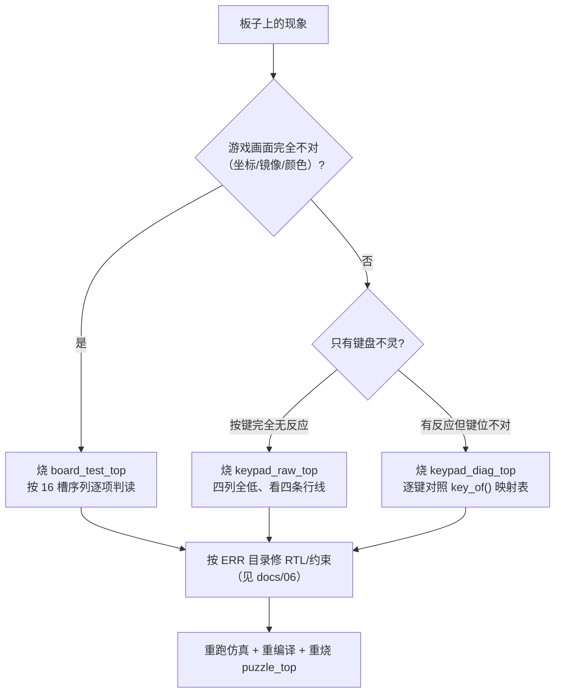

# 诊断顶层：`board_test_top` / `keypad_diag_top` / `keypad_raw_top`

> 一句话定位：这一页回答"出问题时先换哪个顶层、它们各自隔离哪一类假设、历史上靠它们定位过哪些 ERR"。

三个诊断顶层**都不在游戏数据通路上**：它们不例化 `game_fsm`/`puzzle_ctrl`，
也不玩游戏。它们的存在理由是**把"全局性假设"逐个隔离出来** ——
引脚顺序、行列方向、电气极性、时钟档位这些假设只要错一个，
即使游戏逻辑完全正确，画面看起来也是坏的。

!!! quote "为什么诊断固件要单独做顶层，而不是在游戏里加"调试模式""
    * 诊断逻辑与游戏逻辑**不共享模块实例**，出问题时可以排除"游戏代码把它带坏了"；
    * 三者与 `puzzle_top` 一共 4 个顶层，`quartus/puzzle.qsf` 顶部的
      `TOP_LEVEL_ENTITY` 决定**同一时刻只有一个**被编译进去 ⇒ 诊断代码**不占**游戏固件的面积；
    * 诊断顶层的读数**可以被人眼直接判读**（点阵图形、数码管数字），
      不需要仿真器 —— 这正是"板上第一现场"的价值。

## 一、三个顶层各自隔离什么

| 顶层 | 例化子模块 | 隔离的假设 | 读法 |
|---|---|---|---|
| `board_test_top`（{{src:rtl/board_test_top.vhd}}） | 4：`clk_gen`、`keypad_scan`、`dot_matrix_scan`、`seg_scan` | ①`COLR0` 是不是最左列 ②`ROW0` 是不是最上行 ③键盘极性/行列方向 ④时钟选择开关是否在 50 MHz 档 | **16 槽自检序列**（每 3 s 前进一项），序号显示在 8 位数码管上 |
| `keypad_diag_top`（{{src:rtl/keypad_diag_top.vhd}}） | 4：`clk_gen`、`keypad_scan`、`seg_scan`、`dot_matrix_scan` | 只验键盘：按下键 → 数码管显示**键码**，点阵显示原始行列 | 逐键对照 `game_fsm.key_of()` 的映射表 |
| `keypad_raw_top`（{{src:rtl/keypad_raw_top.vhd}}） | 2：`seg_scan`、`dot_matrix_scan` | 最裸的键盘通路：**四列全部驱动为低**，直接显示四条行线电平 | `DISP3..DISP0 = ROW1 ROW2 ROW3 ROW0`；`DISP7` = 子步计数器（证明固件在跑） |

--8<-- "_generated/ports/board_test_top.md"

--8<-- "_generated/ports/keypad_diag_top.md"

--8<-- "_generated/ports/keypad_raw_top.md"

## 二、`board_test_top`：16 槽自检序列

测试序号每 **3 s** 自动前进，所以**烧录一次即可覆盖全部项目**；
`test_idx` 是 **4 位**计数器（15 → 0 回绕，共 16 个槽位），其中 **0..10 已定义**：

| # | 名称 | 显示什么 | 用来判定 |
|---|---|---|---|
| 0 | `CORNERS` | 四个角上的点显示黄色 | 一眼识别**坐标轴镜像**（斜线上的单点有歧义，四个角不会） |
| 1 | `ALL` | 每个点都黄 | 16 个行/列驱动是否都工作 |
| 2 | `FRAME` | 空心矩形，**左上角点为红**、其余边框黄 | 给出"**原点在哪里**"的绝对答案（行方向就是靠它定的） |
| 3 | `RED TOP / GREEN BOTTOM` | 上半红、下半绿 | 把"红/绿组交换"与"行镜像"区分开（两者修法不同） |
| 4 | `WALK` | 单点以 2 Hz 先左→右、再上→下扫过 | 行进方向 |
| 5 | `KEY` | 按下任意键：该键点亮自己的点（按**原始键号**的阅读顺序摆放） | 键盘极性 ＋ 行列方向 |
| 6 | `BUTTON` | **冻结**状态下整屏变黄 | BTN0 通路 |
| 7 | `SEG` | 每 2 s 只驱动一根段线（**绕过译码器**） | 8 根段线 `AA..AP` 的物理顺序 |
| 8 | `DIGIT` | 8 位全段同时点亮（静态 `88888888`） | 共用段线是否全导通、8 位是否都亮 |
| 9 | `KEYPAD` | 点阵最下行显示四条行线实时电平；原始键号查表得到的位置画在点阵网格上 | 键号与物理位置 |
| 10 | `CAT` | `DISP7..DISP0 = 0 1 2 3 4 5 6 7` | **CAT 位选顺序**（0 = `seg_scan` 的 `idx=7` 那一路） |

!!! warning "两处"读不出来"的地方必须说清"
    * **测试 8 读不出 CAT 位选顺序**：位选始终由 `seg_scan` 自己的扫描计数器决定，
      该模块**没有位选旁路端口**（{{src:rtl/seg_scan.vhd:170}}）—— 所以才有测试 10；
    * **测试 6 不能写成"按住 BTN0"**：BTN0 按住 ≥20 ms 会拉起 `rst`，
      而 `rst` 会把点阵驱动器输出清零（按住期间全灭），
      所以"按住才变黄"这个图案**在板上永远看不见**（{{src:rtl/board_test_top.vhd:36}}）。

!!! note "BTN0 的两种用法由 `clk_gen` 的 20 ms 复位滤波自然分开"
    * **短按**（松手时仍没到 20 ms）→ **冻结 / 解冻**（冻结后序号不再前进，便于长时间观察一项）；
    * **长按**（≥20 ms）→ **复位**（序号回到 0，**冻结期间不清**）；长按**不会**顺带切换冻结。
    这也是 `clk_gen` 的非对称消抖（按下要连满 20 个 1 ms 样本、松开立刻生效）
    在板上的直接用途。

## 三、诊断顶层定位过的真实故障

| ERR | 问题 | 是哪个顶层定位的 |
|---|---|---|
| **ERR-001** | `btn`（复位键）引脚**漏配** → 静默落到任意空闲引脚 | 生成器端口表漏列 ⇒ `board_test_top` 的 BTN0 通路不对 |
| **ERR-002** | 键盘诊断固件**漏配键盘引脚**（"本次最长的一次误判"）：`keypad_diag_top`/`keypad_raw_top` 在生成器的 `TOP_PORTS` 里没列 `kp_row`/`kp_col`，引脚处于未约束状态，fitter 把它们放到任意空闲引脚（49、102、130、88…）—— 能编译能运行，只是读错了引脚 | `keypad_raw_top`（把 fitter 的 `.pin` 报告与手册交叉核对） |
| **ERR-011** | 2 Hz 闪烁信号是**单时钟脉冲** → "自检什么都不显示" | `board_test_top` 的闪烁类测试 |
| **ERR-039** | `board_test_top` 自检画面**上下镜像**：`row_idx=0` 切到 `px(63..56)`，与同文件"bit0 = 左上角"的约定相反 | `board_test_top` 自己（测试 0/2 的图形） |

!!! quote "ERR-002 的教训为什么值得单独记"
    诊断固件**自己**的引脚约束漏洞，会让"每个键盘结果都毫无意义" ——
    在实验台上，这与"硬件坏掉"**无法区分**。
    修法不只改了生成器的 `TOP_PORTS`，还加了一条**机器门禁**
    {{src:scripts/check_keypad_pins.py}}：把 fitter 报告里的实际引脚与手册逐条对账，
    让这类"静默落错脚"再也过不了。完整复盘见 {{src:docs/06-硬件调试记录.md}} 的 ERR-002。

## 四、与游戏顶层的区别（一句话记住）

| | `puzzle_top` | 三个诊断顶层 |
|---|---|---|
| 在数据通路上吗 | ✅ 是 | ❌ **不是** |
| 例化 `game_fsm`/`puzzle_ctrl` 吗 | ✅ | ❌ |
| 玩得了游戏吗 | ✅ | ❌（键盘诊断只显示键码） |
| 引脚绑定 | 与 `.qsf` 一起，52 个引脚 | 同一份 `.qsf`，但**顶层选择**不同（`TOP_LEVEL_ENTITY`） |
| 由谁用 | 交付/演示 | 上板调试第一现场 |

## 五、验证与证据（以及**缺失证据**）

!!! danger "这三个顶层**没有**仿真测试台，也没有 Quartus GUI 波形"
    12 个被仿真覆盖的模块是 11 个游戏子模块 ＋ `puzzle_top`；
    三个诊断顶层**不在** `sim/rounds/` 里（{{tree:sim/rounds}} 下没有对应目录）。
    它们的证据只有两类：

    * **编译级**：`quartus_map` 能过、引脚约束能对上（`scripts/check_keypad_pins.py` 是门禁）；
    * **板级**：烧录后**人眼读图**（点阵图形 / 数码管数字），结论记录在
      {{src:docs/06-硬件调试记录.md}} 的 ERR 条目里。

    **缺失的是**：可复现的仿真证据 —— 也就是说，诊断顶层的行为**无法在仓库里被自动复算**，
    只能靠当年那次上板观察的文字记录。这是本项目证据链里**明确的一块缺口**，
    报告里必须如实写明（不要用"编译通过"或"游戏顶层仿真通过"来替代）。

| 项 | 有什么 | 缺什么 |
|---|---|---|
| 编译 | 三者都能单独作为顶层编译通过；引脚约束有 `check_keypad_pins.py` 门禁 | 没有入库的模块级 `map.rpt` 快照 |
| 板级 | ERR-001/002/011/039 的复盘记录、行方向结论（`ROW0` 在最下） | **没有**照片/视频，也没有示波器波形 |
| 仿真 | — | ⚠️ **没有测试台、没有 `.vwf` 轮次记录**（见上面的 danger 块） |

## 证据与出处

| 结论 | 依据 |
|---|---|
| 为什么需要自检顶层（四条全局假设） | {{src:rtl/board_test_top.vhd:5}} |
| 16 槽测试序列与各项判读方法 | {{src:rtl/board_test_top.vhd:16}} |
| BTN0 短按冻结 / 长按复位 | {{src:rtl/board_test_top.vhd:56}} |
| `keypad_raw_top` 的做法与显示布局 | {{src:rtl/keypad_raw_top.vhd:15}} |
| 三个顶层的例化关系与端口数 | `book/docs/_generated/hierarchy.md`、`book/docs/_generated/ports/*.md` |
| ERR-001 / ERR-002（引脚漏配） | {{src:docs/06-硬件调试记录.md}}（ERR-001、ERR-002 小节） |
| ERR-039（自检画面上下镜像） | {{src:docs/06-硬件调试记录.md}}（ERR-039 行） |
| 引脚约束门禁 | {{src:scripts/check_keypad_pins.py}} |
| 顶层选择（`TOP_LEVEL_ENTITY`）与 52 引脚 | {{src:quartus/puzzle.qsf}} |
| 生成器为什么必须列出诊断顶层的键盘端口 | {{src:scripts/gen_project.py}} 的 `TOP_PORTS` |
