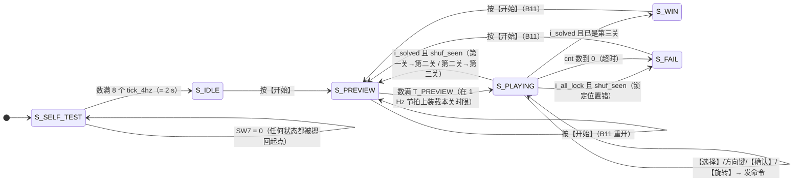

# 游戏控制 `game_fsm`

> 一句话定位：这一页回答"游戏有哪几个状态、按键怎么变成引擎命令、倒计时与 2 Hz 闪烁是怎么来的"。

`game_fsm` 掌管**时间与决策**，不掌管任何坐标：每个空间问题都交给 `puzzle_ctrl`
（[拼图引擎](puzzle-engine.md)）。它是全设计端口第二多的模块（25 个），
也是唯一"随时可以被【开始】打断"的状态机（需求 B11）。

## 一、模块基本信息

| 项 | 值 |
|---|---|
| 子系统 | S3 游戏控制 |
| 源码 | {{src:rtl/game_fsm.vhd}}（实体在 {{src:rtl/game_fsm.vhd:54}}） |
| 端口 | 25：时钟/复位/SW7 ＋ 2 路 tick ＋ 键盘 ＋ 15 个输出 ＋ 3 个来自引擎的输入 |
| 上游 | `clk_gen`（`tick_1hz`/`tick_4hz`）、`keypad_scan`（`i_key`/`i_press`）、`puzzle_ctrl`（`i_solved`/`i_all_lock`/`i_shuf_busy`） |
| 下游 | `puzzle_ctrl`（选中/移动/锁定/旋转/**散落请求**）、`disp_format`（状态/关卡/倒计时/闪烁）、`buzzer_ctrl`（音效码） |
| 核心难点 | ①判决必须"等本局散落跑过"（ERR-024）；②散落用**电平握手**而不是单拍脉冲；③每一处面积都要量（本器件 127 LAB 已满） |

## 二、端口契约

--8<-- "_generated/ports/game_fsm.md"

关键端口的语义补充：

| 端口 | 语义 |
|---|---|
| `i_sw`（SW7） | 系统开关。`'0'` 时整个 FSM 被摁回 `S_SELF_TEST` 起点（B1），重新打开总是从头来 |
| `o_go` | **电平**（不是单拍）：散落请求，配合引擎的 `i_shuf_busy` 构成请求/应答握手 |
| `o_sel`/`o_conf`/`o_move`/`o_up`..`o_rot` | **单拍脉冲**：只在 `S_PLAYING` 且收到 `i_press` 时产生 |
| `o_time(5:0)` | 倒计时秒数，就是内部 `cnt` |
| `o_blink` | 2 Hz、50% 占空的方波（不是 tick 脉冲，见 §五 ERR-038） |
| `o_sound(3:0)` | 4 位音效码；对局中默认码 = `"10" & lvl3 & level`（按关卡选背景音乐） |

## 三、状态机：6 个状态与全部转移条件

| 状态 | 编码（`state_t`） | 停留条件 | 离开条件 |
|---|---|---|---|
| `S_SELF_TEST` | `"000"` | 倒计数数满 **8 个 `tick_4hz`** = 2 s | 计数到 0 → `S_IDLE` |
| `S_IDLE` | `"001"` | 无限（待机，数码管显示 `DISP7=5`、`DISP0=level`） | 按【开始】 |
| `S_PREVIEW` | `"010"` | **`(4, 5] s`**（`T_PREVIEW = 5`，入口与 1 Hz 节拍错相） | 计时到 1 → 装载本关时限 → `S_PLAYING` |
| `S_PLAYING` | `"011"` | **30 / 40 / 60 s**（第一/二/三关） | 过关、判负、超时 |
| `S_WIN` | `"100"` | 显示胜利图案（绿对勾） | 按【开始】 |
| `S_FAIL` | `"101"` | 显示失败图案（红叉） | 按【开始】 |

!!! warning "三处"时长口径"必须说精确"
    * **预览**：倒计时按**自由走**的 1 Hz 节拍递减，而入口是按键（与节拍错相）
      ⇒ 窗口是 `(T_PREVIEW-1, T_PREVIEW] = (4, 5] s`，**不是**"恒 5 s"。
    * **对局限时**：时限是在"预览结束的那个 1 Hz 节拍"上装载的，起点与节拍**对齐**
      ⇒ 窗口**恰好**是 `T_LEVEL*` 秒（`r36` 的 ⑪b 就是按 `o_time = 60` 判第三关）。
    * **自检**：窗口是"数满 8 个 `tick_4hz`"，而 `tick_4hz` 同样自由走
      ⇒ 复位路径 ≈2.000 s、SW7 重入路径落在 **(1.75, 2.0] s**。
      所以只能说"**恒为 8 个旋律步、恰好一声**"，**不要说"时长恒为 2 s"**
      （ERR-051 的教训：绝对说法要逐路径验，{{src:rtl/game_fsm.vhd:165}}）。

## 四、按键 → 命令：一张表管两处

键盘上报的是朴素索引 `4*行+列`，**唯一**的译码点是 `key_of()`
（{{src:rtl/game_fsm.vhd:143}}）：

| 物理键 | 索引 `i_key` | 译码 `kdec` | 效果 |
|---|---|---|---|
| KEY14（控制区左下） | `"0001"` | `K_START` | 状态机层：待机→预览；**任何状态**都能重开（B11） |
| KEY16（控制区右下） | `"0011"` | `K_SELECT` | `o_sel` 单拍：循环切换选中的零片（B6） |
| KEY11（十字中心） | `"0110"` | `K_CONFIRM` | `o_conf` 单拍：锁定选中零片（B8） |
| KEY7（十字上臂） | `"1010"` | `K_UP` | `o_up` ＋ `o_move` 单拍（B7） |
| KEY15（十字下臂） | `"0010"` | `K_DOWN` | `o_down` ＋ `o_move` |
| KEY10（十字左臂） | `"0101"` | `K_LEFT` | `o_left` ＋ `o_move` |
| KEY12（十字右臂） | `"0111"` | `K_RIGHT` | `o_right` ＋ `o_move` |
| KEY8（【上】右边） | `"1011"` | `K_ROT` | `o_rot` 单拍（提高要求 A4：90° 旋转） |
| KEY13 | `"0000"` | — | ⚠️ **不可用**：没有按键时扫描器也上报 `0000`，无法区分，绝不能给它功能 |

!!! bug "ERR-024：判决必须等本局的散落跑过"
    引擎的 `locked/pos` **只在散落（`i_go`）时清零**，所以刚进 `S_PLAYING` 的那一两拍，
    `i_solved`/`i_all_lock` 反映的还是**上一局**的残留状态。旧实现无条件采信它们，
    于是"上一局拼对 → 新一局刚开局就过关"，上板现象是
    **"第一关拼好按确认出叉，退出重进又直接跳第二关"**。
    修法是加记忆位 `shuf_seen`：**本局至少看见过一次 `i_shuf_busy='1'`，判决才被允许**
    （{{src:rtl/game_fsm.vhd:226}}）。仿真证据：`tb_game_fsm` 断言⑯⑰
    （修复前 `r07` = 15/17 —— 对局开始 3 拍就跳走了）。

!!! quote "散落为什么用**电平**握手而不是单拍脉冲"
    `o_go` 置起后一直保持，直到引擎用 `i_shuf_busy='1'` 应答；并且用 `go_done`
    记住"本局已请求过"。没有 `go_done` 时，握手会在引擎一回到空闲就**重新触发**，
    引擎被反复散落、永远忙、任何按键都不起作用（{{src:rtl/game_fsm.vhd:421}}）。
    电平握手的好处是**散落无论要花多久都不会被漏掉**。

## 五、音效选择：16 个码与三层优先级

| 优先级 | 条件 | 码 |
|---|---|---|
| 1（瞬时事件） | `i_solved` 且 `shuf_seen` | `SND_CLEAR`（过关，上行音） |
| 1 | `i_all_lock` 且 `shuf_seen` | `SND_WRONG`（锁定但画面错，下行音） |
| 2（保持期） | `snd_hold ≠ 0` | 保持上一拍的码，每 `tick_4hz` 递减一次（共 2 个旋律步 = 250~500 ms） |
| 3（场景默认） | 其余 | `S_SELF_TEST`→`SND_SELF`；`S_PREVIEW`→`SND_PREVIEW`；`S_PLAYING`→`"10" & lvl3 & level`；`S_WIN`→`SND_WIN`；`S_FAIL`→`SND_FAIL`；待机→`SND_NONE` |

!!! quote "对局默认码为什么能"纯拼线、0 逻辑单元""
    三关背景音乐的码是 `1000`/`1001`/`1011` —— 正好等于 `"10" & lvl3 & level`
    （{{src:rtl/game_fsm.vhd:570}}）。两个位直接来自既有寄存器，
    不需要额外逻辑；为了凑出这个规律，**码表把第三关的曲子放在 `1011`、
    把旋转音挪到 `1010`**（{{src:rtl/puzzle_pkg.vhd:573}}）。

!!! bug "三次用户反馈的演进（别把中间态当最终态）"
    * **第 16 工作阶段第一轮**："上下左右不需要额外音效" ⇒ 移动/选择/开始静音，保留确认 `1100` 与旋转 `1010`；
    * **第 16 工作阶段第二轮**：内容换成马里奥系曲子（码不变）；
    * **第 18 工作阶段**："确认、旋转没必要有特殊音效来打扰背景音乐" ⇒ **对局中任何按键都不发声**，
      原来的 `case kdec` 音效分支整段删除（净省逻辑）。
    * 第 15 工作阶段还**删掉过**"最后 5 秒每秒催一下"的分支：加完三关 BGM 后整机
      1267 LE 却要 **128~129 个 LAB**（瓶颈是 127 LAB），拿掉这一支后
      **1261 LE / 127 LAB / 51.77 MHz** 才装回去（{{src:rtl/game_fsm.vhd:531}}）。
    * ⚠️ "移动/旋转被拒绝"的专用音效（原计划 `SND_NAK`）**做了又撤了**：需要引擎多一个
      `o_nak` ＋ 这里多一级优先分支，实测 **+5 LE 且把最差路径拖垮**（1268 → 1273 LE / 128 LAB，装不下）。
      `puzzle_pkg` 里**没有** `SND_NAK`（码 `1101` 已改作 `SND_SEL`），
      `buzzer_ctrl` 里也**没有** NAK 乐句 —— 将来要接回得重新加常量 ＋ 乐句 ＋ 查表臂。

!!! note "ERR-039c（已记录、未修）"
    判决音效的门控只用了 `shuf_seen`，没有额外检查"这一拍是不是真的结算拍"。
    当前不影响功能（结算拍本身就是 `shuf_seen='1'` 之后才可能出现），
    按"不为无收益的改动重跑整套证据"的纪律保留现状。

## 六、一个完整示例：从待机到打赢第一关

| 步 | 触发 | 内部动作 | 观察到的输出 |
|---|---|---|---|
| 1 | 上电（`i_rst` 释放，SW7=1） | `st=S_SELF_TEST`、`cnt=7` | `o_state="000"`、`o_blink` 2 Hz、`o_sound=SND_SELF`（POST 单声） |
| 2 | 8 个 `tick_4hz`（2 s）后 | `cnt` 数到 0 → `st=S_IDLE` | `o_state="001"`、`o_sound=SND_NONE`（静音） |
| 3 | 按【开始】（`i_press=1, kdec=K_START`） | `cnt=5`（T_PREVIEW）、`level=0`、`lvl3=0` | `o_state="010"`、`o_sound=SND_PREVIEW` |
| 4 | 每来一个 `tick_1hz`，`cnt-1`；到 `cnt<=1` | 装载 `T_LEVEL1=30` → `st=S_PLAYING` | `o_state="011"`、`o_level='0'`、`o_time=30`、背景音乐码 `1000` |
| 5 | 散落握手 | `req_go=1` → 引擎 `i_shuf_busy=1` → `req_go<=0`、`go_done<=1`、`shuf_seen<=1` | `o_go` 先高后低（**电平**，不是脉冲） |
| 6 | 按【选择】 | `sel_r=1` | `o_sel` 单拍（1 clk），引擎把选中零片循环到下一块 |
| 7 | 按【上】 | `up_r=1; move_r=1` | `o_move` ＋ `o_up` 各一拍；引擎判越界/重叠后才真的移动 |
| 8 | 按【确认】 | `conf_r=1` | `o_conf` 一拍；引擎判"零片是否完全落在目标上" → 锁定 |
| 9 | 四块都锁定且都在目标上 | 引擎给 `i_solved='1'`；FSM 里 `level <= '1'`、`cnt=5` | `o_state` 回到 `"010"`（第二关预览）、`o_level='1'` |
| 10 | 超时（`cnt<=1` 且来 1 Hz）或"锁满但位置错" | `st=S_FAIL` | `o_state="101"`、`o_sound=SND_FAIL`、`o_blink` 闪烁 |
| 11 | 在 `S_WIN`/`S_FAIL` 按【开始】 | `cnt=5`、`level=0`、`lvl3=0` → `S_PREVIEW` | 新一局（B11） |

## 七、验证与证据

--8<-- "_generated/assertions/game_fsm.md"

<figure markdown="span">
  { loading=lazy }
  <figcaption>
  **图 3.3** `game_fsm` 的 Quartus 波形编辑器实测截图（`sim/game_fsm.vwf`）。
  观察信号：`i_sw`、`i_press`、`i_key`、`o_state`、`o_level`、`o_lvl3`、`o_time`、`o_go`、`i_shuf_busy`、`i_solved`、`i_all_lock`、`o_sound`、`o_blink`。
  预期：自检 8 拍后进待机；【开始】→ 预览 `(4,5] s` → 对局；`o_go` 是**电平**且每局只请求一次；`o_time` 按 30/40/60 装载。
  实测：`r36` 的 30 条断言全过（{{fact:sim.modules.game_fsm.passed}} / {{fact:sim.modules.game_fsm.total}}）。
  证据：{{src:sim/rounds/game_fsm/r36.json}}、`sim/game_fsm.vwf`。
  **能证明**：状态迁移、计时装载、命令脉冲、音效码、判决门控（`shuf_seen`）。
  **不能证明**：板子上按键的真实手感与玩家体验 —— 那属于【板级实测】。
  </figcaption>
</figure>

| 证据类别 | 有什么 | 缺什么 |
|---|---|---|
| 【RTL 仿真】 | `r36` = {{fact:sim.modules.game_fsm.passed}} / {{fact:sim.modules.game_fsm.total}}：状态迁移、三关时限、`o_go` 握手、ERR-024 场景（断言⑯⑰）、闪烁与音效码 | — |
| 【编译/STA】 | 取舍带来的面积变化（`docs/05` §1.4 的负结果） | 无模块级 STA 报告 |
| 【板级实测】 | 三关流程走过、按键音消失（用户第 18 工作阶段反馈） | 没有帧率/延迟实测；"2 Hz 闪烁"只有仿真与肉眼观察 |

## 证据与出处

| 结论 | 依据 |
|---|---|
| 状态流程与需求编号（B1~B11） | {{src:rtl/game_fsm.vhd:8}} |
| 三关口径（`level` ＋ `lvl3` 两位，而不是加宽 `o_level`） | {{src:rtl/game_fsm.vhd:31}} |
| 键盘映射表与 `key_of()` | {{src:rtl/game_fsm.vhd:90}}、{{src:rtl/game_fsm.vhd:143}} |
| ERR-024（`shuf_seen` 门控判决） | {{src:rtl/game_fsm.vhd:226}} |
| `o_go` 电平握手与 `go_done` | {{src:rtl/game_fsm.vhd:421}} |
| ERR-038（2 Hz 由 `tick_4hz` 翻转） | {{src:rtl/game_fsm.vhd:213}} |
| ERR-051 修法（复用 `cnt` 倒计数、三条进入路径同一窗口） | {{src:rtl/game_fsm.vhd:165}} |
| 音效码、三次反馈演进、被撤的 `SND_NAK`、被删的"最后 5 秒" | {{src:rtl/game_fsm.vhd:468}} |
| 实测数值 | {{src:sim/rounds/game_fsm/r36.json}}、{{src:sim/tb_game_fsm.py}} |
