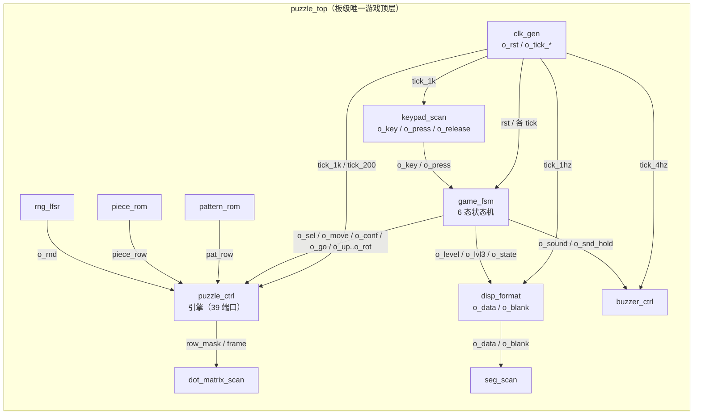

# 模块设计总览

> 一句话定位：这一页回答"整个设计由哪些模块组成、谁例化谁、按什么顺序读、每个模块的一行职责是什么"。

整个 RTL 只有 **16 个 VHDL 文件**：**15 个实体（`entity`）** ＋ **1 个设计包（`package`）**。
按"跑不跑游戏"分成三档：

| 档 | 数量 | 是谁 | 在不在游戏数据通路上 |
|---|---|---|---|
| 游戏顶层 | 1 | `puzzle_top`（引脚绑定在它身上） | ✅ **是**，板子上正常跑的就是它 |
| 游戏子模块 | 11 | S1~S7 七个子系统（见 §一） | ✅ 是，被 `puzzle_top` 例化 |
| 诊断顶层 | 3 | `board_test_top`、`keypad_diag_top`、`keypad_raw_top` | ❌ **不在**，单独编译、单独烧录的调试脚手架 |
| 设计包 | 1 | `puzzle_pkg`（不是模块，没有端口） | — 只是常量/类型/纯函数 |

!!! quote "为什么要切得这么细"
    目标器件 MAX II `{{fact:design.device}}` 只有 1270 个逻辑单元，而**真正的瓶颈是 127 LAB**
    —— 最终用满 `{{fact:build.fit.lab}}`。把"分频 / 键盘 / 状态机 / 引擎 / 查表 / 显示 / 音效"
    彻底切开，换来三件事：**每个模块能单独仿真**（12 个测试台、{{fact:sim.totals.assertions}} 条断言）、
    **面积能按模块归因**（哪个模块吃 LAB 一目了然）、**改坏一个不会连累全部**。
    代价是顶层要写 11 条例化与一批"胶水"信号，见 [顶层集成](top-level.md)。

## 一、分区：11 个游戏子模块

子系统编号 S1~S7 在整套文档里通用（`facts/facts.json` 与 `puzzle_pkg` 注释同源）。

| 子系统 | 模块 | 源码 | 端口 | 一行职责 | 详见 |
|---|---|---|---|---|---|
| **S1 时钟与复位** | `clk_gen` | {{src:rtl/clk_gen.vhd}} | 10 | 单 50 MHz 时钟 → 7 路单拍 `tick` ＋ 上电复位/按键复位 | [时钟与复位](clock-reset.md) |
| **S2 键盘输入** | `keypad_scan` | {{src:rtl/keypad_scan.vhd}} | 9 | 4×4 矩阵扫描（200 Hz）→ 消抖 → 键码 `K_*` ＋ 单次按下脉冲 | [键盘输入](keypad-input.md) |
| **S3 游戏控制** | `game_fsm` | {{src:rtl/game_fsm.vhd}} | 25 | 6 态状态机：自检 → 待机 → 预览 → 对局 → 胜/负；发命令、管倒计时 | [游戏控制](game-control.md) |
| **S4 拼图引擎** | `puzzle_ctrl` | {{src:rtl/puzzle_ctrl.vhd}} | 39 | 散落零片、移动/旋转的越界与重叠判定、锁定与整帧判据 | [拼图引擎](puzzle-engine.md) |
| **S5 图案与零片数据** | `pattern_rom` | {{src:rtl/pattern_rom.vhd}} | 3 | 按图案号查 8 行目标掩码 | [图案与随机数](pattern-random.md) |
| | `piece_rom` | {{src:rtl/piece_rom.vhd}} | 5 | 按（形状，朝向）查 4 行零片掩码 | 同上 |
| | `rng_lfsr` | {{src:rtl/rng_lfsr.vhd}} | 4 | 8 位 LFSR 伪随机序列（周期 255），给散落与抽图案用 | 同上 |
| **S6 显示输出** | `disp_format` | {{src:rtl/disp_format.vhd}} | 7 | 状态 → 8 位数码管内容 `o_data` ＋ 熄灭掩码 `o_blank` | [显示输出](display.md) |
| | `seg_scan` | {{src:rtl/seg_scan.vhd}} | 10 | 8×4 BCD → 七段码，1 kHz 位选扫描 | 同上 |
| | `dot_matrix_scan` | {{src:rtl/dot_matrix_scan.vhd}} | 9 | 8×8 双色点阵行扫描（125 Hz/行）＋ 双缓冲 | 同上 |
| **S7 音效** | `buzzer_ctrl` | {{src:rtl/buzzer_ctrl.vhd}} | 6 | 4 位音效码 → 16 步乐句 → 方波；三关 BGM 与胜负号角 | [音效](audio.md) |

!!! note "为什么 S5 是三个小模块而不是一个"
    `pattern_rom`（49 行）、`piece_rom`（61 行）、`rng_lfsr`（55 行）加起来不到 200 行，
    但三者的**读者**完全不同：图案库只被顶层 `pat_sel` 与引擎的整帧判据读，
    零片库被引擎的"取一行"读，LFSR 被引擎的散落与顶层的抽关读。
    分开写的好处是**综合器能把两个 ROM 各自推成查找表**，而不是合成一大块 mux
    —— 这在 LAB 满仓时是决定性的（见 [资源预算](../02-architecture/resource-budget.md)）。

## 二、谁例化谁

`puzzle_top` 例化 11 个子模块；3 个诊断顶层各自例化 4/4/2 个。诊断顶层与游戏顶层
**不共享任何模块实例**，也不在同一个数据通路上。

--8<-- "_generated/hierarchy.md"

## 三、四个顶层怎么选

一个工程同一时刻**只有一个顶层**，`quartus/puzzle.qsf` 顶部的 `TOP_LEVEL_ENTITY` 决定是谁。
诊断顶层是"临时把 `puzzle_top` 换掉"的调试入口，不常驻：

| 顶层 | 例化数 | 用来干什么 | 什么时候用 |
|---|---|---|---|
| `puzzle_top` | 11 | **正常游戏**：键盘 + 点阵 + 数码管 + 蜂鸣器全流程 | 交付/演示 |
| `board_test_top` | 4 | 16 槽硬件自检：逐项点亮点阵/数码管/蜂鸣器（`test_idx` 走 `BTN0`） | 怀疑硬件接线/外设时 |
| `keypad_diag_top` | 4 | 只验键盘：按下键 → 数码管显示键码，点阵显示原始行列 | 怀疑键盘或引脚锁定时 |
| `keypad_raw_top` | 2 | 最裸的键盘通路：直接显示 `o_raw`（行/列电平），不经消抖 | 怀疑消抖逻辑本身时 |

三者的细节、以及它们分别定位过哪些真实故障，见 [诊断顶层](diagnostic-tops.md)。

## 四、每个模块的"证据入口"

每一页的"验证与证据"一节都指向下面这三样之一，**不要靠叙述，靠记录**：

| 证据 | 位置 | 说明 |
|---|---|---|
| 测试台 + 断言 | `sim/tb_<模块>.py` | 每条断言的判据与实测值 |
| 最新有效轮次 | `sim/rounds/<模块>/rNN.json` | 该轮的 16 个 RTL 指纹 ＋ 逐条断言结果 |
| 波形 | `sim/<模块>.vwf` / GUI 截图 | `.vwf` **既是激励也是结果**（Quartus 回写） |

--8<-- "_generated/sim-rounds.md"

!!! danger "这一页的轮次表**不能**用来证明"板子上是这一版""
    仿真证据只能证明**逻辑在激励覆盖范围内正确**。板级行为必须另有烧录 + 读回校验，
    见 [上板验证与缺失证据](../06-verification/board-validation.md)。
    本设计**没有真实硬件照片**（`book/docs/assets/hardware/` 为空），
    所以"点阵真的亮成那样"这句话在文档站里只由 **GUI 仿真截图** 支撑，两者不能混为一谈。

## 五、建议阅读顺序

先读"底座"再读"业务"：`puzzle_pkg` 里的位序约定是后面所有模块的共同前提，
跳过它会在 `puzzle_ctrl` 的位运算里迷路。

| 顺序 | 页面 | 读完能回答 |
|---|---|---|
| 1 | [设计包 puzzle_pkg](design-package.md) | 8×8 点阵的 64 位掩码、零片坐标、位序谁说了算 |
| 2 | [时钟与复位](clock-reset.md) | 50 MHz 怎么变成 7 路 tick，复位有几种来源 |
| 3 | [键盘输入](keypad-input.md) | 物理按键怎么变成 `K_*` 与单拍 `o_press` |
| 4 | [图案与随机数](pattern-random.md) | 三关图案从哪来、零片形状与朝向怎么编码 |
| 5 | [游戏控制](game-control.md) | 6 个状态怎么走、按键怎么变成引擎命令 |
| 6 | [拼图引擎](puzzle-engine.md) | 重叠/越界/锁定/整帧判据怎么算，为什么塞得进 |
| 7 | [显示输出](display.md) | 状态怎么变成数码管与点阵上的颜色 |
| 8 | [音效](audio.md) | 音效码 → 乐句 → 方波 |
| 9 | [顶层集成](top-level.md) | 11 条例化、52 个引脚、9 个"没人读"的信号 |
| 10 | [诊断顶层](diagnostic-tops.md) | 出问题时先换哪个顶层 |

## 六、数量口径（避免和别处对不上）

| 项 | 值 | 出处 |
|---|---|---|
| VHDL 文件 | 16 | `facts/facts.json` → `sources.rtl` |
| 实体 | 15（11 模块 ＋ 3 诊断顶层 ＋ 1 游戏顶层） | 同上 |
| 设计包 | 1 | 同上 |
| 被仿真覆盖的模块 | {{fact:sim.totals.modules}} | `sim/rounds/` |
| 断言 | {{fact:sim.totals.assertions}}（全通过） | 同上求和 |
| 器件 / 工具 | `{{fact:design.device}}` / `{{fact:design.tool}}` | `quartus/puzzle.qsf` |

## 证据与出处

| 结论 | 依据 |
|---|---|
| 16 文件 = 15 实体 + 1 包；每个实体的端口数与例化关系 | `facts/facts.json`（{{src:scripts/extract_facts.py}} 从 `rtl/` 抽出） |
| 子系统 S1~S7 的归属 | 各模块源码头部注释，例如 {{src:rtl/clk_gen.vhd:14}}、{{src:rtl/puzzle_ctrl.vhd:28}} |
| 资源与瓶颈 | {{src:quartus/build_provenance.json}} → `fit.le` / `fit.lab` |
| 12 个模块的最新轮次与断言 | `sim/rounds/`（每轮 JSON 记有源码指纹） |
| 顶层选择与引脚绑定 | {{src:quartus/puzzle.qsf}} |
