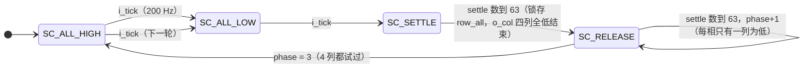

# 键盘输入 `keypad_scan`

> 一句话定位：这一页回答"4×4 矩阵键盘怎么扫、消抖为什么是 4 轮 40 ms、`o_press` 到底在哪一拍出现"。

`keypad_scan` 是整个项目**唯一的输入通道** —— 也是历史上出缺陷最多的地方
（`docs/06` 里 ERR-004/026/030/036/039 都与它有关）。它的输出不是"按键事件"，
而是**朴素的键号 `o_key = 4*行 + 列`** 与两个单拍脉冲 `o_press` / `o_release`；
把键号解释成"开始 / 上 / 旋转"是 `game_fsm.key_of()` 的职责
（见 [游戏控制](game-control.md)）。这条分工让"换键位"只需改一个函数。

## 一、模块基本信息

| 项 | 值 |
|---|---|
| 子系统 | S2 键盘输入 |
| 源码 | {{src:rtl/keypad_scan.vhd}}（实体在 {{src:rtl/keypad_scan.vhd:52}}） |
| 端口 | 9：`i_clk`/`i_rst`/`i_tick` ＋ `i_row(3:0)` / `o_col(3:0)` ＋ `o_key`/`o_press`/`o_release`/`o_raw` |
| 上游 | `clk_gen.o_tick_200`（扫描节拍）、键盘矩阵的行线（`PIN_111..114`） |
| 下游 | `game_fsm`（`i_key`/`i_press`）；`o_col` 回键盘矩阵（`PIN_117..120`） |
| 核心难点 | ①列识别不能"只认最后一列"；②消抖必须按**轮**算（一轮 10 ms 而不是 5 ms）；③多键与悬空时必须"看不清就不报"，不能合成鬼键 |

## 二、端口契约

--8<-- "_generated/ports/keypad_scan.md"

| 端口 | 语义（本页补充） |
|---|---|
| `i_row(3:0)` | 矩阵行线，**低有效**（`KP_ACTIVE = '0'`）；`i_row(0)` 接 `PIN_111` = 丝印 **ROW0（最下一行）** |
| `o_col(3:0)` | 列驱动，**低有效**；`SC_ALL_LOW` 时四列全 `'0'`（`o_col = "0000"`） |
| `o_key(3:0)` | **被消抖接受的**键号 `4*行 + 列`；无键时 `K_NONE = "0000"` |
| `o_press` | **单 clk 周期**脉冲：接受一个新键（或换到另一个键）时出现一次 |
| `o_release` | **单 clk 周期**脉冲：从"有键"回到"无键"时出现一次 |
| `o_raw(3:0)` | 调试旁路：**实时**列驱动（= 组合的 `col_drv`，未打拍），给 `keypad_raw_top` 用 |

!!! warning "`o_col` 与 `o_raw` 不是一回事"
    `o_col` 在 `SC_ALL_LOW`/`SC_SETTLE` 期间是 `"0000"`（四列同时低），
    在 `SC_RELEASE` 期间是"只有 phase 选中的一列为低"；
    `o_raw` **永远**是那个组合的 `col_drv`（不做全低覆盖）。
    调试顶层用 `o_raw` 就是为了看见"到底是哪一列在动"。

## 三、扫描方案：为什么是"全列拉低 → 逐列释放"

实验台上试过两种方案（{{src:rtl/keypad_scan.vhd:18}}）：

| 方案 | 做法 | 问题 |
|---|---|---|
| (a) 列优先 | 每个相位只把一列驱动为低，然后读行 | 一条行线只在自己那列被驱动时才被读 ⇒ **一列接线坏掉就静默丢整列键** |
| **(b) 全列拉低**（采用） | 先四列全低读行（定行），再"每次只有一列低"读行（定列） | 一列坏掉最多丢一个**列号**，键**仍然能被检测到** |

一轮扫描 = `SC_ALL_HIGH` → `SC_ALL_LOW` → `SC_SETTLE` → `SC_RELEASE`(4 相) → 回到 `SC_ALL_HIGH`。
两个 `i_tick`（`tick_200`）之间的 `SC_SETTLE`/`SC_RELEASE` 各用 `settle` 计数 0..63
（`settle` **只有 6 位**，见 §六的面积说明）来等列驱动稳定。

!!! quote "为什么列结果要**累加**而不是每相覆盖"
    `SC_RELEASE` 的每一相都回答"被按的键在不在这一列"。早先的实现每个相位都覆盖
    同一个寄存器 ⇒ 只有**最后一列**能被识别出来（第一关的三个键全都报同一个键号）。
    现在用 `col_low(c)` 逐相置位、最后取"最后一个命中的列"。

## 四、一个完整示例：按下【上】键

目标键是十字的上臂 **KEY7**，物理上落在 **行 2（`ROW2`）× 列 2（`COL2`）**
（映射表见 {{src:rtl/game_fsm.vhd:130}} 的键盘图；`game_fsm.key_of()` 把
`"1010"` 解释成 `K_UP`，{{src:rtl/game_fsm.vhd:143}}）。

| 步 | 模块状态 | 关键信号实测/推导 | 说明 |
|---|---|---|---|
| 1 | `SC_ALL_LOW` | `o_col = "0000"`（四列全低） | 键把 `COL2` 与 `ROW2` 短接 ⇒ `i_row(2)` 被拉低 |
| 2 | `SC_SETTLE` | `settle: 0→63`，末尾锁存 `row_all = "1011"` | 只有第 2 位是 `'0'`（`KP_ACTIVE`） |
| 3 | 组合判据 | `nrow = 1`、`crow = 2` ⇒ `hit = '1'` | 必须**恰好一行**低（ERR-036），否则算"没有键" |
| 4 | `SC_RELEASE` phase=0 | `col_drv = "1110"`（只有列 0 低），`i_row(2) = '1'` ⇒ `col_low(0)` 保持 `'0'` | 键不在列 0 |
| 5 | phase=1 | `col_drv = "1101"`，`i_row(2) = '1'` ⇒ `col_low(1) = '0'` | 不在列 1 |
| 6 | phase=2 | `col_drv = "1011"`，`i_row(2) = '0'` ⇒ **`col_low(2) <= '1'`** | 键在列 2 |
| 7 | phase=3 | `col_drv = "0111"`，`i_row(2) = '1'` ⇒ `col_low(3) = '0'` | 不在列 3 |
| 8 | 组合判据 | `ccol = 2`（取最后一个命中列；一列都没命中则回退列 0） | 见 §五 ERR-036b |
| 9 | → | `cand = 4*2 + 2 = 10 = "1010"` | **键号 = 4\*行 + 列** |
| 10 | 消抖 | 连续 **4 轮** `cand` 都是 `"1010"` 才认（`cnt` 数到 `DEBOUNCE_MAX=3`） | 4 轮 × 10 ms = **40 ms** |
| 11 | → | `stable = "1010"`，`key_r <= stable`，`press_r = '1'`（**单 clk 周期**，20 ns） | `o_key` 保持 `"1010"` 直到松开 |
| 12 | 松开 | 某轮 `cand = K_NONE` 且 `stable` 随之变 `K_NONE` ⇒ `release_r = '1'` | 与 `o_press` 成对（断言③⑤） |

仿真实测（`r27`，{{src:sim/tb_keypad_scan.py}}）：`o_press` 落在 **11T**（上电后第一个键）
与 **103T**（第二个键）、`o_release` 落在 **63T / 143T**，每个脉冲宽度恰好 1 个时钟；
其中 `T = 8 µs`（仿真）代表板上 5 ms —— 换算后**按下到 `o_press` ≈ 55 ms（首键）/45 ms**。

!!! bug "ERR-036：上电后的第一个键曾被提前一轮接受"
    旧实现里 `row_all` **没有初值、复位分支也不赋值**，上电后是确定的 `0`，
    而 `'0'` 的每一位都等于 `KP_ACTIVE` ⇒ 旧判据（取"最后一行为低"）会先造出一个
    "第 3 行被按下"的幻影候选，把消抖计数预置成 1 —— **第一个键只要 3 轮（30 ms）就被接受**。
    修法两条：①声明与复位分支**显式**写出默认值；
    ②判据改成"必须**恰好一行**被拉低"（全 0 与全 1 都判为"没有键"）。
    测试台断言⑨因此从 `9T` 改成 `11T`（{{src:rtl/keypad_scan.vhd:85}}）。

!!! bug "ERR-036b：为什么**故意不**要求"恰好一列""
    整机测试台的行激励窗口（`SETTLE` 段一直拉到 +1400 ns）会让 **phase 0 也采到一次"行低"**，
    于是 `col_low` 同时命中两列。取"最后一个命中"（当前语义）得到的正是**真实按下的那一列**；
    改成"必须恰好一列"会把按键**全部丢成 `K_NONE`**（实测整机断言①③④…全部失败）。
    要收严这一条，必须先修 ERR-039b（`SC_RELEASE` 相 0 只有 1 拍、采样恰好落在相切换那一拍）
    并把两个测试台的按键窗口整体重新标定（{{src:rtl/keypad_scan.vhd:242}}）。

## 五、消抖与"按住只动作一次"

| 量 | 值 | 依据 |
|---|---|---|
| 每轮扫描 | 2 × `tick_200` = **10 ms** | `SC_ALL_HIGH` 与 `SC_ALL_LOW` 各等一个 `i_tick` |
| 接受所需轮数 | **4 轮**（`DEBOUNCE_MAX + 1`） | 连续 4 个**相同**候选 |
| 按下到 `o_press` | ≈ **40~55 ms**（首键 55 ms / 后续键 45 ms） | `r27` 断言⑨（旧的"16 轮 × 5 ms = 80 ms"少算一倍，真实曾是 160 ms） |
| 短按 3 轮 | **不产生** `o_press` | `r27` 断言⑦（消抖有效） |
| 按住不放 | 只产生 **1 次** `o_press`；换到另一个键算一次**新的**按下 | `r27` 断言④ |

!!! quote "为什么按键释放是"立刻生效"而按下要消抖 40 ms"
    松开的抖动不会让游戏误动作，但**多报一次按下**会（比如把"确认"多按一次）。
    所以按下方向消抖从严、松开方向从宽 —— 与 `clk_gen` 的复位消抖同一种非对称策略。

## 六、为省面积做过的两处"位宽手术"（都经过等价性证明）

| 手术 | 原来 | 现在 | 收益 |
|---|---|---|---|
| `settle` 计数器 | 8 位（高 2 位恒 0） | **6 位**（0..63） | 模块内少 12 个 LC，整机 **−7 LE**。Quartus **不做值域分析**，那 2 个触发器是真花钱的 |
| `cnt` 消抖计数器 | 8 位（高 6 位恒 0） | **2 位**（0..`DEBOUNCE_MAX`=3） | 少 6 个触发器 |
| 接受/释放分支 | 三条 `if/elsif` 分别改 `key_r` | 无条件 `key_r <= stable` ＋ 两条件 | 对 `(stable, key_r)` 全部 **256** 组取值逐一比对，0 处不一致 |

!!! warning "改这两个位宽时必须同步改常量"
    `settle` 判据是 `settle = 63`（6 位刚好够）；`cnt` 必须满足
    `位宽 = ceil(log2(DEBOUNCE_MAX+1))` —— 否则 `cnt = DEBOUNCE_MAX` 恒不成立、
    **消抖永远接受不了按键**（与 `clk_gen` 的 `T_BTN_MS`/`por_cnt` 同类陷阱，
    {{src:rtl/keypad_scan.vhd:104}}）。

## 七、验证与证据

--8<-- "_generated/assertions/keypad_scan.md"

<figure markdown="span">
  { loading=lazy }
  <figcaption>
  **图 3.2** `keypad_scan` 的 Quartus 波形编辑器实测截图（`sim/keypad_scan.vwf`）。
  观察信号：`i_row(3:0)`、`o_col(3:0)`、`o_raw`、`phase`、`settle`、`cnt`、`row_all`、`col_low`、`stable`、`key_r`、`o_key`、`o_press`、`o_release`。
  预期：一轮扫描里 `SC_ALL_LOW` 四列全低、`SC_RELEASE` 四个相各只有一列为低；`o_press` 是**单 clk 周期**脉冲；短按 3 轮不产生脉冲。
  实测：`r27` 的 9 条断言全过（{{fact:sim.modules.keypad_scan.passed}} / {{fact:sim.modules.keypad_scan.total}}）。
  证据：{{src:sim/rounds/keypad_scan/r27.json}}、`sim/keypad_scan.vwf`。
  **能证明**：扫描相序、列识别累加、消抖轮数、`o_press`/`o_release` 的单拍语义。
  **不能证明**：真实矩阵键盘的接触电阻与抖动波形 —— 那是【板级实测】（用户已按 KEY14/KEY16 复核过两处键位）。
  </figcaption>
</figure>

| 证据类别 | 有什么 | 缺什么 |
|---|---|---|
| 【RTL 仿真】 | `r27` = {{fact:sim.modules.keypad_scan.passed}} / {{fact:sim.modules.keypad_scan.total}}：无键、按住、松开、短按、换键、消抖轮数、脉冲宽度 | — |
| 【编译/STA】 | 两处位宽手术的面积收益（见 {{src:docs/05-资源利用与编译报告.md}}） | 无模块级 STA 报告 |
| 【板级实测】 | 键位实测复核（`KEY14`=开始、`KEY16`=选择）、真实按键可用 | **没有**键盘电气波形；多键同时按下的行为只有"看不清就不报"的设计约定 |

## 证据与出处

| 结论 | 依据 |
|---|---|
| 扫描方案 (a)/(b) 的取舍与理由 | {{src:rtl/keypad_scan.vhd:18}} |
| 键号 `o_key = 4*行 + 列`（本模块只报朴素编号） | {{src:rtl/keypad_scan.vhd:9}} |
| 键号 → `K_*` 的映射（含 KEY7=上、KEY8=旋转） | {{src:rtl/game_fsm.vhd:143}}、{{src:rtl/game_fsm.vhd:130}} |
| 消抖 = 4 轮 × 10 ms、旧口径 160 ms | {{src:rtl/keypad_scan.vhd:38}} |
| ERR-036（幻影候选）与"恰好一行"判据 | {{src:rtl/keypad_scan.vhd:85}} |
| ERR-036b（故意不校验"恰好一列"） | {{src:rtl/keypad_scan.vhd:242}} |
| 两处位宽手术与 256 组等价性证明 | {{src:rtl/keypad_scan.vhd:76}}、{{src:rtl/keypad_scan.vhd:104}}、{{src:rtl/keypad_scan.vhd:299}} |
| 实测数值（11T / 103T / 63T / 143T） | {{src:sim/rounds/keypad_scan/r27.json}}、{{src:sim/tb_keypad_scan.py}} |
| 引脚（ROW0..3 / COL0..3） | {{src:quartus/puzzle.qsf}}、{{src:docs/06-硬件调试记录.md}} |
