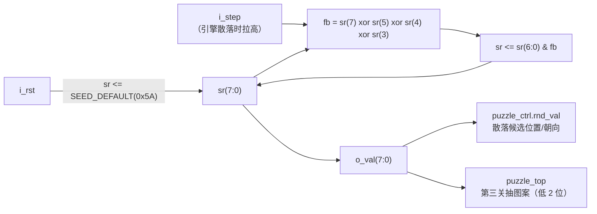

# 图案与随机数：`pattern_rom` / `piece_rom` / `rng_lfsr`

> 一句话定位：这一页回答"三关的图案从哪来、零片形状与朝向怎么编码、随机数为什么只在需要时才走一步"。

这三个模块加起来不到 200 行，却是**全部几何事实的来源**：
图案、零片形状、包围盒尺寸、随机序列。它们都只做一件事 —— **查表或推一步**，
不做任何判定（判定在 [拼图引擎](puzzle-engine.md)，常量在 [设计包](design-package.md)）。

## 一、模块基本信息

| 模块 | 子系统 | 源码 | 端口 | 类型 | 一句话职责 |
|---|---|---|---|---|---|
| `pattern_rom` | S5 | {{src:rtl/pattern_rom.vhd}} | 3 | 纯组合 | `(i_level, i_pat)` → 目标图案掩码 `o_mask(63:0)` |
| `piece_rom` | S5 | {{src:rtl/piece_rom.vhd}} | 5 | 纯组合 | `i_level` → **一次给全部四块**的形状/高/宽/块数 |
| `rng_lfsr` | S5 | {{src:rtl/rng_lfsr.vhd}} | 4 | 时序 | 8 位最大长度 LFSR；只在 `i_step` 时推进一步 |

上游：`puzzle_top`（`pat_sel` 锁存、`i_level`）；下游：`puzzle_ctrl`（图案、形状、随机值）。
三者**互相不知道对方存在**，都由顶层连接。

## 二、端口契约

--8<-- "_generated/ports/pattern_rom.md"

--8<-- "_generated/ports/piece_rom.md"

--8<-- "_generated/ports/rng_lfsr.md"

!!! quote "`piece_rom` 为什么"一次返回四块"而不是"给我第 k 号""
    引擎每一帧本来就需要**全部**形状。如果做成"按 k 取一块"，引擎就得把该 ROM
    **例化四次** —— 那等于在 `puzzle_ctrl` 里塞进一个隐藏模块，
    破坏"系统框图与代码一致"这条规则（{{src:rtl/piece_rom.vhd:5}}）。
    现在的签名 `o_mask : mask_arr_t`（4×64 位）一次给全，代价是 3 个额外输出端口。

## 三、三关的图案与零片（几何真值表）

| 关口 | `i_level` | 目标图案 | 图案来源 | 零片 | 格数 | 初始朝向 |
|---|---|---|---|---|---|---|
| 第一关 | `'0'` | `L1_TARGET_MASK`（图 4-1：4 行 × 3 列实心矩形，第 2..5 行 × 第 2..4 列） | 课程 PDF 图 4-1 逐像素解码（{{src:.ref/solve_l1.py}}） | `L1_P0..L1_P2`（3 块；第 4 槽 `MASK_ZERO`） | 3 + 6 + 3 = **12** | `PIECE_ORI_INIT` 的对应两位 |
| 第二关 | `'1'` | `L2_PATS(L2_FIXED_PAT)` = **PAT3（阶梯）** | 自拟（B10 说"自拟"= 设计者自定，不是随机） | `L2_P0..L2_P3`（4 块异形） | 3 + 2 + 5 + 6 = **16** | 同上 |
| 第三关 | `'1'`（`lvl3='1'`） | `L2_PATS(rng_lfsr 低 2 位)` —— 四幅里**随机选** | 自拟（A2"多种拼图图案随机选择"） | 同上（沿用第二关四块） | **16** | 同上 |

* **第一关只有一幅**：`i_level='0'` 时 `pattern_rom` **忽略** `i_pat`（{{src:rtl/pattern_rom.vhd:44}}）。
* **第二/三关共用图案库**：`L2_PATS = (L2_PAT0..L2_PAT3)` 共 4 幅，"哪一幅"由顶层
  `pat_sel` 锁存进程决定（第二关恒 `L2_FIXED_PAT`，第三关取 `rng_lfsr` 低 2 位）。
  `pattern_rom` **故意保持"按 `i_pat` 选"这一条通路不变**，只是调用方给的 `i_pat` 变了。
* **所有零片都装进 3×3**（`PIECE_MAX_DIM = 3`）：这是引擎"只扫 3×3 邻域"的前提。
* `o_n`（本关块数）= 第一关 `"011"`（3）、第二/三关 `"100"`（4）⇒ 一帧拍数 `8×(npc+2)`
  = 40 / 48 拍（见 [拼图引擎](puzzle-engine.md)）。

!!! quote "为什么用"掩码"而不是"坐标表""
    * 引擎的重叠判定与渲染本来就是**按行做 8 位掩码相与**，掩码是同一个表示法：
      "这块零片在第 r 行占哪几列"= 一个 8 位数。
    * 掩码全是**编译期常量** ⇒ 综合成纯 LUT：源码注释记着 `piece_rom` 0 LE、`pattern_rom` 4 LE。
    * 坐标表则需要**变址读取**：实测 v3（变址数组循环）比 v4（固定移位 + 多路器）更贵
      （2995 LE vs 2350 LE，见 {{src:rtl/puzzle_ctrl.vhd:5}}）。

!!! warning "`L1_TGT*` / `L2_TGT*` / `L2_PAT3_TGT*` **不再是成功判据**"
    它们是"旋转见证"——记录每组朝向里"必须用到旋转才能铺满"的那一种。
    **ERR-021 之后判据改成比画面**，所以这些常量只剩两个用途：
    ①给测试台的走法计划用（`tb_puzzle_ctrl`/`tb_puzzle_top` 的旋转步骤）；
    ②离线核对。**不要**把它们当成"正确解"（{{src:rtl/puzzle_pkg.vhd:333}}）。

## 四、随机数：只在需要时走一步

| 项 | 值 | 依据 |
|---|---|---|
| 位宽 | 8 位 | `sr : std_logic_vector(7 downto 0)` |
| 多项式 | `x⁸ + x⁶ + x⁵ + x⁴ + 1`（Xilinx xapp052 的 8 位标准抽头） | `fb = sr(7) xor sr(5) xor sr(4) xor sr(3)` |
| 周期 | **255**（最大长度）；全零是吸收态 ⇒ 复位强制非零 | {{src:rtl/rng_lfsr.vhd:5}} |
| 种子 | `SEED_DEFAULT = x"5A"` | {{src:rtl/puzzle_pkg.vhd:504}} |
| 推进方式 | **不自由运行**：只有消费者拉高 `i_step` 才走一步 | {{src:rtl/rng_lfsr.vhd:8}} |

!!! quote "为什么不让它自由跑"
    自由运行的随机源会让**散落无法复现、无法仿真**，而且白耗电。需求 A3（随机散落）
    只在**关卡开始**的时刻需要随机性 —— 所以做成"按需推进一步"的同步握手：
    引擎在 `SH_TRY` 里拉高 `rnd_step`，下一拍读 `rnd_val`（{{src:rtl/puzzle_ctrl.vhd:874}}）。
    第三关抽图案也只用低 2 位（四幅库）。

**输入输出示例（三个模块串起来的一拍）**

1. 第三关开局，`piece_rom` 收到 `i_level='1'` ⇒ 立刻给出 `o_mask = (L2_P0..L2_P3)`、
   `o_h = ("001","010","011","011")`、`o_w = ("011","001","011","011")`、`o_n = "100"`。
2. `rng_lfsr`：`sr` 从 `0x5A` 开始，每收到一次 `i_step`（来自引擎的 `rnd_step`）
   就做一次 `sr <= sr(6 downto 0) & fb`。若结果全零（本多项式不会，
   但代码仍防御性地重置）则回到 `SEED_DEFAULT`。
3. `pattern_rom`：`puzzle_top` 把 `rng_lfsr` 的低 2 位锁存成 `pat_sel`，
   再作为 `i_pat` 送进 `pattern_rom` ⇒ `o_mask = L2_PATS(i_pat)` ⇒ 这一局的第三关图案。
4. `puzzle_ctrl` 每拍只用 `o_mask` 的一行与候选块的行掩码相与 ⇒ 判"重叠/到位"。

## 五、"初始朝向固定、不做随机"是**验证过的取舍**

提高要求 A3 原文只要求"位置随机、方向随机"。本设计的取舍是：**位置随机 ✅ / 初始朝向随机 ❌**。

!!! quote "为什么可以不做"初始朝向随机""
    * A4 实现之后，玩家**可以自己把零片转成任意朝向** ⇒ "方向"这件事在玩法上已经完备；
    * 初始朝向我取 `PIECE_ORI_INIT = "10"&"10"&"01"&"01"`（**故意非零**），
      这样"旋转"这个玩法从第一关第一秒就被用上 —— 这是**实现"旋转必需"的手段**；
    * 若开局让朝向随机：四份走法计划（`scripts/check_plans.py` 与整机仿真共用）全部失效，
      需要按随机初始朝向**用带旋转的 A\* 重解一遍**（`rot` 的位置都会变），收益不抵工作量
      （{{src:docs/00-规范理解与需求.md}} A3 行）。
    * 图案库的硬约束（每幅必须能被四块零片**只许平移**恰好铺满）由
      {{src:scripts/check_geometry.py}} 穷举复核；"先旋转再平移"的可解性另有
      `.ref/solve_l1.py` 的逐位解码作证。

## 六、验证与证据

--8<-- "_generated/assertions/pattern_rom.md"

--8<-- "_generated/assertions/piece_rom.md"

--8<-- "_generated/assertions/rng_lfsr.md"

<figure markdown="span">
  { loading=lazy }
  <figcaption>
  **图 3.5** `pattern_rom` 的 Quartus 波形编辑器实测截图（`sim/pattern_rom.vwf`）。
  观察信号：`i_level`、`i_pat`、`o_mask`。
  预期：`i_level='0'` 时 `o_mask` 恒为 `L1_TARGET_MASK`（`i_pat` 被忽略）；`i_level='1'` 时随 `i_pat` 在四幅库里切换。
  实测：`r21` 的 8 条断言全过（{{fact:sim.modules.pattern_rom.passed}} / {{fact:sim.modules.pattern_rom.total}}）。
  证据：{{src:sim/rounds/pattern_rom/r21.json}}、`sim/pattern_rom.vwf`。
  **能证明**：选择逻辑与掩码取值。**不能证明**：图案"好不好看"、以及可解性（那由 `check_geometry.py` 的穷举负责）。
  </figcaption>
</figure>

<figure markdown="span">
  { loading=lazy }
  <figcaption>
  **图 3.6** `rng_lfsr` 的 Quartus 波形编辑器实测截图（`sim/rng_lfsr.vwf`）。
  观察信号：`i_step`、`sr`、`o_val`。
  预期：不拉 `i_step` 时 `sr` 不动；每次拉高走一步；复位回到 `0x5A`；周期 255 且不出现全零。
  实测：`r23` 的 10 条断言全过（{{fact:sim.modules.rng_lfsr.passed}} / {{fact:sim.modules.rng_lfsr.total}}）。
  证据：{{src:sim/rounds/rng_lfsr/r23.json}}、`sim/rng_lfsr.vwf`。
  **能证明**：抽头/周期/播种/按需推进。**不能证明**：随机性在统计意义上的质量（教学用 LFSR，不用于密码学）。
  </figcaption>
</figure>

| 证据类别 | 有什么 | 缺什么 |
|---|---|---|
| 【RTL 仿真】 | `pattern_rom r21` = {{fact:sim.modules.pattern_rom.passed}}/{{fact:sim.modules.pattern_rom.total}}；`piece_rom r23` = {{fact:sim.modules.piece_rom.passed}}/{{fact:sim.modules.piece_rom.total}}；`rng_lfsr r23` = {{fact:sim.modules.rng_lfsr.passed}}/{{fact:sim.modules.rng_lfsr.total}} | — |
| 【编译/STA】 | 两个 ROM 被推成常量/查找表（0 LE / 4 LE） | 无模块级独立报告 |
| 【板级实测】 | 第三关图案确实会变（肉眼观察） | 没有"图案分布均匀性"的实测统计 |

## 证据与出处

| 结论 | 依据 |
|---|---|
| `pattern_rom` 的通路与"第二/三关共用库" | {{src:rtl/pattern_rom.vhd:16}}、{{src:rtl/pattern_rom.vhd:44}} |
| `piece_rom` 一次返回四块的理由与格数 | {{src:rtl/piece_rom.vhd:5}}、{{src:rtl/piece_rom.vhd:11}} |
| LFSR 抽头、周期 255、按需推进、非零防御 | {{src:rtl/rng_lfsr.vhd:5}}、{{src:rtl/rng_lfsr.vhd:43}} |
| 图案/零片常量的实际取值 | `book/docs/_generated/pkg-constants.md`（{{src:scripts/extract_facts.py}} 生成） |
| `L2_FIXED_PAT` 与三关口径 | {{src:rtl/puzzle_pkg.vhd:251}}、{{src:rtl/game_fsm.vhd:31}} |
| 旋转见证常量不再是判据（ERR-021） | {{src:rtl/puzzle_pkg.vhd:333}} |
| 可解性穷举 | {{src:scripts/check_geometry.py}}、{{src:.ref/solve_l1.py}} |
| 「初始朝向固定不做随机」的取舍 | {{src:docs/00-规范理解与需求.md}}（A3 行）、{{src:docs/02-模块详细设计.md}} |
| 实测数值 | {{src:sim/rounds/pattern_rom/r21.json}}、{{src:sim/rounds/piece_rom/r23.json}}、{{src:sim/rounds/rng_lfsr/r23.json}} |
