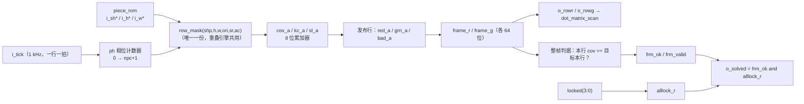
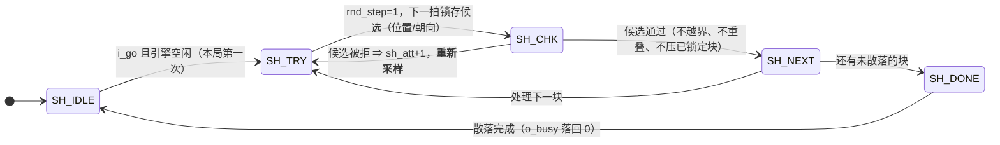

# 拼图引擎 `puzzle_ctrl`

> 一句话定位：这一页回答"重叠/越界/锁定/整帧判据怎么算、为什么这样能塞进 EPM1270"。

`puzzle_ctrl` 是全设计**端口最多（39 个）、行数最多（1130 行）**的模块，
也是唯一"每一拍只算一行"的模块。它掌管一切与**空间**有关的事
（零片在哪、是否重叠、是否到位），但**不持有任何游戏时序** ——
"什么时候散落、什么时候判负"是 `game_fsm` 的事。

## 一、模块基本信息

| 项 | 值 |
|---|---|
| 子系统 | S4 拼图引擎 |
| 源码 | {{src:rtl/puzzle_ctrl.vhd}}（实体在 {{src:rtl/puzzle_ctrl.vhd:60}}） |
| 端口 | 39：时钟/复位/渲染节拍 ＋ 4 块形状与尺寸（4×64 位 ＋ 8×3 位）＋ 图案/关卡 ＋ 6 条命令 ＋ 4 路随机 ＋ 9 个状态输出 ＋ 2 个 64 位帧输出 |
| 上游 | `game_fsm`（命令 ＋ 散落请求）、`piece_rom`（形状/尺寸）、`pattern_rom`（目标图案）、`rng_lfsr`（`rnd_val`）、`clk_gen`（`tick_1k`） |
| 下游 | `dot_matrix_scan`（`o_rowr`/`o_rowg` 两帧）、`game_fsm`（`o_solved`/`o_all_lock`/`o_busy`）、`disp_format` |
| 核心难点 | ①一拍只算一行、组合路径只有 8 位宽；②精确重叠（不能用包围盒）；③成功率判在**拼出来的画面**上（ERR-021） |

## 二、端口契约

--8<-- "_generated/ports/puzzle_ctrl.md"

关键端口的语义补充：

| 端口 | 语义 |
|---|---|
| `i_tick` | **行渲染节拍**，顶层给 `tick_1k`（1 kHz，与点阵扫描同源同速）。一帧 = 8 行 × (npc+2) 拍 ⇒ 内容 **25 / 21 Hz** |
| `i_sh0..i_sh3` / `i_h*` / `i_w*` | 四块零片的 64 位形状与 3 位包围盒高/宽（来自 `piece_rom`） |
| `i_target` | 本关目标图案（来自 `pattern_rom`，由 `(i_level, i_pat)` 决定） |
| `i_go` | **电平**散落请求（每局一次，见 [游戏控制](game-control.md) 的握手） |
| `rnd_step` / `rnd_val` | 向 `rng_lfsr` 要一个随机字节：拉高 `rnd_step` 推进一步，下一拍读 `rnd_val` |
| `o_rowr` / `o_rowg` | **红/绿帧寄存器本身就是输出**（各 64 位），点阵按 `o_scanrow` 切片显示 |
| `o_scanrow` | 当前正在扫描的行（0..7），给点阵模块做行选择 |
| `o_solved` | **画面 == 目标 且 全部锁定**（见 §五 ERR-021） |
| `o_all_lock` | 全部锁定 **且** 已有一个"干净且完整"的帧把画面判据算完 |

## 三、为什么是"行扫描渲染器"（v1→v5 的实测代价）

| 版本 | 做法 | 实测代价 |
|---|---|---|
| v1 | 每块零片做 64 位可变距离移位 | **4690 LE** |
| v2 | 逐行 `CASE` 辅助函数做 8 位行移位 | 2969 LE |
| v3 | 变址数组读取的循环 | 2995 LE |
| v4 | 固定移位的 64 位占位寄存器 ＋ 渲染多路器 | 2350 LE（504 寄存器 ＋ 1717 纯 LUT） |
| **v5（采用）** | **每个扫描节拍只渲染一行** | 见 {{src:docs/05-资源利用与编译报告.md}} |

!!! quote "代价不在"某条语句写得糟"，而在"每块零片都保存 64 位占位""
    回答"这块零片是否覆盖第 r 行第 c 列"其实只需要一个 8 位与门；
    而 64 位版本为了得到答案，**先把整个掩码生成出来**。
    点阵驱动本来就是一拍扫一行，所以"只算即将显示的那一行"**不额外花任何代价**：
    每一次配色判断都只有 8 位宽（{{src:rtl/puzzle_ctrl.vhd:5}}）。

!!! warning "一处必须说准的措辞（源码自己纠过一次）"
    文件头曾写"引擎不保存任何 64 位的东西"——**是错的**：引擎内部确实有
    `frame_r`/`frame_g`（各 64 位，共 128 个触发器）。真正成立的说法是
    **"每一拍的组合计算路径只有 8 位宽"**（{{src:rtl/puzzle_ctrl.vhd:27}}）。
    ⚠️ 另外源码 {{src:rtl/puzzle_ctrl.vhd:374}} 的审计更正段里仍留着"顶层 `i_tick` 接
    `tick_200`"的旧说法，与端口注释（{{src:rtl/puzzle_ctrl.vhd:64}} 写 1 kHz）
    以及顶层连接（`i_tick => t_1k`）矛盾 —— 本页以**端口注释 ＋ 顶层连接**为准（1 kHz）。

## 四、内部工作原理：相位流水与累加器

一拍只算一块零片，四块算完才发布这一行：

| `ph` | 动作 |
|---|---|
| `0` | 准备第 0 块的行掩码（`bp`/`sp`/`op`） |
| `1..npc` | 累加第 `ph-1` 块：把 `bp` 按 `sp` 移位后并进 `cov_a`/`kc_a`/`sl_a`，同时准备下一块 |
| `npc+1` | **发布本行**：算 `red_a`/`grn_a`/`bad_a`，交给下一拍并进帧 |

* **`npc`**：第一关 3 块、第二/三关 4 块（`i_level` 决定）⇒ 一帧 `8×(npc+2)` = **40 / 48 拍**
  = **40 / 48 ms**（`i_tick` = 1 kHz）⇒ 内容刷新 **25 / 21 Hz**，而显示扫描是 125 Hz，
  两者不同源也不会错行，因为整帧存在 `frame_*` 里、顶层只按 `mrow` 切片（ERR-027）。
* **颜色**：绿 = 选中的零片 **或** 任一已锁定零片；红 = 不属于选中零片的其它零片格子；
  锁定 = 红 **AND** 绿 = 黄。其余任何目标图案的格子显示为**红色虚影**。
* **串行化的收益**：原来一拍里四块各算一次 `row_mask`（4 份 8 位桶形移位器），
  拿掉 3 份省 **131 LE**；但 A4 旋转要吃回 **+62 LE**。
  现在只留**一份** `row_mask`，还能与重叠引擎共用（{{src:rtl/puzzle_ctrl.vhd:251}}）。

## 五、判决：为什么比"画面"而不是比"零片编号"

!!! bug "ERR-021：拿锚点编号和写死的目标比较，会把等价铺法判成失败"
    * 第二关四块是**完全相同**的 2×2 方块，填满 4×4 的摆法有 `4! = 24` 种，
      画面逐格都一样，而锚点判据只认其中 1 种 ⇒ 拼对了按【确认】仍然出叉；
    * 第一关 4×3 矩形也有 **2 种**等价铺法 ⇒ 命中率只有 1/2；
    * 修法：**不给零片编号，直接比并集** —— "8 行的 `cov` 都等于目标本行"就等价于
      "零片并集 == 目标图案"，几乎不花面积（{{src:rtl/puzzle_ctrl.vhd:284}}）。

"整帧判据"必须防两件事，源码里各有一个机制：

| 风险 | 机制 |
|---|---|
| 一帧里混着两种摆法的行（这一拍改过位置，后几拍还没画完） | 帧头快照 `p_frm`/`lvl_frm`/`pat_frm`，只在"整帧画完 **且** 中途没变过"时发布 `frm_ok`/`frm_valid` |
| 用 32 位 `pos` 比较"变过没有"太贵 | 改成**每次提交 `pos` 就 +1 的 4 位计数器** `pos_cnt` + 帧头快照。别名需要"一帧提交 ≥16 次"，而一次提交要跑完 ≥5 拍的重叠检查、40 拍一帧最多 8 次 ⇒ **不可能**（{{src:rtl/puzzle_ctrl.vhd:307}}） |

* `o_solved = frm_ok and alllock_r`；
* `o_all_lock = alllock_r and frm_valid` —— 对外"全部锁定"的含义是**判据齐备**，
  否则刚确认最后一块的那一拍会拿上一帧的旧判据，拼对了却被判失败
  （那正是要修的症状，不能在新判据里再留一次）。

!!! note "第二关→第三关切换不需要额外的"换关"快照"
    那时 `i_level` 不变（若第三关恰好抽到 PAT3，连 `i_pat` 也不变），
    但**换关一定伴随一次新的散落**（`pos` 变、`locked` 清零），
    而判决还要求 `shuf_seen='1'` 且 `i_shuf_busy='0'` ⇒ 不影响正确性
    （{{src:rtl/puzzle_ctrl.vhd:318}}）。

## 六、散落：拒绝采样 ＋ 确定性兜底

* **`o_busy`** = "`sh ≠ SH_IDLE`"，所以 `game_fsm` 能用 `i_shuf_busy` 做电平握手。
* **拒绝采样**：候选位置由 `rnd_val` 给出，越界/重叠就**重新采样**；
  但为避免死循环，`sh_att` 数到 15 就退到确定性兜底（{{src:rtl/puzzle_ctrl.vhd:1082}}）。
* **ERR-018a**：重试**必须回到 `SH_TRY`**。留在 `SH_CHK` 会拿**同一个**已寄存的候选
  重跑检查（`sc_cand` 只在 `SH_TRY` 里锁存过）⇒ 拒绝采样从未重新采样，
  第一次冲突就永远失败（{{src:rtl/puzzle_ctrl.vhd:1094}}）。
* **被拒绝的反馈**：第 14 工作阶段删掉了"被拒绝"的 1 拍脉冲 —— 现在的反馈仍是
  **引擎静默不改画面**（配套的 `SND_NAK` 音效也撤了，见 [游戏控制](game-control.md)）。

## 七、一个完整示例：确认一块零片 → 过关

| 步 | 输入 | 内部动作 | 输出 |
|---|---|---|---|
| 1 | `i_confirm` 一拍（`game_fsm.o_conf`） | 以选中块的新锚点为候选，启动检查引擎 `chk <= CH_RUN` | `o_busy` 不变（散落已结束） |
| 2 | `CH_RUN`（≥5 拍，串行化） | 逐行用 `row_mask` 算候选块与其它块的行掩码，相与判重叠；同时判是否越出 8×8 | — |
| 3 | 检查通过 | 提交 `pos`（选中块锚点更新）、`pos_cnt + 1`、`locked(sel) <= '1'` | `o_pos`、`o_lock`、`o_ori` 更新 |
| 4 | 检查失败 | 不提交（画面不变）；若是散落候选则 `sh_att+1` 并回到 `SH_TRY` 重采 | 无变化 |
| 5 | 一帧画完且中途未扰动 | `frm_ok` = "8 行 `cov` 全等于目标本行"；`frm_valid = '1'` | `o_solved = frm_ok and alllock_r` |
| 6 | 四块都锁定 ＋ 画面正确 | — | `o_solved='1'`、`o_all_lock='1'` ⇒ `game_fsm` 进下一关 |

## 八、验证与证据

--8<-- "_generated/assertions/puzzle_ctrl.md"

<figure markdown="span">
  { loading=lazy }
  <figcaption>
  **图 3.4** `puzzle_ctrl` 的 Quartus 波形编辑器实测截图（`sim/puzzle_ctrl.vwf`）。
  观察信号：`i_tick`、`ph`、`bp`/`sp`/`op`、`cov_a`/`kc_a`/`sl_a`、`frame_r`/`frame_g`、`scanrow`、`pos`、`locked`、`ori`、`chk`、`sh`、`sh_att`、`i_go`、`o_busy`、`o_solved`、`o_all_lock`。
  预期：一帧 `8×(npc+2)` 拍；`ph` 走完才发布一行；散落期间 `o_busy='1'` 且候选被拒时会重新采样；判据只在"整帧且未扰动"时发布。
  实测：`r37` 的 28 条断言全过（{{fact:sim.modules.puzzle_ctrl.passed}} / {{fact:sim.modules.puzzle_ctrl.total}}）。
  证据：{{src:sim/rounds/puzzle_ctrl/r37.json}}、`sim/puzzle_ctrl.vwf`。
  **能证明**：相位流水、行掩码/累加、精确重叠、越界拒绝、整帧判据、拒绝采样与兜底。
  **不能证明**：真实按键驱动的整局手感（那要看整机 `puzzle_top` 的证据）、以及板上的时序裕量（那是【编译/STA】）。
  </figcaption>
</figure>

| 证据类别 | 有什么 | 缺什么 |
|---|---|---|
| 【RTL 仿真】 | `r37` = {{fact:sim.modules.puzzle_ctrl.passed}} / {{fact:sim.modules.puzzle_ctrl.total}}：重叠/越界/锁定/旋转/整帧判据/拒绝采样 | — |
| 【编译/STA】 | 串行化与资源共享带来的面积变化（v1→v5 的实测表） | 无模块级 STA 报告；最差路径是全设计级的 |
| 【板级实测】 | 三关可玩、旋转可用（A4 上板核对） | 没有帧率/延迟示波器测量 |

## 证据与出处

| 结论 | 依据 |
|---|---|
| v1~v5 的实测代价与"一拍一行"的理由 | {{src:rtl/puzzle_ctrl.vhd:5}} |
| 8 位组合路径 vs 128 个帧触发器（措辞更正） | {{src:rtl/puzzle_ctrl.vhd:27}} |
| 位序与颜色约定 | {{src:rtl/puzzle_ctrl.vhd:36}} |
| 精确重叠（不用包围盒）的理由 | {{src:rtl/puzzle_ctrl.vhd:44}}、{{src:rtl/puzzle_ctrl.vhd:118}} |
| 相位定义 `ph = 0..npc+1` 与 40/48 拍一帧 | {{src:rtl/puzzle_ctrl.vhd:251}} |
| ERR-021（比画面而不是比编号） | {{src:rtl/puzzle_ctrl.vhd:284}} |
| 4 位 `pos_cnt` 替代 32 位比较器 | {{src:rtl/puzzle_ctrl.vhd:307}} |
| 散落状态机与确定性兜底（`sh_att = 15`） | {{src:rtl/puzzle_ctrl.vhd:195}}、{{src:rtl/puzzle_ctrl.vhd:1082}} |
| ERR-018a（重试必须回 `SH_TRY`） | {{src:rtl/puzzle_ctrl.vhd:1094}} |
| 实测数值 | {{src:sim/rounds/puzzle_ctrl/r37.json}}、{{src:sim/tb_puzzle_ctrl.py}} |
