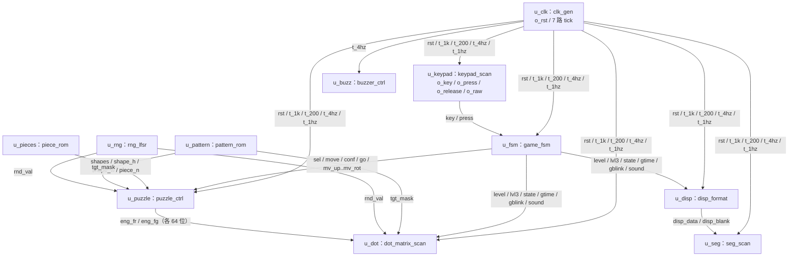

# 顶层集成 `puzzle_top`

> 一句话定位：这一页回答"11 个子模块怎么接起来、52 个引脚怎么分配、顶层自己还做了什么、那几个没人读的信号为什么留着"。

`puzzle_top` 是**唯一绑定引脚的文件**（与 {{src:quartus/puzzle.qsf}} 一起），
板子上正常跑的就是它。它只做四件事：例化、连接、**从整帧里按行切片**、
以及几个"画面级"的特殊状态（自检黄屏 / 待机全暗 / 预览目标 / 胜负闪示 / 告急幽灵）。

## 一、模块基本信息

| 项 | 值 |
|---|---|
| 层次 | 游戏顶层（`tier = top`） |
| 源码 | {{src:rtl/puzzle_top.vhd}}（实体在 {{src:rtl/puzzle_top.vhd:54}}） |
| 端口 | 11（`clk`/`sw7`/`btn` ＋ `kp_row`/`kp_col` ＋ `dot_row`/`dot_colr`/`dot_colg` ＋ `seg`/`cat` ＋ `buzz`） |
| 例化 | **11 个**子模块：`clk_gen`/`keypad_scan`/`game_fsm`/`puzzle_ctrl`/`pattern_rom`/`piece_rom`/`rng_lfsr`/`disp_format`/`seg_scan`/`dot_matrix_scan`/`buzzer_ctrl` |
| 引脚 | **52 个全部显式锁定**（`{{fact:build.fit.pins}}`） |
| 核心难点 | ①行切片必须与引擎/数码管同源同速；②画面级特殊状态的优先级；③告急幽灵只花 1 个 LUT4/行 |

!!! quote "为什么每个子模块都用**显式 component 声明 + 具名端口关联**"
    具名端口映射里**少写或写错端口是编译错误**；而被省略的那个端口的连接
    却可能悄悄留下悬空信号 —— 所以两者结合，等于让编译器替人检查框图与代码是否一致
    （{{src:rtl/puzzle_top.vhd:11}}）。

## 二、端口契约与引脚

--8<-- "_generated/ports/puzzle_top.md"

--8<-- "_generated/pins.md"

引脚按功能分四组：

| 组 | 信号 | 引脚 | 说明 |
|---|---|---|---|
| 时钟/开关/复位/蜂鸣器 | `clk` / `sw7` / `btn` / `buzz` | `PIN_18` / `125` / `61` / `60` | 50 MHz 板钟、系统开关、复位键、蜂鸣器 |
| 键盘矩阵 | `kp_row(3:0)` / `kp_col(3:0)` | `PIN_111..114` / `PIN_117..120` | 行读入（低有效）、列驱动（低有效） |
| 点阵 | `dot_row(7:0)` / `dot_colr(7:0)` / `dot_colg(7:0)` | `PIN_8..1` / `PIN_22..11` / `PIN_45..38` | 行低有效；红/绿列高有效（都高 = 黄） |
| 数码管 | `seg(7:0)` / `cat(7:0)` | `PIN_62..51` / `PIN_63..31` | 段高有效（含小数点 `AP` 恒 0）；位选低有效 |

## 三、11 条例化与连接

--8<-- "_generated/connections-puzzle_top.md"

模块与子系统（S1~S7）的对应关系写在文件头（{{src:rtl/puzzle_top.vhd:16}}），
与框图逐条一致：S1 `clk_gen`、S2 `keypad_scan`、S3 `game_fsm`、S4 `puzzle_ctrl`、
S5 `pattern_rom`/`piece_rom`/`rng_lfsr`、S6 `disp_format`/`seg_scan`/`dot_matrix_scan`、S7 `buzzer_ctrl`。



## 四、顶层自己做的四件事

### 4.1 行计数器 `mrow`：125 Hz 扫描（用户反馈逼出来的）

| 项 | 值 |
|---|---|
| 节拍 | `t_1k`（1 kHz） |
| 一轮 | 8 行 × 1 ms = **8 ms ⇒ 125 Hz** |
| 占空比 | 1/8（与节拍无关） |

!!! bug "ERR-027：25 Hz 会闪 —— 而且"错行"与"闪烁"是两件事"
    原来 `mrow` 走 `tick_200`（200 Hz）：8 行轮一遍 = 40 ms ⇒ **25 Hz**，
    低于临界闪烁融合（LED 一般要 > 60 Hz）⇒ 用户 2026-10-08 反馈
    **"点阵和数码管都闪得比较明显"**。
    更早还出过**错行**问题（扫描与渲染不同源），当时把两边都改成 200 Hz 消掉了错行，
    但**帧率仍是 25 Hz，闪依旧在**。现在三者（`mrow`、引擎行渲染、数码管位选）
    **统一走 `tick_1k`** ⇒ 125 Hz，占空比不变、亮度不变
    （{{src:rtl/puzzle_top.vhd:352}}、{{src:rtl/clk_gen.vhd:14}}）。

### 4.2 `pat_sel` 锁存：图案在**进入预览的那一拍**定下来

* **第三关**（`lvl3='1'`）→ 锁 `rnd_val(1 downto 0)` ⇒ 四幅库随机选（A2）；
* **第二关** → 恒锁 `L2_FIXED_PAT`（PAT3 阶梯，固定）；
* **第一关** → `pattern_rom` 忽略 `i_pat`，恒输出图 4-1。
* 散落用的随机数由引擎在进入对局后继续推进**同一个** LFSR，而这里只在预览起点采样一次，
  所以"重开一局第三关图案会变"。
* ⚠️ `pat_sel` 比 `state` 晚一拍更新（`state` 是寄存器）⇒ 预览会显示**上一幅图案**的一行，
  肉眼不可见（行扫描 1 ms）；而引擎的整帧判据同时快照了 `pat`（`pat_frm`），
  图案切换的那一帧会被判为"不干净"、不发布判据（{{src:rtl/puzzle_top.vhd:379}}）。

### 4.3 行组装：按 `state` 决定"这一行画什么"

先按 `mrow` 从两个 64 位帧里切出当前行（`rw`/`gw`，位序 `8*row+col`），再按状态覆盖：

| 状态 | `mat_r`（红列） | `mat_g`（绿列） | 依据 |
|---|---|---|---|
| `S_SELF_TEST` | 全 `lv` | 全 `lv` | 整屏**黄**、2 Hz 闪烁（B1） |
| `S_IDLE` | 全 `0` | 全 `0` | B2 待机全暗。**绝不能显示引擎帧**：零片还没散落，会全堆在锚点 (0,0) |
| `S_PREVIEW` | `prev_row` | 全 `0` | B4 显示完整目标图案（直接切常量，引擎不参与） |
| `S_WIN` | 全 `0` | `win_row AND ev` | **绿色粗对勾**（交通灯配色：绿=通过） |
| `S_FAIL` | `fail_row AND ev` | 全 `0` | **红色粗叉**（与绿对勾互为反色） |
| `S_PLAYING` | `rw`（引擎红帧本行） | `gw OR (prev_row AND NOT rw AND hint_mask)` | 引擎画面 ＋ 告急幽灵 |

其中 `lv = gblink`（2 Hz 方波）、`ev = gblink or endflash_on`
（结算画面先闪 4 个 250 ms 半周期、之后常亮，{{src:rtl/puzzle_top.vhd:675}}）。

### 4.4 告急幽灵（第 18 工作阶段，降难度）与它的 2 Hz 闪烁（第 22 工作阶段）

| 项 | 值 |
|---|---|
| 触发 | 倒计时 `gtime <= 10` 秒 |
| 显示 | 把"**目标图案里还没被零片盖住的格子**"用红列显示出来：`mat_g <= gw or (prev_row and (not rw) and hint_mask)` |
| 效果 | 拼对的格子被零片盖住 ⇒ 幽灵自然消失 ⇒ 顺带成了"还差哪几格"的进度提示 |
| 面积 | **实测 +12 LE**（`gtime <= 10` 的 6 位比较 ＋ 每行红列一个 4 输入 LUT4） |
| 谁买单 | **同一轮删掉【确认】/【旋转】按键音所省下的 9 LE** |

!!! quote "为什么只在最后 10 秒显示，而不是全程常显"
    用户反馈"每一关我感觉难度都比较大"，根因是**预览只有 5 秒（B4 明文不可改），
    之后完全看不到目标** ⇒ 玩家在做"**回忆**"而不是"**识别**"。
    解法**不是**把图案改简单（用户明确不要，那会变无聊），而是**在玩家卡住时把目标还给他**：
    只在告急时出现，既保留"自己解出来"的成就感，也不至于退化成"描红"
    （{{src:rtl/puzzle_top.vhd:313}}）。

!!! bug "敏感表漏一项会造成"仿真与综合不一致""
    `hint_mask` 被 `mat_g` 那一行读到，**必须**出现在组装进程的敏感表里
    （{{src:rtl/puzzle_top.vhd:707}}）。漏列的后果不是综合错误，
    而是**仿真模型落后于硬件**（幽灵最多晚一拍）—— 这类不一致最难查，因为
    "仿真通过"与"板上正确"此时并不等价。

## 五、9 个"没人读"的信号与 2 个 `=> open` 端口

**先给事实**（可复核）：在 {{src:rtl/puzzle_top.vhd}} 里，下面 9 个标识符**各只出现 2 次**
—— 一次声明、一次端口关联，**没有任何消费者**：

```bash
grep -c '\brelease\b' rtl/puzzle_top.vhd   # 2 = 声明 + 端口关联 ⇒ 无人读
```

| 信号 | 来源 | 无人读的证据 | 为什么留着 |
|---|---|---|---|
| `release` | `keypad_scan.o_release` | 出现 2 次 | 可核对的部分：`game_fsm` 的端口表里**没有** release 输入 ⇒ 顶层确实不用它。**为什么还连着**：待核实（见下） |
| `kp_raw` | `keypad_scan.o_raw` | 出现 2 次 | 可核对的部分：`keypad_scan` 给 `o_raw` 的注释是"调试：实时列驱动"（{{src:rtl/keypad_scan.vhd:62}}），`keypad_raw_top` 靠它验列驱动。**顶层连接的理由**：待核实 |
| `t_100` | `clk_gen.o_tick_100` | 出现 2 次 | ⚠️ **待核实**：10 ms 通用网格，全工程无读者（`clk_gen` 内部 `t3` 仍是第 4/5/6 级链的输入） |
| `t_40` | `clk_gen.o_tick_40` | 出现 2 次 | ✅ 有依据：`clk_gen` 头注释明写这一路"**仅 board_test_top 用**"（自检逐行轮播），端口本身也标注了"不要按误解删这个端口" |
| `piece_n` | `piece_rom.o_n` | 出现 2 次 | ⚠️ **待核实**：引擎用 `i_level` 自己定 `npc`，不读块数 |
| `sel_idx` | `puzzle_ctrl.o_sel_idx` | 出现 2 次 | ⚠️ **待核实**：选中块编号，顶层不显示它 |
| `pos_dbg` | `puzzle_ctrl.o_pos` | 出现 2 次 | ⚠️ **待核实**：四块锚点（32 位）调试口 |
| `lock_dbg` | `puzzle_ctrl.o_lock` | 出现 2 次 | ⚠️ **待核实**：锁定标志调试口 |
| `scanrow` | `puzzle_ctrl.o_scanrow` | 出现 2 次 | ⚠️ **待核实**：引擎的扫描行；顶层用自己的 `mrow` 切片，不读它 |

!!! warning "待核实（统一核实路径）"
    源码里**没有**为 `t_100`/`piece_n`/`sel_idx`/`pos_dbg`/`lock_dbg`/`scanrow`
    写"为什么留着"的注释。**合理的推测**是它们让模块级仿真的波形可读
    （连接不产生额外逻辑：信号本来就存在），但**这需要验证**：
    ① 在 `sim/puzzle_top.vwf` 的观察列表里加上这些信号，看是否有波形；
    ② 查 `quartus/output_files/puzzle.map.rpt` 是否有"被优化掉的寄存器/网络"记录。
    在拿到证据之前，本页只把它们标为**待核实**，不写成"故意保留的设计"。

两个 `=> open` 端口**源码里有明确理由**：

| 端口 | 理由（源码原文的要点） |
|---|---|
| `o_tick_2hz` | 第 16 工作阶段 `game_fsm` **删掉了 `i_tick_2hz` 端口**（ERR-038 改成在 `tick_4hz` 上翻转出真正的 2 Hz），顶层没人读 ⇒ 明确 `open`（{{src:rtl/puzzle_top.vhd:433}}） |
| `o_ori` | A4 的四块朝向（8 位）**仅供模块级仿真观察**，顶层不引出引脚 ⇒ `open`（{{src:rtl/puzzle_top.vhd:563}}） |

## 六、一个完整示例：一拍的行驱动链路

1. `u_clk` 给出 `t_1k = '1'`；`mrow` 从 3 变成 4。
2. 组装进程按 `mrow=4` 切帧：`rw := eng_fr(31 downto 24)`、`gw := eng_fg(31 downto 24)`
   —— 这就是当前稳定帧的**第 4 逻辑行**（逻辑行 0 = 点阵顶部）。
3. 当前 `state = S_PLAYING` ⇒ `mat_r <= rw`；
   `mat_g <= gw or (prev_row and (not rw) and hint_mask)`
   —— 若这一行目标图案上有格子还没被零片盖住、且 `gtime <= 10`，则它显示为**红幽灵**。
4. `u_dot`（`dot_matrix_scan`）收到 `i_row = mrow`、`i_colr = mat_r`、`i_colg = mat_g`，
   把逻辑行 4 译码成 `ROW3`（逻辑 0 = 顶部 ⇒ `ROW7`）并打拍输出 ⇒ 点阵第 4 行点亮 1 ms。
5. 8 拍后一轮结束 ⇒ **125 Hz**；同时引擎在这 8 拍里重建了下一帧（内容 25 Hz，见 [拼图引擎](puzzle-engine.md)）。

## 七、验证与证据

--8<-- "_generated/assertions/puzzle_top.md"

<figure markdown="span">
  { loading=lazy }
  <figcaption>
  **图 3.11** `puzzle_top` 的 Quartus 波形编辑器实测截图（`sim/puzzle_top.vwf`，模式 A 为 r56、模式 B 为 r57）。
  观察信号：`clk`、`sw7`、`btn`、`kp_row`、`kp_col`、`dot_row`、`dot_colr`、`dot_colg`、`seg`、`cat`、`buzz`、`mrow`、`mat_r`/`mat_g`、`pat_sel`、`hint_on`、`state`。
  预期：三关连过（模式 A）/ 失败与超时（模式 B）；`mrow` 每 1 ms 加一；胜负画面闪 4 个半周期后常亮；告急时光涌现身。
  实测：`r57` 的 28 条断言全过（{{fact:sim.modules.puzzle_top.passed}} / {{fact:sim.modules.puzzle_top.total}}）。
  证据：{{src:sim/rounds/puzzle_top/r57.json}}、`sim/puzzle_top.vwf`。
  **能证明**：整机数据通路、三关流程、显示与音效的联动、引脚级行为（在仿真层面）。
  **不能证明**：真实板子的电气正确性与手感 —— 那需要【板级实测】（烧录 ＋ 读回校验 ＋ 人眼观察）。
  </figcaption>
</figure>

| 证据类别 | 有什么 | 缺什么 |
|---|---|---|
| 【RTL 仿真】 | `r57` = {{fact:sim.modules.puzzle_top.passed}} / {{fact:sim.modules.puzzle_top.total}}；两个模式（三关连过 / 失败与超时） | — |
| 【编译/STA】 | 52 引脚全部锁定；LE `{{fact:build.fit.le}}`、LAB `{{fact:build.fit.lab}}`、setup slack `{{fact:build.sta.setup_slack}}` ns | 顶层没有独立报告，读数来自整机编译 |
| 【板级实测】 | 用户多轮反馈（闪烁、难度、音效、键位）已按实测修正 | **没有硬件照片/示波器波形**（`book/docs/assets/hardware/` 为空） |

## 证据与出处

| 结论 | 依据 |
|---|---|
| 框图 ↔ 代码的对应（11 子模块）与具名端口关联的理由 | {{src:rtl/puzzle_top.vhd:11}} |
| 帧寄存器确实存在（128 个触发器），"8 位"指组合路径 | {{src:rtl/puzzle_top.vhd:33}} |
| LED 与点阵绿色复用（刻意不用） | {{src:rtl/puzzle_top.vhd:46}} |
| `mrow` 走 `tick_1k`（ERR-027：25 Hz 会闪） | {{src:rtl/puzzle_top.vhd:352}} |
| `pat_sel` 锁存时机与第三关随机 | {{src:rtl/puzzle_top.vhd:379}} |
| 各状态的行组装（含待机为什么必须全暗） | {{src:rtl/puzzle_top.vhd:735}} |
| 胜负闪示 `endflash_on` | {{src:rtl/puzzle_top.vhd:675}} |
| 告急幽灵（触发/效果/+12 LE 账/与按键音的交换） | {{src:rtl/puzzle_top.vhd:313}} |
| `hint_mask` 必须在敏感表里 | {{src:rtl/puzzle_top.vhd:707}} |
| 9 个信号"无人读"的复核方法（各出现 2 次） | `grep -c` 于 {{src:rtl/puzzle_top.vhd}} |
| 两个 `=> open` 的理由 | {{src:rtl/puzzle_top.vhd:433}}、{{src:rtl/puzzle_top.vhd:563}} |
| 实测数值 | {{src:sim/rounds/puzzle_top/r57.json}}、{{src:sim/tb_puzzle_top.py}} |
