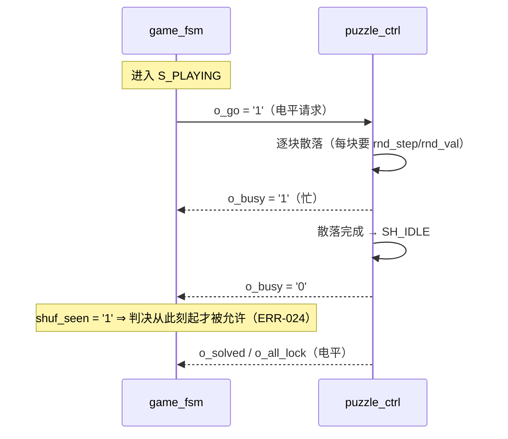

# 控制信号与握手

> 一句话定位：这一页逐个说明跨模块**控制线**的语义、有效条件、脉宽与同步关系，
> 并且明确区分"电平"与"单拍脉冲"。

**读法约定**（全页通用）：本设计**同步**——所有信号都在 `clk` 上升沿被采样。
"1 拍"= 1 个 `clk` 周期 = 20 ns。"电平"= 持续到条件改变为止。

## 一、时钟、复位与节拍

| 信号 | 类型 | 有效条件 | 脉宽/周期 | 同步关系 | 证据 |
|---|---|---|---|---|---|
| `clk` | 时钟 | — | 20 ns（50 MHz） | 全局唯一时钟 | {{src:rtl/clk_gen.vhd:52}} |
| `rst` | **电平**（高有效） | `s_por or s_btn` | 上电约 9 个 `t_1k`；按钮需连满 20 个 1 ms 样本 | 组合产生，进各模块**同步**复位端 | {{src:rtl/clk_gen.vhd:259}} |
| `t_1k` | **单拍脉冲** | 高 1 拍 | 每 1 ms | 点阵行推进 + 数码管位选 + 引擎行渲染 | {{src:rtl/clk_gen.vhd:55}} |
| `t_200` | **单拍脉冲** | 高 1 拍 | 每 5 ms | 键盘扫描轮次 | {{src:rtl/clk_gen.vhd:56}} |
| `t_1hz` | **单拍脉冲** | 高 1 拍 | 每 1 s | 倒计时递减 | {{src:rtl/clk_gen.vhd:60}} |
| `t_4hz` | **单拍脉冲** | 高 1 拍 | 每 250 ms | 2 Hz 闪烁的**翻转源**；蜂鸣器换步 | {{src:rtl/clk_gen.vhd:59}} |
| `t_40` | **单拍脉冲** | 高 1 拍 | 每 25 ms | ⚠️ 游戏顶层无人读；仅 `board_test_top` 用 | {{src:rtl/clk_gen.vhd:61}} |

!!! bug "把 tick 当电平用会看不见（ERR-038 的教训）"
    `t_4hz` 是**一个时钟宽**的脉冲（20 ns）。若直接用它当"闪烁电平"，
    比眨眼快 5 个数量级，肉眼只看到一条极暗的线——正确做法是**翻转**它：
    `blink_r <= not blink_r`（250 ms 高 / 250 ms 低 ⇒ 真正的 2 Hz 方波），
    见 {{src:rtl/game_fsm.vhd:214}}。

## 二、键盘 → 游戏控制

| 信号 | 类型 | 语义 | 有效条件 | 证据 |
|---|---|---|---|---|
| `key[3:0]`（`o_key`） | 4 位**扫描下标** | 不是游戏键码！它就是 `4*row + col` | 与 `press` 同拍有效 | {{src:rtl/keypad_scan.vhd:264}} |
| `press`（`o_press`） | **单拍脉冲** | "有一个键被接受" | `(stable ≠ K_NONE) and (stable ≠ key_r)` | {{src:rtl/keypad_scan.vhd:311}} |
| `release`（`o_release`） | **单拍脉冲** | "所有键都松开了" | `(stable = K_NONE) and (key_r ≠ K_NONE)` | {{src:rtl/keypad_scan.vhd:316}} |
| `kdec`（游戏键码） | 4 位 `K_*` | `key_of(i_key)` 的译码结果 | 组合译码，`press` 当拍可用 | {{src:rtl/game_fsm.vhd:584}} |

!!! note "`o_key` 与 `K_*` 是两套编码，别混"
    `keypad_scan` 只报"矩阵的哪一行哪一列"：`o_key = 4*row + col`（`0..15`）。
    把它翻译成游戏语义（`K_START`/`K_UP`/…）的是 `game_fsm.key_of()`
    （{{src:rtl/game_fsm.vhd:143}}）。所以"键号 = 10 就是 K_UP"这句话
    **只在游戏顶层成立**（依赖那张上板实测的映射表）。
    接线若变，只需改 `key_of()` 一处。

| 行为 | 语义 | 证据 |
|---|---|---|
| 按住不放 | **只报一次** `press`（`stable == key_r` 后不再触发） | {{src:rtl/keypad_scan.vhd:305}} |
| 按住时换按另一个键 | 报**新的一次** `press`（不要求先松开） | {{src:rtl/keypad_scan.vhd:312}} |
| 同时按不同两行的键 | 判为"看不清"⇒ 报 `K_NONE`（不合成鬼键，ERR-036） | {{src:rtl/keypad_scan.vhd:225}} |

## 三、游戏控制 → 拼图引擎（命令与握手）

| 信号 | 类型 | 语义 | 有效条件 | 证据 |
|---|---|---|---|---|
| `sel`（`o_sel`） | **单拍脉冲** | 循环切换"当前选中的零片" | 在 `S_PLAYING` 且键 = `K_SELECT` | {{src:rtl/game_fsm.vhd:592}} |
| `move` + `up/down/left/right` | **单拍脉冲** | 移动请求 + 方向 | 方向键之一；`i_move` 与方向**同拍**有效 | {{src:rtl/game_fsm.vhd:594}} |
| `conf`（`o_conf`） | **单拍脉冲** | 锁定请求（把当前零片定住） | 键 = `K_CONFIRM` | {{src:rtl/game_fsm.vhd:593}} |
| `rot`（`o_rot`） | **单拍脉冲** | 顺时针 90° 旋转请求（A4） | 键 = `K_ROT` | {{src:rtl/game_fsm.vhd:599}} |
| `go`（`o_go`） | **电平**（请求/应答握手） | "请开始这一局的随机散落" | 进 `S_PLAYING` 后拉起，直到引擎应答 | {{src:rtl/game_fsm.vhd:591}} |
| `shuf_busy`（`o_busy`） | **电平** | 引擎"正在散落" | `o_busy = '1'` 当且仅当引擎不在 `SH_IDLE` | {{src:rtl/puzzle_ctrl.vhd:365}} |

!!! bug "ERR-024：判决必须等本局散落跑过（`shuf_seen`）"
    引擎的 `locked`/`pos` 只在 `i_go` 时清零，所以刚进 `S_PLAYING` 的一两拍里，
    引擎里还是**上一局**的残留状态。旧实现无条件采信 `i_solved`/`i_all_lock`
    ⇒ 上板现象是"上一局拼对，新一局一开局就过关"。
    修法：本局至少**看见过一次** `shuf_busy='1'`，判决才生效
    （{{src:rtl/game_fsm.vhd:226}}）。

## 四、引擎 → 游戏控制（判据电平）

| 信号 | 类型 | 语义 | 有效条件 | 证据 |
|---|---|---|---|---|
| `solved`（`o_solved`） | **电平** | "上一整帧并集 == 目标 **且** 四块都锁定" | `frm_ok and alllock_r` | {{src:rtl/puzzle_ctrl.vhd:360}} |
| `all_lock`（`o_all_lock`） | **电平** | "四块都锁定 **且** 那一帧是干净的" | `alllock_r and frm_valid` | {{src:rtl/puzzle_ctrl.vhd:364}} |
| `frm_ok` / `frm_valid` | 内部电平 | 整帧判据（"并集 == 目标" / "这一帧没被扰动"） | 渲染完 8 行后更新 | {{src:rtl/puzzle_ctrl.vhd:305}} |

!!! warning "`solved` 与 `all_lock` 的区别（也是判胜负的关键）"
    - 四块都锁定但拼错 ⇒ `all_lock = '1'`、`solved = '0'` ⇒ **失败**；
    - 并集对了但还有块没锁 ⇒ `solved = '0'`、`all_lock = '0'` ⇒ **继续玩**；
    - 两者都为 `'1'` ⇒ **过关**。
    两个电平的差别只有"是否要求全锁"，但足以区分"拼对"和"拼错"。

## 五、随机数与图案选择

| 信号 | 类型 | 语义 | 有效条件 | 证据 |
|---|---|---|---|---|
| `rnd_step` | **单拍脉冲** | "推进一步 LFSR"（请求一个随机数） | 引擎散落/重试时逐次发出 | {{src:rtl/puzzle_ctrl.vhd:875}} |
| `rnd_val[7:0]` | 8 位数据 | LFSR 当前值；散落时取 `rnd_val(2:0)`/`rnd_val(5:3)` 分别当行/列 | `rnd_step` 之后下一拍即新值 | {{src:rtl/puzzle_ctrl.vhd:922}} |
| `level` | **电平** | `'0'` = 第一关，`'1'` = 第二/三关 | 新一局从 `'0'` 开始 | {{src:rtl/game_fsm.vhd:587}} |
| `lvl3` | **电平** | `'1'` = 第三关 | 第二关过关后置起 | {{src:rtl/game_fsm.vhd:588}} |
| `pat_sel[1:0]` | 多位（顶层锁存） | 目标图案下标：第一关忽略、第二关恒 `L2_FIXED_PAT="11"`、第三关锁 `rnd_val(1:0)` | 进预览瞬间锁存 | {{src:rtl/puzzle_top.vhd:410}} |

!!! note "`level`/`lvl3` 为什么必须是两位而不是"关卡号""
    这是**实测的面积决定**：把 `o_level` 加宽成"关卡号"会让 Fmax 掉 2~5 MHz
    （注释写在 {{src:rtl/game_fsm.vhd:161}}）。所以"第三关"用**独立的 1 位**表达，
    而不是复用 `level` 的取值。读代码时不要试图把两位合并理解。

## 六、显示与音效的控制线

| 信号 | 类型 | 语义 | 有效条件 | 证据 |
|---|---|---|---|---|
| `state[2:0]` | 3 位编码（state_t） | 当前状态：自检/待机/预览/对局/胜利/失败 | 与 `clk` 同步的寄存器 | {{src:rtl/game_fsm.vhd:586}} |
| `gtime[5:0]`（`o_time`） | 6 位**二进制秒数** | 倒计时剩余秒数（**就是** `cnt`） | 预览结束时装载本关限时 | {{src:rtl/game_fsm.vhd:589}} |
| `gblink`（`o_blink`） | **电平** | 2 Hz 闪烁标志（50% 占空） | 由 `t_4hz` 翻转得到 | {{src:rtl/game_fsm.vhd:590}} |
| `sound[3:0]`（`o_sound`） | 4 位编码（SND_*） | 音效/乐句选择码 | 瞬时码会被 `snd_hold` 保持 2 个旋律步 | {{src:rtl/game_fsm.vhd:600}} |
| `i_raw_en` / `i_raw[7:0]` | 1 位 + 8 位 | `seg_scan` 的"原始段码直通"调试入口：`i_raw_en='1'` 时段码直接来自 `i_raw`（**游戏顶层恒接 `'0'`**） | 只有诊断顶层会用 | {{src:rtl/seg_scan.vhd:53}} |

!!! warning "待核实：`snd_hold` 的"听得见"判据"
    瞬时音效被保持 **2 个旋律步**（250~500 ms）的依据是
    `snd_hold` 装载 `"10"` 后每步减一（{{src:rtl/game_fsm.vhd:557}}），
    以及注释里"单拍脉冲必须被保持 ≥1 个旋律步才听得见"的说法
    （{{src:rtl/game_fsm.vhd:208}}）。
    **没有**核实过的部分是："保持 2 步"到底对应多长的**可闻时长**
    （取决于 `buzzer_ctrl` 对同一步码的采样方式）。
    核实路径：读 `buzzer_ctrl` 的步进进程，确认"码变化后的第几个 `t_4hz` 才换音"，
    或在 `tb_buzzer_ctrl` 里加一条"码只维持 2 步"的激励看是否发出一声。

## 证据与出处

| 结论 | 依据 |
|---|---|
| 各级 tick 的脉宽与周期 | {{src:rtl/clk_gen.vhd:54}}、`_generated/pkg-constants.md` |
| `press`/`release` 的充要条件（穷举证明过） | {{src:rtl/keypad_scan.vhd:298}} |
| `o_key` 是 `4*row+col`、`key_of` 才给游戏语义 | {{src:rtl/keypad_scan.vhd:264}}、{{src:rtl/game_fsm.vhd:143}} |
| 命令脉冲与 `o_go` 电平的区别（端口注释） | {{src:rtl/game_fsm.vhd:65}}、{{src:rtl/game_fsm.vhd:68}} |
| `o_busy`/`o_solved`/`o_all_lock` 的表达式 | {{src:rtl/puzzle_ctrl.vhd:360}}、{{src:rtl/puzzle_ctrl.vhd:365}} |
| ERR-024 的 `shuf_seen` 修法 | {{src:rtl/game_fsm.vhd:226}} |
| `pat_sel` 三关口径 | {{src:rtl/puzzle_top.vhd:410}}、{{src:rtl/puzzle_pkg.vhd:251}} |
| `i_raw_en` 只给诊断用 | {{src:rtl/seg_scan.vhd:53}}、`_generated/connections-puzzle_top.md` |
