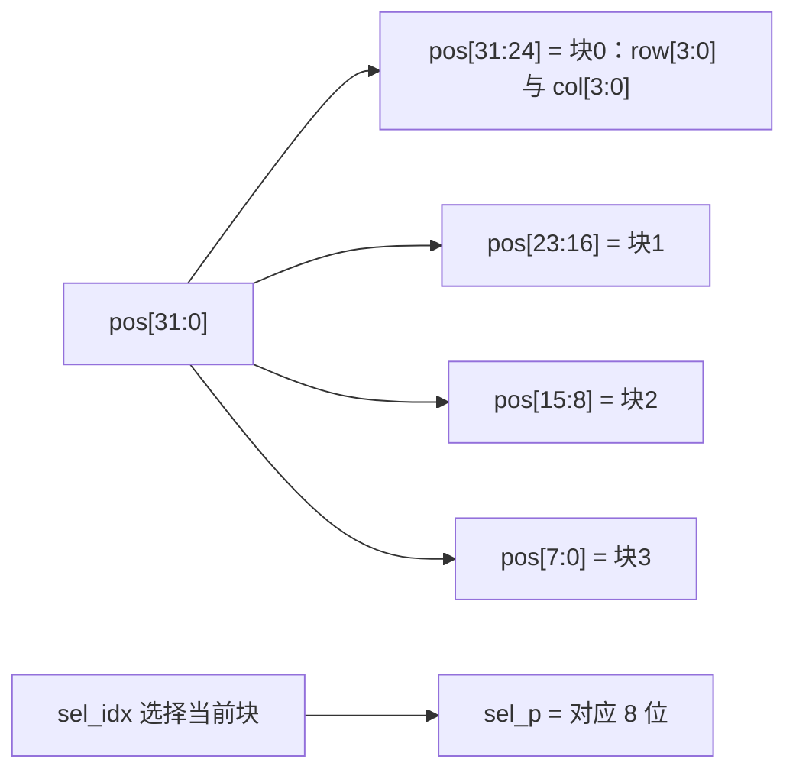

# 数据与编码字典

> 一句话定位：这一页是**数据字典**——把设计里每一个"多位编码"
> （状态、键码、朝向、图案下标、音效码、字位码）的取值与位序约定写清楚。

!!! warning "先说三件**不同**的事，本页全程不混用"
    | 层面 | 约定 | 依据 |
    |---|---|---|
    | **逻辑坐标系** | 拼图语义上的 `(row, col)`：`row` 0..7、`col` 0..7，用于夹紧与边界判定 | 引擎的 `(cr, cc, hh, ww)` 判定 |
    | **位掩码下标** | `bit = 8*row + col`（`mk_cell`/`mask_to_px` 都这么建），注释写明 **bit0 = 左上角** | {{src:rtl/puzzle_pkg.vhd:621}}、{{src:rtl/puzzle_pkg.vhd:640}} |
    | **物理扫描引脚位序** | 行**低有效**、红/绿列**高有效**；逻辑行 0 ↔ `ROW7`（PIN_1） | {{src:rtl/dot_matrix_scan.vhd:6}}、{{src:rtl/dot_matrix_scan.vhd:87}} |

## 一、位序约定：一次性写在这些纯函数里

24 个纯函数（无状态）里，与位序/坐标有关的就是下面这些。它们是**唯一**的约定来源，
任何模块都不许自己手写 64 位掩码字面量：

| 函数 | 干什么 | 位置 |
|---|---|---|
| `mk_cell(r, c)` | 单个格子 → 独热 64 位掩码：`v(8*r + c) := '1'` | {{src:rtl/puzzle_pkg.vhd:621}} |
| `mask_to_px(row, col)` | 绝对坐标 → 显示像素掩码（同样的 `8*row+col`） | {{src:rtl/puzzle_pkg.vhd:643}} |
| `popcount(m)` | 数掩码里 1 的个数（用于"并集是否等于目标"） | {{src:rtl/puzzle_pkg.vhd:628}} |
| `shift_mask(m, dr, dc)` | 整片掩码平移，越界位**丢弃**（不是行末串到下一行） | {{src:rtl/puzzle_pkg.vhd:660}} |
| `srl8(r, dc)` | 8 位行**按列**移位（`v(j) = r(j - dc)`，越界补 0），**允许 `dc = -1/-2`** | {{src:rtl/puzzle_pkg.vhd:703}} |
| `row24(shp24, sr, ac)` | 从 3 行 24 位形状里取第 `sr` 行，再按锚点列 `ac` 移位 | {{src:rtl/puzzle_pkg.vhd:738}} |
| `rot_row(shp, ori, sr)` | 旋转后取第 `sr` 行（3×3 盒内坐标置换） | {{src:rtl/puzzle_pkg.vhd:766}} |
| `rot_off_r/rot_off_c(h, w, ori)` | 旋转后紧包围盒在 3×3 盒里的行列偏移 | {{src:rtl/puzzle_pkg.vhd:795}} |
| `oh(h, w, ori)` / `ow(h, w, ori)` | 旋转后的**有效**高/宽（`ori(0)='1'` 时互换） | {{src:rtl/puzzle_pkg.vhd:819}} |
| `ori_next(ori)` | 朝向 +1（2 位自然回绕，4 次一循环） | {{src:rtl/puzzle_pkg.vhd:833}} |

!!! bug "ERR-019：移位方向写反过（位序约定写错的代价）"
    `srl8` 第一版写的是 `v := '0' & r(7 downto 1)`，在本项目约定下其实是**向左**移，
    于是每个锚点列 > 0 的零片都被画到错误的列（1×3 横条被渲染成第 0 列的一个点）；
    同一个函数还喂给重叠检测器 ⇒ 碰撞检测也一起错。
    由仿真抓出（`tb_puzzle_ctrl` 断言 ⑧）。完整经过见 {{src:rtl/puzzle_pkg.vhd:688}}。

!!! note "为什么 `srl8` 写成"先倒序再左移再倒序""
    直接写"往位号大的方向移"会让综合器无法折叠 `ac≥3` 的常量路径（958 → **1201 LE**）；
    改成"倒序 → 便宜的左移 → 倒序回来"后回到 **967 LE**（数学上等价）。
    这类"等价改写换面积"的判断只能在**真编译**里做，见 {{src:rtl/puzzle_pkg.vhd:707}}。

## 二、游戏状态 `state_t`

`state_t` 是 `std_logic_vector(2 downto 0)` 的**子类型**（{{src:rtl/puzzle_pkg.vhd:511}}），
六个取值全部在 `puzzle_pkg` 里命名：

| 状态 | 编码 | 含义 | 显示内容 |
|---|---|---|---|
| `S_SELF_TEST` | `"000"` | 上电自检（窗口恒 8 个 `t_4hz` 步） | 点阵整行全亮、数码管全 8 |
| `S_IDLE` | `"001"` | 待机（等 `K_START`） | 全灭 |
| `S_PREVIEW` | `"010"` | 预览（(4,5] s） | 目标图案 |
| `S_PLAYING` | `"011"` | 对局（限时 30/40/60 s） | 引擎帧 + 叠色 + 告急幽灵 |
| `S_WIN` | `"100"` | 胜利 | 绿色胜利行（闪烁） |
| `S_FAIL` | `"101"` | 失败 | 红色失败行（闪烁） |

## 三、按键码：两套编码

### 3.1 `keypad_scan.o_key` —— **矩阵扫描下标**（4 位）

`o_key = 4*row + col`，取值 `0..15`：`row` 是"恰好一行被拉低"的那一行、
`col` 是"释放该列时有行落下"的那一列（{{src:rtl/keypad_scan.vhd:264}}）。
行/列无法唯一确定时统一报 `K_NONE`（`"0000"`）。

### 3.2 `game_fsm` 的 `K_*` —— **游戏键码**（4 位）

| 键码 | 值 | 游戏语义 |
|---|---|---|
| `K_NONE` | `"0000"` | 无键 |
| `K_START` | `"0001"` | 开始 / 重开（B11：任何状态都能重开） |
| `K_SELECT` | `"0010"` | 循环切换选中的零片 |
| `K_CONFIRM` | `"0011"` | 锁定当前零片 |
| `K_UP` | `"0100"` | 上移 |
| `K_DOWN` | `"0101"` | 下移 |
| `K_LEFT` | `"0110"` | 左移 |
| `K_RIGHT` | `"0111"` | 右移 |
| `K_ROT` | `"1000"` | 顺时针 90° 旋转（A4） |

映射表（`key_of()`，**上板实测过**的那一张，{{src:rtl/game_fsm.vhd:143}}）：

| 扫描下标 | 游戏键码 | 板上丝印（源码注释） |
|---|---|---|
| `"0001"` | `K_START` | KEY14 |
| `"0011"` | `K_SELECT` | KEY16 |
| `"1010"` | `K_UP` | KEY7（十字上臂） |
| `"0010"` | `K_DOWN` | KEY15（十字下臂） |
| `"0101"` | `K_LEFT` | KEY10（十字左臂） |
| `"0111"` | `K_RIGHT` | KEY12（十字右臂） |
| `"0110"` | `K_CONFIRM` | KEY11（十字中心） |
| `"1011"` | `K_ROT` | KEY8（十字右侧） |
| 其它（含 `"0000"`） | `K_NONE` | — |

!!! tip "为什么"键号"要译码两次"
    `keypad_scan` 只认识矩阵（行/列），`game_fsm` 只认识游戏动作。
    把"哪一行哪一列 → 哪个动作"集中在一个函数里，接线换了只改一处
    （这正是源码注释里写的设计意图）。

## 四、关卡、图案与随机

| 量 | 宽度 | 取值与含义 | 依据 |
|---|---|---|---|
| `level` | 1 | `'0'` 第一关；`'1'` 第二关**或**第三关 | {{src:rtl/game_fsm.vhd:587}} |
| `lvl3` | 1 | `'1'` 就是第三关（与 `level` 配合表达三关） | {{src:rtl/game_fsm.vhd:588}} |
| `pat_sel` | 2 | 图案库下标；第一关被 `pattern_rom` 忽略 | {{src:rtl/puzzle_top.vhd:410}} |
| `L2_PATS` | 数组 | 4 幅图案掩码 `L2_PAT0..L2_PAT3` | {{src:rtl/puzzle_pkg.vhd:251}} |
| `L2_FIXED_PAT` | 2 | `"11"`：第二关恒用 `PAT3`（阶梯） | {{src:rtl/puzzle_pkg.vhd:273}} |
| `L1_TARGET_MASK` | 64 | 第一关目标图案掩码（B4 指定的图 4-1） | {{src:rtl/puzzle_pkg.vhd:155}} |
| `rnd_val` | 8 | LFSR 当前值：散落时 `(2:0)` 当行、`(5:3)` 当列 | {{src:rtl/puzzle_ctrl.vhd:922}} |

第三关的图案是**锁存**的：进预览瞬间锁 `rnd_val(1 downto 0)`，
所以一局之内图案不会变（{{src:rtl/puzzle_top.vhd:415}}）。

## 五、零片：编号、形状、朝向、锚点

| 量 | 宽度 | 含义 | 依据 |
|---|---|---|---|
| 零片编号 | 2 | `0..3`（最多 4 块）；本关实际用几块由 `piece_rom.o_n` 给出 | {{src:rtl/puzzle_ctrl.vhd:541}} |
| `shapes(0..3)` | 4 × 64 | 每块零片的**相对形状掩码**（在 3×3 盒里） | {{src:rtl/piece_rom.vhd:30}} |
| `o_h`/`o_w` | 4 × 3 | 每块零片包围盒的高度/宽度 | {{src:rtl/piece_rom.vhd:31}} |
| `ori(7 downto 0)` | 4 × 2 | 4 块零片各自的朝向 | {{src:rtl/puzzle_ctrl.vhd:541}} |
| `PIECE_ORI_INIT` | 8 | 初始朝向：`"10" & "10" & "01" & "01"` | {{src:rtl/puzzle_pkg.vhd:310}} |
| `pos(31 downto 0)` | 4 × 8 | **锚点打包**：每块 8 位 = `{row[3:0], col[3:0]}` | {{src:rtl/puzzle_ctrl.vhd:995}} |
| `PIECE_MAX_DIM` | 常量 | `3`（形状盒的最大边长） | {{src:rtl/puzzle_pkg.vhd:385}} |

### 5.1 朝向 `ori` 的编码

`ori` 是 2 位，4 个值就是 4 个朝向；`ori_next()` 每次 +1（自然回绕，4 次回原样）：

| `ori` | 角度 | `rot_row` 的坐标置换（3×3 盒内） |
|---|---|---|
| `"00"` | 0° | `r0 = sr, c0 = c` |
| `"01"` | 顺时针 90° | `r0 = 2 - c, c0 = sr` |
| `"10"` | 180° | `r0 = 2 - sr, c0 = 2 - c` |
| `"11"` | 顺时针 270° | `r0 = c, c0 = 2 - sr` |

（置换表来自 {{src:rtl/puzzle_pkg.vhd:775}}；旋转后的有效高宽用 `oh`/`ow` 求，
因为 90°/270° 会把高宽互换——{{src:rtl/puzzle_pkg.vhd:823}}。）

### 5.2 锚点 `pos` 的打包与初始值

`pos` 是 32 位 = **4 块 × 8 位**，每块 8 位拆成高 4 位行、低 4 位列：

散落前的初始锚点是"四角"：块 0 `(0,0)`、块 1 `(0,4)`、块 2 `(4,0)`、块 3 `(4,4)`
（{{src:rtl/puzzle_ctrl.vhd:1086}}）。

!!! warning "待核实：`pos` 的高 4 位是"行"还是"行号的高位""
    从 `pos(31 downto 28)` → `prow`、`pos(27 downto 24)` → `acv` 的取法看
    （{{src:rtl/puzzle_ctrl.vhd:995}}），每块 8 位确实是 `{row[3:0], col[3:0]}`。
    但**行列的数值语义**（`row=0` 是顶部还是底部）与
    [数据流](../02-architecture/dataflow.md) 里那条"朝向待核实"是同一个问题，
    核实前不要把 `pos` 的 `row` 直接说成"从上往下第几行"。

## 六、显示：`disp_data` 与 `disp_blank`

| 量 | 宽度 | 打包方式 | 依据 |
|---|---|---|---|
| `disp_data` | 32 | **8 位数码管 × 4 位字位码**，`digit7` 在最高 4 位 | {{src:rtl/disp_format.vhd:53}} |
| `disp_blank` | 8 | 每一位对应一个数码管，`'1'` = 该位**消隐** | {{src:rtl/disp_format.vhd:54}} |

字位码（`DIG_*`，`seg_scan` 的译码输入）：

| 码 | 值 | 显示 |
|---|---|---|
| `DIG_BLANK` | `"1111"` | 空（配合 `disp_blank` 用） |
| `DIG_A` | `"1010"` | 字母 `A` |
| `DIG_P` | `"1011"` | 字母 `P` |
| `DIG_S` | `"1100"` | 字母 `S` |
| `DIG_F` | `"1101"` | 字母 `F` |
| `DIG_L` | `"1110"` | 字母 `L` |
| `DIG_I` | `"0001"` | 字母 `I` |
| `0..9` | BCD | 十进制数字（倒计时/关卡号用） |

字母码的用途一眼可见：`P A S S` 与 `F A I L` 这类整词显示
（源码注释把这一组码标为"DISP 字位码"，{{src:rtl/puzzle_pkg.vhd:614}}）。

## 七、音效码 `SND_*`（4 位，16 个场景）

| 码 | 值 | 场景 | 备注 |
|---|---|---|---|
| `SND_NONE` | `"0000"` | 静音 | 待机/复位窗口 |
| `SND_SELF` | `"0001"` | 自检 POST 短鸣 | 发声步在第 0/8 步 |
| `SND_PREVIEW` | `"0010"` | 预览提示（上行纯五度 A5→E6） | |
| `SND_CLEAR` | `"0011"` | 过关 | 无休止符短语 |
| `SND_WRONG` | `"0100"` | 拼错 | 无休止符短语 |
| `SND_KEY` | `"0101"` | 按键音 | ⚠️ 查表臂仍在，但 `game_fsm` **已不再生成**它 ⇒ 实际静音 |
| `SND_WIN` | `"0110"` | 胜利 | |
| `SND_FAIL` | `"0111"` | 失败 | |
| `SND_BGM1` | `"1000"` | 第一关背景音乐 | 对局期拼线得到 |
| `SND_BGM2` | `"1001"` | 第二关背景音乐 | 同上 |
| `SND_BGM3` | `"1011"` | 第三关背景音乐 | ⚠️ 是 `1011`，不是 `1010` |
| `SND_ROT` | `"1010"` | 旋转音（A4） | ⚠️ 第 18 工作阶段起**生成分支与查表臂都已删** |
| `SND_CONF` | `"1100"` | 确认音 | 同上（已删） |
| `SND_SEL` | `"1101"` | 选择音 | 码保留，未使用 |
| `SND_MOVE` | `"1110"` | 移动音 | 码保留，未使用 |
| `SND_TIME` | `"1111"` | 倒计时告急 | 码保留，未使用 |

!!! warning "编码表里有"保留了码但删了通路"的项"
    `SND_KEY`/`SND_ROT`/`SND_CONF`/`SND_SEL`/`SND_MOVE`/`SND_TIME` 这些码**仍然存在**，
    但对应的**生成分支或查表臂已被删除** ⇒ 行为上是静音（落进 `when others`）。
    不要把"码表里有这一项"当成"这个音会响"。依据：
    {{src:rtl/puzzle_pkg.vhd:569}}、{{src:rtl/buzzer_ctrl.vhd:435}}。

## 八、LFSR 状态

| 项 | 值 | 依据 |
|---|---|---|
| 位宽 | 8 位 `std_logic_vector(7 downto 0)` | {{src:rtl/rng_lfsr.vhd:28}} |
| 反馈抽头 | 按 Xilinx xapp052（周期 **255**） | {{src:rtl/rng_lfsr.vhd:6}} |
| 种子 | `SEED_DEFAULT = x"5A"` | {{src:rtl/puzzle_pkg.vhd:506}} |
| 推进条件 | `i_step`（即 `rnd_step` 单拍脉冲）+ `i_rst='1'` 时回种子 | {{src:rtl/rng_lfsr.vhd:41}} |

## 证据与出处

| 结论 | 依据 |
|---|---|
| 位序函数与 `8*row+col` | {{src:rtl/puzzle_pkg.vhd:621}}、{{src:rtl/puzzle_pkg.vhd:640}} |
| 状态/键码/音效码/字位码/常量值 | `_generated/pkg-constants.md`、`_generated/pkg-types.md` |
| `key_of` 映射表（上板实测） | {{src:rtl/game_fsm.vhd:143}} |
| 零片形状与包围盒 | {{src:rtl/piece_rom.vhd:29}} |
| 朝向置换与有效高宽 | {{src:rtl/puzzle_pkg.vhd:766}}、{{src:rtl/puzzle_pkg.vhd:819}} |
| `pos` 的 4×8 打包与初始四角 | {{src:rtl/puzzle_ctrl.vhd:995}}、{{src:rtl/puzzle_ctrl.vhd:1086}} |
| `disp_data`/`disp_blank` 位宽与打包 | {{src:rtl/disp_format.vhd:53}}、{{src:rtl/seg_scan.vhd:47}} |
| LFSR 抽头与种子 | {{src:rtl/rng_lfsr.vhd:6}}、{{src:rtl/puzzle_pkg.vhd:506}} |
