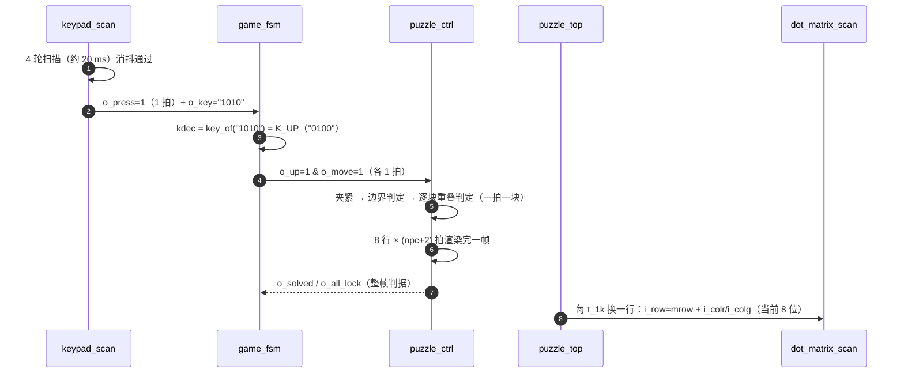
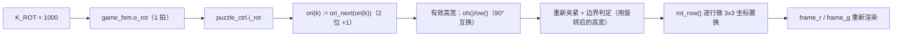
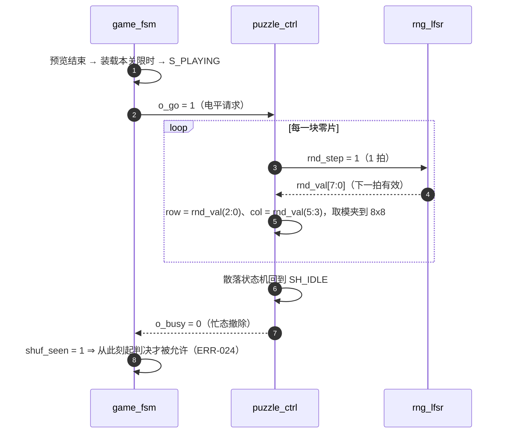
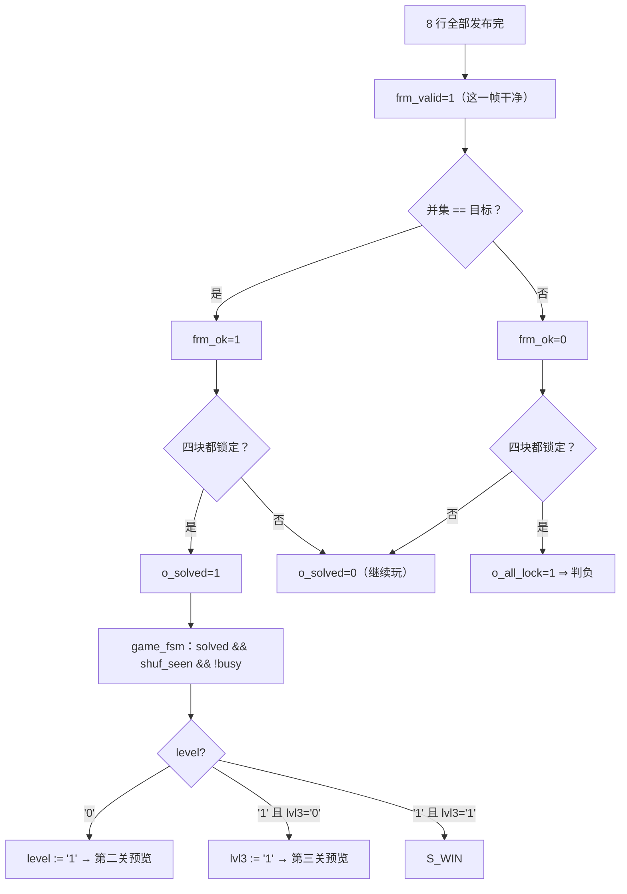
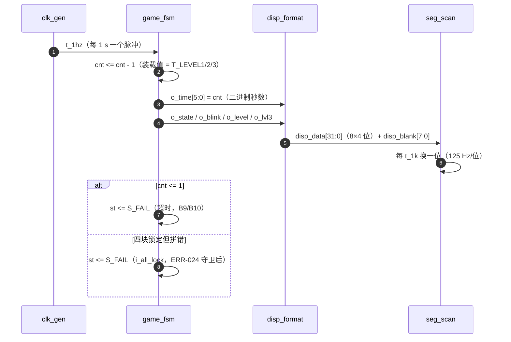

# 端到端事件追踪

> 一句话定位：这一页用五条**真实流程**（A~E）把整条信号链走完——
> 每条都给出 Mermaid 图、信号传递表、逐步解释与证据出处。

**读法**：表中的"拍"= 1 个 `clk` 周期（20 ns）；"轮"= 键盘扫描一轮（5 ms）；
"行"= 点阵一行（1 ms）。所有流程都可用模块级/整机仿真的轮次记录复核
（`sim/rounds/<模块>/rNN.json`）。

## 流程 A：按一次方向键 → 零片移动一格

| 信号 | 位宽 | 发送方 → 接收方 | 时机 |
|---|---|---|---|
| `o_key` | 4 | `keypad_scan` → `game_fsm.i_key` | 与 `press` 同拍 |
| `o_press` | 1 | `keypad_scan` → `game_fsm.i_press` | 单拍脉冲 |
| `o_up` / `o_move` | 1 + 1 | `game_fsm` → `puzzle_ctrl.i_up` / `i_move` | 各单拍，**同一拍** |
| `eng_fr`/`eng_fg` | 64 + 64 | `puzzle_ctrl.o_rowr/o_rowg` → 顶层 | 每发布一行更新 8 位 |
| `mat_r`/`mat_g` | 8 + 8 | 顶层 → `dot_matrix_scan.i_colr/i_colg` | 组合，跟着 `mrow` 变 |
| `dot_row`/`dot_colr`/`dot_colg` | 8×3 | `dot_matrix_scan` → 引脚 | 寄存器输出，1 拍延迟 |

**逐步解释**

1. **消抖**：`keypad_scan` 每轮扫一次；候选键号与 `stable` 连续 4 轮相同才接受
   （`DEBOUNCE_MAX = 3` ⇒ 4 次），所以"按一次"到 `press` 约 20 ms 量级
   （实测上电首键 ≈55 ms、后续 ≈45 ms，见断言 ⑨ 的 11T/103T）。
2. **译码**：`game_fsm` 在 `press` 当拍把扫描下标译成游戏键码
   （`key_of("1010") = K_UP`），随后在输出段拉高 `o_up` 与 `o_move` **各一拍**。
3. **命令注册**：引擎的译码在**每一拍**执行，把命令写进寄存器；即使它当时正在渲染，
   命令也会留到对应相位消费（见 [时序契约](timing-contracts.md)）。
4. **夹紧与判定**：移动前先夹紧到 8×8 内（B7 的守卫之一），再做
   `(cr+hh <= 8) and (cc+ww <= 8)` 的解析式边界判定，最后逐块做重叠判定。
5. **渲染**：一帧 = 8 行 × `npc+2` 拍（第一关 40 拍 = 40 ms）⇒ 画面在**下一个整帧**更新。
6. **输出**：顶层按 `mrow` 切行 → `mat_r/mat_g` → `dot_matrix_scan` 行译码后送出。

<figure markdown="span">
  { loading=lazy }
  <figcaption>
  **图 A.1** `puzzle_ctrl` 模块级仿真波形。
  测试场景：`tb_puzzle_ctrl` 的移动/重叠/锁定场景；观察信号：`i_move`、方向位、
  `o_rowr`/`o_rowg`、`o_solved`/`o_all_lock`；
  预期：方向键到来后锚点改变、越界被夹紧、并集变化；
  实测：见 `sim/rounds/puzzle_ctrl/r37.json`（断言全过）。
  **能证明**：引擎在给定激励下的移动/判定行为。**不能证明**：板子上按键的电气抖动特性
  （那需要【板级实测】）。
  </figcaption>
</figure>

## 流程 B：按一次旋转键 → 零片顺时针 90°

| 信号 | 位宽 | 说明 | 依据 |
|---|---|---|---|
| `o_rot` | 1 | 单拍旋转请求 | {{src:rtl/game_fsm.vhd:599}} |
| `ori` | 4 × 2 | 每块零片一个 2 位朝向 | {{src:rtl/puzzle_ctrl.vhd:541}} |
| `ori_next()` | 2 | `ori + 1`（4 次回原样） | {{src:rtl/puzzle_pkg.vhd:833}} |
| `oh()`/`ow()` | 3 + 3 | 旋转后的有效高/宽（`ori(0)='1'` 时互换） | {{src:rtl/puzzle_pkg.vhd:819}} |
| `rot_row()` | 8 | 旋转后取第 `sr` 行（3×3 盒坐标置换） | {{src:rtl/puzzle_pkg.vhd:766}} |

**为什么"旋转"要同时改三样东西**：①朝向寄存器 `ori`；②**有效高宽**（90°/270° 会互换，
夹紧与边界判定必须用旋转后的值）；③渲染时的坐标置换（`rot_row`）。
只改 ① 会让零片"转着显示但碰撞框没转"，这正是 A4 要实现的功能最容易出错的点。

!!! bug "ERR-019：位序写反 ⇒ 旋转后的零片画错列"
    `srl8` 的移位方向曾经写反（见 [数据与编码字典](data-encoding.md)），
    旋转后按锚点列重定位时整片被画到错误的列。由仿真抓出
    （`tb_puzzle_ctrl` 断言 ⑧），修法记录在 {{src:rtl/puzzle_pkg.vhd:688}}。

## 流程 C：开局随机散落

| 信号 | 位宽 | 说明 | 依据 |
|---|---|---|---|
| `o_go`（`i_go`） | 1 | **电平**散落请求 | {{src:rtl/game_fsm.vhd:591}} |
| `rnd_step` | 1 | 单拍"推进一步 LFSR" | {{src:rtl/puzzle_ctrl.vhd:875}} |
| `rnd_val` | 8 | 随机值：`(2:0)` 行、`(5:3)` 列 | {{src:rtl/puzzle_ctrl.vhd:922}} |
| `o_busy` | 1 | 散落中为 `'1'`（`sh ≠ SH_IDLE`） | {{src:rtl/puzzle_ctrl.vhd:365}} |
| 初始锚点 | 4 × 8 | 散落前是"四角" `(0,0)/(0,4)/(4,0)/(4,4)` | {{src:rtl/puzzle_ctrl.vhd:1086}} |

!!! bug "ERR-024：不等散落就会"秒判胜负""
    引擎的 `locked`/`pos` 只在 `i_go` 时清零，所以刚进 `S_PLAYING` 的一两拍里，
    判据看到的还是**上一局**的残留（全锁 + 上一局的拼法）。
    修法是 `shuf_seen`：本局至少看到过一次"散落忙"才允许判决，
    见 {{src:rtl/game_fsm.vhd:226}}、仿真断言 ⑯⑰。

## 流程 D：通关判定（含三关推进）

| 信号 | 来源 | 判据 | 依据 |
|---|---|---|---|
| `frm_ok` | 引擎 | 整帧并集 == `i_target` | {{src:rtl/puzzle_ctrl.vhd:305}} |
| `frm_valid` | 引擎 | 这一帧没被扰动（判据可用） | {{src:rtl/puzzle_ctrl.vhd:306}} |
| `o_solved` | 引擎 | `frm_ok and alllock_r` | {{src:rtl/puzzle_ctrl.vhd:360}} |
| `o_all_lock` | 引擎 | `alllock_r and frm_valid` | {{src:rtl/puzzle_ctrl.vhd:364}} |
| `level`/`lvl3` | `game_fsm` | 二关/三关推进 | {{src:rtl/game_fsm.vhd:339}} |

**关键区别**（也是判胜负的全部逻辑）：
"并集对了但还有块没锁" ⇒ 不算过关，继续玩；
"四块都锁了但并集不对" ⇒ 判负；
两者都满足 ⇒ 过关。

<figure markdown="span">
  { loading=lazy }
  <figcaption>
  **图 D.1** `puzzle_top` 整机仿真波形（多段子仿真拼接）。
  测试场景：`tb_puzzle_top` 的整机场景（模式 A/B）；观察信号：`state`、`level`/`lvl3`、
  `o_solved`/`o_all_lock`、`eng_fr`/`eng_fg`；
  预期：过关后进入下一关预览、三关后 `S_WIN`；
  实测：见 `sim/rounds/puzzle_top/` 的最新整机轮次。
  **能证明**：三关推进与判胜负的时序关系。**不能证明**：观看/听感体验
  （那需要【板级实测】，本仓库目前没有硬件实拍）。
  </figcaption>
</figure>

!!! note "生成页里的整机波形是**多段子仿真**拼接"
    `puzzle_top.vwf` 里有 8 段子仿真（见 `_generated/figures.md` 与该文件的段号注释），
    所以"段数"不等于"观测节点数"。看图时以节点名与时间刻度为准。

## 流程 E：倒计时与超时判负

| 信号 | 位宽 | 说明 | 依据 |
|---|---|---|---|
| `o_time`（`gtime`） | 6 | 倒计时剩余秒数，**就是** `cnt` | {{src:rtl/game_fsm.vhd:589}} |
| `o_blink`（`gblink`） | 1 | 2 Hz 闪烁（由 `t_4hz` 翻转） | {{src:rtl/game_fsm.vhd:590}} |
| `disp_data` | 32 | 8 位数码管的字位码 | {{src:rtl/disp_format.vhd:53}} |
| `disp_blank` | 8 | 逐位消隐 | {{src:rtl/disp_format.vhd:54}} |

**时限口径**：第一关 30 s、第二关 40 s、第三关 60 s
（`T_LEVEL1/2/3`，{{src:rtl/puzzle_pkg.vhd:474}}）。
限时是在"预览结束的那个 `t_1hz` 节拍"上装载的，起点与节拍对齐 ⇒ 窗口**恰好**是
标称秒数；而**预览窗口**是按键进入的（与节拍错相）⇒ 是 `(T_PREVIEW−1, T_PREVIEW]`
= `(4, 5]` s（{{src:rtl/game_fsm.vhd:301}}）。

<figure markdown="span">
  { loading=lazy }
  <figcaption>
  **图 E.1** `disp_format` 模块级仿真波形。
  测试场景：`tb_disp_format` 的待机/预览/对局/结算/自检各态；观察信号：`o_data`、`o_blank`；
  预期：倒计时两位数拆分显示、`DISP2` 在所有窗口都消隐（口径 C）；
  实测：见 `sim/rounds/disp_format/r27.json`。
  **能证明**：状态 → 数码管内容的映射与消隐掩码。**不能证明**：实际数码管的亮度/视角。
  </figcaption>
</figure>

## 五条流程的共同点（一张表收尾）

| 环节 | 共同机制 | 证据 |
|---|---|---|
| 输入 | 200 Hz 扫描 + 4 轮消抖 ⇒ 只报一次 `press` | {{src:rtl/keypad_scan.vhd:286}} |
| 译码 | 扫描下标 → `K_*` 集中在一个纯函数里 | {{src:rtl/game_fsm.vhd:143}} |
| 命令 | 单拍脉冲；接收方每拍译码 ⇒ 不会丢 | {{src:rtl/puzzle_ctrl.vhd:737}} |
| 执行 | 引擎一拍一块、一行 `npc+2` 拍、8 行一帧 | {{src:rtl/puzzle_ctrl.vhd:257}} |
| 判据 | 整帧 `frm_ok` + 全锁 `alllock_r`，且必须"见过散落" | {{src:rtl/puzzle_ctrl.vhd:360}}、{{src:rtl/game_fsm.vhd:226}} |
| 输出 | 顶层按行切片 → 点阵寄存器输出；状态 → 数码管/蜂鸣器 | {{src:rtl/puzzle_top.vhd:712}} |

## 证据与出处

| 结论 | 依据 |
|---|---|
| 按键消抖/接受/释放语义 | {{src:rtl/keypad_scan.vhd:298}}、`sim/rounds/keypad_scan/r27.json` |
| 键码映射（上板实测） | {{src:rtl/game_fsm.vhd:143}} |
| 移动/夹紧/重叠/锁定（引擎） | {{src:rtl/puzzle_ctrl.vhd:806}}、`sim/rounds/puzzle_ctrl/r37.json` |
| 旋转原语与有效高宽 | {{src:rtl/puzzle_pkg.vhd:766}}、{{src:rtl/puzzle_pkg.vhd:819}} |
| 散落与 `rnd_step`/`rnd_val` | {{src:rtl/puzzle_ctrl.vhd:875}}、{{src:rtl/rng_lfsr.vhd:41}} |
| 整帧判据与胜负口径 | {{src:rtl/puzzle_ctrl.vhd:360}}、{{src:rtl/puzzle_ctrl.vhd:364}} |
| 三关推进与时限 | {{src:rtl/game_fsm.vhd:311}}、{{src:rtl/puzzle_pkg.vhd:474}} |
| ERR-019 / ERR-024 / ERR-051 的修复 | {{src:rtl/puzzle_pkg.vhd:688}}、{{src:rtl/game_fsm.vhd:226}}、{{src:rtl/game_fsm.vhd:165}} |
| 仿真轮次记录 | {{tree:sim/rounds}} |
