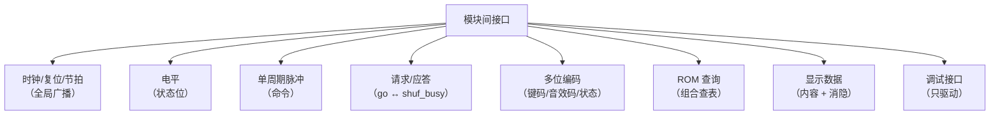

# 接口分类学

> 一句话定位：这一页回答"该用哪些词描述这个设计的模块间接口"——
> 以及**不该**用哪些词。

**先说结论**：本设计是**同步 RTL**，模块之间只有**线**，没有"调用"。
所以描述接口时**不许**使用下列说法：

| ❌ 不许用 | 为什么 | ✅ 改用 |
|---|---|---|
| "软件 API / 函数调用" | 没有指令、没有栈、没有"被调用方"主动返回；模块是**每拍并行求值** | "端口 + 有效条件" |
| "消息队列 / 事件总线 / 缓冲区" | 没有队列深度、没有仲裁、没有握手完成的包 | "单拍脉冲 / 电平握手" |
| "总线协议 / 事务 / 突发" | 没有地址、没有读写命令、没有总线仲裁 | "一条多位数据线 + 一条使能" |
| "中断 / 回调" | 没有任何"主动通知"机制；一切都由时钟沿推进 | "电平状态位" |
| "流水线级数 = 接口延迟" | 端口上没有"延迟"属性；延迟由**接收方的采样时刻**决定 | "在第 N 拍被采样" |

!!! quote "为什么这一页要专门写"不许用的词""
    错误的词会把读者引向错误的预期：如果接口被描述成"消息队列"，
    读者自然会问"队列满了怎么办、丢包怎么办"——而本设计里**根本没有队列**，
    正确的问题是"这个脉冲会不会被漏采"（答案见
    [时序契约](timing-contracts.md)）。
    这是一次"用词决定问题"的典型例子。

## 一、七类接口

| 类别 | 判据 | 本设计的例子 | 谁产生 → 谁消费 |
|---|---|---|---|
| **时钟/复位/节拍** | 全局广播，1 位，与数据无关 | `clk`、`rst`、`t_1k`、`t_200`、`t_1hz`、`t_4hz`、`t_40` | `clk_gen` → 所有模块 |
| **电平（level）** | 1 位，持续多拍，语义是"现在处于某状态" | `state`、`level`、`lvl3`、`solved`、`all_lock`、`shuf_busy`、`sw7` | 见 [控制信号](control-signals.md) |
| **单周期脉冲（pulse）** | 1 位，**恰好一个 `clk` 周期**为高 | `press`、`release`、`sel`、`move`、`conf`、`rot`、`up/down/left/right`、`rnd_step` | `keypad_scan`/`game_fsm`/`puzzle_ctrl` |
| **请求/应答（handshake）** | 1 位**电平**请求 + 用忙态应答 | `go`（请求散落）↔ `shuf_busy`（引擎忙） | `game_fsm` → `puzzle_ctrl` |
| **多位编码（code）** | 多位，取值有**离散语义** | `key[3:0]`（K_*）、`sound[3:0]`（SND_*）、`state[2:0]`（state_t）、`ori[1:0]` | 见 [数据字典](data-encoding.md) |
| **ROM 查询（lookup）** | 组合、无寄存器，输入下标 → 输出掩码 | `pattern_rom`（`i_level`+`i_pat` → `o_mask`）、`piece_rom`（`i_level` → 4 个形状） | 顶层直连进引擎 |
| **显示数据（display）** | 面向物理外设的"内容 + 消隐"两件套 | `disp_data[31:0]`（8×4 位字位码）、`disp_blank[7:0]`；`mat_r/mat_g` 与 `i_row` | `disp_format`→`seg_scan`；顶层→`dot_matrix_scan` |
| **调试接口（debug）** | 只驱动、无人读；或只在诊断顶层被读 | `o_raw`、`o_sel_idx`、`o_pos`、`o_lock`、`o_scanrow`、`o_tick_2hz`（`board_test_top` 读） | 见 [层级与顶层](../02-architecture/hierarchy.md) 的"诚实清单" |

## 二、这 6 页怎么配合读

| 想回答的问题 | 去哪一页 |
|---|---|
| 某个模块有哪些端口、位宽多少？ | [模块接口契约](module-ports.md) |
| 某个跨模块信号的语义、有效条件、脉宽？ | [控制信号与握手](control-signals.md) |
| 某个多位编码每个值是什么意思？ | [数据与编码字典](data-encoding.md) |
| 脉冲会不会被漏采、会不会重复？ | [时序契约](timing-contracts.md) |
| "按一次键到底发生了什么"？ | [端到端事件追踪](event-traces.md) |

!!! note "端口表是机械生成的，别手抄"
    15 个实体的端口契约、4 个顶层的连接表都由 `book/scripts/gen_pages.py` 从源码抽出。
    本节的页面只写"**读法与判据**"，端口名/位宽一律引用生成页，
    避免出现"文档抄错位宽"（本仓库真发生过，见 ERR-022）。

## 证据与出处

| 结论 | 依据 |
|---|---|
| 端口名/方向/位宽 | `_generated/ports/*.md`、`_generated/connections.md` |
| 跨模块连接的发送/接收端口 | `_generated/connections-puzzle_top.md` |
| 脉冲 vs 电平的判定（VHDL 原码） | {{src:rtl/keypad_scan.vhd:298}}、{{src:rtl/game_fsm.vhd:65}}、{{src:rtl/game_fsm.vhd:68}} |
| 调试/无人读信号的清单 | `_generated/connections-puzzle_top.md` |
