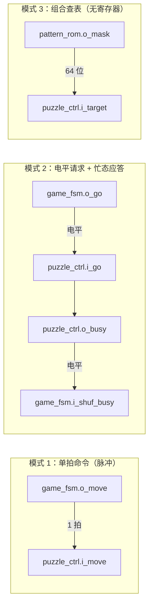

# 模块接口契约

> 一句话定位：这一页给出"谁连到谁"的**机械表**，并教你怎么读它
> ——以及**不要**从这张表里读出什么。

## 一、四个顶层的跨模块连接总表（机械抽取）

--8<-- "_generated/connections.md"

## 二、怎么读这张表

| 列 | 含义 | 注意 |
|---|---|---|
| 发送方（驱动） | 谁在驱动这条线 | 可能是**实例**（`u_puzzle`）、**顶层端口**（`kp_row`）、**顶层自身逻辑**（顶层进程）、或**常量实参** |
| 发送端口 | 驱动方的端口名 | 与"信号名"可能不同：端口 `o_rowr` 驱动信号 `eng_fr` |
| 信号名 | 顶层内部的连线名 | **这才是读代码时要找的名字** |
| 接收方 | 谁在读 | 可能是实例、顶层端口、**顶层自身逻辑**、或"**（无人读）**" |
| 接收端口 | 接收方的端口名 | 同一个信号可扇出到多个端口（表里会合并显示） |
| 位宽 / VHDL 类型 | 机械从声明得到 | 位宽以**源码为准**；本表只是它的投影 |

四种特殊行：

| 行样式 | 含义 | 例子 |
|---|---|---|
| **常量实参** | 直接写在 `port map` 里的字面量，**没有**对应信号 | `u_seg.i_raw_en <= '0'`、`u_seg.i_raw <= (others => '0')` |
| **顶层自身逻辑** | 顶层自己的进程在驱动/读取 | `mat_r`/`mat_g`（切行结果）由顶层进程驱动 |
| **（无人读）** | 被驱动但没有任何接收方 | `release`、`kp_raw`、`piece_n`、`sel_idx`、`pos_dbg`、`lock_dbg`、`scanrow`、`t_100`、`t_40`（游戏顶层内） |
| **按元素读取** | 数组端口被拆成元素来接 | `piece_rom.o_h(o_h)` → `i_h0..i_h3`（4 条单 bit 连接） |

!!! warning "这张表**不能**告诉你的事"
    1. **语义**：`o_go` 是电平还是脉冲？表里看不出来（它只记"谁连到谁"）。
       语义见 [控制信号与握手](control-signals.md)。
    2. **有效条件**：什么时候这条线是"有效"的？表里没有。
    3. **时序**：接收方在哪个时钟沿采样？会不会漏采？见 [时序契约](timing-contracts.md)。
    4. **朝向/极性**：物理引脚的高低有效电平属于**板级**约定（例如点阵行是低有效），
       见 {{src:rtl/dot_matrix_scan.vhd:6}}。

## 三、15 个实体的端口契约（逐实体一页）

端口表（端口名/方向/类型位宽/源码注释/实际连接）由 `gen_pages.py` 生成，
每页还会标出"被例化于"（顶层 / 某个父模块）与实体声明行号：

| 实体 | 端口页 | 角色 |
|---|---|---|
| `clk_gen` | `_generated/ports/clk_gen.md` | S1 时钟与时间基准 |
| `keypad_scan` | `_generated/ports/keypad_scan.md` | S2 键盘输入 |
| `game_fsm` | `_generated/ports/game_fsm.md` | S3 游戏控制 |
| `puzzle_ctrl` | `_generated/ports/puzzle_ctrl.md` | S4 拼图核心 |
| `piece_rom` | `_generated/ports/piece_rom.md` | S5 零片形状表 |
| `pattern_rom` | `_generated/ports/pattern_rom.md` | S5 目标图案表 |
| `rng_lfsr` | `_generated/ports/rng_lfsr.md` | S5 伪随机数 |
| `disp_format` | `_generated/ports/disp_format.md` | S6 数码管内容 |
| `seg_scan` | `_generated/ports/seg_scan.md` | S6 数码管扫描 |
| `dot_matrix_scan` | `_generated/ports/dot_matrix_scan.md` | S6 点阵行驱动 |
| `buzzer_ctrl` | `_generated/ports/buzzer_ctrl.md` | S7 音效 |
| `puzzle_top` | `_generated/ports/puzzle_top.md` | **游戏顶层**（唯一绑定引脚的游戏设计） |
| `board_test_top` | `_generated/ports/board_test_top.md` | 诊断顶层：硬件自检 |
| `keypad_diag_top` | `_generated/ports/keypad_diag_top.md` | 诊断顶层：键盘映射实测 |
| `keypad_raw_top` | `_generated/ports/keypad_raw_top.md` | 诊断顶层：键盘电气测试 |

`puzzle_pkg` **没有端口页**——它是设计包，不是实体。

## 四、连线的"形状"：三种典型模式

| 模式 | 谁发起 | 谁"完成" | 风险 |
|---|---|---|---|
| 单拍脉冲 | 发送方（一拍） | 接收方必须在**当拍**看到 | 漏采（见 [时序契约](timing-contracts.md)） |
| 电平 + 忙态 | 发送方拉高电平 | 接收方用 `o_busy` 应答 | 双方对"什么时候算完成"必须有共识 |
| 组合查表 | 没有"发起" | 同拍就有结果 | 组合路径过长（时序风险） |

## 证据与出处

| 结论 | 依据 |
|---|---|
| 全部连接（含特殊行样式） | `_generated/connections.md`、`_generated/connections-puzzle_top.md` |
| 15 个实体的端口契约与"被例化于" | `_generated/ports/*.md` |
| `puzzle_pkg` 不是实体 | `_generated/pkg-types.md` |
| 点阵行/列极性属于板级约定 | {{src:rtl/dot_matrix_scan.vhd:6}} |
| 单拍命令与电平握手的 VHDL 原码 | {{src:rtl/game_fsm.vhd:65}}、{{src:rtl/game_fsm.vhd:68}}、{{src:rtl/puzzle_ctrl.vhd:365}} |
