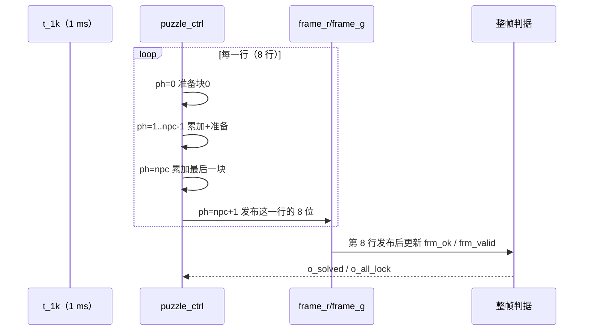

# 时序契约

> 一句话定位：这一页回答"每个跨模块信号在第几拍产生、谁在第几拍采样、
> 会不会被漏采或重复采"，以及拼图引擎内部那条 `ph` 流水线到底延迟几拍。

**总契约**：全设计**同步**——所有寄存器都在 `clk` 上升沿更新；
没有任何"异步接口"。因此一条线的生命周期只有三句话：
**产生方在某个上升沿更新它 → 它在整个周期内可读 → 接收方在下一个上升沿采样它**。

## 一、"产生 → 保持 → 采样 → 消费"一览

| 信号 | 产生（更新时刻） | 保持 | 谁在什么时候采样 | 会不会丢 | 证据 |
|---|---|---|---|---|---|
| `t_1k`/`t_200`/`t_1hz`/`t_4hz` | `clk_gen` 计数器回绕的沿 | **1 个 `clk`（20 ns）** | 消费者各自的进程（见下） | **会**（见第 3 节：只在特定状态分支里被看） | {{src:rtl/clk_gen.vhd:200}} |
| `press` | `keypad_scan` 的消抖进程（仅在 `state = SC_ALL_HIGH` 且 `i_tick='1'` 时评估） | 1 个 `clk` | `game_fsm` 状态机的**每个**周期都看 | 不会（接收方每拍都看） | {{src:rtl/keypad_scan.vhd:286}} |
| `key[3:0]` | 与 `press` 同拍（`key_r` 是寄存器） | 直到下一次接受/释放 | 同上 | 不会 | {{src:rtl/keypad_scan.vhd:324}} |
| `sel/move/conf/rot/up..right` | `game_fsm` 的输出段（与状态机同拍） | 1 个 `clk` | `puzzle_ctrl` 的命令译码（每个渲染/空闲拍都看） | 不会（见下节的"为什么）` | {{src:rtl/game_fsm.vhd:592}} |
| `go` | `game_fsm` 拉高（**电平**） | 直到引擎应答 | `puzzle_ctrl` 在空闲拍看 | 不适用（电平） | {{src:rtl/game_fsm.vhd:591}} |
| `shuf_busy` | `puzzle_ctrl`（散落状态机） | 散落期间一直高 | `game_fsm` 判决分支 | 不适用 | {{src:rtl/puzzle_ctrl.vhd:365}} |
| `solved`/`all_lock` | `puzzle_ctrl`（整帧渲染完时更新） | 到下一帧判据更新 | `game_fsm` 判决分支 | 不适用 | {{src:rtl/puzzle_ctrl.vhd:360}} |
| `rnd_step` | `puzzle_ctrl`（散落时逐块发出） | 1 个 `clk` | `rng_lfsr`（`i_step`） | 不会 | {{src:rtl/puzzle_ctrl.vhd:875}} |
| `rnd_val` | `rng_lfsr` 在 `i_step` 之后的沿更新 | 到下一次推进 | `puzzle_ctrl` 在读相位取用 | 不会（**下一拍才读**） | {{src:rtl/rng_lfsr.vhd:41}} |
| `tgt_mask`/`shapes` | `pattern_rom`/`piece_rom`（**纯组合**） | 同拍有效 | 被引擎的组合路径直接用 | 不适用（无寄存器） | {{src:rtl/pattern_rom.vhd:37}} |
| `disp_data`/`disp_blank` | `disp_format`（组合或寄存器） | 到输入变化 | `seg_scan` 的位选进程 | 不适用 | {{src:rtl/disp_format.vhd:53}} |
| `mat_r`/`mat_g` | `puzzle_top` 的组合进程 | 到 `mrow`/帧变化 | `dot_matrix_scan` 的**寄存器** | 不适用 | {{src:rtl/puzzle_top.vhd:712}} |

!!! note "一个可核验的"漏采"例子：`t_200` 在扫描相位间被忽略"
    `keypad_scan` 的消抖块写成
    `if (i_tick = '1') and (state = SC_ALL_HIGH) then …`
    （{{src:rtl/keypad_scan.vhd:286}}）——也就是说，
    **只有在 `SC_ALL_HIGH` 那一拍到来的 `t_200` 才会被用**，其余相位里的 `t_200`
    被**有意忽略**。这不是 bug：一轮扫描（4 相位）结束时必然经过 `SC_ALL_HIGH`，
    所以"每轮恰好采样一次"成立，"消抖需要 4 次采样 ≈ 20 ms"也就是按**轮**算的。
    读文档时若把消抖理解成"每 5 ms 采一次"，结论会差一个相位。

## 二、拼图引擎的流水线：`ph = 0 .. npc+1`

引擎不是"一拍算完整帧"，而是**一拍一块**地串行累加，然后在一行结束时发布：

| 相位 | 做什么 | 依据 |
|---|---|---|
| `ph = 0` | 准备第 0 块（读形状/朝向/锚点） | {{src:rtl/puzzle_ctrl.vhd:536}} |
| `ph = 1 .. npc-1` | 累加第 `ph-1` 块，同时准备第 `ph` 块 | 同上 |
| `ph = npc` | 累加最后一块 | 同上 |
| `ph = npc+1` | **发布本行**（写 `frame_r`/`frame_g` 的对应 8 位），并把 `ph` 归零 | {{src:rtl/puzzle_ctrl.vhd:459}} |
| 行计数 | 每发布一行，`iframe`（行号）推进；8 行一帧 | {{src:rtl/puzzle_ctrl.vhd:257}} |

其中 `npc` = 本关零片数：**第一关 3、第二/三关 4**
（{{src:rtl/puzzle_ctrl.vhd:457}}）。

!!! warning "延迟的"准确说法"
    一条命令（例如移动）**不会**在一拍内出现在点阵上。从命令被采样到画面更新，
    至少要经过：**整帧渲染时间**（第一关 8 行 × 5 拍 = 40 拍 = 40 ms；
    二三关 48 拍 = 48 ms）+ 输出寄存器 1 拍。
    源码里明确纠正过"延迟只有几拍"的说法（{{src:rtl/puzzle_ctrl.vhd:215}}）。
    所以本页与 `docs/02` 都只写"**判决延迟来自整帧渲染**"。

## 三、命令脉冲为什么不会丢

`sel/move/conf/rot` 都是**单拍脉冲**，而引擎在渲染流水线里"很忙"——
为什么不会漏掉？因为引擎的**命令译码在每一拍都执行**（渲染相位与命令译码是同一进程的
两个分支，命令存储是寄存器：`sel_p`/`mv_*` 等），命令一旦被写入就**留到对应相位消费**
（{{src:rtl/puzzle_ctrl.vhd:737}}）。这就是"渲染忙时命令不会丢"的机制。

!!! danger "本页**不能**证明的事"
    1. 上表"会不会丢"的判断全部来自**读 RTL + 模块级仿真**；
       整机并发场景下的极端时序（例如命令恰好在 `ph=npc+1` 那一拍到来）只有
       `sim/rounds/puzzle_top/` 的整机轮次覆盖，**不是**形式化证明。
    2. 没有做**时序仿真**（post-fit timing simulation）；
       因此"逻辑上与板上一致"只由【编译/STA】的 slack 为正来支持，
       真实的建立/保持余量由器件保证，见 {{src:docs/05-资源利用与编译报告.md}}。

## 四、ROM 数据的读取与消费时机

| ROM | 类型 | 什么时候有效 | 谁在什么时候用 |
|---|---|---|---|
| `pattern_rom` | 纯组合（`i_level`/`i_pat` → `o_mask`） | 输入稳定后同拍有效 | 引擎的重叠判定与叠色，每拍可用 |
| `piece_rom` | 纯组合（`i_level` → `shapes`/`h`/`w`/`n`） | 同上 | 引擎读形状/包围盒，每拍可用 |
| `rng_lfsr` | **寄存器**（`i_step` 推进） | 推进后的**下一拍** | 引擎散落时按相位取 `rnd_val` |

## 证据与出处

| 结论 | 依据 |
|---|---|
| 单时钟同步、所有采样在 `rising_edge(clk)` | {{src:rtl/clk_gen.vhd:132}}、各模块架构头 |
| `t_200` 只在 `SC_ALL_HIGH` 被使用（漏采例子） | {{src:rtl/keypad_scan.vhd:286}} |
| `press` 的充要条件与 1 拍宽度 | {{src:rtl/keypad_scan.vhd:298}} |
| 引擎相位定义 `ph = 0..npc+1`（含两拍流水） | {{src:rtl/puzzle_ctrl.vhd:257}}、{{src:rtl/puzzle_ctrl.vhd:264}} |
| `npc` = 3（第一关）/ 4 | {{src:rtl/puzzle_ctrl.vhd:457}} |
| 命令在渲染忙时也不会丢（译码每拍执行） | {{src:rtl/puzzle_ctrl.vhd:737}} |
| 帧判据更新时机 | {{src:rtl/puzzle_ctrl.vhd:642}} |
| ROM 组合/寄存器属性 | {{src:rtl/pattern_rom.vhd:36}}、{{src:rtl/piece_rom.vhd:29}}、{{src:rtl/rng_lfsr.vhd:33}} |
