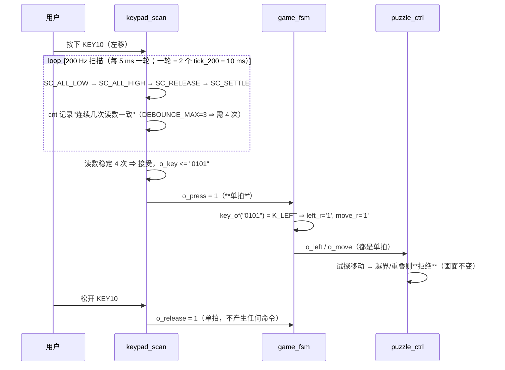

# 键盘操作

> 一句话定位：哪个物理键对应哪个功能、在哪个状态下有效、一次按键为什么只触发一次。

**结论**：8 个键各有明确功能（`K_START` / `K_SELECT` / `K_CONFIRM` / `K_UP` / `K_DOWN` /
`K_LEFT` / `K_RIGHT` / `K_ROT`）；**对局中**（`S_PLAYING`）才响应选择/移动/旋转/确认，
**只有【开始】键在任何状态都有效**；按键信号经过 **4 次一致性消抖（≈40 ms）** 后
只产生**一个时钟周期的 `o_press` 脉冲** ⇒ **按住不放不会连发**，必须松开再按。

## 一、按键映射表（以源码 `key_of()` 为唯一真值源）

| 物理键号 | 矩阵位置 | 原始键号 `idx` = `4*row+col` | 键码 | 功能 |
|---|---|---|---|---|
| **KEY14** | 上板实测确认 | `0001` (1) | `K_START` | **开始 / 重开一局** |
| **KEY16** | 上板实测确认 | `0011` (3) | `K_SELECT` | **循环选择**零片 |
| **KEY11** | 十字中心 | `0110` (6) | `K_CONFIRM` | **确认锁定**（变黄） |
| **KEY7** | 十字上臂 | `1010` (10) | `K_UP` | 上移 |
| **KEY15** | 十字下臂 | `0010` (2) | `K_DOWN` | 下移 |
| **KEY10** | 十字左臂 | `0101` (5) | `K_LEFT` | 左移 |
| **KEY12** | 十字右臂 | `0111` (7) | `K_RIGHT` | 右移 |
| **KEY8** | 十字右侧 | `1011` (11) | `K_ROT` | **顺时针旋转 90°** |
| KEY13（本行空格） | — | `0000` (0) | `K_NONE` | 无按键 |

!!! bug "这张表是**上板测量**出来的，不是照键盘丝印推的"
    早期版本按"阅读顺序"猜键号，结果【开始】与【选择】都失灵——ERR-004 记录"键码编码与比较表
    不一致"，ERR-002 更是**本次最长的一次误判**（诊断固件自己漏配了键盘引脚）。
    现在 `key_of()` 是唯一的键位真值源，{{src:rtl/game_fsm.vhd:143}} 里每个分支都注明了
    "上板确认/上板核对"。

## 二、哪个状态响应哪些键

| 状态 | 【开始】`K_START` | 【选择】`K_SELECT` | 【确认】`K_CONFIRM` | 【上/下/左/右】 | 【旋转】`K_ROT` |
|---|---|---|---|---|---|
| `S_SELF_TEST` | — | — | — | — | — |
| `S_IDLE` | ✅ 进入预览（重装 `T_PREVIEW`，关数归 1） | — | — | — | — |
| `S_PREVIEW` | ✅ **重开**（B11） | — | — | — | — |
| `S_PLAYING` | ✅ **重开**（B11） | ✅ 循环选中 | ✅ 锁定选中块 | ✅ 移动选中块 | ✅ 旋转选中块 |
| `S_WIN` / `S_FAIL` | ✅ 重开（B11） | — | — | — | — |

!!! note "「—」是**真的不响应**，不是"没接""
    命令译码进程只有一条使能条件：`i_press='1'` **且** `st = S_PLAYING`
    （{{src:rtl/game_fsm.vhd:408}}）。【开始】则由状态寄存器单独处理，
    所以在四个状态下都能重开。**选择/移动/旋转/确认在非对局态被忽略**——
    这正是 B6~B8 的隐含约束（没散落哪来的零片可操作）。

## 三、一次按键在电路里长什么样

**为什么按住不会连发**：`keypad_scan` 只在"**新接受的键**"出现时发 `o_press`
（状态机里"已接受"与"待释放"分开），而 `game_fsm` 的命令寄存器**每个时钟周期都被默认清零**
（{{src:rtl/game_fsm.vhd:401}}），只有 `i_press='1'` 那一拍才置位
⇒ 一次按下 = **一个 `o_press` 脉冲** = 走一格 / 转 90°。

!!! tip "手感提示（演示时有用）"
    要连走 3 格，必须**按 3 次**（每次松开再按）。长按只会走一格。
    消抖窗口 ≈ 40 ms，所以**超快连按**（< 40 ms）可能被当成抖动合并掉——
    正常人手速不成问题。

## 四、消抖参数与它的坑

| 参数 | 值 | 含义 | 改大/改小的坑 |
|---|---|---|---|
| 扫描节拍 | `t_200` = **200 Hz**（5 ms） | 状态机每 5 ms 走一步 | — |
| 一致性轮数 | `DEBOUNCE_MAX` = **3**（需连续 4 次读数一致） | 接受一个新键的条件 | — |
| 一轮耗时 | **10 ms**（`SC_ALL_HIGH` 与 `SC_ALL_LOW` 各等一个 tick） | ⇒ 4 次 ≈ **40 ms** | 旧注释写"16 × 5 ms = 80 ms"，是错的 |
| `cnt` 位宽 | **2 位**（`0..3`） | 8 位 → 2 位省下的触发器是真的 | ⚠️ **若 `DEBOUNCE_MAX` 改成 > 3，必须同步加宽 `cnt`**，否则 `cnt = DEBOUNCE_MAX` 恒不成立、消抖**静默失效** |

## 五、实测波形

<figure markdown="span">
  { loading=lazy }
  <figcaption>
  **图 5.2** `keypad_scan` 的扫描状态机与 `o_press`/`o_release` 单拍语义
  （**真实 Quartus 波形编辑器截图**）。
  测试场景：`sim/tb_keypad_scan.py` 的按键按下/松开/抖动断言；
  观察信号：`state`（`SC_ALL_LOW/HIGH/RELEASE/SETTLE`）、`i_tick`（200 Hz）、`o_key`、`o_press`、`o_release`；
  预期：读数连续 4 次一致后才更新 `o_key`，且 `o_press` 只有**一个时钟周期**宽；
  实测：见 `sim/rounds/keypad_scan/r27.json`；证据级别：【RTL 仿真】。
  **能证明**：消抖窗口与"一次按下只发一个脉冲"的语义。**不能证明**：
  真板上按键的抖动幅度与手感（需板级观察）。
  </figcaption>
</figure>

## 证据与出处

| 结论 | 依据 |
|---|---|
| 键位映射（唯一真值源） | {{src:rtl/game_fsm.vhd:143}}（`key_of`） |
| 键码常量 | {{src:rtl/puzzle_pkg.vhd:523}} |
| 状态使能条件（只有对局响应） | {{src:rtl/game_fsm.vhd:408}} |
| 单拍脉冲语义 | {{src:rtl/game_fsm.vhd:400}}（默认清零） |
| 扫描/消抖状态机 | {{src:rtl/keypad_scan.vhd:38}}、{{src:rtl/keypad_scan.vhd:105}}（位宽警告） |
| 断言与轮次 | `sim/rounds/keypad_scan/r27.json`、`sim/rounds/game_fsm/r36.json` |
| 键位误判的两次教训 | {{src:docs/06-硬件调试记录.md}}（ERR-002、ERR-004） |

!!! warning "待核实"
    表中"KEY14 = 开始 / KEY16 = 选择"来自**上板实测**（`key_of` 注释里写明"上板确认"），
    但仓库里**没有保存那次测量的原始记录**（没有照片、没有测量日志）。
    核实路径：按 [现场演示脚本](../09-defense/demo-script.md) 依次按 8 个键，
    记录实际反应；或读诊断顶层 `keypad_diag_top` 的键码显示输出。
