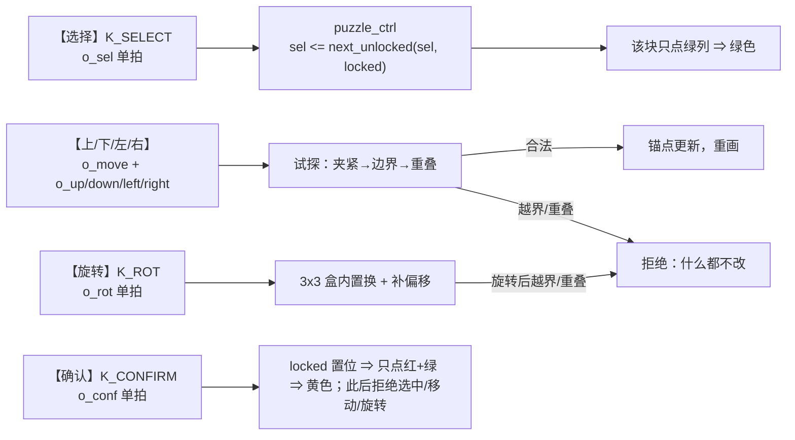

# 移动与旋转

> 一句话定位：零片怎么被选中、怎么走、怎么转、怎么锁定；**旋转在坐标上到底做了什么**——
> 并用一块**真实零片掩码**逐步把四个朝向算出来。

**结论**：选中 = 循环切换（选中块**绿**）；移动 = 上/下/左/右各走一格，
**越界或与别的零片重叠的请求被直接拒绝**（画面不变）；旋转 = 每次**顺时针 90°**，
在**固定 3×3 盒**里做坐标置换、再在算行掩码处补回**锚点偏移**；
确认 = 锁定（**黄**），锁定后不可再选、不可再移。

## 一、操作与画面语义



| 零片状态 | 红列 `o_rowr` | 绿列 `o_rowg` | 肉眼颜色 |
|---|---|---|---|
| 未锁定、未选中 | 1 | 0 | **红** |
| 选中 | 1 | 1 | **绿**（红+绿=绿，因为该点两种颜色同时亮） |
| 已锁定 | 1 | 1 | **黄**（同样的双色叠加，但**语义**由 `locked` 区分；画面上靠"不能动"区分） |
| 告急幽灵（目标空格，剩余 ≤10 s） | 0 | 2 Hz 方波 | **绿色闪烁**（全屏唯一会闪的东西） |

!!! note "为什么"选中绿"和"锁定黄"在点阵上都是双色叠加"
    这块点阵**只有红/绿两列**，每个点只有 4 种状态（灭/红/绿/黄）。
    `puzzle_ctrl` 输出的是**两套 64 位掩码**（`o_rowr`/`o_rowg`），
    显示层只做"按行切片 + 叠加"。真正的"选中 vs 锁定"区别在**引擎里的 `sel` / `locked` 寄存器**，
    画面上则靠"选中块还会跟着移动键走、锁定块不动"来区分。

## 二、坐标与位序约定（后面所有演算都基于它）

| 项 | 约定 | 依据 |
|---|---|---|
| 掩码位下标 | `bit = 8*row + col`（`row` 0 = **最上面**一行） | {{src:rtl/puzzle_pkg.vhd:621}}（`mk_cell`） |
| 64 位帧的位 63..56 | 第 0 行（最上） | {{src:rtl/puzzle_top.vhd:724}} |
| 零片掩码 | 每块零片存成 64 位，**紧包围盒锚在自己的 (0,0)** | {{src:rtl/puzzle_pkg.vhd:106}} |
| 朝向 `ori` | 2 位/块：`00`=0°、`01`=顺时针 90°、`10`=180°、`11`=顺时针 270° | {{src:rtl/puzzle_pkg.vhd:95}} |
| 初始朝向 | `PIECE_ORI_INIT = "10"&"10"&"01"&"01"` ⇒ 四块分别是 1/1/2/2 | {{src:rtl/puzzle_pkg.vhd:310}} |
| 零片最大包围盒 | 3×3（`PIECE_MAX_DIM`）⇒ 引擎只扫 3×3 邻域 | {{src:rtl/puzzle_pkg.vhd:385}} |

## 三、真实零片的逐步旋转演算

**对象**：第一关第三块零片 `L1_P2`（L 形三格块），源码里的常量是
{{src:rtl/puzzle_pkg.vhd:173}}：

```text
L1_P2 = 0000000000000000000000000000000000000000000000000000001100000010
                                                 bit 9,8 ┘        └ bit 1
```

按 `bit = 8*row + col` 解码，紧包围盒是 **2×2**（`h = w = 2`，即 3 位向量 `"010"`）：

| 紧包围盒坐标 | 位下标 | 值 |
|---|---|---|
| `(0,0)` | 0 | 0 |
| `(0,1)` | 1 | **1** |
| `(1,0)` | 8 | **1** |
| `(1,1)` | 9 | **1** |

形状（`#` = 有格子）：

```text
. #        (0,1)
# #        (1,0) (1,1)
```

**旋转是怎么算的**（`puzzle_ctrl` 里的唯一调用点 {{src:rtl/puzzle_ctrl.vhd:149}}）：

```text
dr := rot_off_r(h, w, ori)          -- 旋转后紧包围盒在 3x3 盒里的行偏移
dc := rot_off_c(h, w, ori)          -- 列偏移
行掩码 := srl8( rot_row(shp, ori, sr + dr),  ac - dc )
                                        ↑ 盒内行号      ↑ 列移位（可为负）
旋转后高度 hh := oh(h, w, ori)      -- 90°/270° 时高宽互换
```

四个朝向的**偏移量**（源码公式：`"01"→3-h`、`"10"→3-w`、`"11"→3-w`（行）/`0`（列）、其余 0）：

| `ori` | 含义 | `oh` / `ow` | `dr` | `dc` | 说明 |
|---|---|---|---|---|---|
| `00` | 0° | 2 / 2 | 0 | 0 | 无需补偿 |
| `01` | 顺时针 90° | 2 / 2 | 0 | **1** = 3−h | 2×2 转完停在盒的第 1 列 |
| `10` | 180° | 2 / 2 | **1** = 3−h | **1** = 3−w | 行、列都要补 |
| `11` | 顺时针 270° | 2 / 2 | **1** = 3−w | 0 | 只补行 |

**逐行演算**（`rot_row` 的置换公式：`00`→`(sr, c)`；`01`→`(2−c, sr)`；
`10`→`(2−sr, 2−c)`；`11`→`(c, 2−sr)`；下表的"盒内行"= `sr + dr`）：

| `ori` | 紧包围盒行 `sr` | 盒内行 | `rot_row` 取到的格子（盒坐标） | 行掩码（低 3 位） | 减去 `dc` 后的紧包围盒行 |
|---|---|---|---|---|---|
| `00` | 0 | 0 | `(0,0)(0,1)(0,2)` → 0,**1**,0 | `010` | `.#` |
| `00` | 1 | 1 | `(1,0)(1,1)(1,2)` → **1**,**1**,0 | `011` | `##` |
| `01` | 0 | 0 | `(2,0)(1,0)(0,0)` → 0,**1**,0 | `010` | `#`（第 0 行） |
| `01` | 1 | 1 | `(2,1)(1,1)(0,1)` → 0,**1**,**1** | `110` | `##`（第 1 行） |
| `10` | 0 | 1 | `(1,2)(1,1)(1,0)` → 0,**1**,**1** | `110` | `##` |
| `10` | 1 | 2 | `(0,2)(0,1)(0,0)` → 0,**1**,0 | `010` | `#.` |
| `11` | 0 | 1 | `(0,1)(1,1)(2,1)` → **1**,**1**,0 | `011` | `##` |
| `11` | 1 | 2 | `(0,0)(1,0)(2,0)` → 0,**1**,0 | `010` | `.#` |

**四种朝向下的实际形状**（锚点行 `ar`、锚点列 `ac`；绝对列 = `ac + 紧包围盒列`）：

| `ori` | 紧包围盒形状 | 相对锚点的绝对格（`ar=2, ac=3` 为例） |
|---|---|---|
| `00`（0°） | `.#` / `##` | (2,4)、(3,3)、(3,4) |
| `01`（顺时针 90°） | `#.` / `##` | (2,3)、(3,3)、(3,4) |
| `10`（180°） | `##` / `#.` | (2,3)、(2,4)、(3,3) |
| `11`（顺时针 270°） | `##` / `.#` | (2,3)、(2,4)、(3,4) |

四种朝向**两两不同**（也可以反过来说：这块零片**必须**转对方向才能拼进目标），
四条结果与 `scripts/check_geometry.py` 的独立实现（"在紧包围盒里直接转"）
**逐块 × 逐朝向 × 逐行比对全等**。

!!! quote "为什么"先转、再补偏移"，而不是"直接在紧包围盒里转""
    直接在紧包围盒里转要在每个下标上算 `h−1−c` / `w−1−c` 并加范围保护——
    **实测 +229 LE，直接装不下**。盒内转只在每个调用点放 **3 个 4:1 mux**（约 +6 LE），
    把"贵的那一级置换"放在**本来就被逐行复用**的地方；偏移只在**算行掩码的唯一一处**补回。
    这正是讲义"器件资源的优化"里那条：**串行化 / 复用**。

!!! bug "第一版漏了偏移补偿（ERR-040）"
    盒内转之后**紧包围盒不再锚在 (0,0)**：1×3 横条转 90° 会落到盒的第 2 列，
    于是零片一旋转就**凭空横移两格**、而且再也够不到点阵左边界。
    抓到它的是"旋转后仍以紧包围盒左上角为锚点"这条不变量，
    留档见 {{src:docs/06-硬件调试记录.md}}。

## 四、移动的拒绝语义

| 情况 | 判定 | 结果 |
|---|---|---|
| 目标位置整块在 8×8 内、且与任何其它零片不重叠 | 允许 | 锚点更新，重画 |
| 任一格越出 8×8（B7） | 拒绝 | **锚点不变**，画面无变化 |
| 与另一块零片（无论是否锁定）有格子重叠 | 拒绝 | 同上 |
| 该块已锁定（B8） | 拒绝 | 选中都会被跳过（`next_unlocked`），更不会移动 |
| 旋转后越界或重叠（A4） | 拒绝 | **朝向与锚点都不变** |

## 五、实测波形

<figure markdown="span">
  { loading=lazy }
  <figcaption>
  **图 5.3** `puzzle_ctrl` 的整帧快照、锁定与判据输出（**真实 Quartus 波形编辑器截图**）。
  测试场景：`sim/tb_puzzle_ctrl.py` 的移动/旋转/拒绝/锁定/整帧判据断言；
  观察信号：`o_rowr`/`o_rowg`（两套 64 位帧）、`o_lock`（四块锁定）、`o_sel_idx`、`o_ori`、`o_solved`、`o_all_lock`；
  预期：移动/旋转被拒绝时帧不变；四块全锁且并集等于目标时 `o_solved='1'`；
  实测：见 `sim/rounds/puzzle_ctrl/r37.json`（本轮新增断言 ⑳）；证据级别：【RTL 仿真】。
  **能证明**：几何校验、旋转置换与整帧判据的行为。**不能证明**：
  玩家手感，以及 ERR-018b/041 那两条极端分支的现场概率。
  </figcaption>
</figure>

## 证据与出处

| 结论 | 依据 |
|---|---|
| 位序与 `mk_cell` | {{src:rtl/puzzle_pkg.vhd:621}} |
| 旋转原语与偏移公式 | {{src:rtl/puzzle_pkg.vhd:766}}、{{src:rtl/puzzle_pkg.vhd:795}}、{{src:rtl/puzzle_pkg.vhd:807}} |
| 高宽互换 `oh`/`ow` | {{src:rtl/puzzle_pkg.vhd:819}}、{{src:rtl/puzzle_pkg.vhd:826}} |
| 调用组合（`dr`/`dc`/`srl8`） | {{src:rtl/puzzle_ctrl.vhd:149}} |
| 真实零片掩码 | {{src:rtl/puzzle_pkg.vhd:160}}（1×3 横条）、{{src:rtl/puzzle_pkg.vhd:170}}（6 格阶梯）、{{src:rtl/puzzle_pkg.vhd:173}}（本页用的 L 形） |
| 选中/锁定/拒绝 | {{src:rtl/puzzle_ctrl.vhd:764}}（`next_unlocked`）、{{src:rtl/puzzle_ctrl.vhd:823}}（移动校验）、`sim/rounds/puzzle_ctrl/r37.json` |
| 几何独立实现比对 | {{src:scripts/check_geometry.py}} |
| +229 LE / +6 LE 的面积实测 | {{src:rtl/puzzle_pkg.vhd:99}}（注释里的实测记录） |
| 整机旋转覆盖 | `sim/rounds/puzzle_top/r56.json`（断言 ⑰：按 KEY8 三次查朝向单调 +1、`o_pos` 不变） |

!!! warning "待核实"
    本页的"逐行演算"是**按源码公式手算**的（并已与 `check_geometry.py` 的独立实现核对过朝向与形状）。
    **仿真波形里的位级中间值**没有单独截图：`rot_row` 是**纯函数**，
    在 VHDL 里被展开成组合逻辑，不会出现在 `sim/*.vwf` 的信号列表里。
    核实路径：在 `sim/tb_puzzle_ctrl.py` 里对 `o_rowr` 逐行抓值，
    或在 Python 里按 {{src:rtl/puzzle_pkg.vhd:703}}（`srl8`）与 `rot_row` 重放本页的算例。
