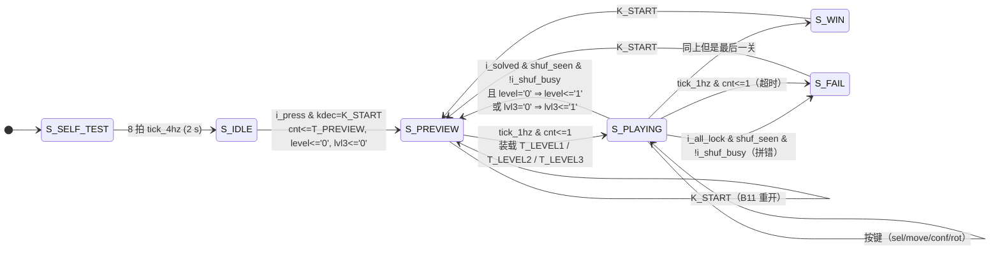
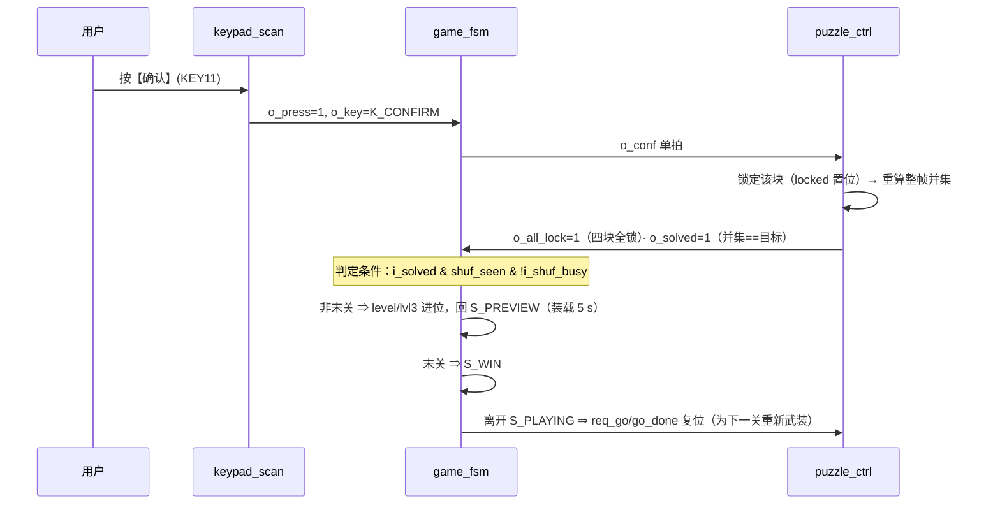

# 一局的生命周期

> 一句话定位：从按下【开始】到这一局结束，状态机走过哪些状态、每个状态停留多久、
> 三个显示器件与蜂鸣器在这一局里各阶段表现成什么样。

**结论**：一局 = **预览 5 s**（`S_PREVIEW`）→ **散落**（`S_PLAYING` 头几毫秒的握手）
→ **对局限时**（第一关 **30 s**、第二关 **40 s**、第三关 **60 s**）→
**过关**（回预览下一关）或 **失败**（拼错立即失败 / 限时到）。

## 一、状态迁移（带条件）

!!! note "为什么成功/失败判定都要等 `i_shuf_busy='0'` 和 `shuf_seen='1'`"
    这两条是 ERR-024 的修法，**不是多余条件**：
    引擎的 `locked`/`pos` 只在**散落**时被清零，所以在新一局**刚进入 `S_PLAYING`、还没散落**
    的那几个周期里，`i_solved`/`i_all_lock` 反映的是**上一局的残留状态**——
    直接拿来判决会让"上一局刚赢"的机器在开局瞬间再次判赢。
    `shuf_seen` 记录"本局已经看见过散落的忙态"，`i_shuf_busy='0'` 保证"散落已经结束"。

## 二、一局的四个阶段

| 阶段 | 时长 | 点阵 | 数码管 | 蜂鸣器 | 状态/信号 |
|---|---|---|---|---|---|
| **预览** | 5 s（见下面的相位说明） | 完整目标图案（红） | `DISP7` = 剩余秒 5→1；`DISP0` = 关数 | `SND_PREVIEW`（上行纯五度 A5→E6） | `S_PREVIEW`、`cnt` 从 `T_PREVIEW`=5 递减 |
| **散落** | 几十微秒~毫秒级 | 三/四块零片出现在随机位置（红） | 同上（限时已装载） | 本关 BGM 起 | `S_PLAYING` 头几个周期：`o_go` 电平握手 + `i_shuf_busy` |
| **对局** | 30 / 40 / 60 s | 零片（选中绿、锁定黄、未锁定红）；剩余 ≤10 s 出现**绿色 2 Hz 闪的告急幽灵** | `DISP4:DISP3` = 剩余秒（两位）；`DISP0` = 关数 | 本关 BGM 循环 | `S_PLAYING`，`cnt` 每秒递减 |
| **结算** | 到按【开始】为止 | `S_WIN`：绿色粗对勾；`S_FAIL`：红色粗叉（先闪 1 s 再常亮） | 保持关数显示 | `SND_WIN` / `SND_FAIL` | `S_WIN` / `S_FAIL` |

!!! warning "预览的"5 秒"实际是 `(4, 5] s`，限时才是**恰好**整秒"
    倒计时按**自由走的 1 Hz 节拍**递减，而预览的**入口是按键**（与节拍错相）⇒
    预览窗口 = `(T_PREVIEW−1, T_PREVIEW]` s，随按键相位浮动（最差比标称少不到 1 s）。
    限时这一段不同：它是在"预览结束的**那个节拍**"上装载的，起点与节拍对齐
    ⇒ 窗口**恰好**是 `T_LEVEL*` 秒。这条口径写在 {{src:rtl/game_fsm.vhd:301}}。
    **板上演示时别按"整 5 秒"来读秒**——这是设计事实，不是计时 bug。

## 三、关卡是怎么往上走的

| 关卡 | 编码 | 图案 | 零片 | 限时 | 进入条件 |
|---|---|---|---|---|---|
| 第一关 | `level='0'`, `lvl3='0'` | 恒为图 4-1（4 行 × 3 列矩形） | **3 块** | 30 s | 按【开始】 |
| 第二关 | `level='1'`, `lvl3='0'` | **固定 PAT3（阶梯）** | **4 块**（异形） | 40 s | 第一关拼对 |
| 第三关 | `level='1'`, `lvl3='1'` | **四幅库随机**（`pat_sel` 锁存 `rng_lfsr` 低 2 位） | **4 块** | 60 s | 第二关拼对 |
| 胜利 | — | — | — | — | 第三关拼对（`S_WIN`） |

!!! quote "为什么关数用**两个信号**（`o_level` + `o_lvl3`）而不是一根 2 位总线"
    在这颗已占用 **98%** 的器件上，把原来的关卡网络加宽成 2 位总线
    **损失了 2~5 MHz 的 Fmax**（依据见 {{src:rtl/disp_format.vhd:18}}）。
    于是用"两个已有信号"表达三关：`level` 表示"是否过了第一关"，`lvl3` 表示"是否在第三关"。

## 四、一次"过关"的完整握手

## 五、超时与拼错的差别

| 情形 | 触发 | 画面 | 音效 |
|---|---|---|---|
| **拼错**（四块全锁定，但并集 ≠ 目标） | `i_all_lock='1'` 且 `i_solved='0'` | 立即进 `S_FAIL` | `SND_FAIL` |
| **超时**（限时到） | `tick_1hz='1'` 且 `cnt<=1` | 进 `S_FAIL` | `SND_FAIL` |
| **未锁完但限时到** | 同上 | 进 `S_FAIL`（不看是否拼对） | `SND_FAIL` |

## 证据与出处

| 结论 | 依据 |
|---|---|
| 状态与转移条件 | {{src:rtl/game_fsm.vhd:262}}（`case st is` 全部分支） |
| 限时装载与"恰好整秒" | {{src:rtl/game_fsm.vhd:296}}、{{src:rtl/game_fsm.vhd:301}} |
| `shuf_seen` / `i_shuf_busy` / `go_done` 握手 | {{src:rtl/game_fsm.vhd:421}}、{{src:rtl/game_fsm.vhd:440}} |
| 三关的图案与零片数 | {{src:rtl/puzzle_pkg.vhd:189}}、{{src:rtl/puzzle_pkg.vhd:240}}、{{src:rtl/puzzle_pkg.vhd:273}} |
| 关卡编码与 Fmax 代价 | {{src:rtl/disp_format.vhd:18}} |
| 整机轮次（三场景） | `sim/rounds/puzzle_top/r56.json`（模式 A）、`sim/rounds/puzzle_top/r57.json`（模式 B） |
| 四份走法计划 | {{src:scripts/check_plans.py}}、{{src:sim/tb_puzzle_top.py}} |

!!! warning "待核实"
    "散落耗时几十微秒~毫秒级"没有精确实测值——仿真里散落由**拒绝采样**驱动，
    耗时取决于候选池与 LFSR 相位。核实路径：在 `sim/rounds/puzzle_ctrl/r37.json`
    里找 `i_shuf_busy` 的连续高电平长度（以 1 kHz 拍计数），即散落占用的拍数。
