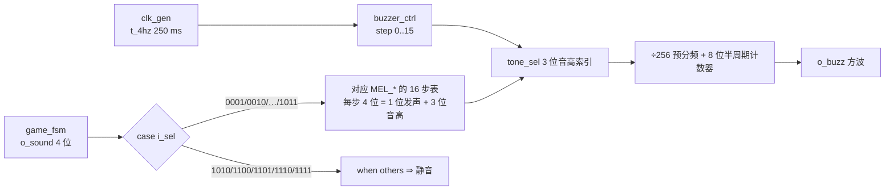

# 音效与背景音乐

> 一句话定位：4 位音效码怎么变成声音、三关背景音乐怎么区分、
> **哪些场景故意没有声音**，以及为什么"好不好听"这件事在本仓库里**没有客观证据**。

**结论**：`game_fsm` 输出 **4 位音效码 `o_sound`**；`buzzer_ctrl` 用一张 **8 音高表**
（`E5 G5 A5 A#5 B5 C6 E6 G6`）在 **÷256 预分频**后的 **195312.5 Hz** 上产生方波，
每个码对应一条 **16 步乐句**（**每步 250 ms，一句 4 s**，由 `tick_4hz` 推进）。
**16 个码里有 5 个没有查表臂 ⇒ 整句静音**，这是有意的。

## 一、音效码总表

| 码 | 常量 | 场景 | 有查表臂？ | 旋律（步数 / 特征） |
|---|---|---|---|---|
| `0000` | `SND_NONE` | 待机（静音） | ✅（指向 `MEL_SILENT`） | 16 步全静音 |
| `0001` | `SND_SELF` | 开机自检 | ✅ | 第 0 步与第 8 步各一声短鸣（间隔正好 8 步） |
| `0010` | `SND_PREVIEW` | 预览/倒计时 | ✅ | A5 → E6（**上行纯五度**）×3 步 = **0.75 s**，全系统最短 |
| `0011` | `SND_CLEAR` | 过关 | ✅ | C6 E6 G6 E6 上行琶音回旋 ×2（16/16 全发声） |
| `0100` | `SND_WRONG` | 拼错 | ✅ | **下行**：E6 → C6 → B5 → A#5 |
| `0101` | `SND_KEY` | 按键（普通） | ✅（**已不再生成**） | G6 短促 blip（16/16） |
| `0110` | `SND_WIN` | 通关 | ✅ | 最高音区同音反复 + 拖长（4 s） |
| `0111` | `SND_FAIL` | 失败 / Game Over | ✅ | 稀疏下行 E6 → A5 |
| `1000` | `SND_BGM1` | **第一关背景音乐** | ✅ | E6/G6 高音区、只换 4 次音、舒缓波浪 |
| `1001` | `SND_BGM2` | **第二关背景音乐** | ✅ | E5→G5→A5→E5 低音区、每 4 拍换一次（慢速块状） |
| `1010` | `SND_ROT` | 旋转（原设计） | ❌ **已删** | 常量与乐句保留，不再生成 |
| `1011` | `SND_BGM3` | **第三关背景音乐** | ✅ | G5↔E6 **跨音区**、16 步里换 14 次音（忙而紧） |
| `1100` | `SND_CONF` | 确认/锁定（原设计） | ❌ **已删** | 同上，常量保留 |
| `1101` | `SND_SEL` | 选择零片 | ❌ 无 | 落入 `when others` ⇒ 静音 |
| `1110` | `SND_MOVE` | 移动一步 | ❌ 无 | 同上 |
| `1111` | `SND_TIME` | 最后 5 秒催促 | ❌ 无（**预留未用**） | 同上 |

!!! note "背景音乐码是**纯拼线**得到的（0 个逻辑单元）"
    `game_fsm` 里对局期的音效码是一行拼接：
    `sound_p <= "10" & lvl3 & level`（{{src:rtl/game_fsm.vhd:570}}）——
    两个位直接来自**已有的关卡寄存器**，所以三关 BGM（`1000`/`1001`/`1011`）不需要任何查表逻辑。
    曾有一个"把轨迹位拍进 2 位寄存器"的方案，实测 **1272 LE 装不下**，被否决。

## 二、8 个音高与音准

| 音高索引 | 音名 | 半周期（预分频后的 tick 数） | 实际频率 `f = 195312.5 / (2·(half+1))`（与设计值偏差） |
|---|---|---|---|
| 0 | E5 | 148 | ≈ 655.4 Hz（设计 659.3，**−0.6%**） |
| 1 | G5 | 125 | ≈ 775.1 Hz（784.0，−1.1%） |
| 2 | A5 | 111 | ≈ 871.9 Hz（880.0，−0.9%） |
| 3 | A#5 | 105 | ≈ 921.3 Hz（932.3，−1.2%） |
| 4 | B5 | 99 | ≈ 976.6 Hz（987.8，−1.1%） |
| 5 | C6 | 93 | ≈ 1038.9 Hz（1046.5，−0.7%） |
| 6 | E6 | 74 | ≈ 1302.1 Hz（1318.5，**−1.25%** ← 最大误差档） |
| 7 | G6 | 62 | ≈ 1549.3 Hz（1568.0，−1.2%） |

!!! warning "音准是有代价的：**8 个音统一偏低 0.6~1.25%**"
    预分频从 ÷64 → ÷128 → **÷256**、半周期计数器从 9 位 → **8 位**，
    才把"方波那一侧"的逻辑压下来（配合 16 步让查表输入变成 8 位，
    8 位函数每个输出位要 **3 个 LUT4** = **+4 LE**）。
    代价是**半周期取整**：8 个音**一致偏低** 0.6~1.25%（`195312.5` 不是整数 Hz 的整数倍），
    最大误差在 **E6（−1.25%）**。**人耳几乎听不出**，
    但"绝对音准"确实不达标——如需精确音准应换更大的计数器（面积不够）。

## 三、乐句结构与节拍

| 项 | 值 |
|---|---|
| 每步时长 | **250 ms**（`tick_4hz`） |
| 一句长度 | **16 步 = 4 s**，循环 |
| 每步编码 | 4 位 = 1 位"这步响不响" + 3 位音高索引 |
| 预分频 | **÷256** ⇒ 一拍 **195312.5 Hz** |
| 半周期计数器 | **8 位**（最大 255） |
| 瞬时事件的保持 | `game_fsm` 的 **2 位 `snd_hold`** 把瞬时码保持 **2 个旋律步（250~500 ms）** |

!!! quote "为什么"填休止符"而不是"照抄原谱"（ERR-050）"
    第一关的旋律是**照抄**《超级马里奥》Overworld 开头的：音高**一字不错**，
    但原谱里有休止 ⇒ 16 步里只有 7 步发声（**56% 静音**）⇒
    在**单音蜂鸣器**上听起来就是"滴滴滴…停顿…滴滴滴"。
    **"转录正确"不等于"听得好"。** 修法是把每个休止填成"下一个要响的音"
    （句尾填上一个音）⇒ **音高序列与音的顺序一个不变**（还听得出是马里奥），
    但 16 步**全部发声**，成了一条连绵的旋律线。
    顺带的好处：相邻步变成同值后 fitter 能合并逻辑，**面积反而 −5 LE**。

## 四、三关 BGM 靠什么区分

用户在第 18 工作阶段反馈"三关 BGM **区分度不够**"（三首全在 C6~G6、全都是"每步一音"的连奏，
听起来像同一首曲子的三段）。重做后的分配原则：

| 维度 | 第一关 | 第二关 | 第三关 |
|---|---|---|---|
| 音区 | **高音区**（E6/G6） | **低音区**（E5/G5/A5） | **跨音区**（G5 ↔ E6） |
| 换音次数 | 4 次 | 3 次（每 4 拍才换） | **14 次**（几乎每步都换） |
| 节奏型 | 舒缓波浪 | **慢速块状脉冲** | 忙而紧 |
| 尾音 | G5 | E5 | **C6** |

三条依据（都来自听觉告警/耳标设计的实证结论）：① 音区只做**粗分**，
不要靠 1~2 个半音区分；② **节奏型/换音速率**是最强的区分维度，远强于音高本身；
③ **首音与尾音必须各不相同**（共享起音是已证实的混淆源）。

## 五、哪些场景**没有**声音（及原因）

| 场景 | 有没有声音 | 原因 |
|---|---|---|
| 对局中按【选择】/【移动】 | ❌ 静音 | 该码无查表臂；**用户明确要求**"确认、旋转按键没必要有特殊音效打扰背景音乐"（第 18 工作阶段） |
| 对局中按【确认】/【旋转】 | ❌ 静音 | 生成分支与查表臂**都已删**；常量与乐句保留（将来可加回两行 `when`） |
| 被拒绝的操作（越界/重叠/已锁定） | ❌ 静音 | 与上同源：无码、无臂；也避免"用一个音效表示失败"的歧义 |
| 最后 5 秒催促 | ❌ 静音 | `SND_TIME`=1111 **预留未用**（面积） |
| 待机 | ❌ 静音 | `SND_NONE` ⇒ `MEL_SILENT` |
| 自检 / 预览 / 过关 / 拼错 / 通关 / 失败 / 三关 BGM | ✅ 有 | 见第一节总表 |

## 六、实测波形

<figure markdown="span">
  { loading=lazy }
  <figcaption>
  **图 5.5** `buzzer_ctrl` 的音效码选择、16 步乐句与方波输出
  （**真实 Quartus 波形编辑器截图**）。
  测试场景：`sim/tb_buzzer_ctrl.py` 的码表/音高/节拍断言；
  观察信号：`i_sel`（4 位音效码）、`step`（0..15）、`i_t4`（250 ms）、`tone_sel`（3 位音高）、`o_buzz`；
  预期：每 250 ms 走一步、一句 16 步；被拒码（如 `1110`）输出静音；
  实测：见 `sim/rounds/buzzer_ctrl/r37.json`（16/16）；证据级别：【RTL 仿真】。
  **能证明**：码→乐句→音高的映射、节拍与发声/静音位置。**不能证明**：
  实际音色与"三关 BGM 是否真的听得出区别"（**没有录音证据**，见本页 danger 块）。
  </figcaption>
</figure>

## 证据与出处

| 结论 | 依据 |
|---|---|
| 16 个音效码与常量 | {{src:rtl/puzzle_pkg.vhd:564}} |
| 查表臂（哪些码真的有声音） | {{src:rtl/buzzer_ctrl.vhd:436}}（`when "0001"` 起）与 `when others` |
| 8 音高表与半周期 | {{src:rtl/buzzer_ctrl.vhd:146}} |
| 三关 BGM 的旋律与设计依据 | {{src:rtl/buzzer_ctrl.vhd:290}}、{{src:rtl/buzzer_ctrl.vhd:309}}、{{src:rtl/buzzer_ctrl.vhd:332}} |
| 连奏填音（ERR-050） | {{src:rtl/buzzer_ctrl.vhd:285}} |
| 自检"恰好一声"的修法 | {{src:rtl/buzzer_ctrl.vhd:207}}、{{src:rtl/game_fsm.vhd:265}} |
| BGM 码纯拼线 | {{src:rtl/game_fsm.vhd:570}} |
| 听感迭代（ERR-055：三个都混） | {{src:docs/06-硬件调试记录.md}} §21 |
| 断言与轮次 | `sim/rounds/buzzer_ctrl/r37.json`（16/16）、`sim/rounds/game_fsm/r36.json` |

!!! danger "本页最重要的诚实声明：音效的"听感"**没有**客观证据"
    【RTL 仿真】只能证明：**码选对了、步数对了、频率表对了、发声/静音的位置对了**。
    它**不能**证明"三关 BGM 听起来确实不同""提示音不刺耳""音量合适"。
    这些结论目前**只有人的文字判断**（`docs/06` 记录了三次"上板听 → 改"的迭代），
    **没有录音、没有频谱图、没有 AB 试听记录**。
    要做实，需要：录一段板上的声音（`.wav`）并入库、或至少记录"盲听测试"的结果。
    在此之前，任何"音效好听/区分度好"的说法都**只能算主观判断**。
