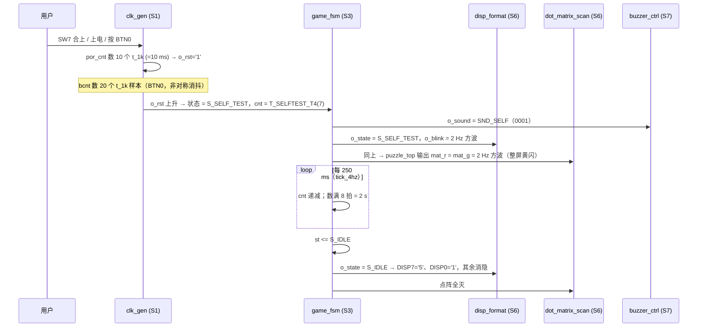
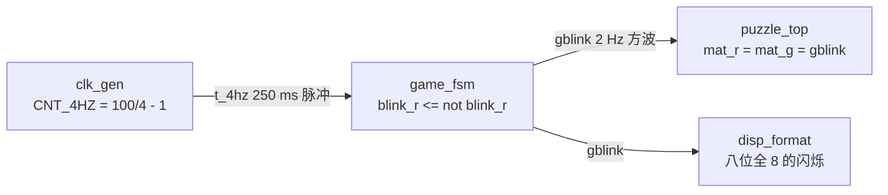

# 上电与自检

> 一句话定位：这一页讲**从上电到待机**这 2 秒多里发生了什么——`SW7` 合上后，
> 时钟复位链如何产生一个可靠的内部复位，状态机如何跑完自检，三个显示器件与蜂鸣器各做什么。

**结论**：`SW7='1'` → `clk_gen` 给出 **10 ms 上电复位（POR）** → `game_fsm` 进入
`S_SELF_TEST`，点阵**整屏黄、2 Hz 闪**、八位数码管**全 "8"、2 Hz 闪**、蜂鸣器**一声短鸣** →
数满 **8 拍 `tick_4hz`（= 2 s）** 后进入 `S_IDLE` 待机：点阵**全灭**、`DISP7='5'`、`DISP0='1'`。

## 一、复位与自检的链路

## 二、三个入口都走同一条路

| 入口 | 触发条件 | 自检窗口 | 备注 |
|---|---|---|---|
| **上电 POR** | 器件上电，`por_cnt` 数满 `T_POR_MS`=10 个 1 ms | **恒 2 s** | 计数器宽 4 位，只在 `T_POR_MS ≤ 16` 时够用（改大必须同步加宽） |
| **`BTN0` 按键复位** | `i_btn` 连续 20 个 1 ms 样本为高 | **恒 2 s** | **非对称消抖**：任一拍为低立即清零（松开立刻生效） |
| **`SW7` 关→开** | `i_sw='0'` 期间状态被钉在 `S_SELF_TEST` 并重装 `cnt` | **恒 2 s** | 旧版这里只有 **1 s**（ERR-051，已在第 17 工作阶段修掉） |

!!! quote "为什么自检要"数 8 拍 `tick_4hz`"而不是"数 2 拍 `tick_1hz`""
    这是 ERR-051 的修法。旧写法数 `tick_1hz`（2 拍 = 2 s）在**复位路径**上凑巧成立，
    但在 **`SW7` 重新进入**路径上只走了 1 s；更糟的是自检音效的旋律步与窗口不同相时，
    **整段自检可能一声都不响**。
    现在改成数 8 拍 `tick_4hz`（每次进入都重装），窗口恒为 **8 个旋律步**，
    而 `MEL_SELF` 的发声步相隔 8 ⇒ **连续 8 步必然恰好含一个发声步** ⇒ 两条路径都恰好一声。
    实现上用了**倒计数**（入口装 7、数到 0 退出），直接复用对局期已有的减法器与比较器
    ——正计数会多要一个 LAB（实测）。

## 三、三个阶段，三个器件各自做什么

| 阶段 | 点阵 `mat_r`/`mat_g` | 数码管 | 蜂鸣器 | 状态 |
|---|---|---|---|---|
| **POR / 复位期**（前 10 ms） | 全灭（`rst='1'` 强制清零） | 全灭 | 静音 | `S_SELF_TEST` 起点 |
| **自检**（2 s，B1） | 整屏**黄**：`mat_r = mat_g = gblink`（2 Hz 方波） | 八位全 **"8"**，2 Hz 闪 | `SND_SELF`：**一声短鸣**（第 0 / 8 步） | `S_SELF_TEST` |
| **待机**（B2，等【开始】） | **全灭** | `DISP7='5'`、`DISP0='1'`，其余消隐 | `SND_NONE`（静音） | `S_IDLE` |

!!! note "为什么待机时点阵必须"显式全灭"，不能"什么都不做""
    `puzzle_top` 在 `S_IDLE` 里是**强制清零**（{{src:rtl/puzzle_top.vhd:739}}），
    不是"保持上一帧"。因为零片要等开局散落才存在，若显示引擎帧，
    四块零片会全部堆在锚点 `(0,0)` 上（ERR-009 就是这么来的）。

## 四、自检的 2 Hz 是怎么来的

**关键点**：`t_4hz` 是 **250 ms 的脉冲**，**翻转**它才得到 2 Hz 方波。
曾有一段代码直接拿 500 ms 的 `tick_2hz` 当"2 Hz 节拍"用，
结果只有 **1 Hz**（ERR-038 的 2 倍记账错误）——所以现在全工程统一"**在 `t_4hz` 上翻转**"。

## 六、实测波形

<figure markdown="span">
  { loading=lazy }
  <figcaption>
  **图 5.1** `clk_gen` 的复位与节拍链（**真实 Quartus 波形编辑器截图**）。
  测试场景：`sim/tb_clk_gen.py` 的时钟/复位/抖动断言；
  观察信号：`o_rst`（复位）、`por_cnt`（POR 计数）、`bcnt`（`BTN0` 计数）、`o_tick_1k/200/1hz`；
  预期：POR 数满 10 个 1 ms 后 `o_rst` 释放，各 tick 间隔 1 ms / 5 ms / 1 s；
  实测：见 `sim/rounds/clk_gen/r25.json`；证据级别：【RTL 仿真】。
  **能证明**：分频计数器的翻转间隔与复位释放时序符合设计。**不能证明**：
  板上 50 MHz 晶振的绝对精度，也不能替代板级实测。
  </figcaption>
</figure>

## 证据与出处

| 结论 | 依据 |
|---|---|
| POR 10 ms、`BTN0` 20 ms 非对称消抖 | {{src:rtl/clk_gen.vhd:103}}、{{src:rtl/puzzle_pkg.vhd:427}} |
| 自检窗口恒 2 s（8 拍 `tick_4hz`）、`SW7` 重装 | {{src:rtl/game_fsm.vhd:252}}、{{src:rtl/game_fsm.vhd:264}} |
| 全黄 2 Hz、`S_IDLE` 全灭 | {{src:rtl/puzzle_top.vhd:735}}、{{src:rtl/puzzle_top.vhd:739}} |
| 待机 `DISP7='5'`、`DISP0='1'` | {{src:rtl/disp_format.vhd:7}} |
| 自检音效 `SND_SELF` | {{src:rtl/game_fsm.vhd:565}}、{{src:rtl/buzzer_ctrl.vhd:207}} |
| 断言与轮次 | `sim/rounds/clk_gen/r25.json`、`sim/rounds/game_fsm/r36.json`、`sim/rounds/puzzle_top/r56.json` |
| ERR-038 / ERR-051 的来龙去脉 | {{src:docs/06-硬件调试记录.md}} |

!!! warning "待核实"
    `BTN0` 消抖的"20 个 1 ms 样本"在源码里有注释与常量，
    但**按下/松开的时间窗**在真实板子上没有实测记录（人手抖动特性因板而异）。
    核实路径：用示波器或逻辑分析仪抓 `PIN_BTN0`，或临时把 `bcnt` 接到一个 LED 上观察。
