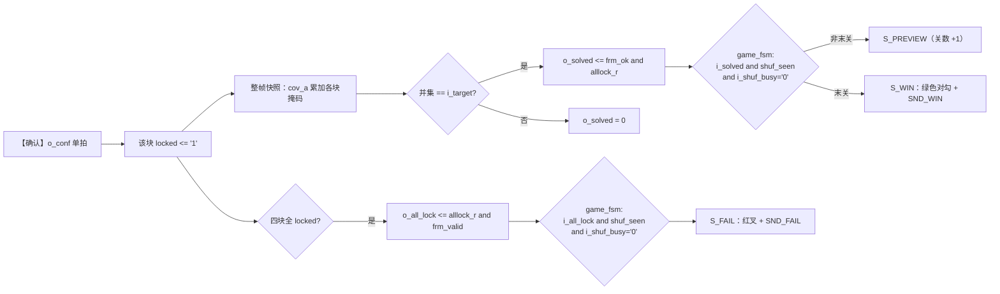

# 胜负判定

> 一句话定位：一块零片被锁定之后，电路是怎么"知道"整幅图拼对了的？
> 为什么判定要等两个额外的条件？结算画面与音效是什么？

**结论**：锁定 = `locked` 置位；引擎对**整帧快照**做"**并集 == 目标图案**"的判据
（`frm_ok`）与"这一帧是干净帧"的判据（`frm_valid`）；
`game_fsm` 只在 **`shuf_seen='1'`（本局见过散落）且 `i_shuf_busy='0'`（散落已结束）** 时才采信，
据此进 `S_WIN`（绿色对勾 + 胜利号角）或 `S_FAIL`（红叉 + 失败音）。

## 一、判定链

## 二、三条判据各自在防什么

| 判据 | 含义 | 防的是 |
|---|---|---|
| `frm_ok` | **整帧快照**的并集 == 目标图案 | ERR-021：**不能**用"引擎内部编号/计数"判过关——只有"玩家看得见的画面"才算数 |
| `frm_valid` | 这一帧是**干净帧**（快照窗口内没被新请求扰动） | 半更新状态被当成整帧判决 |
| `shuf_seen` | 本局**看见过散落的忙态** | ERR-024：新一局开局瞬间，`i_solved`/`i_all_lock` 还是**上一局的残留**，直接采信会"开局即判赢" |
| `i_shuf_busy='0'` | 散落**已经结束** | 散落过程中的中间态被误判 |

!!! bug "为什么"看见过散落"是必需的（ERR-024）"
    引擎的 `locked`/`pos` **只在散落时清零**。所以在新一局刚进 `S_PLAYING`、散落还没开始的那几个周期里，
    `o_solved`/`o_all_lock` 反映的是**上一局**的状态。
    症状：上一局刚赢的机器，按【开始】新开一局会**瞬间再次判赢**。
    修法就是加 `shuf_seen` 这一位"记忆"（{{src:rtl/game_fsm.vhd:440}}）。

!!! warning "还有一条已记录但**未修**的边界（ERR-041）"
    "干净帧"快照窗口有一条缝：某些相位下快照可能取到"半新半旧"的组合。
    已在 {{src:docs/06-硬件调试记录.md}} 记录、**未修**（需要更宽的握手）。
    当前实现用 `frm_valid` 把绝大多数相位挡掉了。

## 三、结算画面

| 状态 | 点阵图案 | 颜色 | 节奏 | 音效 |
|---|---|---|---|---|
| `S_WIN` | `WIN_MASK`：**粗对勾**（24 格，笔画 3 格宽） | **只点绿列** ⇒ 绿 | **先闪 4 个 250 ms 半周期（= 1 s）再常亮** | `SND_WIN` |
| `S_FAIL` | `FAIL_MASK`：**叉**（与对勾互为反色） | **只点红列** ⇒ 红 | 同上 | `SND_FAIL` |

配色的由来说起来很实用：这块点阵只有双色，**"红/绿"本身就是第一判读线索**
（绿 = 通过、红 = 不通过），比"同色靠形状区分"更直观。
历史演进：细红对勾 → 黄笑脸 → 粗红对勾 → **粗绿对勾**（用户拍板）。

!!! bug ""先闪 1 s"曾经是"先闪 2 s"（ERR-038）"
    闪烁节奏原本数 `t_2hz`（500 ms 脉冲）的 4 个脉冲 = **2 s**，
    而注释与文档都写"2 个 2 Hz 周期 = 1 s"—— 又是"把 500 ms 脉冲当 2 Hz 节拍"的**2 倍记账错误**。
    现在统一数 `t_4hz`（250 ms）：4 个半周期 = **1 s**，与文档一致。

## 四、成功的定义（与题目原文对齐）

| 项 | 内容 |
|---|---|
| "拼图成功"的判据 | **四块全部锁定**且**并集恰好等于目标图案**（题目 B9："位置和形状与初始拼图一致"） |
| 第一关目标 | 图 4-1：4 行 × 3 列实心矩形（12 格） |
| 第二关目标 | `L2_FIXED_PAT` = PAT3 阶梯（16 格，4 块异形零片拼成） |
| 第三关目标 | 四幅图案库随机一幅（`pat_sel` 在进入预览时锁存） |
| 过关后 | 非末关 ⇒ 回 `S_PREVIEW` 并装载下一关限时；末关 ⇒ `S_WIN` |
| 失败 | 拼错（全锁但不匹配，**立即**失败）或限时到（不论拼到哪一步） |

## 五、实测波形

<figure markdown="span">
  { loading=lazy }
  <figcaption>
  **图 5.4** 整机 `puzzle_top` 的三关流程、告急幽灵与结算画面
  （**真实 Quartus 波形编辑器截图**）。
  测试场景：`sim/tb_puzzle_top.py` 的模式 A（按录制走法拼完三关）；观察信号：`state`、`gtime`、
  `mat_r`/`mat_g`、`hint_on`/`hint_blink`、`o_sound`、`o_time`；
  预期：过关进 `S_PREVIEW` 且关数 +1、末关进 `S_WIN`、拼错/超时进 `S_FAIL`；
  实测：见 `sim/rounds/puzzle_top/r56.json`（模式 A）与 `r57.json`（模式 B）；证据级别：【RTL 仿真】。
  **能证明**：状态迁移、判定链与结算画面的逻辑正确。**不能证明**：
  点阵实际观感与"对勾/叉"在远处是否易读（无实拍照片）。
  </figcaption>
</figure>

## 证据与出处

| 结论 | 依据 |
|---|---|
| 整帧判据 `frm_ok` / `frm_valid` | {{src:rtl/puzzle_ctrl.vhd:305}}、{{src:rtl/puzzle_ctrl.vhd:360}} |
| `o_all_lock` 的定义 | {{src:rtl/puzzle_ctrl.vhd:364}} |
| `shuf_seen` 与 `i_shuf_busy` 门控 | {{src:rtl/game_fsm.vhd:337}}、{{src:rtl/game_fsm.vhd:350}}、{{src:rtl/game_fsm.vhd:440}} |
| 结算画面掩码与配色 | {{src:rtl/puzzle_pkg.vhd:374}}、{{src:rtl/puzzle_top.vhd:750}} |
| 结算闪烁 1 s 的修法 | {{src:rtl/puzzle_top.vhd:663}} |
| 断言与轮次 | `sim/rounds/puzzle_top/r56.json`（赢）、`sim/rounds/puzzle_top/r57.json`（输/超时）、`sim/rounds/puzzle_ctrl/r37.json` |
| ERR-021 / ERR-024 / ERR-038 / ERR-041 | {{src:docs/06-硬件调试记录.md}}、`facts/facts.json` → `errors` |

!!! warning "待核实"
    "`frm_valid` 把绝大多数相位挡掉了"是**结论性描述**：`docs/06` 记了 ERR-041 的缝存在，
    但**没有**给出"剩余风险相位占比"的量化数字。
    核实路径：在 `sim/tb_puzzle_ctrl.py` 里对 `frm_valid` 逐拍采样，
    枚举"锁定请求与快照窗口同相/不同相"的相位，统计漏判概率。
