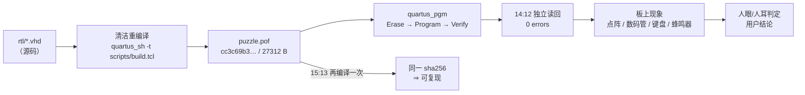

# 上板验证与缺失证据

> 这一页回答：**这套设计在真板子上到底验过什么** —— 以及**哪些证据我们其实没有**。

## 一、烧录记录（最近一次）

| 项 | 值 | 出处 |
|---|---|---|
| 固件 | `quartus/output_files/puzzle.pof`，sha256 `{{fact:build.provenance.pof.sha256}}`，**{{fact:build.provenance.pof.bytes}} 字节** | `quartus/build_provenance.json` |
| POF 生成时刻 | `{{fact:build.provenance.pof.mtime}}`（清洁重编译产物） | 同上 |
| provenance 记录 | `{{fact:build.provenance.timestamp}}` | 同上 |
| **重烧** | **2026-10-15 14:11:33 ~ 14:11:51**：Erase → Program → **Verify**，**0 errors** | {{src:HANDOFF.md:38}} |
| **独立读回** | **2026-10-15 14:12** 再单独读回校验一次，**0 errors** | {{src:HANDOFF.md:9}} |
| 结论 | 本次改动**不需要重新烧录**：2026-10-15 15:13 的清洁重编译**逐字节复现**了同一份固件 | {{src:HANDOFF.md:36}} |

!!! note "为什么"重烧 + 独立读回"要写两行"
    `quartus_pgm` 的 `Verify` 是**零成本**的（写完立刻回读比对），但它与"另外起一次命令单独读回"
    是两件事：前者证明"这一次写进去的就是这个文件"，后者证明"**过一会儿再读还是它**"。
    本项目历史上出过"引脚漏配却烧录全过"（ERR-001/002）—— 烧录成功**不等于**功能正确。

## 二、上板复测结论

| 时间 | 结论 | 出处 |
|---|---|---|
| 2026-10-12 | **用户原话："现象满足题目要求，效果可以。"** | {{src:docs/06-硬件调试记录.md:3935}} |
| 同上 | 整体三关流程 / 显示 / 音效 / 手感：用户**未提出异议**，按"整体复测通过"记录 | {{src:docs/06-硬件调试记录.md:3940}} |
| 2026-10-15 | 第 26 工作阶段的改动**不改逻辑**（8 个文件只改注释、诊断顶层另算），固件逐字节未变 ⇒ **沿用 10-12 的复测结论** | {{src:HANDOFF.md}} |

## 三、只有板级证据能支持的结论

| 结论类别 | 具体是什么 | 为什么仿真/STA 证不了 |
|---|---|---|
| **听感** | 三个提示音"分得清"；背景音乐"不断断续续"（连奏填音整改）；对局中按键不打扰音乐 | 仿真只能证明**频率与占空比**（见 `buzzer_ctrl` ⑥⑩），分不分得清是听觉判断 |
| **观感** | 点阵亮度、2 Hz 闪烁是否"看得见在闪"、内容率是否够（25 Hz / 21 Hz 这类口径）、绿对勾远距离是否可读 | 仿真只能证明"点亮了哪些格、什么时候点亮" |
| **手感** | 按键消抖是否跟手、确认/旋转有没有迟滞 | 仿真里的按键是理想化激励，机械抖动与人体感受不在模型里 |
| **整机联动** | 一次上电把三关走完、显示与声音同步 | 整机仿真覆盖了协议，但"实物是否同拍"只有眼睛能判 |

!!! danger "反过来也成立"
    板级"现象可以"**不能**替代编译/STA：板子跑得动不代表 **50 MHz 下时序收敛**（那是
    `{{fact:build.constraint.fmax_mhz}} MHz` 约束与 setup {{fact:build.sta.setup_slack}} ns 的事）；
    也不能替代 RTL 仿真的**覆盖率**（板子只走了用户试的那几条路径）。

## 四、证据三级对照

| 关键结论 | 【RTL 仿真】 | 【编译/STA】 | 【板级实测】 |
|---|---|---|---|
| 三关流程与胜负判定 | ✅ 184 条断言（{{fact:sim.totals.assertions}} 条全过） | —— | ✅ 用户复测未提异议 |
| 引脚功能正确 | ⚠️ 只能验"逻辑上连到了哪个端口" | ✅ Fitter 引脚表（{{fact:build.fit.pins}}） | ✅ 真板子上按键/显示/蜂鸣器都响应 |
| 资源占用 | —— | ✅ LE {{fact:build.fit.le}}、LAB {{fact:build.fit.lab}} | —— |
| 时序裕量 | ⚠️ 功能仿真不含布局布线延迟 | ✅ setup {{fact:build.sta.setup_slack}} ns / hold {{fact:build.sta.hold_slack}} ns | —— |
| 音效听感 | ❌ 证不了 | ❌ 证不了 | ✅ **只有**板级 |
| 电气正确（电平/驱动能力） | ❌ | ❌ | ✅ 上电运行即隐含证明 |
| **硬件外观（照片）** | ❌ | ❌ | ⚠️ **缺失，见下** |

## 五、缺失的证据

!!! danger "真实开发板实拍照片 = 0 张"
    仓库里**没有任何一张开发板实拍照片**。点阵、数码管、键盘、蜂鸣器在真实硬件上的效果，
    目前只有**文字记录**（{{src:docs/06-硬件调试记录.md}}）与**用户口头结论**。
    这一条是本次审计最重要的发现：**仓库里那些"看起来很硬件"的图，都不是实拍**
    （`演示-*.gif`、`演示-首帧.png`、`结算画面-预览.png` 都是浏览器引擎渲染）。

现有素材的证据级别（机械清单见 {{src:docs/图/README.md}}）：

| 素材 | 数量 | 证据级别 |
|---|---|---|
| `GUI-*.png`（Quartus 波形编辑器截图） | 12 | ✅ 真实 **Quartus GUI** 仿真截图 |
| `SIM-*.svg`（脚本重绘波形） | 12 | ❌ 辅助波形，不是 Quartus 截图 |
| `演示-*.gif` / 渲染静态图 | 3 | ❌ 网页引擎渲染，**不是**硬件实拍 |
| **硬件实拍照片** | **0** | ⚠️ **缺失** |

## 待补拍清单

| # | 拍什么 | 怎么拍 | 能证明什么 |
|---|---|---|---|
| 1 | **整板全景**（板子 + USB Blaster + 电源，含板上丝印的型号 `EPM1270T144C5`） | 手机横拍，桌面干净背景，把型号丝印拍清楚 | 开发板型号与接线属实 |
| 2 | **自检画面**（8 位数码管全 `8` + 点阵全黄闪） | 上电、SW7 拨到自检位，连拍 2~3 张（抓住亮/灭两相） | 自检画面与仿真 ① 一致 |
| 3 | **待机 / 预览 / 对局**三态各一张 | 按【开始】进入各态，屏幕正面微俯拍 | 显示器件的真实亮度与可读性 |
| 4 | **点阵彩色**（红色零片 + 被选中的**绿色**零片） | 对局中按【选择】，近距拍点阵 | B6「选中零片变绿」在实物上成立 |
| 5 | **胜利 / 失败结算**（绿对勾 + PASS / 红叉 + FAIL） | 分别走到胜、负，各一张 | 结算画面的实际观感与远距可读性 |
| 6 | **键盘与蜂鸣器** | 拍按键按下的一瞬（可让第二人协助），蜂鸣器无法拍照 ⇒ 补一段**视频**或写明"仅口头确认" | 手感与被试记录的真实性 |
| 7 | **烧录过程**（Quartus Programmer 窗口 + 成功提示） | 截图 Programmer 输出（**同样要裁掉含本机路径的标题栏**，见 [波形与图注](waveforms.md)） | 烧录/读回 0 error 的界面证据 |

**补拍方法（统一约定）**：

1. 用**手机或相机实拍**，不要用屏幕截图代替；关掉闪光灯，室内白炽灯下斜 30° 拍，避免点阵反光成一片白。
2. 每张图保留**拍摄时间**（相册 EXIF）与一句环境说明（光照、距离），登记到 `docs/图/README.md` 的清单里。
3. 文件名建议 `HW-<内容>.png`（如 `HW-自检.png`、`HW-结算-胜利.png`），与 `GUI-*.png`、`SIM-*.svg` 区分开。
4. 补齐后**必须同时更新** `docs/图/README.md` 的清单与 `book/scripts/sync_assets.py` 的同步规则，
   否则素材同步不进站点（`docs/图/` 不在 `docs_dir` 里，靠同步脚本复制过去）。

!!! tip "补拍不是"补手续"，而是补一类证据"
    听感/观感/手感这三类结论，**只有**实拍与视频能留住。哪怕只补第 1、2、5 三项，
    文档站就能从"逻辑全对"升级成"人看得到的效果也对"。

## 证据与出处

| 结论 | 依据 |
|---|---|
| 固件指纹与字节数 | {{src:quartus/build_provenance.json}} |
| 14:11 重烧 + 14:12 独立读回（均 0 errors） | {{src:HANDOFF.md:38}}、{{src:HANDOFF.md:9}} |
| 2026-10-12 用户复测结论原话 | {{src:docs/06-硬件调试记录.md:3935}} |
| 历史烧录记录（更早几次） | {{src:docs/06-硬件调试记录.md:3599}}、{{src:docs/06-硬件调试记录.md:3930}} |
| 图片的证据分级与"硬件照片 0 张" | {{src:docs/图/README.md}}、`book/docs/_generated/figures.md` |
| 引脚与资源读数 | {{src:quartus/build_provenance.json}} → `fit` |
