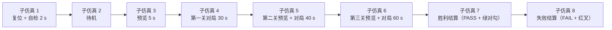

# 整机测试

> 这一页回答：**单个模块都对，合起来还对吗** —— 以及整机波形为什么比模块波形难读。

## 一、两种整机场景

整机只有 `puzzle_top` 一个顶层（唯一绑定引脚的文件）。它的测试台 `sim/tb_puzzle_top.py`
把"一次完整的游戏流程"当激励，跑出 28 条断言（{{fact:sim.modules.puzzle_top.passed}}/{{fact:sim.modules.puzzle_top.total}}）。
第三关的图案是**随机**的，所以整机不是一个场景、而是两个**固定随机值**的场景：

| 场景 | 环境变量 | 第三关图案 | 轮次 | 断言 | 仿真时长 |
|---|---|---|---|---|---|
| **模式 A** | `DLD_L3PAT=0` | 图案 0「田」 | **r56** | 28 / 28 | 121 656 000 ns |
| **模式 B** | `DLD_L3PAT=2` | 图案 2「S/Z」 | **r57** | 28 / 28 | 125 272 000 ns |

两个模式都要跑：模式 B 的第三关走法计划更长（仿真时长差 ≈3.6 ms），
**只跑 A 会漏掉"另一幅图案也能拼出来"**。

!!! warning "历史轮次不要当成当前证据"
    `sim/rounds/puzzle_top/` 里有多轮历史记录（`r52`/`r53`/`r54`/`r55` …），
    它们对应的**是当时那一版 RTL 的指纹**。引用时必须写清是哪一版；
    当前值只认最新一轮（本页 `r56`/`r57`）。

## 二、整机波形：为什么一个 `.vwf` 里有 8 段子仿真

整机跑一次要几十毫秒仿真时间、观察上百个信号，Quartus 会把一个场景**切成多段子仿真**存进同一个 `.vwf`：

| 事实 | 数值 | 读法 |
|---|---|---|
| `sim/puzzle_top.vwf` 的 `TRANSITION_LIST` 段数 | **1 271** 段 | **段数 ≠ 节点数** |
| 子仿真段数（`/*sub-simulation number 2..8*/`） | **8** 段 | 一个场景一段，拼起来才是完整流程 |
| 唯一节点名 | **165** 个 | 1 271 = 158 × 8 + 7 ⇒ 大多段是"同一节点在不同子仿真里的波形" |

⇒ 看整机波形时**不要按段数估算信号个数**；要按子仿真分段读，
每段对应流程里的一个阶段（见下）。

## 三、整机的四类场景与各自的关键断言

| 场景 | 做什么 | 关键断言 | 这一条在证明什么 |
|---|---|---|---|
| 第一场景：走完一关 | 用真实矩阵按键把三块拼成图 4-1 的 4×3 矩形并确认 | ⑩ 整机第一关拼成 | **跨模块协议**（键盘→FSM→引擎→显示）真的通了，不是模块内部自嗨 |
| 第二场景：第二关 | 四块异形零片拼成 PAT3「阶梯」 | ⑪、⑯ | 第二关图案**固定**、异形零片也能整机拼成 |
| 第三场景：连过三关 | 三关连续推进到胜利 | ⑪b、⑫、⑬ | D2 之后真的**多了一关**；结算画面是**绿色对勾 + PASS** |
| 第四场景：失败路径 | 开新一局后三块直接确认（不满足判据） | ⑮、⑯ | 失败结算画面是**红叉 + FAIL**，且新一局不受上一局残留影响（ERR-024 回归） |

三条**只有整机能测**的东西：

1. **协议不变量**：⑧ 要求"FSM 每发一次方向脉冲，引擎必须在 2 拍内锁进非 0 的 `mv_dir`" —— ERR-020 的回归判据，模块级测试看不见这个跨模块时序。
2. **音效码真的走到蜂鸣器**：⑱⑲⑳㉑ 逐关核对 `game_fsm.sound_p → buzzer_ctrl.i_sel`，并确认"对局中四个按键都不发声"（第 18 工作阶段的整改）。
3. **自检窗口恰好一声**：㉒ 对 ERR-051 的回归 —— SW7 关→开之后，自检窗口内 `buzz` 只能响一声。

## 证据与出处

| 结论 | 依据 |
|---|---|
| 模式 A/B 与两个轮次 | `facts/facts.json` → `sim.modules.puzzle_top`；记录见 {{src:sim/rounds/puzzle_top/r56.json}}、{{src:sim/rounds/puzzle_top/r57.json}} |
| 28 条断言的含义与实测 | {{tree:sim/rounds/puzzle_top}}、[断言清单](assertions.md) |
| 整机测试台与波形 | {{src:sim/tb_puzzle_top.py}}、{{src:sim/puzzle_top.vwf}} |
| 段数/节点数/子仿真的读法 | {{src:docs/图/README.md}}（§2.1 的 `TRANSITION_LIST` 口径） |
| 两关/三关的规格与限时 | {{src:rtl/puzzle_pkg.vhd}}、{{src:docs/00-规范理解与需求.md}} |
| 整机流程图与场景划分 | {{src:docs/03-仿真验证方案.md}} |
