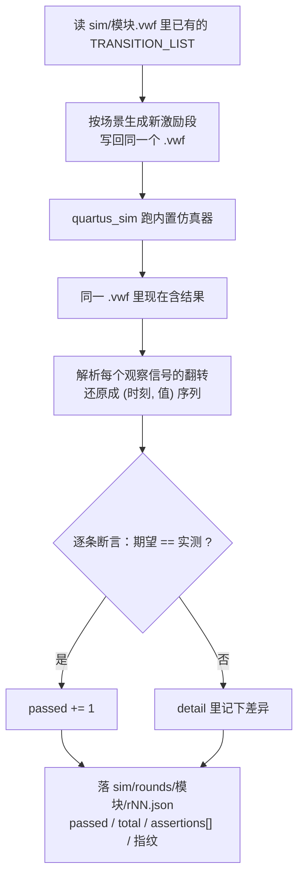

# 模块级测试

> 这一页回答：**11 个游戏子模块 + 整机顶层各自测什么、激励怎么给、盯哪个信号。**

## 一、总表（最新有效轮次）

--8<-- "_generated/sim-rounds.md"

## 二、每个测试台测什么

每个模块一个测试台 `sim/tb_<模块>.py`，配一份 `sim/<模块>.vwf`。共同约定：
测试台把激励向量写进 `.vwf`，跑完仿真后**同一个 `.vwf` 里已经是结果**，测试台再解析它做断言。

| 模块 | 测什么（主要断言） | 激励怎么给 | 观察信号 |
|---|---|---|---|
| `clk_gen` | 7 档 tick 的**脉冲宽度与分频比**；上电复位时长；按键消抖的**非对称**行为（按下要连续 20 个 1 ms 样本、松开 ≤1 个样本） | 人为制造 `i_clk` 边沿与 `i_btn` 按下/松开/短毛刺序列 | `o_tick_1k/200/100/40/4hz/2hz/1hz`、`o_rst`、内部 `por_cnt`、`bcnt` |
| `keypad_scan` | 4×4 扫描四状态机；按下/释放各产生一次单拍 `o_press`；消抖窗口 | 逐行拉低 `i_kp_row`、按时序松开 | `o_key`、`o_press`、内部状态与采样计数 |
| `game_fsm` | 三关状态机：自检 8 步 → 待机 → 预览 → 对局（30/40/60 s）→ 胜负；`o_go` 每局只上升一次；`o_blink` 是真正的 2 Hz 方波 | 按时间轴送【开始】【确认】【旋转】【方向】键码 | `o_state`、`o_time`、`o_level`、`o_lvl3`、`o_go`、`o_blink`、`sound_p` |
| `puzzle_ctrl` | 引擎：散落不重叠、选中/锁定、旋转 + 紧包围盒偏移、整帧判据、**主路径竞态保护** | 按协议驱动 `i_shuf`/`i_move`/`i_sel`/`i_rot`/`i_conf` 单拍脉冲 | `o_piece_pos`、`o_piece_ori`、`o_sel`、`o_lock`、`o_frame_ok`、`o_all_lock` |
| `pattern_rom` | 图案库按 `i_pat` 查表（第二关固定 PAT3、第三关随机） | 给 `i_pat`/`i_level` 组合 | `o_rows`（8 行图案） |
| `piece_rom` | 零片形状库按（形状、朝向）查表；四块异形零片的格数与朝向 | 遍历形状 × 4 个朝向 | `o_rows`（4 行零片掩码） |
| `rng_lfsr` | x⁸+x⁶+x⁵+x⁴+1 的**最大长度**序列：周期恰 255、状态两两不同、每 bit 平衡；**复位分支真的被激励** | `i_step` 单拍推进 + 中途补一次复位脉冲 | `o_val`、内部 `sr`、抽头 `fb` |
| `dot_matrix_scan` | 8×8 点阵行扫描：`o_row` 每次恰一位低且等于 `7-row`；消隐相全灭；红/绿列互斥；**早采样点无鬼影** | 给 8 行内容 + `i_en` 消隐 | `o_row`、`o_colr`、`o_colg`、内部行计数 |
| `seg_scan` | 位选低有效且互不重叠；位选与段码**同源**；熄灭掩码；`i_raw_en` 直通；结算拼字 PASS/FAIL | 给 8 位内容 + 消隐掩码 + `i_raw_en` | `o_seg`、`o_cat` |
| `disp_format` | 状态 → 8 位数码管内容：自检八位全 8、待机/预览/对局/结算、倒计时**两位拆分**、**口径 C：DISP2 恒熄灭**、78 个画面互不相同 | 状态码 + 秒值 + `i_blink` | `o_data`、`o_blank`、内部 `tens`/`ones` |
| `buzzer_ctrl` | 16 个音效码的乐句（响/停 + 音高）；休止步真的静音；换码不清零步号；**8 位**半周期计数器；预分频 | `i_sel` 码 + `i_en` + `i_t4` 步进脉冲 | `o_buzz`、内部 `step`、`cnt`、`tone_sel` |
| `puzzle_top` | **整机**：三关流程、按键→引擎→显示协议、音效码真的走到蜂鸣器、结算画面、告急幽灵 | 整机时间轴（见 [整机测试](integration-tests.md)） | 点阵三色列、`seg`/`cat`、`buzz`、状态码 |

## 三、一个测试台的骨架

!!! tip "为什么把源码指纹也写进 rNN.json"
    改一行 RTL，**12 个模块的所有旧轮次会立刻"过期"**。指纹存在记录里，审计脚本才能区分
    "这个绿是刚验过的"还是"三天前的绿"。所以纪律是：**改 RTL ⇒ 重扫 seed + 清洁重编译 +
    全部 12 个模块重跑**（流程见 [可复现性](../07-implementation/reproducibility.md)）。

## 证据与出处

| 结论 | 依据 |
|---|---|
| 12 个模块的最新轮次与条数 | `facts/facts.json` → `sim.modules`（第一节由 `_generated/sim-rounds.md` 机械生成） |
| 每个模块的测试台与波形 | {{src:sim/tb_clk_gen.py}}、{{src:sim/clk_gen.vwf}}（其余同构：`sim/tb_<模块>.py` + `sim/<模块>.vwf`） |
| 逐条断言的名称与实测值 | {{tree:sim/rounds}}（`rNN.json` 的 `assertions[]`），另见 [断言清单](assertions.md) |
| 跑仿真/看结果的入口 | {{src:scripts/sim.py}} |
| 测试台约定与两类踩坑 | {{src:docs/03-仿真验证方案.md}}、ERR-022（{{src:docs/06-硬件调试记录.md:685}}）、ERR-028（{{src:docs/06-硬件调试记录.md:1079}}） |
