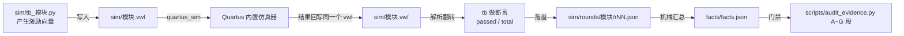

# 验证策略

> 这一页回答一个问题：**明明没有 ModelSim、没有断言语法，184 条断言是怎么来的、凭什么算数。**

## 一、先说结论

| 决定 | 为什么 | 代价（失去什么） |
|---|---|---|
| 用 **Quartus II 9.1 内置仿真器** | 本机只有 Quartus II 9.1（Web Edition），没有 ModelSim-Altera、也没有 GHDL | **没有 testbench、没有 `assert`/`report` 语法**；只能"给向量 + 看波形" |
| `.vwf` **既是激励也是结果** | 内置仿真器把仿真结果**回写进同一个 `.vwf`** | 同一模块的仿真**不能并发跑**（波形互相覆盖，见 ERR-028） |
| 断言写在 **Python 测试台** `sim/tb_<模块>.py` | Python 能解析 `.vwf` 的翻转、能表达"第几条断言 / 期望 / 实测" | 断言不在 RTL 里，要自己维护；解析器写错会"假绿" |
| 每条证据带 **源码指纹** | 防"陈旧绿"（ERR-022：激励常量过期、结论仍全绿） | 改一处 RTL ⇒ 全部 12 个模块指纹失效，**必须整套重跑** |

!!! quote "设计理由"
    这是"用 9.1 的老工具做可核验验证"的取舍：**工具能力有限，就用流程纪律 + 机读证据补**。
    与其伪造一套跑不起来的 UVM，不如把每一次仿真都落成 `sim/rounds/<模块>/rNN.json`，
    让结论可以被脚本复查。

## 二、证据链：从激励到断言

两条**真踩过**的坑：

| 坑 | 后果 | 现在的防线 |
|---|---|---|
| 同一模块的仿真被并发跑（ERR-028） | 两个进程抢同一个 `.vwf`，读到的可能是别人的半成品 | **一个模块一个 `.vwf`，串行跑**；`scripts/sim.py check` 只读记录文件 |
| 激励常量过期还全绿（ERR-022"陈旧绿"） | 结果是**真的通过**，但验的是旧设计 | `rNN.json` 记 **RTL/激励源码指纹**；`audit_evidence.py` A 段与 `git blob` 比对 |

## 三、三类证据的分工：谁也不能替谁

| 级别 | 来源 | **能证明** | **不能证明** |
|---|---|---|---|
| 【RTL 仿真】 | 内置仿真器 + Python 断言 | 逻辑功能、时序**关系**（在激励覆盖范围内） | 电气行为、晶振绝对频率、外设真实响应、听感/观感 |
| 【编译/STA】 | Fitter + TimeQuest | 资源（{{fact:build.fit.le}}、{{fact:build.fit.lab}}）、时序裕量（setup {{fact:build.sta.setup_slack}} ns / hold {{fact:build.sta.hold_slack}} ns）、引脚（{{fact:build.fit.pins}}） | 逻辑正确性：时序过了不代表功能对 |
| 【板级实测】 | 真板上电、烧录、读回、人眼/人耳 | 电气正确、外设真实行为、听感/观感/手感 | **可复现性差**：没有量化记录就只是一句话（本项目**真实硬件照片 = 0 张**，见 [上板验证](board-validation.md)） |

!!! danger "不能证明的结论别写出来"
    "仿真全绿"**不等于**"硬件验收通过"。音效听感、点阵观感、按键手感这三类结论
    **只有板级证据**能支持；反过来 Fmax 这类读数**只有 STA** 能支持，仿真跑一万轮也证明不了。

## 四、为什么"全绿"还要复查

184 条断言全部通过（{{fact:sim.totals.assertions}} 条 / {{fact:sim.totals.modules}} 个模块），
但"绿"本身也可能是假象，所以另有一套**独立**复查：

| 复查 | 查什么 | 命令 |
|---|---|---|
| 证据审计 | A~G 段：指纹与 `git blob` 是否一致、断言统计能否重算、编译/STA 读数能否对上、固件是否落后于 RTL、文档数字是否与真值源一致 | `python scripts/audit_evidence.py` |
| 注释纪律 | 改过的 RTL 是否**只**改了注释 | `python scripts/check_comments.py diff rtl/<文件>.vhd` |
| 环境检查 | 工具链在不在、工程能否复现生成 | `python scripts/check_env.py` |

## 证据与出处

| 结论 | 依据 |
|---|---|
| 无 ModelSim/GHDL，用内置仿真器；`.vwf` 既是激励也是结果 | {{src:docs/03-仿真验证方案.md}}、{{src:sim/tb_clk_gen.py}}、ERR-028（{{src:docs/06-硬件调试记录.md:1079}}） |
| 断言由 Python 测试台给出，轮次落 `sim/rounds/` | {{src:scripts/sim.py}}、{{tree:sim/rounds}}、{{src:sim/rounds/clk_gen/r25.json}} |
| 184 条断言 / 12 个模块全部通过 | `facts/facts.json` → `sim.totals`（`{{fact:sim.totals.assertions}}` / `{{fact:sim.totals.modules}}`） |
| 资源与时序读数 | {{src:quartus/build_provenance.json}} |
| "陈旧绿"与"并发覆盖波形"两类教训 | {{src:docs/06-硬件调试记录.md}}（ERR-022、ERR-028） |
| 独立复查脚本 | {{src:scripts/audit_evidence.py}}、{{src:scripts/check_comments.py}}、{{src:scripts/check_env.py}} |
