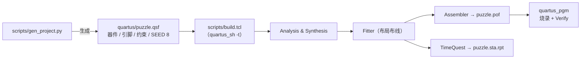

# 编译流程

> 这一页回答：**这份固件是怎么从源码编译出来的** —— 以及为什么"能编译"不够，还要挑 Fitter seed。

## 一、工程是**生成**出来的，不是手工建的

`quartus/puzzle.qsf` 由脚本生成，这样"引脚/器件/时序约束"就都在版本控制里，而不是藏在 GUI 的设置对话框里。

| 步骤 | 命令 | 产物 |
|---|---|---|
| 生成工程 | `python scripts/gen_project.py puzzle_top` | `quartus/puzzle.qsf`（含 52 个 `set_location_assignment`） |
| 清洁编译 | `quartus_sh -t scripts/build.tcl` | `output_files/puzzle.fit.rpt`、`puzzle.sta.rpt`、`puzzle.pof` |
| 记录 provenance | `python scripts/record_build.py` | `quartus/build_provenance.json`（读数 + 源码指纹 + POF 指纹） |
| 环境自检 | `python scripts/check_env.py` | 工具链是否可用、`.qsf` 能否复现生成 |

!!! warning "改动 RTL 之后的纪律"
    **改 RTL ⇒ ① 重扫 Fitter seed ② 清洁重编译 ③ 重跑全部 12 个模块的测试台**。
    只做其中一步就会得到"陈旧绿"：仿真过了但用的是旧网表，或者 B 段读数对不上新逻辑。
    完整流程见 [可复现性](reproducibility.md)。

## 二、为什么要重扫 Fitter seed

Quartus 的布局布线是**随机化 + 迭代优化**的：同一份 RTL，换一个 `SEED` 会得到不同的面积与时序。
本设计**面积已经贴顶**，所以"哪个 seed 装得下"完全不可预测 —— 每一版 RTL 都要重新扫。

**判据是两条，缺一不可**：

| 判据 | 门槛 | 怎么读 |
|---|---|---|
| ① 装得下 | **LAB 不超 127**（`Total LABs 127 / 127`） | `puzzle.fit.rpt` 的 Fitter Summary |
| ② 跑得动 | **Fmax ≥ 50 MHz**（开发板晶振档位 {{fact:build.constraint.fmax_mhz}} MHz，周期 {{fact:build.constraint.period_ns}} ns） | `puzzle.sta.rpt` 的 Fmax Summary（TimeQuest） |

!!! bug "经典时序分析器 `quartus_tan` 读不了这个约束"
    {{src:quartus/puzzle.sdc}} 的文件头专门写了这条：`quartus_tan` **不读 `.sdc`**，
    所以 Fmax **必须**从 `quartus_sta`（TimeQuest）读；跑 `quartus_tan` 只会得到空的 Fmax 列，
    看起来"没有违例"，其实什么都没证明。

### 当前选择：`SEED 8`

| 项 | 值 |
|---|---|
| 当前 seed | **`SEED 8`**（`set_global_assignment -name SEED 8`，见 {{src:quartus/puzzle.qsf}}） |
| 选择依据 | **第九次重扫** `1~16`，按"两个判据都过 + Fmax 最高"选 |
| 当轮读数 | LE {{fact:build.fit.le}}、LAB {{fact:build.fit.lab}}、Fmax 由 setup slack {{fact:build.sta.setup_slack}} ns 推得 **54.27 MHz** |
| 判据与逐种子结果 | {{src:docs/05-资源利用与编译报告.md}} §1A'''''.1；脚本内注释见 {{src:scripts/gen_project.py:121}} |

**为什么它不可省**：历史上每一版"看起来更省"的 RTL 都换过 seed —— 逐次记录都在
{{src:scripts/gen_project.py:121}} 的注释里（第四次 `SEED 1` / 第五次 `SEED 15` / 第六次 `SEED 6` /
第七次 `SEED 16` …），并且同一份 RTL 换 seed 会让 Fmax 上下浮动几 MHz。

## 三、报告怎么读（别读错文件）

| 想知道 | 打开 | 关键行 |
|---|---|---|
| 面积 | `quartus/output_files/puzzle.fit.rpt` | `Fitter Summary`：`Total logic elements`、`Total LABs`（**两行都要读**） |
| 时序 | `quartus/output_files/puzzle.sta.rpt` | `Fmax Summary`；`Clock Setup 'clk'` 的 slack |
| 引脚 | `quartus/output_files/puzzle.pin` 或 `.qsf` | 52 个 `set_location_assignment`（表见 [引脚分配](pin-assignment.md)） |
| 编译是否成功 | 构建输出 | `Successful - <时间>`；0 errors |

⚠️ 读报告前先确认**报告属于哪一次编译**：`output_files/` 里只有一份 `fit.rpt`/`sta.rpt`，
它们总是**最近一次**编译的产物；而要引用到文档里的数字，唯一真值源是
{{src:quartus/build_provenance.json}}（它同时记了源码指纹与 POF 指纹）。

## 四、常见坑

| 现象 | 原因 | 处理 |
|---|---|---|
| 编译报"装不下"（>127 LAB） | Fitter seed 不适合这一版 RTL | 重扫 seed，见 §二 |
| `.qsf` 被 Quartus 改写 | 打开/编译工程时 GUI 会回写 `.qsf` | 提交前 `git checkout -- quartus/puzzle.qsf`；以生成器的输出为准 |
| 报告里 Fmax 一栏是空的 | 用了 `quartus_tan`（不读 `.sdc`） | 用 `quartus_sta`（TimeQuest） |
| 引脚漏配但编译全过 | 器件上电后引脚默认高阻/弱上拉，功能错但工具不报错 | 追 ERR-001 / ERR-002 的教训：**逐引脚核对**，见 [引脚分配](pin-assignment.md) |

## 证据与出处

| 结论 | 依据 |
|---|---|
| 工程生成与清洁编译流程 | {{src:scripts/gen_project.py}}、{{src:scripts/build.tcl}}、{{src:scripts/record_build.py}} |
| seed 判据与逐次重扫记录 | {{src:scripts/gen_project.py:121}}、{{src:docs/05-资源利用与编译报告.md}} |
| 当前读数（LE/LAB/引脚/时序/POF 指纹） | {{src:quartus/build_provenance.json}} |
| 50 MHz 约束与 `quartus_tan` 的限制 | {{src:quartus/puzzle.sdc}} |
| 引脚漏配的教训 | ERR-001（{{src:docs/06-硬件调试记录.md:47}}）、ERR-002（{{src:docs/06-硬件调试记录.md:58}}） |
