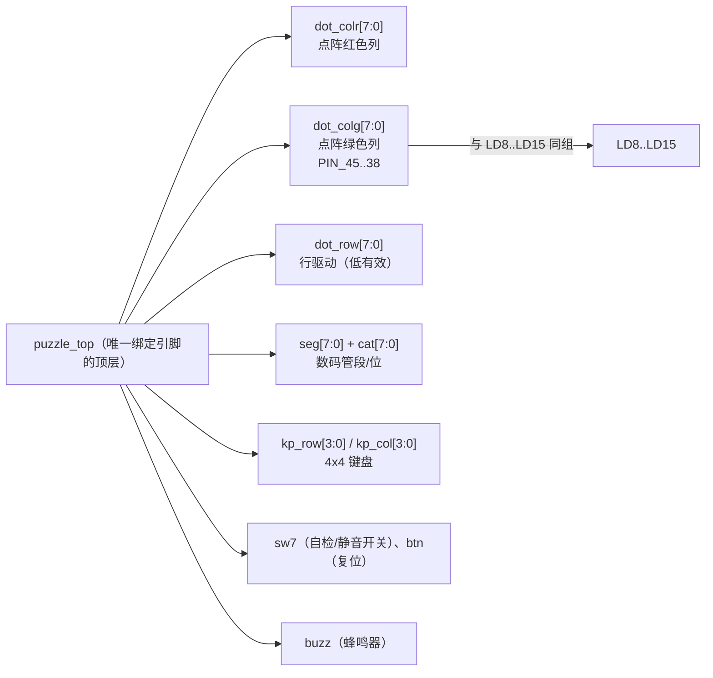

# 引脚分配

> 这一页回答：**52 个引脚是怎么落到板子上的** —— 以及"引脚漏配"为什么是本项目最贵的坑。

## 一、引脚锁定表（机械抽取）

--8<-- "_generated/pins.md"

## 二、为什么全部显式锁定

| 事实 | 说明 |
|---|---|
| 顶层端口 11 组、**{{fact:build.fit.pins}}** 引脚 | 全部有 `set_location_assignment` |
| 生成方式 | `scripts/gen_project.py` 生成到 {{src:quartus/puzzle.qsf}}（共 52 条），**不靠 GUI 手点** |
| 不锁定的后果 | Quartus 会"自动选脚"（`Auto`），功能看起来编译通过、烧进去却不工作 |

!!! bug "ERR-001 / ERR-002：引脚漏配是本项目最贵的两类坑"
    * **ERR-001**：`btn`（复位键）引脚**漏配** ⇒ 静默落到别的脚，按键没反应；
    * **ERR-002**：键盘诊断固件**整体漏配键盘引脚** ⇒ 本次最长的一次误判（怀疑键盘坏了、怀疑扫描逻辑错了，
      实际上是"没接到那些脚上"）。
    教训：**烧录成功 ≠ 接对了脚**。引脚必须逐条与开发板手册对照，
    并且要有**独立脚本**核对（见 §四）。

## 三、关键复用：点阵绿列与 LD8..15 同组

{{src:rtl/puzzle_top.vhd:47}} 明确记录了这个"板子给的约束"：

> 板子把 `COLG0..COLG7`（点阵**绿色**列）接到 `PIN_38..45`，与 **`LD8..LD15` 同一组**，
> 而 `PIN_137..144` 由 `LD8..LD15` 与 **VGA** 共用。

由此产生的取舍：

| 约束 | 后果 | 设计怎么应对 |
|---|---|---|
| 绿色列与 `LD8..LD15` 复用 | 用点阵绿色就不能同时当 LED 用 | 点阵是主显示器件，LED 只作辅助 |
| `PIN_137..144` 与 VGA 共用 | 同时用点阵绿列与 VGA 会冲突 | 本设计不用 VGA；接线时避开 |
| 红/绿两列各自 8 位 | 每个点**只有 4 种状态**（全灭 / 红 / 绿 / 黄） | 颜色本身成了判读线索（绿对勾 / 红叉） |

## 四、引脚核对脚本

`scripts/check_keypad_pins.py` 用**三重对照**判断"键盘故障有没有可能是引脚分配错"：

| 对照对象 | 内容 |
|---|---|
| `rtl/` 与生成器 | 顶层端口 ↔ `gen_project.py` 的引脚表 |
| 开发板手册（仓库内文本） | 手册里这些脚的功能定义 |
| 布局布线器实际放置 | `puzzle.pin` / Fitter 报告里的实际位置 |

任何一处不一致就会被报出来 —— 这是 ERR-001/002 之后加的防线。

!!! tip "自己复核一遍的方法"
    1. 打开 {{src:quartus/puzzle.qsf}}，搜 `set_location_assignment`，数一下是不是 **52** 条；
    2. 打开 `quartus/output_files/puzzle.fit.rpt` 的 Fitter Summary，看 `Total pins` 是不是 **{{fact:build.fit.pins}}**；
    3. 跑 `python scripts/check_keypad_pins.py`，看有没有 mismatch。

## 证据与出处

| 结论 | 依据 |
|---|---|
| 全部引脚锁定与 52 条分配 | {{src:quartus/puzzle.qsf}}、`facts/facts.json` → `build.pins_locked` |
| 引脚读数 | {{src:quartus/build_provenance.json}} → `fit.pins` |
| 绿列与 `LD8..LD15` / VGA 的复用 | {{src:rtl/puzzle_top.vhd:47}}、{{src:rtl/puzzle_top.vhd:63}} |
| 引脚分配由脚本生成 | {{src:scripts/gen_project.py}} |
| 键盘引脚核对 | {{src:scripts/check_keypad_pins.py}} |
| 引脚漏配的代价（ERR-001 / ERR-002） | {{src:docs/06-硬件调试记录.md:47}}、{{src:docs/06-硬件调试记录.md:58}} |
