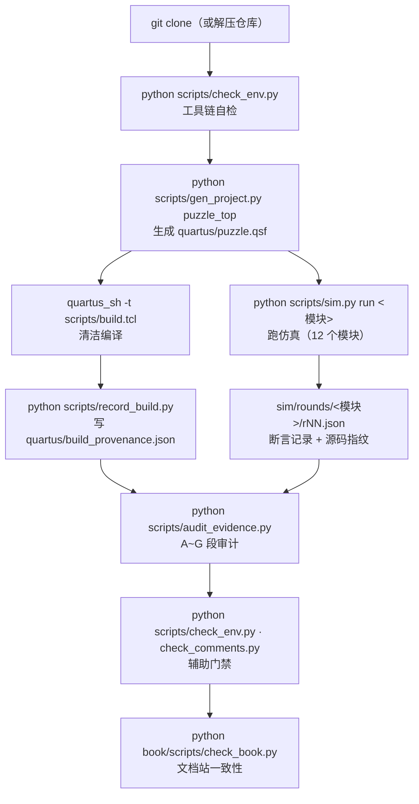

# 可复现性

> 这一页回答：**别人拿到这个仓库，怎么一步步复现出全部结论** —— 以及改一处 RTL 之后必须做什么。

## 一、从零到"全部结论可查"

| 步骤 | 命令 | 产物 / 判据 |
|---|---|---|
| 1 环境 | `python scripts/check_env.py` | 工具链在不在、`.qsf` 能否复现 |
| 2 生成工程 | `python scripts/gen_project.py puzzle_top` | {{src:quartus/puzzle.qsf}}（应与入库内容一致） |
| 3 清洁编译 | `quartus_sh -t scripts/build.tcl` | `fit.rpt` / `sta.rpt` / `puzzle.pof`（0 errors） |
| 4 记录证据 | `python scripts/record_build.py` | {{src:quartus/build_provenance.json}} |
| 5 跑仿真 | `python scripts/sim.py run <模块>`（或整套） | {{tree:sim/rounds}} |
| 6 审计 | `python scripts/audit_evidence.py` | **A~G 段**见 §三 |
| 7 文档站 | `python book/scripts/check_book.py` | 页面级一致性（点此页的任务：0 FAIL） |

## 二、只读检查：不编译也能验的几件事

| 想验什么 | 命令 | 说明 |
|---|---|---|
| 断言记录是否与当前 RTL 匹配 | `python scripts/sim.py check <模块>` | 比 `rNN.json` 里的源码指纹；**不重跑仿真** |
| 改过的 RTL 是否**只**改了注释 | `python scripts/check_comments.py diff rtl/<文件>.vhd` | 逐 token 比代码部分；本项目用它证明"注释订正没动逻辑" |
| 键盘引脚三重对照 | `python scripts/check_keypad_pins.py` | 见 [引脚分配](pin-assignment.md) |
| 走法计划是否仍成立 | `python scripts/check_plans.py` | 与整机仿真共用同一套计划 |
| 几何参考模型 | `python scripts/check_geometry.py` | 旋转/包围盒/覆盖的独立复算 |

## 三、`audit_evidence.py` 的 A~G 段各查什么

| 段 | 查什么 | 为什么要有 |
|---|---|---|
| **A** | 每个模块最新轮次的**源码指纹**是否与 `git blob` 一致；不一致时退化为"逻辑指纹"并说明 | 防"陈旧绿"：RTL 改了、记录没重跑 |
| **B** | 从 `sim/rounds/**` **重新求和**断言总数与通过数，和文档里写的数字对照 | 防"抄错总数"；本项目曾把 163/179 当成当前值 |
| **C** | 断言里声称的"代码事实"能否在 RTL 里找到（声码交叉核对） | 防"断言在验不存在的东西" |
| **D** | 编译/STA 读数能否在报告文件里找到 | 防"手打读数" |
| **E** | **固件是否落后于 RTL**（源码指纹变了就要重烧/重记 provenance） | 防"改了逻辑还用旧固件" |
| **F** | 仓库状态（工作树是否干净、HEAD 是否已推送、轮次是否入库） | 防"证据只在本地" |
| **G** | 文档里的数字与真值源是否一致（含常见口径漂移） | 防"文档与代码不一致"（ERR-022 的同类风险） |

判据：**0 FAIL**。WARN 允许存在，但必须能在正文里说清是什么（例如"LAB 已满"是事实，不是缺陷）。

## 四、改过 RTL 之后必须做的三件事

!!! warning "只做一半就会得到"假的绿""
    1. **重扫 Fitter seed**（面积贴顶，换 seed 才能装下/达到 50 MHz，判据见 [编译流程](compilation.md)）；
    2. **清洁重编译**（拿掉 `db/`、`incremental_db/`，避免增量编译复用旧布局）；
    3. **重跑全部 12 个模块的测试台** —— 一处 RTL 改动会让**所有**模块的源码指纹失效。

    完成后再跑 `record_build.py` + `audit_evidence.py`，让 `build_provenance.json` 与轮次记录回到"当前"。

| 反例（本项目真发生过） | 后果 |
|---|---|
| 只重跑"受影响"的模块 | A 段报其他模块指纹过期 |
| 改了 RTL 但没重记 provenance | E 段报"固件落后于 RTL" |
| 用增量编译 | 布局布线沿用旧结果，面积/时序读数不可比 |

## 五、复现的边界（哪些复现不了）

| 项 | 能不能复现 | 说明 |
|---|---|---|
| 逻辑与断言（184 条） | ✅ | 只要 RTL 与 `sim/` 一致，任何机器都能重跑 |
| 面积/时序**读数** | ⚠️ 基本可复现 | 同一版本工具 + 同一 seed 下可复现（本项目实测：改注释后清洁重编译得到**逐字节相同**的 POF） |
| **板上观感/听感/手感** | ❌ | 需要真板子与人的判断（见 [上板验证](../06-verification/board-validation.md)） |
| **硬件实拍照片** | ❌ | 仓库里**一张都没有**（同上） |

## 证据与出处

| 结论 | 依据 |
|---|---|
| 各脚本的职责与用法 | {{src:scripts/check_env.py}}、{{src:scripts/gen_project.py}}、{{src:scripts/build.tcl}}、{{src:scripts/record_build.py}}、{{src:scripts/sim.py}}、{{src:scripts/audit_evidence.py}} |
| A~G 段的实现 | {{src:scripts/audit_evidence.py}} |
| 断言总数与轮次记录 | {{tree:sim/rounds}}、`facts/facts.json` → `sim.totals` |
| "改注释 ⇒ 同一份 POF" | {{src:quartus/build_provenance.json}}（sha256 `{{fact:build.provenance.pof.sha256}}`） |
| 指纹/陈旧绿的教训 | ERR-022（{{src:docs/06-硬件调试记录.md:685}}）、ERR-028（{{src:docs/06-硬件调试记录.md:1079}}） |
| 文档站自检 | {{src:book/scripts/check_book.py}} |
