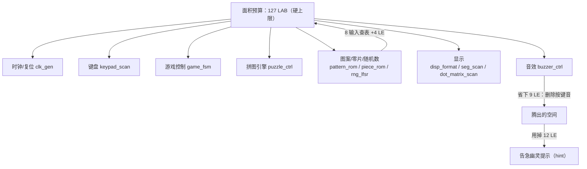

# 资源报告

> 这一页回答：**1264 / 1270 LE 是怎么花掉的** —— 以及为什么真正的瓶颈是 **LAB 而不是 LE**。

## 一、关键读数（机械抽取）

--8<-- "_generated/metrics.md"

## 二、真正的瓶颈：LAB 127 / 127，而不是 LE

| 资源 | 读数 | 余量 | 是不是瓶颈 |
|---|---|---|---|
| 逻辑单元 LE | {{fact:build.fit.le}} | 6 个 | ⚠️ 看起来还有余量 |
| **逻辑阵列块 LAB** | **{{fact:build.fit.lab}}** | **0** | ✅ **真瓶颈** |
| 引脚 | {{fact:build.fit.pins}} | 64 个 | 不紧 |

MAX II 的 LE 是**装在 LAB 里**的：一个 LAB 固定装 10 个 LE。于是会出现这种情况：

> **还有 6 个 LE 空着，但没有任何一个 LAB 能再塞进逻辑** —— 新加一点逻辑，哪怕只用到 1 个 LE，
> 也可能要求"再多一个 LAB"，而 LAB 已经 127/127 用满。

这就是为什么本项目的面积账要按 **LAB** 记账，也是为什么"＋12 LE 的幽灵提示"曾经被认为装不下、
必须从别处**先省出 LAB 级的空间**（见 [工程取舍](../08-debugging/engineering-tradeoffs.md)）。

!!! quote "设计理由"
    在贴顶的设计里，"省 LE"和"省 LAB"不是一回事。真正的预算单位是**每个 LAB 里腾出来的空位**：
    只有让某个 LAB 从 10/10 掉到 9/10，才有地方放新逻辑。

## 三、面积账：几次关键取舍花了多少

以下都是**真编译量出来的差值**（不是估算），逐条出处见 {{src:docs/05-资源利用与编译报告.md}}。

| 变更 | 面积 | 原因 |
|---|---|---|
| 乐句 **8 步 → 16 步**（`step` 3 → 4 位） | **+4 LE** | 查表输入从 7 位变 **8 位**；一个 8 输入函数要 **3 个 LUT4** 才算 1 个输出位（7 输入只要 2 个） |
| 预分频 **÷64 → ÷256** + 半周期计数器 **9 → 8 位** | **−2 LE** | `cnt` 少 1 位、`half` 多路器少 1 位、相等比较器少 1 位；代价是音准误差变大 |
| **连奏填音**（把音乐句的休止步填成音） | **−5 LE** ⇒ 落到 **1264** | 只改常量表的**值**：休止被填成"下一个音"后，旋律表里大量相邻条目变成同一个值，fitter 的复制/合并能吃掉 |
| 第 18 工作阶段的一省两增 | 净 **+5 LE**（1263 → 1268） | 删掉"打扰背景音乐的按键音"（−9 LE）换成告急幽灵提示（+12 LE） |
| 显示逻辑整改（第 22 工作阶段） | **±0 LE** | 一进一出打平：改了显示判据但面积没变 |

⚠️ 上表是**演进对照**；当前读数一律取 {{src:quartus/build_provenance.json}}（LE {{fact:build.fit.le}}、
LAB {{fact:build.fit.lab}}、`SEED 8`、setup {{fact:build.sta.setup_slack}} ns）。

## 四、这份预算还剩什么

| 还想做的事 | 代价 | 现在能不能做 |
|---|---|---|
| 恢复"被拒移动/旋转"的提示音 | 需要重新加常量 + 乐句 + 查表臂（**不是**"一键接回"） | ❌ 当前 LAB 满载，先得省出空间 |
| 随机初始朝向（A3 的另一半） | 逻辑 + 走法计划全部重解 | ❌ 明确不做（见 [工程取舍](../08-debugging/engineering-tradeoffs.md)） |
| 更长的音乐/更多音效码 | 8 输入查表的 LUT 代价会继续涨 | ⚠️ 要看具体实现，不能凭"只是常量"下结论 |

## 证据与出处

| 结论 | 依据 |
|---|---|
| LE / LAB / 引脚 / 时序读数 | {{src:quartus/build_provenance.json}}（`fit` / `sta`），报告文件 `quartus/output_files/puzzle.fit.rpt`、`puzzle.sta.rpt` |
| LAB 的容量结构（10 LE/LAB） | {{src:quartus/puzzle.qsf}}（器件 `EPM1270T144C5`，1270 LE / 127 LAB） |
| 每一项面积增减的实测差值 | {{src:docs/05-资源利用与编译报告.md}}（§1A~§1A'''''） |
| 8 输入查表为何 +4 LE | {{src:rtl/buzzer_ctrl.vhd}}、{{src:docs/05-资源利用与编译报告.md}} §1A.1 |
| "省 9 LE / 花 12 LE"的交换 | {{src:docs/05-资源利用与编译报告.md}}、{{src:rtl/game_fsm.vhd}} |
