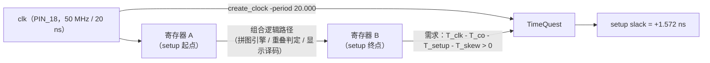

# 时序报告

> 这一页回答：**50 MHz 下时序到底余多少** —— 以及为什么这个数字只能从 TimeQuest 读。

## 一、约束：一个 50 MHz 时钟

{{src:quartus/puzzle.sdc}} 里只有一条真正的约束，其余是外设延时：

```tcl
create_clock -name clk -period 20.000 [get_ports {clk}]
```

| 项 | 值 | 说明 |
|---|---|---|
| 时钟端口 | `clk`（PIN_18） | 开发板晶振经 `USER_BTN` 选档 |
| 周期 | **{{fact:build.constraint.period_ns}} ns** | 即 **{{fact:build.constraint.fmax_mhz}} MHz** 约束 |
| 输入延时 | `set_input_delay 5.000` | 按键/LED/点阵/数码管都是低速人机接口 |
| 输出延时 | `set_output_delay 5.000` | 同上 |

因为所有外设都是**低速人机接口**，所以真正起作用的约束只有**内部 50 MHz 时钟**这一条 ——
也就是说：时序报告里的 Fmax 描述的是**内部逻辑**能跑多快，不是"按键要按多快"。

!!! bug "`quartus_tan` 不读 `.sdc` —— 会得到一份"看着没问题"的空报告"
    {{src:quartus/puzzle.sdc}} 文件头专门写了：**经典时序分析器（`quartus_tan`）不读 `.sdc` 文件**。
    用 `quartus_tan` 跑出来的 Fmax 列是空的（因为它不知道周期是多少），"没有违例"只是**没有约束**。
    ⇒ Fmax 必须从 **`quartus_sta`（TimeQuest）** 读：`quartus/output_files/puzzle.sta.rpt`。

## 二、当前读数

| 项 | 值 | 出处 |
|---|---|---|
| 约束周期 | {{fact:build.constraint.period_ns}} ns | {{src:quartus/puzzle.sdc}} |
| **Clock Setup `clk` slack** | **+{{fact:build.sta.setup_slack}} ns** | {{src:quartus/build_provenance.json}} → `sta.setup_slack` |
| **Clock Hold `clk` slack** | **+{{fact:build.sta.hold_slack}} ns** | 同上 → `sta.hold_slack` |
| 违例条数 | **0** | `puzzle.sta.rpt` |
| 推出的 Fmax | `1 / (20 − 1.572) ≈ ` **54.27 MHz** | 由 setup slack 换算（与 `puzzle.sta.rpt` 的 Fmax Summary 一致） |
| Fitter seed | `SEED 8` | {{src:quartus/puzzle.qsf}} |



## 三、正 slack 说明了什么、没说明什么

| 结论 | 说明 |
|---|---|
| ✅ 逻辑在 **54.27 MHz** 以下能稳定工作 | setup slack +1.572 ns ⇒ 还有约 **4.27 MHz** 余量（54.27 − 50） |
| ✅ hold 也过（+1.078 ns） | 与时钟频率无关，是"同一沿别抢跑"的检查；本设计全是同步逻辑、无跨时钟域 |
| ❌ **不能**说明板子上晶振正好 50 MHz | 板子有多个晶振档位；设计只保证"给 50 MHz 能跑" |
| ❌ **不能**说明换 seed 后还一样 | 布局布线是随机化的（见下） |

!!! quote "为什么要留 1.5 ns 的余量"
    ① Fitter 的布局布线是**随机化**的：同一份 RTL 换个 `SEED`，Fmax 会上下浮动几 MHz
    （{{src:scripts/gen_project.py:121}} 的注释里记了逐次重扫的结果）；
    ② 温度/电压变化会影响实际延迟；
    ③ 这台开发板的晶振档位由 `USER_BTN` 选，不能假设用户一定选 50 MHz。
    所以逐 seed 重扫的判据是"**Fmax ≥ 50 MHz**"，而不是"刚好 50.0"。

## 四、seed 与面积/时序的连带关系

面积与时间是**同一个**布局布线问题的两面，所以挑 seed 要同时看两个判据：

| 判据 | 门槛 | 报告 |
|---|---|---|
| 装得下 | LAB ≤ 127 | `puzzle.fit.rpt` |
| 跑得动 | Fmax ≥ 50 MHz | `puzzle.sta.rpt` |

当前读数（{{fact:build.fit.le}}、{{fact:build.fit.lab}}、setup +{{fact:build.sta.setup_slack}} ns / 54.27 MHz）
来自 {{src:docs/05-资源利用与编译报告.md}} §1A'''''。**改 RTL 之后这两行都会变，必须重扫**（见 [编译流程](compilation.md)）。

## 证据与出处

| 结论 | 依据 |
|---|---|
| 50 MHz 约束、5 ns 输入/输出延时、`quartus_tan` 不读 `.sdc` | {{src:quartus/puzzle.sdc}} |
| setup / hold slack 读数 | {{src:quartus/build_provenance.json}}（源报告 `quartus/output_files/puzzle.sta.rpt`） |
| Fmax 与 slack 的换算关系 | 定义式 `Fmax = 1 / (T_clk − slack)`；本页 §二 |
| seed 与重扫判据 | {{src:scripts/gen_project.py:121}}、{{src:docs/05-资源利用与编译报告.md}} |
| 历史时序演进（含每次改动的读数） | {{src:docs/05-资源利用与编译报告.md}} |
