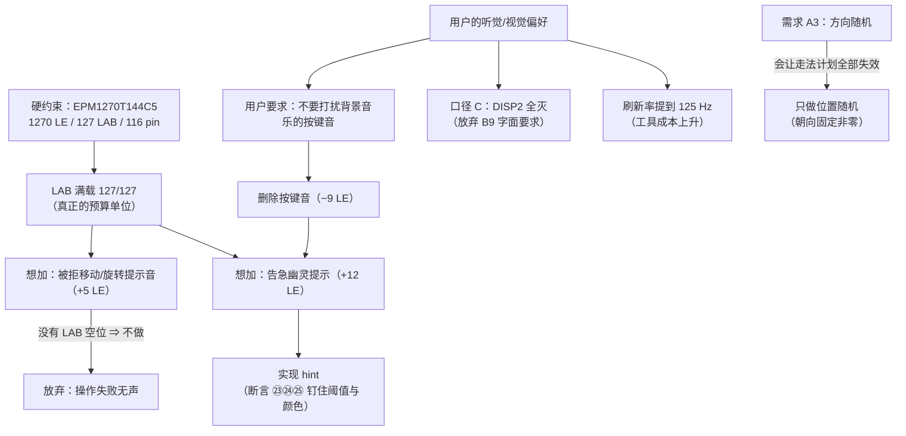

# 工程取舍

> 这一页回答：**为了装进这块器件、为了做得完，我们主动放弃了什么** —— 每条都给"得到什么 / 失去什么 / 为什么这样选 / 证据在哪"。

## 一、六条主要取舍

| 取舍 | 选择 | 代价 | 证据 |
|---|---|---|---|
| A3 的"初始朝向随机" | **不做**（只做位置随机） | 少一个加分点；换来走法计划与穷举验证全部有效 | {{src:rtl/puzzle_pkg.vhd}}、{{src:scripts/check_geometry.py}} |
| 对局中按键提示音 | **删除**（只留背景音乐） | 玩家听不到按键反馈 | {{src:rtl/game_fsm.vhd}}、{{src:docs/05-资源利用与编译报告.md}} |
| "被拒移动/旋转"的提示音 | **不做**（+5 LE 装不下） | 操作失败时没有声音提示 | {{src:rtl/game_fsm.vhd:485}}、{{src:rtl/buzzer_ctrl.vhd}} |
| 告急幽灵提示（hint） | **做**（倒计时 ≤10 s 显示目标幽灵） | 花掉 +12 LE，用掉按键音省下的 9 LE | {{src:rtl/puzzle_top.vhd}}、{{src:docs/05-资源利用与编译报告.md}} |
| DISP2 显示内容（口径 C） | **全部熄灭** | 放弃 B9 的字面要求 | {{src:docs/02-模块详细设计.md:403}}、{{src:docs/03-仿真验证方案.md:798}} |
| 显示刷新率 | **扫描提到 125 Hz** | 工具侧解析成本变大（40+ 分钟） | {{src:docs/06-硬件调试记录.md:1023}} |

## 二、逐条展开

### 取舍 1 · A3「零片初始朝向随机」：**有意不做**

| 项 | 内容 |
|---|---|
| **得到什么** | 四份走法计划（`scripts/check_plans.py` 与整机仿真共用）**全部有效**；几何与覆盖性可以被**穷举**验证；玩家仍可自己把零片转成任意朝向（A4 覆盖了"方向"这件事） |
| **失去什么** | A3 的后半句"**方向随机**"没有做 —— 严格按字面，只实现了"位置随机" |
| **为什么这样选** | ① 初始朝向随机会让**所有**走法计划失效（A\* 需要按随机朝向重解一遍，`rot` 的位置全变）；② "旋转"这一步已经是**必需**的（见 ERR-043），玩法上不缺方向这件事；③ 收益不抵工作量 |
| **证据在哪** | {{src:rtl/puzzle_pkg.vhd}} 的穷举注释：4⁴ = **256** 种朝向组合，其中 **162** 组同时满足两关的"非平凡覆盖" ⇒ "四块都保持初始朝向就能拼出"的组合占 **94/256 ≈ 37%**；参考模型 {{src:scripts/check_geometry.py}}；需求裁定见 {{src:docs/00-规范理解与需求.md}}（A3 行）、实现事实见 {{src:rtl/puzzle_pkg.vhd}}（`PIECE_ORI_INIT`） |

!!! quote "这条取舍的关键不是"少做一个功能"，而是"让做出来的功能真的必需""
    ERR-043 的教训：**如果存在一条绕过旋转的通关路线，旋转对玩家就等于不存在**。
    所以初始朝向被钉在一个固定的**非零**值上，把设计挪到那 162 组"必须旋转"的组合里。

### 取舍 2 · 对局中按键**没有**提示音（省下 9 LE）

| 项 | 内容 |
|---|---|
| **得到什么** | 省 **9 LE**（LAB 级空间）；背景音乐不再被按键音打断，听感干净 |
| **失去什么** | 【选择】【方向】【确认】【旋转】四类操作**完全没有声音反馈** |
| **为什么这样选** | 用户第 18 工作阶段的原话："确认、旋转按键我认为没必要有特殊音效来打扰背景游戏音效" ⇒ 这是**用户的听觉偏好裁定**，不是面积逼出来的；面积只是顺带获益 |
| **证据在哪** | {{src:rtl/game_fsm.vhd}}（确认/旋转的生成分支与查表臂已删）、`buzzer_ctrl` 的 16 码表、`puzzle_top` 断言 ⑳（四个按键之后仍是背景音乐码 `1000`）；面积账见 {{src:docs/05-资源利用与编译报告.md}} |

!!! warning "不要写"一键接回""
    被删掉的音效码**不能**通过"腾出面积"接回来：`puzzle_pkg` 里 `1101` 这个位置已经改作 `SND_SEL`、
    **没有 `SND_NAK`**，`buzzer_ctrl` 里也**没有 1101 的查表臂**（落进 `when others` ⇒ 静音）。
    要恢复必须**重新加常量 + 乐句 + 查表臂**。依据：{{src:rtl/game_fsm.vhd:485}}、
    {{src:rtl/puzzle_pkg.vhd:577}}、{{src:rtl/buzzer_ctrl.vhd}}。

### 取舍 3 · "被拒移动/旋转"的提示音：**不做**（+5 LE 装不下）

| 项 | 内容 |
|---|---|
| **得到什么** | 不占用已经满载的 LAB 预算 |
| **失去什么** | 玩家做了一次"无效操作"时没有任何声音提示（只能靠画面判断） |
| **为什么这样选** | 该项目标版本要 **+5 LE**，而当时 LAB 已经是 127/127 ⇒ 需要**先省出 LAB 级的空间**；而"省 LE"和"省 LAB"在 MAX II 上不是一回事（一个 LAB 装 10 个 LE，剩 6 个 LE 但没有任何 LAB 有空位） |
| **证据在哪** | {{src:docs/05-资源利用与编译报告.md}}（面积账）、{{src:quartus/build_provenance.json}}（LAB {{fact:build.fit.lab}}）、[资源报告](../07-implementation/resource-report.md) |

### 取舍 4 · 告急幽灵（hint）：+12 LE 换掉按键音省下的 9 LE

| 项 | 内容 |
|---|---|
| **得到什么** | 倒计时 **≤10 s** 时点阵显示"目标图案幽灵"（拼对的格子不覆盖），给玩家一个可感知的告急提示；第 22 工作阶段又按上板反馈改成"**只闪绿色**、确实在闪" |
| **失去什么** | 净面积 **+5 LE**（−9 + 12）；把刚省下的预算全部花掉 |
| **为什么这样选** | 这是**本轮最划算的一笔交换**：用"用户明确不要的按键音"换"提高可玩性的提示"；提示的实施细节（阈值、只闪绿、跨相位窗口）都被写成断言，可回归 |
| **证据在哪** | {{src:rtl/puzzle_top.vhd}}（`hint_on`/`hint_blink`）、面积账 {{src:docs/05-资源利用与编译报告.md}}；回归断言：`puzzle_top` ㉓（跨相位窗口内目标格子至少被点亮过一次）、㉔（只闪绿色）、㉕（倒计时 = 11 时目标格子全灭 ⇒ 阈值本身被钉住），见 {{src:sim/rounds/puzzle_top/r57.json}} |

### 取舍 5 · DISP2 口径裁定（口径 C：**全部熄灭**）

| 项 | 内容 |
|---|---|
| **得到什么** | 显示口径**全局一致、可判定**（除自检态外 **76 个窗口**的 DISP2 恒熄灭 ⇒ 一条断言就能钉住） |
| **失去什么** | 题目 B9 的字面要求"进入第二关，数码管 DISP2 显示 2"被**作废** |
| **为什么这样选** | 2026-10-12 **用户裁决**：B9 的这条与要求 3 的显示口径冲突，裁定 DISP2 在所有状态下熄灭（自检态豁免 —— B1 明文要求八位全显 `'8'`） |
| **证据在哪** | {{src:docs/02-模块详细设计.md:403}}（裁决原文）、{{src:docs/03-仿真验证方案.md:798}}（冲突说明）；回归断言 `disp_format` ⑥c（{{src:sim/rounds/disp_format/r27.json}}） |

!!! danger "这条取舍必须写在最显眼的地方"
    "不满足题目某一条字面要求"是我们**主动放弃**的东西，不是没做出来。凡是引用本设计
    完成度的地方，都要带上这条口径 —— 否则就成了隐瞒。

### 取舍 6 · 显示刷新率：扫描 125 Hz，工具成本暴涨

| 项 | 内容 |
|---|---|
| **得到什么** | 点阵行频 **125 Hz**：上板"闪得比较明显"的问题消失（原先 25 Hz 甚至更低） |
| **失去什么** | 波形数据量随刷新率上升，`vwf.py` 的解析成为瓶颈（曾要跑 **40+ 分钟**） |
| **为什么这样选** | 观感是硬需求（用户明确反馈"闪"）；工具慢是可以优化的工程问题（后来把查询从 O(n²) 优化掉） |
| **证据在哪** | ERR-027（{{src:docs/06-硬件调试记录.md:1023}}，含"25 Hz 已高于闪烁融合"这个**写错的假设**）、ERR-012（{{src:docs/06-硬件调试记录.md:152}}，更早的 ~3 Hz）、ERR-029（{{src:docs/06-硬件调试记录.md:1120}}，工具优化） |

!!! warning "待核实 · "内容率 21 Hz"这一档"
    本页只敢写仓库里能核到的数：**点阵行频 125 Hz**（{{src:docs/03-仿真验证方案.md}}、ERR-027），
    以及早期"8 行 × `tick_200` ⇒ 25 Hz 帧刷新"的口径（{{src:docs/06-硬件调试记录.md:1029}}）。
    任务书里提到的"**21 Hz**"内容率在仓库文本里**没有找到出处**（`git grep '21 Hz'` 无命中）。
    核实路径：读 {{src:docs/02-模块详细设计.md}} 的显示章节与 `rtl/dot_matrix_scan.vhd` 的
    行计数注释，或按 `tick_1k`/`tick_200` 的比例重新算一遍点阵与数码管的**整屏内容更新率**。

## 三、取舍的因果图

## 四、这些取舍留下了什么痕迹

| 痕迹 | 在哪 |
|---|---|
| 被删除的音效码仍是常量（但无查表臂） | {{src:rtl/puzzle_pkg.vhd}}、{{src:rtl/buzzer_ctrl.vhd}} |
| 每次改动的面积账 | {{src:docs/05-资源利用与编译报告.md}} |
| 每次取舍的原因与用户原话 | {{src:docs/06-硬件调试记录.md}}、{{src:docs/00-规范理解与需求.md}} |
| 取舍被写成断言（可回归） | [断言清单](../06-verification/assertions.md)（⑳㉓㉔㉕⑥c 等） |
| 已知限制汇总 | {{src:docs/00-规范理解与需求.md}}、[缺失证据](../06-verification/board-validation.md#待补拍清单) |

## 证据与出处

| 结论 | 依据 |
|---|---|
| A3 取舍与 256/162 组穷举 | {{src:docs/00-规范理解与需求.md}}、{{src:rtl/puzzle_pkg.vhd}}、{{src:scripts/check_geometry.py}} |
| 按键音删除与"不能一键接回" | {{src:rtl/game_fsm.vhd:485}}、{{src:rtl/puzzle_pkg.vhd:577}}、{{src:rtl/buzzer_ctrl.vhd}} |
| 面积账（−9 / +12 / +5 / −5 / ±0） | {{src:docs/05-资源利用与编译报告.md}} |
| hint 的阈值、颜色与回归断言 | {{src:rtl/puzzle_top.vhd}}、{{src:sim/rounds/puzzle_top/r57.json}} |
| DISP2 口径 C 的裁决 | {{src:docs/02-模块详细设计.md:403}}、{{src:docs/03-仿真验证方案.md:798}} |
| 刷新率演进与工具优化 | {{src:docs/06-硬件调试记录.md:1023}}、{{src:docs/06-硬件调试记录.md:1120}} |
| 资源读数 | {{src:quartus/build_provenance.json}} |
