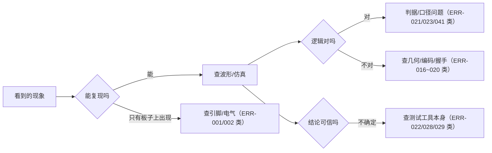

# 故障索引

> 这一页回答：**调试记录怎么用** —— 31 条有独立小节的故障分别属于哪个子系统、哪类根因。

## 一、先看机械索引

--8<-- "_generated/errors.md"

## 二、怎么用这份索引

这份索引**不是流水账**，而是可检索的证据链：每条 ERR 都有"现象 → 定位 → 根因 → 修法 → 回归证据"。

| 检索路径 | 怎么用 | 例子 |
|---|---|---|
| **按编号** | 从别的文档看到 `ERR-0xx`，回 {{src:docs/06-硬件调试记录.md}} 查它的小节 | 看到 ⑳ 断言提到 ERR-020 ⇒ 去查"方向键失效" |
| **按子系统 / 信号名** | 从出问题的信号出发，找同类历史 | "键盘读错" ⇒ **ERR-002**（引脚漏配）、**ERR-003**（轮次被提前清零）、**ERR-004**（键码表不一致） |
| **按现象关键词** | 从"看到的坏现象"找根因模式 | "显示不出来/颜色不对" ⇒ **ERR-007**（绿色出不来）、**ERR-010**（上下镜像）、**ERR-012**（刷新率太低）、**ERR-013**（底图不消失）、**ERR-027**（刷新率与注释假设） |

!!! tip "最有用的一条经验"
    先问"**这条结论是拿什么测出来的**"：如果只有人眼观察、没有量化判据，那大概率是
    **激励/判据类**缺陷（本项目 31 条里有 5 条属于这一类：ERR-021/022/025/028/029）。

## 三、按子系统分布（31 条）

归类依据是 `_generated/errors.md` 的**标题文字**；标题本身跨类的，放在更接近根因的那一类并在表里注明。

| 子系统 | 条数 | ERR 编号 |
|---|---|---|
| 显示（点阵 + 数码管） | **7** | ERR-007、008、009、010、012、013、027 |
| 测试 / 工具 / 流程 | **5** | ERR-021（判据）、022、025、028、029 |
| 拼图引擎与几何 | **4** | ERR-016、017、018、040 |
| 引脚与工程配置 | **4** | ERR-001、002、014、015 |
| 游戏控制（状态机） | **3** | ERR-005、006、024 |
| 键盘输入 | **2** | ERR-003、004 |
| 时钟 / 时序 / 相位 | **2** | ERR-011、020 |
| 图案与零片内容 | **2** | ERR-019（移位方向）、023（目标图案被置零） |
| 音效与需求口径 | **1** | ERR-050（休止 ⇒ 断断续续） |
| **合计** | **31** | —— |

**读出来的规律**：**显示类最多（7 条）**，这与"本项目最贵的资源是点阵与数码管的**内容映射**"
一致 —— 显示是"逻辑正确但**看起来**不对"的高发区（颜色、镜像、刷新率、底图、内容率）。
其次是**测试/工具类（5 条）**：这类缺陷的特征是"设计没错，是**验证方式**在骗人"。

## 四、按根因类型分布（31 条）

| 根因类型 | 条数 | ERR 编号 | 典型特征 |
|---|---|---|---|
| 显示映射与颜色 | **7** | ERR-007、008、009、010、012、013、027 | 波形对、画面错 |
| 工程配置与引脚 | **4** | ERR-001、002、014、015 | 编译全过、硬件不工作 |
| 判据与口径 | **4** | ERR-021、023、041、050 | "测得对"但**判错了对象** |
| 测试与工具实现 | **4** | ERR-022、025、028、029 | 工具本身不可靠（并发/性能/陈旧常量） |
| 几何与覆盖算法 | **4** | ERR-016、017、018、040 | 边界/流水/偏移 |
| 状态机与握手 | **3** | ERR-005、006、024 | 少一次记忆 / 用了上一局的残留 |
| 位宽与编码 | **2** | ERR-004、019 | 抄错位宽或方向 |
| 时序与相位 | **2** | ERR-011、020 | 晚一拍 / 单拍 vs 电平 |
| 键盘扫描 | **1** | ERR-003 | 样本被提前清零 |
| **合计** | **31** | —— | —— |

## 五、几条"值得当模板"的故障

| ERR | 为什么值得记住 | 详见 |
|---|---|---|
| **ERR-022** | **陈旧绿**：激励常量过期，仿真全绿但验的是旧设计 ⇒ 之后每轮证据都带源码指纹 | {{src:docs/06-硬件调试记录.md:685}} |
| **ERR-028** | 同一模块的仿真**并发跑**，`.vwf` 互相覆盖 ⇒ 变成"一个模块一个波形、串行跑" | {{src:docs/06-硬件调试记录.md:1079}} |
| **ERR-021** | 成功判据选了"内部编号"而不是"玩家看得见的画面" ⇒ 判据必须落在**可观测对象**上 | {{src:docs/06-硬件调试记录.md:621}} |
| **ERR-002** | 最长的一次误判：**引脚漏配**被当成逻辑错误查了很久 | {{src:docs/06-硬件调试记录.md:58}} |
| **ERR-050** | "照抄原谱"在单音蜂鸣器上就是"断断续续" ⇒ 需求要翻译成**可数指标** | {{src:docs/06-硬件调试记录.md:2625}} |

## 证据与出处

| 结论 | 依据 |
|---|---|
| 31 条索引与行号 | `book/docs/_generated/errors.md`（由 `facts/facts.json` 的 `errors` 机械生成） |
| 每条故障的现象/根因/修法/回归 | {{src:docs/06-硬件调试记录.md}} |
| 编号总量（全文引用 56 个不同编号） | 同上（`_generated/errors.md` 的开头说明） |
| 复盘精选 | [典型故障复盘](representative-bugs.md) |
| 取舍类结论 | [工程取舍](engineering-tradeoffs.md) |
