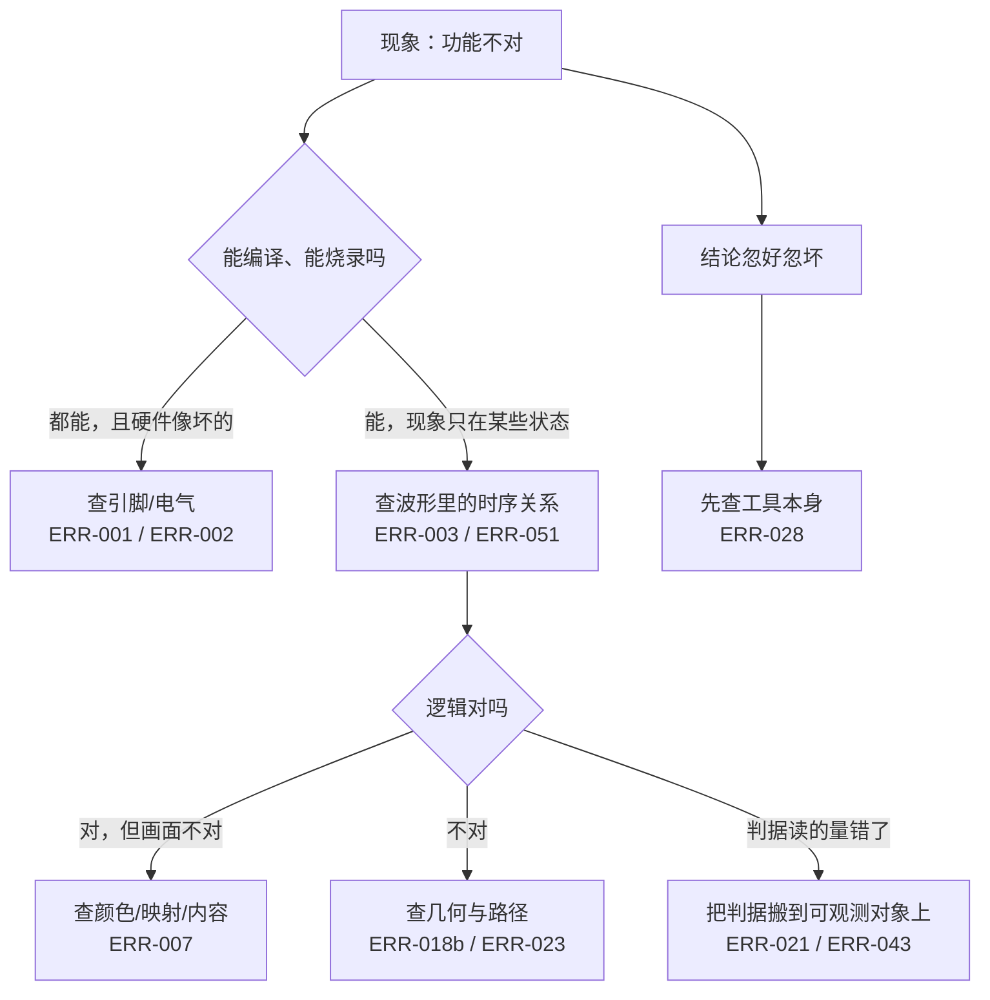

# 典型故障复盘

> 这一页回答：**这台机器上真正踩过的坑长什么样** —— 挑 10 条，每条给现象 / 定位 / 根因 / 修法 / 回归证据 / 教训。

## 一、速查

| ERR | 一句话现象 | 根因类型 | 回归证据 |
|---|---|---|---|
| ERR-001 | 复位键没反应 | 工程配置 | `scripts/check_keypad_pins.py`、52 条锁定引脚 |
| ERR-002 | 键盘整组没反应（查了很久逻辑） | 工程配置 | 同上 + `gen_project.py` 第二道守卫 |
| ERR-003 | 引脚修好后按键仍无反应 | 键盘扫描 | `keypad_scan` 断言 ⑨（{{src:sim/rounds/keypad_scan/r27.json}}） |
| ERR-007 | 选中零片"看不出变化" | 显示映射 | `puzzle_top` 断言 ⑤（{{src:sim/rounds/puzzle_top/r57.json}}） |
| ERR-018b | 散落偶尔叠在一起 | 几何算法 | `puzzle_ctrl` 断言 ⑫⑳（{{src:sim/rounds/puzzle_ctrl/r37.json}}） |
| ERR-021 | "拼好了却判失败" | 判据 | `puzzle_ctrl`/`puzzle_top` ⑩⑪（`r37` / `r57`） |
| ERR-023 | ERR-021 的新判据反而全失效 | 判据 + 逻辑 | `puzzle_top` ⑯⑯b（{{src:sim/rounds/puzzle_top/r57.json}}） |
| ERR-028 | 结论忽好忽坏、像灵异事件 | 测试工具 | `audit_evidence.py` F 段 + 轮次记录 |
| ERR-043 | 用户："旋转好像没什么影响" | 判据 + 数据 | `scripts/check_geometry.py`、`puzzle_pkg` 穷举注释 |
| ERR-051 | 自检提示音偶尔不是一声 | 时序 / 相位 | `puzzle_top` 断言 ㉒（{{src:sim/rounds/puzzle_top/r57.json}}） |

## 二、逐条复盘

### ERR-001 · 复位键引脚漏配 —— 静默落错脚

| 项 | 内容 |
|---|---|
| **现象** | 按复位键没反应，其它功能看着正常 |
| **怎么定位** | 先怀疑按键/消抖逻辑 ⇒ 查波形发现输入端口根本没有边沿 ⇒ 回头核对 `.qsf` 与开发板手册 |
| **根因** | `btn` 的 `set_location_assignment` 漏了 ⇒ Quartus 自动选脚，信号接到了别的物理脚上 |
| **修法** | 补上该引脚，并把引脚表纳入生成器（{{src:scripts/gen_project.py}}），不再手点 GUI |
| **回归证据** | 52 条锁定引脚（`facts/facts.json` → `build.pins_locked`）+ `python scripts/check_keypad_pins.py` 零 mismatch |
| **教训** | **漏配引脚不报错、能编译、能运行**，现象与"硬件坏了"一模一样。判据必须是 `.pin` 里的**实测落点** |

出处：{{src:docs/06-硬件调试记录.md:47}}

### ERR-002 · 键盘诊断固件整组漏配引脚 —— 最长的一次误判

| 项 | 内容 |
|---|---|
| **现象** | 键盘整组无响应；换用诊断固件排查时**仍然**无响应 |
| **怎么定位** | 反复怀疑扫描逻辑、按键硬件、基板接线 —— 直到把"诊断固件自己的引脚表"拿出来对 |
| **根因** | **诊断顶层**（`keypad_diag_top` / `keypad_raw_top`）的端口整组没进生成器的 `TOP_PORTS` ⇒ 诊断固件本身就没接到键盘上 |
| **修法** | ① 补全两个诊断顶层的端口清单；② 给生成器加**第二道守卫**：解析顶层 VHDL 的 `entity` 端口列表，**任何未列入 `TOP_PORTS` 的端口直接报错退出** |
| **回归证据** | 生成器守卫 + 负向测试（故意去掉 `kp_col` 确实报错）；引脚表 52 条 |
| **教训** | 守卫本身也要被审查：第一道守卫（"列出的端口必须有引脚"）**抓不到"漏列端口"** |

出处：{{src:docs/06-硬件调试记录.md:58}}

### ERR-003 · 键盘轮次结果被提前清零

| 项 | 内容 |
|---|---|
| **现象** | 引脚修正后，按键**仍然**没反应 |
| **怎么定位** | 抓 `o_key` / `round_code`：消抖级只在 200 Hz tick 采样，而结果寄存器每拍被清 |
| **根因** | `round_code` 在 `ST_IDLE` 里被**无条件**每拍清成 `K_NONE`，而该状态持续约 **250 000 个时钟** ⇒ 采样点永远读到 `K_NONE`。附带缺陷：只捕获 `phase=3`，第 0~2 列的按键永远读不到 |
| **修法** | 改为"取本轮**任意已稳定相位**的第一次命中"并保持到下一轮开始；消抖级直接读保持寄存器（避免同沿读到旧值滞后一轮） |
| **回归证据** | `keypad_scan` 断言 ⑨：按下/释放各一次单拍脉冲、消抖 4 个连续相同样（{{src:sim/rounds/keypad_scan/r27.json}}） |
| **教训** | "清零"与"采样"跑在**不同节拍**上，就会得到一个**永远为空**的寄存器 —— 静态代码审查几乎看不出来 |

出处：{{src:docs/06-硬件调试记录.md:70}}

### ERR-007 · 选中零片**永远**显示不出绿色

| 项 | 内容 |
|---|---|
| **现象** | 按【选择】切换零片时，选中的零片**看不出任何变化**（要求 B6 的"选中变绿"看不到） |
| **怎么定位** | 逐点比渲染公式的两个颜色通道，发现绿色通道的输入集合是红色通道的**子集** |
| **根因** | `redrow := cov or (tgtrow and (not cov))`，`cov` 是**所有**零片格；绿通道只由 `cov` 内的格子构成 ⇒ **纯绿格不可能存在**，选中零片显示为红+绿=**黄**，与"已锁定"观感完全一样 |
| **修法** | 单独累加"选中行" `selrow`，并从红通道里**排除**它：`red = (cov and not selrow) or ghost`、`green = locked or selrow` |
| **回归证据** | `puzzle_top` 断言 ⑤：绿色零片从一块切到另一块、未选中仍为红、总点亮格数保持 12（{{src:sim/rounds/puzzle_top/r57.json}}） |
| **教训** | **颜色也是逻辑**：通道之间的包含关系会让某个状态**不可达**，而波形看起来"信号都动了" |

出处：{{src:docs/06-硬件调试记录.md:107}}、{{src:rtl/puzzle_ctrl.vhd}}

### ERR-018b · 散落重试用错回退锚点

| 项 | 内容 |
|---|---|
| **现象** | 散落后偶尔**两块叠在一起**（重叠检查没拦住） |
| **怎么定位** | 分两步查：(a) 重试时有没有重新抽候选；(b) 失败回退时的锚点有没有查重叠 |
| **根因** | **(a)** 散落重试沿用了同一个候选（没有重新抽）；**(b)** 回退锚点直接采用，**跳过重叠检查** |
| **修法** | 重试重新抽新候选；回退锚点同样走重叠判定 |
| **回归证据** | `puzzle_ctrl` 断言 ⑫（扫描不变量：125 次检查 / 536 次邻块比较 / 98 次判定命中）与 ⑳（主路径竞态 0 误判），{{src:sim/rounds/puzzle_ctrl/r37.json}} |
| **教训** | "重试"是一条**独立路径**，必须和主路径一样过判据 —— 否则它就是漏洞的入口 |

出处：{{src:docs/06-硬件调试记录.md:397}}

### ERR-021 · 成功判据选了"内部编号"

| 项 | 内容 |
|---|---|
| **现象** | 玩家明明拼成了，程序却判失败（或反过来） |
| **怎么定位** | 把"判据用的量"与"玩家看到的画面"并排放在波形上比 |
| **根因** | 判据用了**内部零片编号**（形状/朝向的编码），而不是**玩家看得见的画面**（目标图案逐格比对）；两者在异形零片下并不等价 |
| **修法** | 判据改为**整帧逐格比对**（画面 == 目标图案） |
| **回归证据** | `puzzle_ctrl` 的帧判据 + `puzzle_top` 断言 ⑩⑪（整机用真实按键拼成并确认），{{src:sim/rounds/puzzle_top/r57.json}} |
| **教训** | **判据必须落在可观测对象上**：能被玩家看到的东西，才是能被验证的东西 |

出处：{{src:docs/06-硬件调试记录.md:621}}

### ERR-023 · 对局态把目标图案置零

| 项 | 内容 |
|---|---|
| **现象** | ERR-021 刚改好的新判据**反而全判失败** |
| **怎么定位** | 查"新判据读到的目标图案"：在对局态里它是 0 |
| **根因** | 对局态为了让点阵**不显示目标图案**，把图案寄存器清成了 0 —— 而新判据正好读同一个寄存器 |
| **修法** | 把"给玩家看的图案"与"判据用的图案"分开：对局中目标图案仍然成立，只是不进渲染通道 |
| **回归证据** | `puzzle_top` 断言 ⑯（第二关预览显示 PAT3）与 ⑯b（第三关预览显示图案库第 2 幅），{{src:sim/rounds/puzzle_top/r57.json}} |
| **教训** | **显示**与**判据**共用寄存器时，任何"为了画面"的清零都会顺手打坏判据 —— 两者要显式分层 |

出处：{{src:docs/06-硬件调试记录.md:738}}

### ERR-028 · 同一模块的仿真并发跑

| 项 | 内容 |
|---|---|
| **现象** | 同一模块的结论忽好忽坏、像灵异事件（错误其实来自**上一次**的波形） |
| **怎么定位** | 发现两个仿真进程在写**同一个** `sim/<模块>.vwf` |
| **根因** | Quartus 内置仿真器把结果**回写同一个 `.vwf`**（它既是激励也是结果）；并发跑时激励与结果互相覆盖 |
| **修法** | **一个模块一个 `.vwf`、串行跑**；`scripts/sim.py check` 默认**只读记录文件**，不再读波形 |
| **回归证据** | 每模块最新轮次的记录完整（{{tree:sim/rounds}}）；`audit_evidence.py` F 段核对轮次是否入库 |
| **教训** | 工具把"激励"与"结果"放进同一个文件时，**并发就是数据竞争** —— 这不是运气问题，是结构问题 |

出处：{{src:docs/06-硬件调试记录.md:1079}}、{{src:scripts/sim.py}}

### ERR-043 · "不旋转也能通关"

| 项 | 内容 |
|---|---|
| **现象** | 用户上板反馈原话：**"旋转好像对游戏没有什么影响，不旋转也能成功通关"** |
| **怎么定位** | 用穷举脚本（{{src:scripts/check_geometry.py}} 的参考模型）枚举朝向组合，看"一次都不转"的解是否存在 |
| **根因** | 四块零片开局朝向**全是 `"00"`**，而四幅图案又是用**只许平移**的铺法搜索推导的 ⇒ 永远存在"一次都不转"的通关路线。**256 种朝向组合里有 94 组（≈37%）**存在纯平移解 |
| **修法** | 开局朝向改为固定的非零值（`PIECE_ORI_INIT`）⇒ 把设计挪到那 162 组"必须旋转"的组合里 |
| **回归证据** | {{src:rtl/puzzle_pkg.vhd}} 的穷举注释（4⁴ = 256 组、**162 组**同时满足两关的"非平凡覆盖"）；`puzzle_top` 断言 ⑰（A4 旋转整机：朝向每次 +1 mod 4、锚点不变） |
| **教训** | **"功能实现了"不等于"功能是必需的"**：如果存在一条绕过它的通关路线，那它对玩家就等于不存在 |

出处：{{src:docs/06-硬件调试记录.md:1955}}、{{src:docs/06-硬件调试记录.md:293}}

### ERR-051 · "自检短鸣恰好一声"这个说法过强

| 项 | 内容 |
|---|---|
| **现象** | 收尾对抗性审查发现："自检短鸣无论从哪一步进都恰好一声"只在**复位/上电路径**成立 |
| **怎么定位** | 把"自检窗口的起点"与"旋律步网格的相位"对齐分析 |
| **根因** | `i_rst` 同时清零 `step` 与 FSM ⇒ 复位路径的自检窗口**必从第 0 步开始**；而 SW7 重新进入时窗口起点与 4 Hz 网格**不同相**，第一个旋律步只有 (0, 250] ms |
| **修法** | 自检窗口改为**数 8 个 `tick_4hz`**（复用 `cnt` 倒计数）⇒ 窗口恒为 8 个旋律步，而发声步相隔 8 ⇒ **必定恰好含其中一个** |
| **回归证据** | `puzzle_top` 断言 ㉒：SW7 关→开之后自检窗口内 `buzz` **恰好一声**（{{src:sim/rounds/puzzle_top/r57.json}}） |
| **教训** | **"结论比证据强"也是缺陷**：说法要限定到它真正被证明的那条路径上；残余的 1/8 相位问题如实记在 {{src:docs/06-硬件调试记录.md}} §18.1.7 |

出处：{{src:docs/06-硬件调试记录.md:301}}、{{src:docs/06-硬件调试记录.md:2376}}

## 三、这 10 条的共同模式

| 共同模式 | 出现次数 | 代表 |
|---|---|---|
| **工具/流程不报错**，但结果错（引脚漏配、并发、陈旧常量） | 3 | ERR-001、ERR-002、ERR-028 |
| **判据选错对象**（内部编号、寄存器被顺手清零） | 2 | ERR-021、ERR-023 |
| **不同节拍/相位的交互**（清零 vs 采样、窗口 vs 网格） | 2 | ERR-003、ERR-051 |
| **存在绕过路径**（不旋转也能通关） | 1 | ERR-043 |
| **通道包含关系**导致状态不可达 | 1 | ERR-007 |
| **重试/回退是独立路径**，漏了判据 | 1 | ERR-018b |

## 证据与出处

| 结论 | 依据 |
|---|---|
| 每条 ERR 的现象/根因/修法原文 | {{src:docs/06-硬件调试记录.md}}（行号见各条"出处"） |
| 31 条有独立小节的故障索引 | `book/docs/_generated/errors.md`、[故障索引](index.md) |
| 回归证据所在轮次 | {{tree:sim/rounds}}（如 {{src:sim/rounds/puzzle_top/r57.json}}、{{src:sim/rounds/puzzle_ctrl/r37.json}}） |
| 几何穷举与参考模型 | {{src:scripts/check_geometry.py}}、{{src:rtl/puzzle_pkg.vhd}} |
| 仿真串行化与记录只读 | {{src:scripts/sim.py}} |
