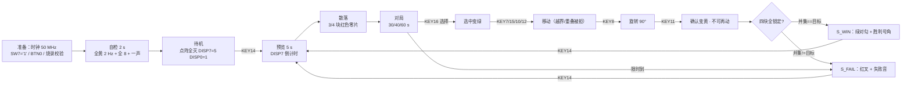

# 现场演示脚本

> 一句话定位：照着这一页按，就能在真板子上把设计跑一遍——
> 每步写清**怎么按、应该看到什么、对应哪个模块、能讲什么原理、坏了怎么办**。

!!! danger "先读这一条：演示脚本必须跟着**真实功能**走"
    本页所有操作都只用**真实存在的**输入：`SW7`（系统开关）、`BTN0`（复位）、
    以及 8 个键盘键（`KEY14` 开始 / `KEY16` 选择 / `KEY11` 确认 /
    `KEY7` 上 / `KEY15` 下 / `KEY10` 左 / `KEY12` 右 / `KEY8` 旋转）。
    **没有**"按某个键直接跳场景"的隐藏功能——**每个场景都要真的玩出来**。
    如果现场时间不够，宁可演示"**故意拼错 → 失败画面**"（确定可达），
    也不要说"这个键能直接出胜利画面"。

## 〇、整条演示链路

!!! tip "演示取舍"
    **确定可达**的是"自检 → 待机 → 预览 → 散落 → 选择/移动/旋转/确认 → **故意拼错 → 失败**"；
    "完整拼完三关 → 胜利"受**随机散落**与限时限制，现场不保证。
    时间紧就走前者，胜利画面用 `GUI-puzzle_top.png` 与 `sim/rounds/puzzle_top/r56.json` 讲。

## 一、演示前准备（5 分钟）

| # | 检查项 | 期望 | 不做会怎样 |
|---|---|---|---|
| 1 | **板上时钟选择**（板上右上角 `USER_BTN` 可切换输入时钟频率） | 选 **50 MHz**（本项目 `CNT_1K = CLK_HZ/1000 − 1`，`CLK_HZ` 按 50 MHz 写死） | 所有节拍**全部错**（自检不是 2 s、倒计时不是 1 s/秒） |
| 2 | `SW7` 拨到 **'1'** | 系统上电工作 | '0' 时**所有显示器件不显示**（B1），看起来像"没烧进去" |
| 3 | 烧录 + **读回校验** | `puzzle.pof`（sha256 `{{fact:build.provenance.pof.sha256}}`）Program → Verify 全过、0 error | 无法证明"板上的固件就是仓库里的固件" |
| 4 | 按一次 `BTN0` | 重新走一遍上电自检（**干净的起点**） | 上电状态未知，可能停在上一次演示的中间态 |
| 5 | 蜂鸣器音量 | 若声音小，顺时针调**点阵左上角的 102 电位器**（别用力过猛） | 音效环节听不清 |
| 6 | 记牢键位 | 见 [键盘操作](../05-gameplay/keypad-operation.md) 的映射表（**含物理键号**） | 按错键 → 演示卡壳 |
| 7 | 想好节奏 | 第一关 30 s、第二关 40 s、第三关 60 s；**预览只有 5 s** | 预览时还在看稿，图案已经消失 |

!!! tip "一句"报幕词"开场"
    「这是 MAX II EPM1270 上的拼图游戏，纯 VHDL 手写、**{{fact:build.fit.le}} LE、LAB {{fact:build.fit.lab}}**。
    我先按 `BTN0` 复位，然后从自检开始一步步走。」

## 二、第 1 步：上电自检（2 s）

| 项 | 内容 |
|---|---|
| **操作** | `SW7` 拨到 '1'（或按 `BTN0`） |
| **预期现象** | 点阵**整屏黄**、以 **2 Hz** 闪烁；**8 位数码管全显示 "8"** 并以 2 Hz 闪；蜂鸣器**一声短鸣** |
| **对应模块** | `clk_gen`（POR 10 ms）→ `game_fsm.S_SELF_TEST` → `puzzle_top`（全黄）/ `disp_format`（全 8）/ `buzzer_ctrl`（`SND_SELF`） |
| **可讲的原理** | ① 复位**不是**靠初值：初值只有仿真意义，真实复位来自 **POR（10 ms）或 `BTN0`（20 ms 非对称消抖）**；② 2 Hz 是"**在 250 ms 的 `t_4hz` 上翻转**"得到的，直接拿 500 ms 脉冲当 2 Hz 会得到 1 Hz（ERR-038）；③ 自检时长是"数 **8 拍 `tick_4hz`**"，所以从复位进入和从 `SW7` 重新进入**都是 2 s**（ERR-051 的修法） |
| **异常与恢复** | 全黑 → 检查 `SW7`、再按 `BTN0`；只有一个角亮 → 可能是引脚下拉/限流电阻问题，先按 `BTN0` 复现，再讲 `docs/06` 里的引脚排查（ERR-001） |

## 三、第 2 步：待机

| 项 | 内容 |
|---|---|
| **操作** | 什么都不按，等 2 s |
| **预期现象** | 点阵**全灭**；`DISP7` 显示 **"5"**、`DISP0` 显示 **"1"**，其余 6 位**全灭** |
| **对应模块** | `game_fsm.S_IDLE` → `disp_format`（组合逻辑） |
| **可讲的原理** | ① `DISP7='5'` 是**题目规定的待机画面**（B2），不是"倒计时 5"；② 待机时点阵**必须显式清零**，不能"保持上一帧"——否则四块零片会全堆在锚点 `(0,0)`（ERR-009）；③ 关数只由 `DISP0` 显示（DISP2 全程熄灭，见 [题目要求与验收](../01-project/requirements.md) 的口径 C 裁定） |
| **异常与恢复** | `DISP2` 亮着 → 说明烧的是**旧固件**（口径 C 之前）；重新烧 `{{fact:build.provenance.pof.sha256}}` 这一版 |

## 四、第 3 步：图案预览（5 s）

| 项 | 内容 |
|---|---|
| **操作** | 按 **`KEY14`（开始）** |
| **预期现象** | 点阵显示**完整目标图案**（第一关 = 4 行 × 3 列矩形）；`DISP7` 从 **5 倒计时到 1**；蜂鸣器响`SND_PREVIEW`（A5→E6 上行，**0.75 s**） |
| **对应模块** | `game_fsm.S_PREVIEW`（`cnt` 从 `T_PREVIEW`=5 递减）→ `puzzle_top`（`prev_row` 从 `tgt_mask` 切行） |
| **可讲的原理** | ① 预览图案来自**编译期常量**（`pattern_rom` 4 LE），引擎**不参与**；② 倒计时按**自由走的 1 Hz 节拍**递减，而入口是按键 ⇒ 实测窗口是 **(4, 5] s**，随按键相位浮动——**不是** bug；③ 预览结束的**那个节拍**才装载本关限时，所以**限时恰好是整秒** |
| **异常与恢复** | 图案不出现 → 确认 `SW7`=1；图案**上下反了** → 那是 ERR-010 类的历史问题（已修），若复现请按 `docs/06` 的"行号顺序实测"一节核对；预览一闪就没了 → 检查板上时钟是不是不是 50 MHz（准备清单第 1 条） |

## 五、第 4 步：散落

| 项 | 内容 |
|---|---|
| **操作** | 等预览结束（不用按键） |
| **预期现象** | 点阵上出现 **3 块红色零片**（第一关），位置**随机**、互不重叠；`DISP4:DISP3` 开始显示 **30 秒**倒计时；背景音乐起（`SND_BGM1`） |
| **对应模块** | `game_fsm`（`o_go` 电平握手）→ `puzzle_ctrl`（有界候选 + 拒绝采样）→ `rng_lfsr`（`i_step` 推进） |
| **可讲的原理** | ① 散落用**请求/应答握手**（`o_go` 直到 `i_shuf_busy` 拉高才撤销）⇒ **不会漏**；② 每局只请求一次（`go_done` 记忆位），否则引擎会**无限重复散落**（ERR-006）；③ 随机源是**8 位最大长度 LFSR**，只在 `i_step` 时推进 ⇒ 散落**可复现**（对仿真很重要）；④ 零片包围盒 ≤ 3×3，所以候选只有 3×3 邻域（有界） |
| **异常与恢复** | 零片**重叠**出现 → 说明走到了"回退锚点不做重叠检查"的极端分支（ERR-018b，概率 ≈1e-7），按 `KEY14` 重开即可；零片不动/没出现 → 检查是否还在 `S_PREVIEW` |

## 六、第 5 步：选择 / 移动 / 旋转（核心演示）

| 项 | 内容 |
|---|---|
| **操作** | ① 按 `KEY16`（选择）循环切块；② 按 `KEY7/15/10/12`（上/下/左/右）走格子；③ 按 `KEY8`（旋转）转 90° |
| **预期现象** | ① **选中块变绿**；② 选中的绿块**跟着方向键走**；③ 旋转时该块的**形状变向**（锚点不动）；**越出 8×8 或与别的零片重叠的请求被拒绝 —— 画面完全不变** |
| **对应模块** | `game_fsm`（命令译码 + 单拍脉冲）→ `puzzle_ctrl`（夹紧→边界→重叠检查；旋转在同一套校验流水里） |
| **可讲的原理** | ① 一次按下 = **一个 `o_press` 脉冲**（命令寄存器每拍默认清零）⇒ **按住不会连发**；② 消抖 = 连续 **4 次读数一致**（≈40 ms，200 Hz 扫描）；③ **旋转在固定 3×3 盒里做**，再在算行掩码的**唯一一处**补回锚点偏移——直接"在紧包围盒里转"实测 **+229 LE 装不下**，盒内转只要 **+6 LE**（[移动与旋转](../05-gameplay/movement-rotation.md) 有逐行演算）；④ 旋转不是装饰：`PIECE_ORI_INIT` 让每块**至少转一次**，穷举证明"不转就拼不出来" |
| **异常与恢复** | 按键无反应 → 只有**对局态**才响应选择/移动/旋转/确认（`S_IDLE`/预览态按键无效是**设计**）；选不中某块 → 已锁定的块会被"循环选择"跳过；旋转后位置"跳"了 → 那是 ERR-040（已修），若复现说明固件不是当前版本 |

## 七、第 6 步：确认锁定

| 项 | 内容 |
|---|---|
| **操作** | 把一块移到目标位置后按 **`KEY11`（确认）**；重复"选块 → 移到位 → 确认"直到四块都锁定 |
| **预期现象** | 该块**变黄**，之后**不可再选、不可再移**；四块全锁定时，若并集 = 目标图案 ⇒ **过关**（进下一关预览），否则 ⇒ **立即失败** |
| **对应模块** | `game_fsm`（`o_conf`）→ `puzzle_ctrl`（`locked` + `frm_ok`/`frm_valid`）→ `game_fsm`（`S_PREVIEW`/`S_WIN`/`S_FAIL`） |
| **可讲的原理** | 成功判据是"**四块全锁** 且 **并集恰好等于目标图案**"（`o_solved = frm_ok and alllock_r`），而且必须满足 **`shuf_seen='1'`（本局见过散落）**、`i_shuf_busy='0'`——这一位是 ERR-024 的修法，防"新一局开局瞬间拿着上一局的残留状态判赢" |
| **异常与恢复** | 拼对了却不判过关 → 检查是否还有零片没锁定（判据要求 `alllock_r`）；确认后还能移动 → 那是 B8 的旧缺陷（ERR-007 一类），按 `KEY14` 重开并检查固件版本 |

## 八、第 7 步：胜利画面

| 项 | 内容 |
|---|---|
| **操作** | 连续过关：第一关（30 s）→ 第二关（40 s，图案固定 = 阶梯）→ 第三关（60 s，图案**随机**） |
| **预期现象** | 第三关拼对 ⇒ 点阵显示**绿色粗对勾**（先闪 1 s 再常亮）+ `SND_WIN` 胜利号角；`DISP0` 显示 3 |
| **对应模块** | `puzzle_pkg.WIN_MASK` + `puzzle_top`（只点绿列 + 1 s 闪烁）+ `buzzer_ctrl.MEL_WIN` |
| **可讲的原理** | ① 结算画面用**绿色对勾 / 红色叉**的交通灯配色（点阵只有双色，"颜色本身就是第一判读线索"）；② "先闪 1 s 再常亮"= 数 **4 个 250 ms 半周期**（ERR-038 修正了把 500 ms 脉冲当 2 Hz 拍的 2 倍错误）；③ 第三关的图案在**进入预览那一拍**锁存（`pat_sel` 取 LFSR 低 2 位）⇒ 预览看到的就是本关要拼的 |
| **异常与恢复** | **现场时间不够就跳过这一条**（一关最优解是 **19 条命令**，实际要更多：散落位置随机）；改用仿真证据讲解：`GUI-puzzle_top.png` + `sim/rounds/puzzle_top/r56.json` |

!!! warning "诚实提示：现场很难在限时内拼完三关"
    题目限时是 30/40/60 s，而一关的**最优按键数**是 19 条命令（`scripts/check_plans.py` 可证：
    下界 16，实际 19）。**随机散落**让每次要走的格数不同 ⇒ 现场演示建议：
    ① 主打"**选择/移动/旋转/拒绝**"这四件事；② 用"故意拼错"演示失败画面；
    ③ 胜利画面用仿真截图讲（有真实 Quartus 波形作证据）。

## 九、第 8 步：失败画面（确定性可达，推荐演示）

| 项 | 内容 |
|---|---|
| **操作** | ① **拼错路径**：选中任意一块，用方向键**移开 1 格**，然后 `KEY16`+`KEY11` 把四块**都确认**；② **超时路径**：什么都不做，等限时走完 |
| **预期现象** | ① 四块刚锁完就**立即**显示**红色粗叉**（先闪 1 s 再常亮）+ `SND_FAIL`；② 限时到的瞬间同样进失败画面 |
| **对应模块** | `puzzle_ctrl.o_all_lock`（但 `o_solved=0`）→ `game_fsm.S_FAIL`；超时走 `i_tick_1hz & cnt<=1` |
| **可讲的原理** | ① "拼错"的判据是 **全锁但并集≠目标**（零片不重叠 ⇒ 移开一块后并集必然 ≠ 目标，所以这条路**确定**能演示出失败）；② 超时**不看拼到哪一步**；③ 失败与成功共用同一条判定链，区别只是 `frm_ok` |
| **异常与恢复** | 全锁完却出胜利 → 说明移开的那一格恰好构成了**等价的精确覆盖**（理论上可能但极罕见）；换一块再试，或直接用超时路径 |

## 十、第 9 步：重开与关卡切换的讲解点

| 项 | 内容 |
|---|---|
| **操作** | 在**对局中**、**失败画面**、**胜利画面**分别按一次 `KEY14` |
| **预期现象** | 三种情况都**回到第一关的 5 s 预览**（关数归 1） |
| **对应模块** | `game_fsm`：`S_PLAYING`/`S_WIN`/`S_FAIL` 三个分支里都有 `kdec = K_START` 的处理 |
| **可讲的原理** | B11 要求"游戏过程中或结束后再次按开始键可开新一轮"——实现上是**三个状态各写一遍**（而不是加一个"全局复位"分支），代价更小；同时 `req_go`/`go_done`/`shuf_seen` 会在离开 `S_PLAYING` 时**重新武装**，为下一局的散落做准备 |
| **异常与恢复** | 按了没反应 → 确认按的是 `KEY14`（键位见准备清单第 6 条） |

## 十一、收尾：主动说出限制（30 s）

按 [已知限制与取舍](../01-project/limitations.md) 挑三条讲，**别等老师问**：

1. **LAB 满载**（{{fact:build.fit.lab}}）——有一版功能实测 **1278 LE 装不下**；
2. **A3 只做一半**（初始朝向固定，理由：37% 的牌局会"不转也能拼出来"）；
3. **没有真实硬件照片、音效听感没有录音证据** —— 板子当时不在手边，补拍清单已列。

## 十二、演示对照图（**不是硬件实拍**）

<figure markdown="span">
  { loading=lazy }
  <figcaption>
  **图 9.1** 板面显示内容的**对照参考**（点阵 + 数码管的布局与配色）。
  **证据级别：❌ 网页引擎渲染**——由原展示站的引擎按同一套规则绘出（原 `site/` 已删除），**不是**开发板实拍。
  用途仅限"现场核对布局是否与预期一致"；**不能**证明点阵亮度、颜色、限时行为。
  真实硬件照片：**0 张**（补拍清单见 [已知限制与取舍](../01-project/limitations.md) 第 7 条）。
  </figcaption>
</figure>

## 证据与出处

| 结论 | 依据 |
|---|---|
| 键位与键码 | {{src:rtl/game_fsm.vhd:143}}、{{src:rtl/puzzle_pkg.vhd:523}} |
| 自检/待机/预览的时长与画面 | {{src:rtl/game_fsm.vhd:264}}、{{src:rtl/disp_format.vhd:7}} |
| 散落握手与 `go_done`/`shuf_seen` | {{src:rtl/game_fsm.vhd:421}}、{{src:rtl/game_fsm.vhd:440}} |
| 移动/旋转的拒绝语义 | {{src:rtl/puzzle_ctrl.vhd:823}}、{{src:rtl/puzzle_ctrl.vhd:149}} |
| 胜负判据 | {{src:rtl/puzzle_ctrl.vhd:360}}、{{src:rtl/game_fsm.vhd:337}} |
| 结算画面与闪烁 | {{src:rtl/puzzle_top.vhd:750}}、{{src:rtl/puzzle_top.vhd:663}} |
| 一关最优 19 条命令 | {{src:scripts/check_plans.py}}、{{src:sim/tb_puzzle_top.py}} |
| 板上时钟选择 / 蜂鸣器电位器 | `refs/pdf/数字系统设计2026.pdf`（"五、数字系统设计时注意的问题"（八）仿真） |
| 固件指纹 | {{src:quartus/build_provenance.json}} |

!!! warning "待核实"
    ① "移开一块后并集必然 ≠ 目标"是**推理**（零片互不重叠 + 目标为精确铺满），
    没有专门的仿真断言守它；核实路径：在 `sim/tb_puzzle_ctrl.py` 里加一条"故意错位后全锁"的激励。
    ② **本脚本没有在真板子上逐条彩排过**（板子不在手边）——
    第一次彩排后请把"实际现象 vs 预期"的差异补记到本页。
