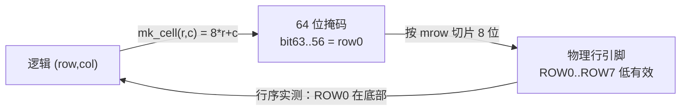

# 技术深挖

> 一句话定位：给"追问到底"准备的八个硬话题——**位序约定、旋转数学、LFSR、
> 拒绝采样、时钟域、LAB 装箱、时序裕量、错误检测与恢复**。每个都给出公式、源码位置与边界。

## 一、位掩码与三种坐标系

| 坐标系 | 定义 | 用在哪 |
|---|---|---|
| **逻辑坐标** `(row, col)` | `row` 0 在**上**、`col` 0 在**左**，范围 0..7 | 引擎内部计算、图案常量 |
| **位掩码** | `bit = 8*row + col`，64 位 `std_logic_vector(63 downto 0)` | 帧、零片形状、目标图案 |
| **物理引脚** | `ROW0..ROW7`（低电平选通）、`COLR0..7`/`COLG0..7` | `dot_matrix_scan` 输出 |



**三个陷阱**（都真踩过）：

1. **位序与行序方向相反**：掩码的 bit 63..56 是**第 0 行（最上）**，
   而物理 `ROW0` 是**最下面**一行（实测发现，见 {{src:rtl/dot_matrix_scan.vhd:41}}）⇒
   逻辑行号必须从底部往上数，否则图形上下镜像（ERR-010）。
2. **行列移位方向**：`row_mask` 是"第 row 行的 8 位列"，列 `c` 对应 bit `c`；
   向右移动零片 = 掩码**向高位**移。`srl8` 的语义是 `v(j) = r(j − dc)`（允许负 `dc`），
   写成"位号大的方向移"会让 fitter **无法常量折叠**，实测 958 → 1201 LE
   （实测记录写在 {{src:rtl/puzzle_pkg.vhd:707}} 的注释里）。
3. **同一行内不要用"绝对行号"**：引擎一拍只算一行，行内用**行内列**（0..2 或 0..7），
   跨行才用绝对行号——混用就是 ERR-016"重叠检查的行号流水没对齐"。

## 二、旋转的坐标数学

**问题**：给定零片掩码 `shp`（紧包围盒锚在 (0,0)）、朝向 `ori`、要渲染的紧包围盒行 `sr`，
求这一行的 3 位列掩码（再按锚点列移位）。

**做法**：先在**固定 3×3 盒**里做置换，再补回紧包围盒在盒里的偏移。

```text
盒内行号   = sr + dr,   dr = rot_off_r(h, w, ori)
盒内列置换 = rot_row 的四个公式（c = 0,1,2）：
      "00" : (r0, c0) = (sr, c)          -- 0°
      "01" : (r0, c0) = (2-c, sr)        -- 顺时针 90°
      "10" : (r0, c0) = (2-sr, 2-c)      -- 180°
      "11" : (r0, c0) = (c, 2-sr)        -- 顺时针 270°（= 逆时针 90°）
行掩码 v(c) = shp(8*r0 + c0)
列移位     = ac - dc,  dc = rot_off_c(h, w, ori)   -- 可能为负 ⇒ srl8 支持 -1/-2
旋转后高宽 = oh(h,w,ori) / ow(h,w,ori)             -- 90°/270° 互换
```

**为什么"盒内转 + 补偏移"是对的**（一行的证明）：
设零片某格在紧包围盒里的坐标是 `(r, c)`，它在盒里的坐标是 `(r + dr, c + dc)`（由 `dr/dc` 定义）。
盒内置换把"要渲染的紧包围盒行 `sr`"映射到盒行 `sr + dr`，取出的列坐标是"盒列"`c_box`；
减去 `dc` 后得到"紧包围盒列"`c = c_box − dc`；最后按锚点列移位把 `c` 放到 `ac + c`。
⇒ 结果与"直接在紧包围盒里转"等价，这正是 `scripts/check_geometry.py` 用它做**独立实现比对**的原因
（7 块 × 4 朝向 × 逐行全等）。

**面积对比（全部实测）**：

| 写法 | 代价 | 结果 |
|---|---|---|
| ROM 存 4 套形状（24 位整体置换） | ≈ **+190 LE** | 装得下但太贵 |
| 紧包围盒里直接转（算 `h−1−c`、`w−1−c` + 范围保护） | **+229 LE** | ❌ **装不下** |
| **盒内转 + 唯一一处补偏移**（本设计） | **+6 LE / 调用点** | ✅ 采用 |

!!! quote "这条最能说明"面积优先"的设计风格"
    同一件事有两种等价写法，逻辑上都能对；**决定采用哪一种的是 LE 与 LAB**。
    讲义"器件资源的优化"里"**串行化 / 复用**"说的就是这里：把贵的置换放在
    **本来就被逐行复用**的那一级，而不是每块零片各来一套。

## 三、LFSR：周期、性质与局限

**结构**：8 位最大长度 LFSR，抽头 `x⁸ + x⁶ + x⁵ + x⁴ + 1`（Xilinx xapp052 标准 8 位抽头），
**周期 = 2⁸ − 1 = 255**（全零状态是吸收态，被排除）。

| 性质 | 说明 |
|---|---|
| 周期 | **255**，覆盖除全零外的所有 8 位状态 |
| 均衡性 | 一个完整周期里 1 的个数比 0 多 1（128 : 127） |
| 步进控制 | **只在 `i_step='1'` 时推进**（{{src:rtl/rng_lfsr.vhd:27}}）⇒ 散落**可复现** |
| 复位种子 | `SEED_DEFAULT`，复位/`i_go` 时装载 |

**局限（必须主动说明）**：

1. **状态空间小**（255）：长序列会重复；本用途每局只推进几次，够用。
2. **线性结构**：相邻输出位之间存在线性关系，**不是**密码学随机；
   若把连续输出当"独立随机数"用会出错。
3. **取低位有偏**：本设计"第三关选图案"直接取**低 2 位**——
   在一个周期内低 2 位的分布并不完全均匀（周期 255 不能被 4 整除 ⇒ 四种取值出现 64/64/64/63 次）。
   影响：某种图案比其它多出现约 **1.6%**（1/64）；对玩法无影响，但**不是均匀随机**。
4. **没有去偏/后处理**：散落用拒绝采样间接减轻了偏置，但没有做白化。

## 四、拒绝采样（散落）与它的边界

**算法**（`puzzle_ctrl`）：对每块零片，从 `3×3` 锚点邻域里抽候选 →
检查越界/重叠 → 不合法就重抽；重抽次数用尽后走**回退路径**。

| 环节 | 设计要点 | 依据 |
|---|---|---|
| 候选**有界** | 零片包围盒 ≤ 3×3（`PIECE_MAX_DIM`）⇒ 候选只有 3×3 = 9 个锚点 | {{src:rtl/puzzle_pkg.vhd:385}} |
| 重试抽新候选 | ERR-018a：早期版本重试时**不再抽新候选**，等于死循环 | {{src:docs/06-硬件调试记录.md}} |
| 回退路径 | ⚠️ **不做重叠检查**（ERR-018b），概率量级 ≈ **1e-7**，**已记录未修** | 同上 |
| 握手 | `o_go` 电平 + `go_done` 记忆位 ⇒ 每局只散落一次，且**不会漏** | {{src:rtl/game_fsm.vhd:421}} |

!!! warning "概率数字的来源要说清"
    "≈1e-7"是 `docs/06` 里的**量级估算**，不是穷举统计。
    严格做法：枚举 LFSR 状态序列，统计"连续 K 次抽到非法候选"的出现频率。
    本页把它标为**待核实**（核实路径见页末）。

## 五、单时钟域 + 节拍使能 vs 异步时钟域

| 维度 | 本项目：单时钟 + 节拍使能 | 异步多时钟域（如 PLL 分频） |
|---|---|---|
| 时钟树 | **1 条**（`clk` = 板上 50 MHz） | 多条，需 CDC 约束 |
| 跨域通信 | 不存在（所有寄存器同沿） | 需同步器/握手/异步 FIFO |
| STA | 只分析一条路径，结论直接 | 需 `set_clock_groups`/`set_false_path`，易漏 |
| 面积 | 使能脉冲是**已有的比较器输出**，便宜 | PLL + 同步器 + 握手逻辑 |
| 风险 | 使能脉宽必须**恰好一拍** | 亚稳态、偏斜、复位域交叉 |
| 适用 | 低速外设、事件驱动的显示/音效 | 高速数据流、需要真正不同频率的接口 |

**为什么本设计不需要异步域**：所有外设都是"**低速 + 事件驱动**"——
点阵 125 Hz、数码管 125 Hz、键盘 200 Hz、音效几 kHz、倒计时 1 Hz。
它们要的是"**每隔 N 个时钟做一次**"，而不是"另一个频率的时钟"。
代价是**所有节拍必须严格一拍宽**，所以产生节拍的进程统一写成
"计数到常量 → 输出高一个周期"。

!!! bug "把 500 ms 脉冲当 2 Hz 节拍（ERR-038）"
    工程上最容易犯的一类错：`t_2hz` 是**每 500 ms 一个脉冲**，
    要在它上面"翻转"才得到 2 Hz 方波；直接把它当"2 Hz 节拍"用只有 **1 Hz**。
    本项目因此统一口径：**需要 2 Hz 就在 `t_4hz`（250 ms）上翻转**。

## 六、LAB 装箱与 LE 利用率

```
器件：EPM1270T144C5 —— 1270 LE / 127 LAB ⇒ 每 LAB 10 个 LE
本设计：LE {{fact:build.fit.le}}，LAB {{fact:build.fit.lab}}
```

| 概念 | 含义 | 为什么两者都要看 |
|---|---|---|
| LE 利用率 | "**逻辑量**用了多少" | 报 100% 说明逻辑塞满了 |
| LAB 利用率 | "**物理容器**用了多少" | LE 只能按 LAB 打包 ⇒ **容器满了就再也放不下任何 LE** |

**本设计的判据**：两行**同时**看。实例：自检窗口从"正计数"改成"倒计数"（复用已有减法器）
正是为了**不多要一个 LAB**；"红/绿交替"幽灵版 **1278 LE** 直接报错
（*device contains only 1270*）。

!!! tip "改动的正确评估姿势"
    1. 先判断"这个改动会新增几个**独立的小逻辑块**"——它决定**LAB**增长；
    2. 再真编译，比较 `Total logic elements` 与 `Total LABs` **两行**；
    3. 若 LAB 达到 127/127，哪怕 LE 只增 8 个也可能失败。

## 七、时序裕量怎么读

| 量 | 值 | 读法 |
|---|---|---|
| 约束周期 | {{fact:build.constraint.period_ns}} ns（50 MHz） | 来自 {{src:quartus/puzzle.sdc}} |
| setup slack | **+{{fact:build.sta.setup_slack}} ns** | 数据比要求早到 1.572 ns ⇒ **正裕量** |
| 可达 Fmax | `1/(20 − 1.572) ns ≈ **54.27 MHz**` | 反推值，不是报告里的"目标" |
| hold slack | **+{{fact:build.sta.hold_slack}} ns** | 保持时间也有裕量，无违例 |
| 相对 50 MHz 的余量 | **4.27 MHz**（54.27 − 50） | 给"布局波动/温度"留的空间 |

**三条解读纪律**：

1. **slack 是"当前布局布线 + 当前 SEED"的结果**：改 RTL、改 seed、改器件选项都要重跑。
2. **正 slack ≠ 可以随便加逻辑**：面积是瓶颈（LAB 满），而不是速度。
3. **种子要两个判据一起看**：本项目扫过 16 个 SEED，其中 **SEED 15 装得下但只有 47.87 MHz**
   （过不了 50 MHz）⇒ "装得下"不等于"能用"。选中的是 `SEED 8`。

## 八、错误检测与恢复的思路

**本项目已经在用的四层**：

| 层 | 手段 | 发现什么 |
|---|---|---|
| 运行时（RTL 内） | 6 态状态机有 `when others` 兜底（并重装自检倒计数）；请求/应答握手带记忆位 | 非法状态、丢失的请求 |
| 仿真期 | {{fact:sim.totals.assertions}} 条断言 + 每轮 `rNN.json` | 功能错误、时序关系错误 |
| 构建期 | Fitter/STA 报告 + **`.pof` 哈希** + 逻辑指纹（`build_provenance.json`） | 资源/时序越界、"改了却以为没改" |
| 交付期 | `audit_evidence.py` / `verify-facts.mjs` / `check_book.py` **强制对账** | 文档与真值源漂移 |

**如果重做，会补的三件事**：

1. **回退路径也做重叠检查**（关掉 ERR-018b）——用更宽的握手换取"无死角"。
2. **把"干净帧"窗口加宽**（关掉 ERR-041），或用双缓冲帧 + 帧有效位。
3. **给外设侧加轻量自检**：例如键盘扫描读回不一致时点亮一个诊断位，
   把"按键没反应"从"人肉排查"变成"板上自报"。

## 证据与出处

| 结论 | 依据 |
|---|---|
| 位序与 `mk_cell`、`srl8`、`row24` | {{src:rtl/puzzle_pkg.vhd:621}}、{{src:rtl/puzzle_pkg.vhd:703}}、{{src:rtl/puzzle_pkg.vhd:738}} |
| 旋转原语与偏移、`oh`/`ow` | {{src:rtl/puzzle_pkg.vhd:766}}、{{src:rtl/puzzle_pkg.vhd:795}}、{{src:rtl/puzzle_pkg.vhd:819}} |
| 旋转三版面积实测 | {{src:rtl/puzzle_pkg.vhd:99}}、{{src:docs/06-硬件调试记录.md}} |
| 几何独立实现比对 | {{src:scripts/check_geometry.py}} |
| LFSR 多项式与步进 | {{src:rtl/rng_lfsr.vhd:5}}、{{src:rtl/rng_lfsr.vhd:27}} |
| 拒绝采样与回退路径 | {{src:rtl/puzzle_ctrl.vhd}}、{{src:docs/06-硬件调试记录.md}}（ERR-017/018） |
| 时钟域与节拍 | {{src:rtl/clk_gen.vhd:55}}、{{src:rtl/puzzle_pkg.vhd:397}} |
| LAB/LE 与 1278 LE 报错 | {{src:docs/05-资源利用与编译报告.md}}、{{src:docs/06-硬件调试记录.md}} §22.3 |
| 时序与 SEED 15 = 47.87 MHz | {{src:quartus/puzzle.sdc}}、{{src:docs/05-资源利用与编译报告.md}} |
| 四层错误检测 | {{src:scripts/audit_evidence.py}}、{{src:quartus/build_provenance.json}}、{{tree:sim/rounds}} |

!!! warning "待核实（三处）"
    1. **ERR-018b 的 1e-7**：量级估算，非穷举统计。核实路径：
       枚举 LFSR 状态序列，统计"连续 K 次非法候选"频率。
    2. **LFSR 低 2 位的偏置（约 1.6%）**：由"周期 255 不能被 4 整除"推出的**理论值**，
       没有实测统计。核实路径：跑满 255 个状态，统计低 2 位四种取值次数。
    3. **"盒内转 + 补偏移"的等价性证明**：本页只给了单行推导，
       完整验证靠 `check_geometry.py` 的逐块×逐朝向×逐行比对（**已通过**），
       但没有形式化证明文档。
