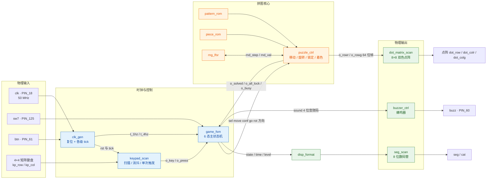
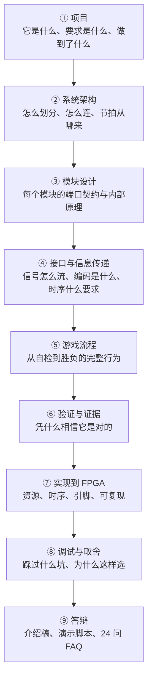

# 简易拼图游戏 · 工程技术文档

> 在一块 **8×8 双色点阵**上玩拼图 —— **纯 VHDL-93 RTL**，跑在
> **Altera MAX II `EPM1270T144C5`** 上，用 **Quartus II 9.1** 综合。
>
> 这是项目的**对外网站**，也是技术文档本体：逐模块的接口契约、数据编码、
> 时序关系、仿真证据与工程取舍。**导航本身就是一条阅读路径**，跟着走一遍即可。

---

## 三十秒读懂这个项目

先显示**目标图案 5 秒**，然后 **3 块零片随机散落**；玩家用 **4×4 矩阵键盘**
选择零片、上下左右移动、必要时**原地旋转 90°**，把零片拼成与目标一致的形状后
逐块按【确认】锁定 —— 拼对过关，超时或拼错判负。**三关递增**，
第三关的图案从四幅库中随机选。

它不是一个"点灯实验"：整机 **1264/1270 个逻辑单元**全手写，
**LAB 已经 127/127 装满**，还有 **{{fact:sim.totals.assertions}} 条断言**、
**12 张真实 Quartus GUI 仿真截图**和一份**可机器核验**的证据链。



> 这张图只是"看个大概"。它省略了信号、位宽与有效条件 ——
> **完整版**（含每一条连线的真实信号名）在
> [系统总体架构](02-architecture/system-overview.md)，**逐条可核对**的
> 连接清单在 [跨模块连接总表](04-interfaces/module-ports.md)。

---

## 现在这个实现的状态

| | |
|---|---|
| 器件 | MAX II **EPM1270T144C5**（1270 LE / 127 LAB，144 脚 TQFP） |
| 逻辑单元 | **{{fact:build.fit.le}}** —— 余 6 个 LE，但**装箱层面约等于 0** |
| 逻辑阵列块 | **{{fact:build.fit.lab}}** ← **真正的瓶颈**：MAX II 的 LE 只能按每 LAB 10 个成组分配 |
| 引脚 | {{fact:build.fit.pins}}，**全部显式锁定**（没有"让工具自己挑"的引脚） |
| 时序 | 约束 50 MHz / 20 ns；**Fmax {{fact:build.constraint.fmax_mhz}} MHz**，setup `{{fact:build.sta.setup_slack}} ns`、hold `{{fact:build.sta.hold_slack}} ns`，**0 条违例** |
| 仿真 | **{{fact:sim.totals.modules}} 个模块 / {{fact:sim.totals.assertions}} 条断言，全部通过** |
| 源码规模 | {{fact:hierarchy.counts.files}} 个 VHDL 文件 = {{fact:hierarchy.counts.modules}} 个游戏子模块 + {{fact:hierarchy.counts.diag_tops}} 个诊断顶层 + {{fact:hierarchy.counts.packages}} 个设计包 |
| 基本要求 | **B1~B11 全部实现**（11/11） |
| 提高要求 | **A1 / A2 / A4 / A5 全部实现**（4/4）；**A3 只完成一半** —— 见下 |

!!! warning "A3 为什么只做了一半（说清楚，不糊弄）"
    题目 A3 要的是"位置随机 + **方向随机**"。本项目**有意**不做初始朝向随机：

    * 从第 14 工作阶段起，「**不旋转就拼不出来**」是一条**硬保证**：
      开局朝向固定为 `PIECE_ORI_INIT = 1/1/2/2`，并由
      {{src:scripts/check_geometry.py}} 对四幅图案 + 第一关**穷举证明**：
      四块都保持初始朝向时**无解**。
    * 若把初始朝向也随机，4⁴ = 256 种组合里只有 **162 种**满足这个性质
      ⇒ 约 **37% 的牌局会"不转也能拼出来"** —— 而那正是上板后被明确否掉的
      现象（`ERR-043`）。

    ⇒ 这里用 **A3 的一半换 A4 的成立**。这不是"忘了做"，是**有证据的取舍**，
    完整论证见 [工程取舍](08-debugging/engineering-tradeoffs.md)。

---

## 这个文档站怎么读

导航是刻意排成一条**学习路径**的，第一次接触项目的人顺着走一遍即可：



| 我想知道 | 直接读 |
|---|---|
| 题目要求每一条落在哪、拿什么证明 | [题目要求与验收](01-project/requirements.md) |
| 系统是怎么切模块的、为什么这么切 | [系统总体架构](02-architecture/system-overview.md) |
| `puzzle_top` 到底例化了什么 | [RTL 层级与实例](02-architecture/hierarchy.md) |
| 某个模块的端口/位宽/有效条件 | [模块设计](03-modules/index.md) → 对应模块页 |
| **一次按键怎么从物理引脚走到屏幕** | [端到端事件追踪](04-interfaces/event-traces.md) |
| 状态码、键码、掩码位序是怎么编的 | [数据字典与位序约定](04-interfaces/data-encoding.md) |
| 哪些信号是脉冲、哪些是电平、会不会丢 | [接口时序契约](04-interfaces/timing-contracts.md) |
| 184 条断言都在验什么 | [断言清单](06-verification/assertions.md) |
| 波形图怎么看、能证明什么 | [波形与图注](06-verification/waveforms.md) |
| 资源为什么到顶、Fmax 怎么读 | [资源报告](07-implementation/resource-report.md) · [时序报告](07-implementation/timing-report.md) |
| 踩过什么坑 | [典型故障复盘](08-debugging/representative-bugs.md) |
| 答辩怎么讲、可能被问什么 | [答辩](09-defense/presentation-outline.md) · [FAQ](09-defense/faq.md) |

---

## 这个项目最花时间的地方：**让每句话都有证据**

大多数课程设计的文档和代码是两套东西；这里刻意做成**一套**：

| 机制 | 作用 | 在哪 |
|---|---|---|
| **源码指纹** | `build_provenance.json` 对 16 个 RTL 文件记两个哈希：逐字节的 + **去掉注释与空白**的逻辑指纹。后者是"这次只动了注释"的机器证据。 | `quartus/build_provenance.json` |
| **轮次记录** | 每一轮仿真写一份 `sim/rounds/<模块>/rNN.json`，记下当时的断言结果**和**源码指纹。RTL 一变，全部 12 个模块的指纹失效 ⇒ 必须整套重跑。 | {{tree:sim/rounds}} |
| **证据审计** | `scripts/audit_evidence.py` 分 A~G 段交叉核对：轮次是否过期、`all_pass` 是否与逐条断言自洽、`git_head` 是否真实存在、setup/hold 是否与报告一致。 | {{src:scripts/audit_evidence.py}} |
| **事实模型** | `scripts/extract_facts.py` 从源码/仿真/编译报告抽出 `facts/facts.json`；**这个文档站的表格与数字全部由它派生**，页面里手打数字会被门禁拦下。 | {{src:scripts/extract_facts.py}} |
| **文档门禁** | `mkdocs --strict` + `book/scripts/check_book.py`：占位符、源码路径、图片、内部链接、生成页、关键读数逐项核对。 | {{src:book/scripts/check_book.py}} |

!!! quote "一句话"
    这个仓库里，"文档说 A、代码做 B" 是一种**会被工具拦住**的错误，
    不是一种"下次注意"的态度问题。

---

## 三类证据，不许互相冒充

做数字系统最危险的一句话是"仿真过了，所以板子上是对的"。这里把三类证据
**分开标注**，每一处引用都写明它属于哪一类：

| 标记 | 怎么来的 | 能证明 | **不能**证明 |
|---|---|---|---|
| 【RTL 仿真】 | Quartus II 9.1 **内置**仿真器（本机没有 ModelSim/GHDL）+ Python 测试台解析 `.vwf` 做断言 | 逻辑功能、状态迁移、时序关系（在激励覆盖范围内） | 电气正确性、真实外设行为、听感/观感 |
| 【编译/STA】 | Fitter + TimeQuest 报告 | 资源占用、引脚锁定、时序裕量 | 逻辑是否写对（约束满足 ≠ 功能正确） |
| 【板级实测】 | 真板子上电、烧录、读回、人眼/人耳观察 | 电气正确、外设真实行为、观感与听感 | 覆盖率（人不可能穷举所有输入组合） |

!!! danger "这个仓库缺什么，直接说"
    **没有任何一张真实开发板照片。** 点阵、数码管、键盘、蜂鸣器在真板上的效果
    目前只有**文字记录**与**上板复测结论**（2026-10-12 用户结论：
    "现象满足题目要求，效果可以"），没有影像证据。

    这是**已知缺失**，不补拍就不存在。补拍清单与方法见
    [上板验证与缺失证据](06-verification/board-validation.md)。

    同样明确的是：`演示-跑一局.gif` 之类是**网页引擎**按同一套规则跑出来的
    动画，用来解释"规则是什么"，**不能**用来证明"板子跑出来就是这样"。

---

## 环境与本地运行

```bash
# 1) 本站（唯一站点；构建前必须先生成事实页与素材，所以用 book.py 而不是 mkdocs）
python -m venv book/.venv
book/.venv/Scripts/python -m pip install -r book/requirements.txt   # Windows
book/.venv/bin/python     -m pip install -r book/requirements.txt   # Linux/macOS
python book/scripts/book.py serve        # → http://127.0.0.1:8000/

# 2) 一致性门禁（改动文档后跑这个）
python book/scripts/book.py check
```

> ⚠️ 本站在 2026-10-15 第 27 工作阶段做了一次**站点取舍**：原先还有一个独立的
> Vite + React「工程展示站」（`site/`，挂在 `/dld/`），本站挂 `/dld/docs/`。
> 用户决定**去掉展示站、只保留本站并让它占用根路径 `/dld/`**，
> 于是 `site/` 已删除、本站的 `site_url` 改为 `https://tortrixx.github.io/dld/`。
> 原展示站里的交互点阵 / 时序播放器 / 演示动画**不再提供**；
> 其中"一局演示"的静态产物仍在 `docs/图/`（并已明确标注是**网页引擎渲染**，不是硬件实拍）。

复现硬件工程（编译 / 仿真 / 审计）见
[可复现性](07-implementation/reproducibility.md)。

---

## 站点地图

| 章节 | 你会得到 |
|---|---|
| [一、项目](01-project/overview.md) | 目标、要求落点、功能状态、亮点、**已知限制** |
| [二、系统架构](02-architecture/system-overview.md) | 总体框图 + 7 张子系统图、RTL 层级、数据通路、节拍、面积账 |
| [三、模块设计](03-modules/index.md) | 11 个模块 + 3 个诊断顶层 + 设计包的接口级说明 |
| [四、接口与信息传递](04-interfaces/index.md) | 连接总表、控制信号、**数据字典**、时序契约、流程 A~E |
| [五、游戏流程](05-gameplay/startup.md) | 上电自检 → 一局生命周期 → 移动/旋转 → 胜负 → 音效 |
| [六、验证与证据](06-verification/strategy.md) | 策略、模块测试、整机测试、184 条断言、波形图注、上板 |
| [七、实现到 FPGA](07-implementation/compilation.md) | 编译、资源、时序、引脚、可复现性 |
| [八、调试与取舍](08-debugging/index.md) | ERR 索引、典型复盘、工程取舍 |
| [九、答辩](09-defense/presentation-outline.md) | 介绍稿、演示脚本、≥24 问 FAQ、技术深挖 |

---

!!! quote "开源与版权"
    仓库里的 RTL、测试台、脚本与本文档均为本人原创。
    `refs/` 下的课程原始资料（题目、课程说明、实验板手册、讲义）**版权归课程方**，
    处理方式与声明见 {{src:refs/README.md}}。
