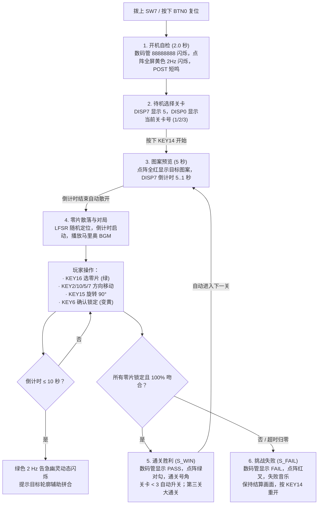

# 🎮 硬件操作指南与游戏玩法手册

> **实验平台**：数字逻辑实验箱 ｜ **控制输入**：4×4 矩阵键盘 + SW7 开关 + BTN0 按键 ｜ **声画反馈**：8×8 双色点阵 + 8 位数码管 + 无源蜂鸣器

---

## 1. 硬件外设与 4×4 矩阵键盘键位映射

本系统严格按照实验箱手册【附图 26】的物理引脚与丝印分布，将 16 键矩阵键盘单点映射为 8 个功能键：

```
       COL0 (PIN_117)   COL1 (PIN_118)   COL2 (PIN_119)   COL3 (PIN_120)
ROW3 [  KEY1: (空)  ] [  KEY2: ⬆️ 上   ] [  KEY3: (空)  ] [  KEY4: (空)  ] (PIN_114)
ROW2 [  KEY5: ⬅️ 左   ] [  KEY6: ✅ 确认 ] [  KEY7: ➡️ 右   ] [  KEY8: (空)  ] (PIN_113)
ROW1 [  KEY9: (空)  ] [  KEY10: ⬇️ 下  ] [ KEY11: (空)  ] [ KEY12: (空)  ] (PIN_112)
ROW0 [ KEY13: (空)  ] [ KEY14: ▶️ 开始 ] [ KEY15: 🔄 旋转 ] [ KEY16: 🔀 切换 ] (PIN_111)
```

### 核心功能键定义

| 物理按键 | 键位功能 | 动作时序 | 说明 |
|:---:|:---:|:---:|:---|
| **KEY14** | **▶️ 游戏开始 / 重开** | 单拍触发 | 待机态进入预览；游戏中或结算后随时按下可**立即重新开局**（需求 B11） |
| **KEY16** | **🔀 切换活动零片** | 单拍触发 | 在当前关卡可操作的零片之间循环轮选（活动零片呈现亮绿色） |
| **KEY2** | **⬆️ 向上平移** | 单拍触发 | 将活动零片向上移动 1 格（遇上边界或重叠时刚性拦截） |
| **KEY10** | **⬇️ 向下平移** | 单拍触发 | 将活动零片向下移动 1 格（遇下边界或重叠时刚性拦截） |
| **KEY5** | **⬅️ 向左平移** | 单拍触发 | 将活动零片向左移动 1 格（遇左边界或重叠时刚性拦截） |
| **KEY7** | **➡️ 向右平移** | 单拍触发 | 将活动零片向右移动 1 格（遇右边界或重叠时刚性拦截） |
| **KEY15** | **🔄 顺时针旋转 90°** | 单拍触发 | 在零片局部包围盒内顺时针正交旋转 90°（遇越界或重叠拦截，提高要求 A4） |
| **KEY6** | **✅ 确认并锁定** | 单拍触发 | 将当前活动零片锁定在棋盘上（颜色变为黄色），切换到下一未锁定零片 |
| **BTN0** | **🔄 硬件全局复位** | 20 ms 滤波 | 系统完全复位，重新进入开机自检 |
| **SW7** | **🔌 系统总电源开关** | 电平有效 | 拨下为全系统静默全黑，拨上开启系统运转 |

---

## 2. 完整游戏流程图解



---

## 3. 三大关卡规则与进阶玩法

| 关卡编号 | 目标图案与格数 | 零片构成 | 倒计时限时 | 特色与挑战点 |
|:---:|:---|:---|:---:|:---|
| **第一关** | **12 格实心矩形**（【题】图 4-1，4×3） | 3 块经典零片（3+6+3 格） | **30 秒** | 基础入门：熟悉上下左右平移与锁定手感 |
| **第二关** | **16 格固定阶梯图案**（PAT3） | 4 块异形零片（3+2+5+6 格） | **40 秒** | 异形挑战：零片非对称性增强，需规划摆放次序 |
| **第三关** | **16 格动态随机图案**（田/十字/SZ/阶梯） | 4 块异形零片（3+2+5+6 格） | **60 秒** | 巅峰对决：开局随机抽题，考验瞬时空间想象力 |

---

## 4. 声光电视觉与听觉提示一览

* **颜色语义**：
  - **亮绿色 (Green)**：当前正在操作的活动零片；
  - **亮黄色 (Yellow)**：已被玩家确认锁定的零片；
  - **红色 (Red)**：预览时的目标底图，或失败时的红叉；
  - **绿色 2 Hz 闪烁**：倒计时 $\le 10$ 秒时的告急目标幽灵。
* **数码管提示**：
  - 待机：`5 ...... 1`（关卡1）
  - 预览：`5 ...... 1`（倒计时 5..1 秒）
  - 游戏中：`... 30 . 1`（中间两位显示倒计时，右边显示关卡）
  - 胜利：`PASS ....`
  - 失败：`FAIL ....`
* **音效提示**：
  - 第一关：经典马里奥地上世界 Overworld 连奏旋律；
  - 第二关：沉稳有力的地下城堡低音脉冲；
  - 第三关：快节奏跨音区决战音乐；
  - 胜负：欢快的大三和弦通关号角与下行跌落失败音。
